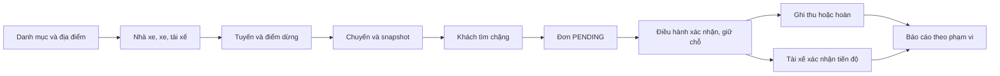
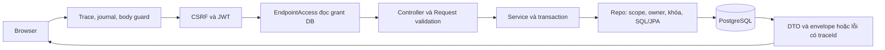

# Tổng quan VietRoute

Đọc trong khoảng 10 phút trước khi vào [phần thành viên](../05-ke-hoach/PHAN_CONG.md) và [demo, hỏi–đáp](../05-ke-hoach/DEMO_VA_HOI_DAP.md). Mốc phát hành thật và phần đang chờ nằm tại [tiến độ](../05-ke-hoach/TIEN_DO_VA_KE_HOACH_NHOM.md).

## Bài toán và phạm vi

VietRoute là web quản lý nhà xe và đặt chỗ xe khách theo **chặng**. Điều hành chuẩn bị tuyến/chuyến, tiếp nhận yêu cầu đặt chỗ và ghi tiền thực thu/hoàn; tài xế xác nhận mốc đến/rời điểm; khách tìm chuyến và xem đơn của mình; quản trị cấp tài khoản/quyền. Chưa đánh số ghế cố định.

Không có GPS/app mobile, email/reset mật khẩu qua thư, upload/avatar/logo, job/Redis/metrics hoặc cổng thanh toán. Địa điểm có tọa độ tĩnh và link Maps; đó không phải vị trí xe hoặc ETA trực tiếp. Dữ liệu nền do dự án giả lập, không phải lịch vận tải thương mại đã được xác minh.

## Công nghệ và trách nhiệm

| Thành phần | Dùng trong dự án |
|---|---|
| Java | Target17, phát triển bằng JDK21; Maven Wrapper, WAR/Tomcat10.1 |
| Spring MVC6 và Thymeleaf | Controller/page và REST, render HTML tại server; không Spring Boot |
| Spring Security, Nimbus JWT, BCrypt | Xác thực và bảo vệ request; grant endpoint lấy từ DB |
| Spring Data JPA/Hibernate | CRUD và entity; không tự tạo schema hoặc OSIV |
| JDBC | Batch, SQL phức tạp, khóa/CAS; cùng transaction với JPA |
| PostgreSQL | DB đang chạy; baseline 8 SQL, array/JSONB/advisory lock/pg_trgm |
| Oracle26ai | Có driver/profile chuẩn bị, runtime còn bị chặn; chưa chuyển SQL hoặc kiểm nghiệp vụ thật |
| Bootstrap/CSS/JavaScript | UI tab/modal, validation và paging server; Node chỉ phục vụ phát triển/CI |

Phiên bản chính xác đọc [pom.xml](../../pom.xml) và [package.json](../../package.json); không duy trì bảng version thứ hai dễ lỗi thời.

## Bản đồ source và dữ liệu

| Khối | File Java | Bảng | Trách nhiệm |
|---|---:|---:|---|
| auth | 40 | 8 | User/role/function/menu/API, scope, lifecycle và history |
| business/catalog | 25 | 3 | Danh mục, tỉnh/thành, địa điểm |
| business/carrier | 23 | 3 | Nhà xe, xe, hồ sơ tài xế |
| business/trip | 42 | 6 | Tuyến/chuyến, snapshot, chặng, tiến độ và tìm chuyến |
| business/booking | 15 | 2 | Đơn và sự kiện trạng thái/thu–hoàn |
| business/report | 10 | 0 | Báo cáo và dashboard đọc dữ liệu nghiệp vụ |
| business/bootstrap | 6 | 0 | Khởi tạo nền có cờ bật rõ ràng |
| common | 61 | 1 | Nền MVC/DB, response/lỗi và api_request_journal |
| History migration | — | 1 | vietroute_schema_history |

Tổng 222 file Java trong ba khối chính,24 bảng gồm history. Xem tên bảng và quan hệ tại [schema](../02-phat-trien/SCHEMA_VA_PHAN_QUYEN.md). Số file là mốc source, không phải bằng chứng một thành viên đã viết toàn bộ khối được phân công.

## Một request đi qua đâu

Menu giúp điều hướng; backend kiểm lại endpoint và SQL kiểm dữ liệu được thấy. Mỗi request private không phải chỉ một SELECT: có các lần đọc account/grant và kiểm nghiệp vụ. Không quảng bá số query hoặc tải thực tế chưa đo.

## Từ luồng chung đến phần mỗi người

| Người học | Mở phần của mình |
|---|---|
| hieuv526034 | [Dev nền, DB/deploy và báo cáo/dashboard](../05-ke-hoach/PHAN_CONG.md#hieuv526034) |
| BangPhamIT | [Dev catalog/carrier/trip/booking và UI](../05-ke-hoach/PHAN_CONG.md#bangphamit) |
| anhhoang104 | [Báo cáo Word, sơ đồ và tổng hợp bản nộp](../05-ke-hoach/PHAN_CONG.md#anhhoang104) |
| hiencoi250404-design | [Test thủ công, ảnh chức năng và báo cáo Word](../05-ke-hoach/PHAN_CONG.md#hiencoi250404-design) |

Hai dev chịu source và test của thay đổi mình viết; Anh chủ trì báo cáo Word/sơ đồ, Hien test thủ công/chụp ảnh chức năng; cả hai cùng hoàn thiện bản nộp. Test tự động do hai dev phụ trách. Học luồng trước/sau phần mình để bàn giao được bằng ID, trạng thái, testcase và bằng chứng. Phân công mới từ02/11/2026 không thay tác giả code đã có; đóng góp thực đối chiếu commit/PR.
