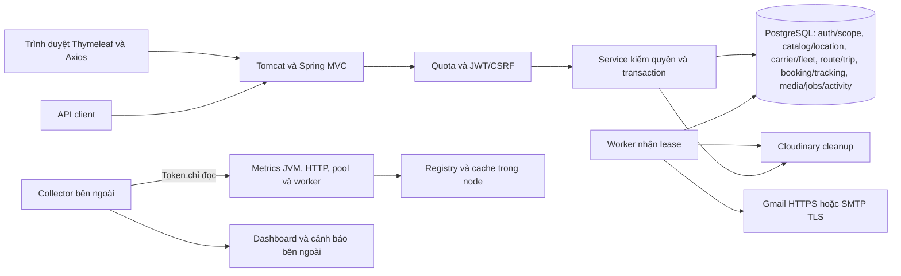

# Tổng quan VietRoute cho thành viên mới

Cập nhật 25/10/2026: đã có tuyến, chuyến, đặt chỗ theo chặng, màn khách/tài xế/điều hành, báo cáo và tracking riêng tư. BUSINESS05 chuẩn hóa dữ liệu Neon, thêm breadcrumb và dashboard theo quyền sau khi rà luồng nghiệp vụ; trạng thái triển khai và bằng chứng kiểm ở tiến độ. Ba tài khoản đã cấp sẵn dùng ngay. Đọc tài liệu này trước, sau đó mở chuyên đề; Maps/Gmail hiện chưa cấu hình theo lựa chọn chủ dự án.

Để biết ai làm gì tiếp theo và phần nào đã/chưa hoàn thành, xem [Tiến độ và kế hoạch nhóm](../05-ke-hoach/TIEN_DO_VA_KE_HOACH_NHOM.md). Bảng tách trạng thái source/API/UI và cấu hình dịch vụ ngoài app, kèm PR và phụ thuộc để bàn giao.

Để tra công nghệ từ BE đến UI và giải thích vai trò từng thư viện, đọc [danh mục công nghệ](CONG_NGHE_VA_THU_VIEN.md); phiên bản lấy từ source và được cập nhật cùng PR nâng dependency.

Phần hoàn thiện ngày 23/10 có UI quản trị job/quyền và xem cấu hình whitelist trong menu Hệ thống; xem [hướng dẫn quản trị](../04-van-hanh/QUAN_TRI_HE_THONG.md). Các màn này chưa phải nghiệp vụ nhà xe/chuyến/booking và không sửa secret từ trình duyệt.

## 1. Hệ thống gồm những gì

VietRoute là một ứng dụng Java đóng gói WAR: Spring MVC 6 + Spring Security, Thymeleaf + Bootstrap/Axios, JDBC thuần và PostgreSQL. Docker chạy Java 21/Tomcat 10.1; IntelliJ dùng launcher trong `src/dev/java`. Không có Spring Boot, ORM, Kafka hoặc Redis bắt buộc. Redis adapter cũ chỉ là tùy chọn tương thích, không bật trong cấu hình hiện tại.

Phần đã có source: nền tảng locale/error/validation/audit/paging, auth/JWT/phân quyền, migration/seed, catalog CRUD, LOCATION01 tỉnh–địa điểm (API/UI quản trị và lookup công khai), hàng đợi PostgreSQL, adapter Gmail/SMTP/Cloudinary và giám sát. BUSINESS02–04 bổ sung CRUD nhà xe/xe/hồ sơ tài xế có scope, menu danh mục riêng, tuyến một chiều, snapshot chuyến/lịch chồng, tồn chỗ theo chặng, booking WEB/PHONE/thu-hoàn thủ công, tìm/chi tiết/lịch sử khách, tiến độ tài xế, báo cáo và cấp nhân sự scoped. TRACK01 chia sẻ vị trí sau consent, đọc theo chuyến/phạm vi/chủ đơn CONFIRMED; Maps giữ UNCONFIGURED. Hợp đồng ở API base, trạng thái PR/Render ở tiến độ và cách tiếp nhận ở [PHAN_CONG.md](../05-ke-hoach/PHAN_CONG.md).

[Nhật ký API và debug](../04-van-hanh/NHAT_KY_API_VA_DEBUG.md) nằm trong `common.monitoring`: filter trước Security → projection DTO/response → PostgreSQL (V005) → API/page có kiểm quyền. Dùng để tra traceId/controller và xuất Postman đã che dữ liệu; lịch sử dùng chung DB/schema giữa các node, không phải gateway/audit bất biến.

## 2. Tìm code ở đâu

| Package | Trách nhiệm và điểm bắt đầu |
|---|---|
| `common.config` | RootConfig/initializer lắp ghép; application/database/integration/traffic/monitoring/web giữ config/settings theo trách nhiệm; launcher local chủ động bật nguồn env file riêng |
| `common.base` | Hợp đồng kế thừa entity/DTO/request/response/page và BaseController |
| `common.constant` | Key cấu hình, route/regex/HTTP, mã lỗi, thành công và validation; không chứa secrets |
| `common.jdbc` | Connection đặt schema, transaction, metadata và nâng cấp DB; giữ một cụm vì quy mô còn nhỏ |
| `common.web` | Controller web, envelope, filter, locale, advice, OpenAPI và route policy |
| `common.exception`, `validation`, `util` | Chuyển lỗi an toàn, quy tắc nhập liệu và tiện ích dùng chung |
| `common.job` | `controller`, `dto/request`, `dto/response`, `model`, `repository`, `service`, `handler`, `worker` |
| `common.mail` | `controller`, `dto/request`, `model`, `service`, `handler`, `transport`; provider chỉ ở transport |
| `common.monitoring` | `controller`, `dto/response`, `filter`, `repository`, `service`: đo HTTP/JVM/pool/worker và probe DB có chủ đích |
| `common.traffic` | Giới hạn request/body/quota, nhận địa chỉ qua trusted proxy; quota memory theo node |
| `auth` | Credential, role/permission, principal, cookie/JWT, bootstrap và vòng đời đăng ký/email/reset |
| `business/catalog` | Danh mục nền đang chạy; controller → service → repository → entity/response |
| `business/location` | LOCATION01 tỉnh/thành và địa điểm, V016; ADMIN + quyền hành động, public chỉ active, UI `/operations/locations`. Hợp đồng trường/tọa độ/trạng thái ở API base |
| `business/carrier` (gồm nhà xe, xe và tài xế) | BUSINESS02/V017: nhà xe và scope, xe, hồ sơ tài xế; API/UI theo quyền hành động và membership hiện hành. Hồ sơ tài xế khác account auth |
| `business/route` | V018: tuyến một chiều và điểm dừng theo thứ tự, offset phút qua ngày, giá cộng dồn; không sửa snapshot chuyến cũ |
| `business/trip` | V019: phân xe/tài xế, snapshot điểm/chặng, lịch chồng, tiến độ actual và lịch sử; tài xế chỉ chuyến được giao hiện hành |
| `business/booking`, `business/journey` | V020: đơn WEB/PHONE, khóa tồn chỗ theo chặng, thu-hoàn thủ công, tra cứu public và lịch sử owner; kiểm trạng thái/idempotence/rollback |
| `business/report` | Báo cáo scoped theo nhóm ngày khởi hành, trạng thái đơn và số tiền thực thu/hoàn tách riêng |
| `business/dashboard` | Trang tổng quan sau đăng nhập, đọc API owner/phân công/scoped hiện hành theo capabilities; không thêm cơ chế quyền hoặc dữ liệu tổng hợp riêng |
| `business/tracking` | V021: consent/lease, snapshot/trace PostgreSQL, API vị trí private và fallback Maps chưa cấu hình |
| `business/demo` | Seed bộ DEMO có nhãn qua thao tác ADMIN chủ động; không chạy trong build/startup, không tự cấp account/role |
| `common/media` | Lõi thư viện ảnh/upload dùng chung, controller public gọi service lõi |

Đổi package chỉ đổi tổ chức code, không đổi route/schema/dữ liệu. Không tạo lớp ở package cũ để chuyển tiếp. Sau khi cập nhật nhánh lần đầu, dừng IDE server → Maven clean → Reload Maven → Rebuild Project rồi Run.

## 3. Khởi động và dừng

1. Tomcat khởi tạo root context và các bean hạ tầng; Settings kiểm env OS/IDE. WAR không tự đọc `.env`; launcher local chủ động đọc file riêng trước khi tạo context.
2. DatabaseInitializer chỉ migrate/seed khi `VIETROUTE_DB_INIT_ENABLED=true`. V001–V021 có history/checksum, advisory transaction lock và kiểm metadata trước commit. Không reset admin đã tồn tại. Nâng từ code trước VIEW cần dừng/drain node cũ trước khi áp V013 theo [chuyên đề phân quyền](../02-phat-trien/SCHEMA_VA_PHAN_QUYEN.md#cây-chức-năng-và-quyền-hành-động--access03).
3. Pool khởi tạo lười. Worker và DatabaseProbe chỉ bắt đầu sau initializer, mỗi loại bật bằng env riêng; tắt mặc định.
4. MVC context đăng ký controller/advice/Thymeleaf/Swagger; hai context không tạo service/controller trùng. Sau khi mapping sẵn sàng, AccessResourceSynchronizer đồng bộ danh bạ UI/API vào DB nếu ACCESS_SYNC bật (mặc định theo DB_INIT khi không khai báo). Danh bạ không tự cấp quyền hoặc đổi public; xem [schema và phân quyền](../02-phat-trien/SCHEMA_VA_PHAN_QUYEN.md).
5. Shutdown ngừng poll, chờ worker đang chạy theo timeout, đóng pool, GC listener và registry. Kill đột ngột có thể để lại lease; node khác nhận lại khi hết hạn.

Xem [schema và quyền](../02-phat-trien/SCHEMA_VA_PHAN_QUYEN.md), [IntelliJ](CHAY_LOCAL_VA_CLOUDINARY.md) và [deploy](../04-van-hanh/DEPLOY_RENDER.md).

## 4. Luồng request và lỗi

Tomcat giới hạn connection/header/body → HttpMetricsFilter gắn request ID và bắt đầu đo → TrafficGuardFilter kiểm quota/semaphore/body → CSRF/JWT → policy menu/endpoint bổ sung → MVC chuyển kiểu và validate DTO → BaseController.execute → service kiểm quyền/nghiệp vụ → JDBC → factory envelope. Filter đo nằm ngoài security nên ghi cả 401/403/429/503; bỏ health/static/scrape. RequestTraceFilter của MVC tái sử dụng ID đã có.

JWT kiểm chữ ký/hạn dùng rồi tra DB để cập nhật active/tokenVersion/quyền trên từng request. Cookie HttpOnly cần CSRF khi ghi; Bearer tách khỏi cơ chế cookie. AccessResource/AccessOperation sinh mã quyền từ tài nguyên/hành động; meta-PreAuthorize đọc mapping DB hiện hành, không thêm rule riêng từng quyền. User nhiều role, role gán menu/hành động từ registry. Nền scope/membership và DataScopeGuard tách quyền theo phạm vi; DAO nhà xe/chuyến/booking phải tích hợp thêm WHERE scope/owner khi triển khai. Lịch sử thay quyền lưu cùng transaction, tra trong tab Lịch sử phân quyền (ADMIN + ACCESS_READ), mặc định 7 ngày/mục tiêu 1.000 sự kiện. Ẩn nút UI không thay quyền server.

Lỗi trước controller vào GlobalExceptionHandler, lỗi trong execute vào ApiExceptionMapper, lỗi filter dùng ApiErrorWriter; đều giữ HTTP status, code, messageKey, locale và traceId. Không trả stacktrace/SQL/password. Thời điểm là Instant/UTC. Xem [luồng base](../02-phat-trien/LUONG_XU_LY_BASE.md) và [API_BASE.md](../02-phat-trien/API_BASE.md).

## 5. Transaction, job và provider

JdbcTransactions mượn connection → tắt autocommit → đặt search_path LOCAL → callback DAO dùng cùng transaction/backend → commit/rollback → trả pool. Không gọi Gmail/Cloudinary trong transaction giữ khóa DB dài. Client không được ghi audit, quyền hoặc tenant.

Outbox: transaction lưu `system_jobs` cùng thay đổi nghiệp vụ → commit → worker claim `SKIP LOCKED` và lease → commit claim → handler mạng → transaction ACK/NACK. Retry backoff+jitter, lỗi cuối DEAD; token lease ngăn worker cũ ghi đè. Đây là at least once: provider đã nhận nhưng ACK mất thì có thể gửi lặp. Handler cần idempotent và timeout nhỏ hơn lease; tác vụ dài cần thiết kế gia hạn riêng.

Ảnh công khai: giữ metadata PENDING + job cleanup → upload ngoài transaction → metadata READY. Xóa qua DELETING/job/provider/DELETED; cleanup không xóa ảnh READY. Chỉ JPEG/PNG bytes thật, giới hạn byte/pixel, quyền và owner phía server. Không dùng module này cho giấy tờ riêng tư.

Email auth: đăng ký CUSTOMER pending → transaction lưu challenge hash + outbox mã hóa → worker gửi mã → xác minh một lần. Reset đổi hash/lịch sử và thu hồi JWT atomically; giữ khóa tạm 5 sai/15 phút và không trùng hiện tại + hai mật khẩu cũ. Mặc định tắt, cần cấu hình provider. AUTH17 chỉ cấp sẵn trạng thái xác minh cho đúng bootstrap identity khi init/sync; mọi tài khoản khác, kể cả ADMIN được gán và tài khoản cũ, phải xác minh email trước quyền private. Xem [API và giới hạn auth](../02-phat-trien/API_BASE.md).

Chi tiết [worker/mail](../02-phat-trien/NEN_TANG_MO_RONG.md) và [Cloudinary](CHAY_LOCAL_VA_CLOUDINARY.md).

## 6. Vận hành và nhiều node

`/health` kiểm web sống; `/api/v1/admin/system/status` kiểm DB thật theo yêu cầu; `/api/v1/admin/system/runtime` và `/monitoring` đọc runtime/cache với SYSTEM_READ; `/internal/metrics` dùng token vận hành riêng và không cần DB/JWT. Dashboard bền vững/cảnh báo nằm bên ngoài app. Xem [GIAM_SAT_VA_VAN_HANH.md](../04-van-hanh/GIAM_SAT_VA_VAN_HANH.md).

Nhiều node dùng cùng DB/schema/JWT secret và cấu hình provider. Không cần sticky session cho đăng nhập. Quota memory áp dụng từng node, tổng mức có thể tăng theo số node; phải đặt quota toàn cụm tại ingress khi scale. Tổng connection = tổng pool mọi node và worker. Job chia qua DB, mỗi node tự có metrics; collector phải scrape từng instance thực, không qua load balancer ngẫu nhiên. Queue counts là dữ liệu chung: dùng max, không sum giữa node.

Đã có nền khóa/migration/worker nhiều instance; chưa phải nghiệm thu tải production hoặc cam kết không lỗi. Render Free một instance có ngủ và không bảo đảm lịch job liên tục. Chưa đổi Spring major trong lượt này: Framework 6.2/Security 6.5 có rủi ro vòng đời OSS, cần PR nâng stack được kiểm tương thích riêng.

## 7. Cách thêm module đúng nền

Đọc quy ước/phân công → tạo nhánh member/task → chốt API, quyền, scope và SQL migration mới → DTO @Schema/Validation + bundle vi/en → service transaction + quyền → DAO PreparedStatement → controller BaseController + @Operation → UI gọi client CSRF chung → kiểm thử bằng DB tạm → format → PR/CI → merge. Không sửa migration đã áp dụng hoặc test trên Neon production.

Local: `mvnw verify`, Node test Swagger và formatter. Production: `-Pproduction` chỉ main, bỏ test/launcher/Node; CI Docker dùng PostgreSQL tạm. Xem [CONTRIBUTING.md](../../CONTRIBUTING.md). Khi đọc kết quả kiểm tra trong tài liệu cũ, xem commit/PR tương ứng, không coi số test lịch sử là số hiện tại.

Đợt FOUNDATION02 qua [PR #35](https://github.com/hieuv526034/vietroute-web/pull/35) bổ sung registry/policy auth, local env, media chung và online/bất thường. Đọc [nền tảng mở rộng](../02-phat-trien/NEN_TANG_MO_RONG.md) để thêm quyền/role/policy, [vận hành](../04-van-hanh/GIAM_SAT_VA_VAN_HANH.md) để hiểu cửa sổ online, quota theo node và missed writes. Bằng chứng và phần chưa triển khai giữ ở tiến độ, không suy từ sơ đồ rằng provider/cảnh báo ngoài app đã hoạt động.
