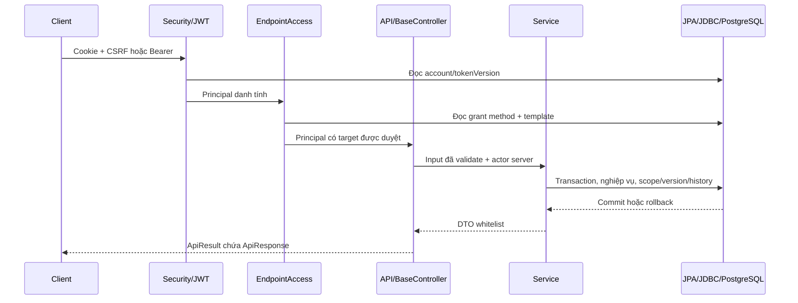

# Học và mở rộng source base

## Đọc code theo luồng request

Đọc theo thứ tự: [RootConfig](../../src/main/java/vn/vietroute/common/config/RootConfig.java) → SecurityConfig/JwtAuthenticationFilter → WebConfig/EndpointAccess → controller/api → service → repo → DTO/envelope. [Schema auth](SCHEMA_VA_PHAN_QUYEN.md#luồng-xác-thực-và-kiểm-endpoint) là hợp đồng hiện hành; không học theo class AccessFunction/Permission/AccessGuard đã xóa. Auth có 40 class, ba DTO trực tiếp ở auth.dto, request/search riêng; các module business đang có vẫn dùng repository JDBC.



Public endpoint được WebRoutePolicy phân loại và có thể bỏ bước JWT/DB tùy route. Method security vẫn bật ở root và servlet, nhưng không có annotation action tự ánh xạ method Java sang quyền nữa. HTTP endpoint được interceptor kiểm; service dùng UserPrincipal.current/requireCurrent, trần ủy quyền và kiểm nghiệp vụ. Caller nội bộ không được tự coi principal danh tính là một endpoint đã duyệt. Scope/owner phải lọc tại DAO, không chỉ tại menu hoặc URL.

## Base API và try/catch

Auth/business API kế thừa BaseController, gọi execute(status,SuccessCode,request,callback), trả ApiResult<T>. HTTP body vẫn ApiResponse<T> gồm code/messageKey/message/data/errors/timestamp/path/traceId/locale. Tạo mới chọn HTTP201 trong execute; không đổi lỗi thành200/201. Không cần thêm @ResponseStatus nếu execute đã trả ResponseEntity đúng status.

ApiExceptionMapper dùng chung với GlobalExceptionHandler; advice xử lý JSON/binding/validation trước controller, ApiErrorWriter xử lý lỗi filter. Không catch rồi trả exception.getMessage() của SQL/provider. Client xử lý HTTP status + code, không so câu dịch. Thêm message key vào cả vi/en.

DTO không phải entity. Auth DTO/request/search dùng class/getter/setter, không record hoặc var; UserDTO có projection tài khoản và wrapper login/preview để giữ ngân sách lớp. Request dùng chung theo tài nguyên, field bắt buộc từng operation kiểm tại service và mô tả trong [API base](API_BASE.md#api-auth-hiện-hành). Không tạo compatibility class ở package cũ.

## Transaction và đăng nhập

UserService.login dùng transaction khóa account và so BCrypt. Lỗi password phải ghi bộ đếm trước khi trả lỗi; do đó service lưu kết quả lỗi trong callback và ném sau commit. Không ném lỗi sai password bên trong callback khiến bộ đếm rollback. Khóa5 lần/15 phút không tự reset password.

JpaConfig dùng JpaTransactionManager trên SchemaDataSource, SharedEntityManagerCreator và TransactionAwareDataSourceProxy cho JDBC. JdbcTransactions.execute tham gia transaction hiện tại hoặc tạo transaction bằng manager; JPA saveAndFlush và SQL mapping/history cùng commit/rollback. Callback JDBC không tự close/commit connection vật lý hoặc bật autocommit; proxy close chỉ trả quyền sở hữu về transaction. Nhánh JDBC độc lập cho fixture giữ manual commit/rollback của nó.

Sau SQL atomic tăng version, phải refresh entity đang managed trước khi sửa/save tiếp; UserService.delete là ví dụ. Không ghi vòng lặp query/save từng row. Bind addBatch hoặc tính trên dữ liệu đã tải trong RAM là hợp lệ. Không gọi email/storage mạng trong transaction đang giữ khóa.

## Schema, table và index trong entity

Auth có tám @Entity/@Table ánh xạ đầy đủ @Column, @Id/@Version theo model, không schema cứng và không hậu tố Entity. User kế thừa BaseEntity; các entity khác khai báo rõ cột theo bảng, không ép kế thừa khi định danh khác. Mapping/challenge có identity kỹ thuật từ V026, PK/FK ghép của DB vẫn giữ. Entity không sinh schema tự động; migrations là nguồn DDL.

@JdbcTable/@JdbcIndex dùng kiểm metadata DB, không thay JPA annotations và không tự tạo index. Các entity business JDBC tiếp tục dùng metadata của chúng. Timestamp JDBC chỉ chuyển tại repo; hợp đồng entity/DTO/service dùng Instant, audit actor hệ thống0.

## Import, callback và cách viết dễ học

Import tường minh, không wildcard/FQCN trong thân code, không var trong production. Tách trách nhiệm khi thư viện trùng tên; OpenApiModels/OpenApiInputs tách annotation/model Swagger và reflection. Lambda nhiều bước giữ rõ transaction; lambda chỉ chuyển tiếp dùng method reference. Formatter chung không thay việc đặt tên, comment luồng bằng tiếng Việt hoặc review quyền.

## Kiểu trả về ngắn của controller

```java
@GetMapping(Routes.AUTH + Routes.ME_ACTION)
@Operation(summary = "Tài khoản hiện tại")
public ApiResult<UserDTO> me(
    @AuthenticationPrincipal UserPrincipal actor,
    HttpServletRequest request
) {
    return execute(SuccessCode.OK, request, () -> users.me(actor));
}
```

Đoạn này lấy từ hợp đồng UserAPI: principal/servlet là tham số server, không khai báo như query/body Swagger. Page dùng @Controller trong controller; API dùng @RestController trong controller/api. Mỗi operation công khai mô tả @Operation, request/DTO field có @Schema; kiểm cả path/query/header/body và phân trang kế thừa bằng OpenApiContractTest.

## Ranh giới transaction và schema — AUTH19

JdbcConnectionFactory/SchemaDataSource bắt đầu transaction trước set LOCAL search_path, schema đã validate và pg_temp cuối; không fallback public/$user hoặc session state qua transaction pooler. JdbcTransactions tham gia Spring transaction không tự commit riêng. History failure rollback mutation; journal/activity có cơ chế ghi/commit riêng theo chuyên đề, không gộp chúng vào audit quyền.

Đọc [schema/migration](SCHEMA_VA_PHAN_QUYEN.md#schema-và-migration), [audit](AUDIT_VA_SYSTEM.md) và [kiểm query](QUY_UOC_PHAT_TRIEN.md#rà-query-và-ghi-theo-tập--perf02) khi thêm DAO. Xong thay đổi: formatter/rules/docs, kiểm thử phù hợp trên H2/PostgreSQL riêng và regression hai context khi động tới quyền; không dùng Neon để kiểm build.
