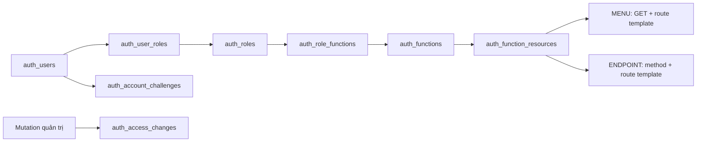

# Auth: schema, phân quyền và khởi tạo

## Hợp đồng hiện hành

Đối chiếu source ngày 02/11/2026. Auth dùng Spring MVC 6, Spring Security/Nimbus JWT/BCrypt và Spring Data JPA/Hibernate; JDBC dành cho aggregate, batch và SQL atomic. Không Spring Boot. Cấu trúc 40 class nằm trong [quy ước phát triển](QUY_UOC_PHAT_TRIEN.md#auth-gọn-40-class-tám-bảng); API tại [API_BASE](API_BASE.md#api-auth-hiện-hành). Trạng thái kiểm thử/commit/remote chỉ ghi ở [tiến độ](../05-ke-hoach/TIEN_DO_VA_KE_HOACH_NHOM.md).

Mô hình hiện hành là **User → Role → Function → Menu/API**. Role là nhóm quyền duy nhất; mã role/function là dữ liệu DB. Không có permission/action registry, policy bổ sung hoặc annotation AccessFunction/AccessOperation/AccessResource. Menu và API có grant độc lập; thấy menu không tự được gọi CRUD.

## Tám bảng auth

| Bảng / entity / repo | Trách nhiệm | Khóa nghiệp vụ chính |
|---|---|---|
| auth_users / User / UserRepo | Danh tính, credential, trạng thái, khóa đăng nhập, tokenVersion, hash history | id; username duy nhất, email theo ràng buộc DB |
| auth_roles / Role / RoleRepo | Nhóm quyền, active/deleted, all_scopes, protected_role, marker init | code |
| auth_user_roles / UserRole / UserRoleRepo | Global role và role theo nhà xe của cùng user | user_id + role_code + scope_id |
| auth_functions / Function / FunctionRepo | Nhóm chức năng, tên vi/en, metadata hiển thị, active/deleted, marker init | code |
| auth_role_functions / RoleFunction / RoleFunctionRepo | Gán function cho role | role_code + function_code |
| auth_function_resources / FunctionResource / FunctionResourceRepo | Gán target MENU/ENDPOINT, method/template và nhãn menu | function_code + kind + target |
| auth_account_challenges / AccountChallenge / AccountChallengeRepo | Challenge cũ; consume/invalidate atomic, không còn luồng HTTP phát mã mới | user_id + purpose |
| auth_access_changes / AccessChange / AccessChangeRepo | Whitelist lịch sử thay đổi trong cùng transaction | id |

Các bảng nghiệp vụ như carriers và bookings không tính vào tám bảng auth. Scope nằm trong carriers; membership dùng auth_user_roles, không có ba bảng scope riêng hoặc bảng menu riêng.



### Nhóm cột cần hiểu

- User: username/display_name, email/email_verified_at, password_hash và previous_password_hash_1/2, active/deleted/activation_pending/must_change_password, failed_login_attempts/locked_until/token_version, bootstrap_scope_pending và scope_membership_versions.
- Role: code/name_vi/name_en, active/deleted, all_scopes, protected_role, functions_initialized. Function: code/name_vi/name_en, description/parent_code/icon/sort_order, active/deleted, resources_initialized. parent_code là metadata hiện có; không suy grant hoặc cam kết đã có CRUD cây menu tùy ý.
- UserRole: user_id/role_code/scope_id/active/version, hai cột sinh global_scope_id/carrier_scope_id phục vụ composite FK. RoleFunction: role_code/function_code/version. FunctionResource: function_code/kind/target/http_method/path_template, handler/description/name_vi/name_en/icon/sort_order/version.
- AccountChallenge: user_id/purpose/token_hash/token_version/expires_at. AccessChange: event_type/target_kind/target_key/actor_id/trace_id/before_state/after_state/version.
- Entity ánh xạ đủ cột; timestamp là Instant/TIMESTAMPTZ. Audit created_at/updated_at/created_by/updated_by lấy từ server, actor hệ thống là 0. User/Role/Function và các mapping có version theo model; AccountChallenge không tự có optimistic version ngoài token_version. Không trả entity hoặc hash ra HTTP.

UserRole/RoleFunction/FunctionResource/AccountChallenge có id identity UNIQUE cho JPA; PK/FK ghép nghiệp vụ vẫn được giữ để ràng buộc dữ liệu.

## Luồng xác thực và kiểm endpoint

Tài liệu API là tài nguyên quản trị: `GET /docs` và `GET /v3/api-docs` không công khai, không bỏ qua JWT. Khi bật sync chủ động, bộ bootstrap ADMIN_CONSOLE nhận hai target qua inventory như endpoint private khác; CUSTOMER/DRIVER/OPERATOR mặc định không có grant. Không kiểm chuỗi ADMIN trong code. Menu Swagger lấy từ mapping DB; thu hồi grant chặn ngay cả URL trực tiếp. Swagger UI dùng cookie phiên đã đăng nhập; OpenAPI thiếu xác thực trả 401 JSON, trang /docs dẫn đến login.

1. SecurityConfig tạo chain stateless. Cookie mutation cần CSRF; Bearer hợp lệ không phụ thuộc cookie. Public/self-service do WebRoutePolicy phân loại từ source, không nhận cờ DB hoặc header tự khai vai trò.
2. UserService.login khóa dòng user, so BCrypt, lưu lần sai/khóa hoặc hoàn tất login trong transaction. Sai5 lần khóa 15 phút; lỗi được ném sau commit để bộ đếm không rollback. Login thành công trả JWT 30 phút, cookie HttpOnly/SameSite=Lax; Secure theo môi trường.
3. JwtAuthenticationFilter kiểm HS256/issuer/audience/exp/iat/jti, rồi UserRepo.load đọc account/tokenVersion/targets từ DB. Role trong JWT chỉ mô tả, không là nguồn cấp quyền. Filter tạo principal danh tính chưa có target được duyệt.
4. EndpointAccess thu thập RequestMappingHandlerMapping sau servlet refresh và dùng BEST_MATCHING_PATTERN_ATTRIBUTE khi kiểm request. Target là method + dấu cách + template, ví dụ GET /api/v1/admin/accounts/{id}; không lưu URL chứa ID cụ thể. HEAD dùng GET.
5. Trước handler private, EndpointAccess đọc lại account/tokenVersion và quyền DB. Account inactive/deleted/pending, token cũ, mật khẩu tạm, chưa xác minh hoặc thiếu target bị chặn. Lỗi DB không dùng quyền cache/JWT cũ để cho qua. Target chưa có trong inventory bị từ chối.
6. Khi hợp lệ, interceptor gắn UserPrincipal có target hiện tại vào SecurityContext. Controller nhận actor server và gọi service. UserPrincipal.current/requireCurrent kiểm context đã được duyệt và ID/tokenVersion/roles của actor; service tiếp tục kiểm nghiệp vụ, version, trần ủy quyền và transaction. Đây không phải annotation tự kiểm mọi method Java theo tên: caller bean nội bộ phải tuân thủ ranh giới này; không truyền principal giả hoặc gọi helper ghi dữ liệu từ controller mới chưa có kiểm quyền.
7. SQL nghiệp vụ lọc thêm scope/owner/quan hệ tài xế. UI dùng capabilities/menu từ cùng mapping; ẩn nút không thay kiểm quyền server. Thu hồi có hiệu lực ở lần kiểm tiếp theo, không hủy tác vụ đã chạy qua guard.

Filter và interceptor hiện có hai lần đọc snapshot ở request private dùng JWT; không tuyên bố một SELECT duy nhất cho toàn bộ request. Source không query/save theo từng role/function của một trang, nhưng độ trễ thực vẫn cần đo trên dữ liệu/môi trường đích.

## CRUD và giới hạn ủy quyền

- UserService giữ login/me/password/logout/profile và User CRUD; RoleService giữ Role CRUD, role-function, user-role và scope membership; FunctionService giữ Function CRUD, resource bindings, inventory/capabilities/navigation. JwtService chỉ cấp/giải mã JWT. Tám repo cụ thể kế thừa Spring Data SimpleJpaRepository qua JpaRepositorySupport; không cần tám service/API rỗng cho đủ số lượng.
- User tạo qua quản trị có active=true, được người vận hành xác minh và must_change_password=true. Ba account init có ngoại lệ cấp sẵn theo yêu cầu. Email không phải bằng chứng đã gửi thư. User update chỉ sửa tên; state/delete bảo vệ system/self/bootstrap/account nhận protected role; username/email/hash không được sửa tùy ý qua CRUD.
- Mọi mutation nhận version hiện hành; stale trả 409. Đọc lại tài nguyên sau khi mutation, không tự cộng version phía client: gán role hoặc membership có thể làm tăng nhiều mốc khác nhau.
- Tập endpoint định gán phải nằm trong quyền hiện hành của actor; kiểm cả function/role đang tắt để không lách qua việc bật lại. Protected role không được gán/sửa/xóa qua API thường. Không bypass theo chuỗi ADMIN; các mã bootstrap đến từ JSON/env và trạng thái DB.
- all_scopes chỉ nới dữ liệu của các endpoint thuộc chính role đó. Gán function vào all_scopes role hoặc sửa function đã được all_scopes role tham chiếu cần trần globalTargets tương ứng, kể cả role tắt. Sửa tên không tự bật lại active, xóa metadata hoặc hạ all_scopes khi field bị bỏ qua.
- Xóa User là soft-delete, thu hồi token/challenge/global/scoped mappings và ghi history. Xóa Role bị chặn khi còn UserRole; xóa Function bị chặn khi còn RoleFunction. Giữ ID/tombstone/audit, không tái dùng mã để ghi đè lịch sử.

## Phạm vi dữ liệu và ownership

scope_id=0 trong UserRole là role toàn cục. scope_id>0 là role trong nhà xe, bắt buộc là tập con role toàn cục của chính user qua composite FK. Scope security active khác trạng thái kinh doanh carrier active. Đọc/chỉnh sửa ngoài phạm vi thường trả 404 để không lộ bản ghi.

UserRoleRepo.visibleSql/bindVisible/require/requireGlobal đọc trạng thái account/tokenVersion, scope_active, role/function/mapping và target trên connection của caller. Quyền endpoint và all_scopes phải do cùng role cấp; không union quyền của role toàn cục khác hoặc membership nhà xe khác. Cột canUpdate/canAssign kiểm endpoint mutation riêng, không dùng target GET của bảng đang xem.

Global role replacement giữ mapping không đổi, thu hồi scoped role không còn thuộc tập global, tăng mốc membership và ghi delta theo batch. scope_membership_versions giữ mốc kể cả membership bị xóa hết; gán lại không nhận version 0 cũ. Khách đặt chỗ vẫn phải là owner; role DRIVER không tự là hồ sơ tài xế hoặc quyền xem mọi chuyến. Khi cấp account cho tài xế, nghiệp vụ giữ khóa nhà xe/hồ sơ và gọi UserService.provisionDriver trên cùng transaction.

## JPA, JDBC, audit và lịch sử

JpaConfig lắp SchemaDataSource → JpaTransactionManager và TransactionAwareDataSourceProxy cho JDBC; EntityManager dùng SharedEntityManagerCreator. Hibernate scan auth.entity và các entity business, không tự tạo/sửa schema, không Open Session in View. DTO dựng khi dữ liệu cần thiết còn trong transaction.

Service dùng JdbcTransactions.execute: khi có Spring transaction thì tham gia, nếu cần thì tạo transaction qua manager; mọi repo dùng cùng datasource/connection. JDBC callback không tự commit hoặc bật autocommit. CRUD saveAndFlush, mapping batch và append history cùng thành công hoặc cùng rollback; SQL atomic đổi version cần refresh entity trước save tiếp. Không gọi provider mạng khi đang giữ khóa tài khoản/role.

AccessChange chỉ nhận Map whitelist cụ thể từ service, không serialize request/entity/password. Append đồng bộ; lỗi history rollback mutation. Không có màn/API history hiện hành. Cleanup dùng advisory lock, mỗi lô tối đa 200, xóa cũ hơn 7 ngày hoặc theo mục tiêu khoảng 1000 ID; không phải giới hạn số dòng tuyệt đối khi sequence có khoảng trống. Cleanup chạy tại startup và các đợt bảo trì theo lô của nhật ký. Không phải audit DB bất biến, không backfill bootstrap/direct SQL.

## Khởi tạo và bảo vệ bootstrap

| Cờ | Hành vi |
|---|---|
| VIETROUTE_DB_INIT_ENABLED | Startup áp migration/checksum/metadata và AuthInitializer.initialize; không chạy trong Maven packaging |
| VIETROUTE_ACCESS_SYNC_ENABLED | Sau MVC refresh, sync bindings khai báo và sửa role/function bootstrap theo inventory; mặc định theo DB_INIT nếu không khai báo |
| VIETROUTE_DEFAULT_ACCOUNTS_ENABLED | Trong init, tạo 12 khách/24 tài xế/6 điều hành còn thiếu từ JSON/env, verified/active, không bắt đổi password theo yêu cầu |
| VIETROUTE_BUSINESS_INIT_ENABLED | Khởi tạo danh mục nghiệp vụ/nhà xe/tuyến và liên kết scope ban đầu theo module business, không tự công bố chuyến |

AuthInitializer đọc auth/default-access.json. Username/email/password bootstrap từ VIETROUTE_BOOTSTRAP_ADMIN_*; mật khẩu được encode khi tạo mới, không reset hash/history/lock của account đã có. DB_INIT có thể chuẩn hóa trạng thái/email của đúng bootstrap identity và bảo đảm global role gốc. ACCESS_SYNC riêng sửa Role/Function/bindings, không gọi lại bước chuẩn hóa account; cần DB_INIT khi phải sửa trạng thái account gốc. Không có nút/API admin-recovery nữa.

Bootstrap function nhận các endpoint private hiện có khi sync bật. Vì vậy endpoint mới mặc định deny ở runtime, và được gán bootstrap qua lần sync chủ động; không phải bypass runtime. Ordinary role/function có marker init một lần, không tự khôi phục grant đã thu hồi sau restart. Bật cờ phải có chủ đích, không dùng Neon để thử build.

Account cũ ngoài bootstrap chưa xác minh vẫn bị chặn private. Luồng email/reset đã cắt nên phải có phương án người vận hành xử lý dữ liệu hoặc thiết kế bổ sung trước chuyển đổi; app không tự gửi thư hay tự đặt lại password. Theo yêu cầu mới02/11/2026, `.env` gốc chỉ giữ local và bị ignore Git, mẫu `.env.example` không có credential thật; giá trị không đưa vào tài liệu/log/image. OS/IDE ưu tiên file local; WAR/Render không tự đọc `.env`.

Danh sách đầy đủ account, key mật khẩu, scope và luồng nghiệm thu ở [hướng dẫn dữ liệu khởi tạo](../01-bat-dau/CHAY_LOCAL.md#tài-khoản-và-dữ-liệu-khởi-tạo). Email bổ sung nằm trong JSON thuộc miền giả lập; credential vẫn từ env. Scope/link chỉ nhận khi bootstrap_scope_pending và nguồn nhà xe/hồ sơ sẵn sàng, không khôi phục sau thu hồi.

## Schema và migration

### Baseline theo cụm bảng

```text
db/migration/postgresql/
  migrations.list
  auth/001_schema.sql                  8 bảng tài khoản/phân quyền
  catalog/001_schema.sql               3 bảng danh mục/tỉnh/địa điểm
  carrier/001_schema.sql               3 bảng nhà xe/xe/tài xế
  trip/001_schema.sql                  6 bảng tuyến/chuyến/chặng/tiến độ
  booking/001_schema.sql               2 bảng đặt chỗ/sự kiện
  common/001_schema.sql                1 bảng nhật ký API
  foundation/001_system_account.sql    Actor hệ thống
  foundation/002_references.sql        FK nội bộ và liên cụm
```

Tổng **8 SQL, 23 bảng ứng dụng + vietroute_schema_history = 24 bảng**. report chỉ đọc dữ liệu, bootstrap giữ seed Java/JSON nên không tạo bảng hoặc SQL rỗng cho hai package này. DDL tạo trực tiếp cột/index/constraint hiện hành; không dựng bảng đã bỏ rồi DROP lại. Số bước bắt đầu 001 riêng từng cụm, thứ tự chạy do manifest quyết định: sáu cụm schema → system → toàn bộ FK. Cách này xử lý vòng tham chiếu giữa auth và carrier mà không tắt kiểm FK.

Mỗi file schema gồm bảng, sequence, PK/UNIQUE/CHECK và index của cụm. pg_trgm được tra namespace extension thực, không giả định public. SQL không có schema cứng; connection bắt đầu transaction rồi chọn LOCAL search_path đã validate, pg_temp cuối. History lưu version như trip/001_schema.sql, checksum SHA-256 byte gốc và installed_at. common.initializer.MigrationCatalog kiểm manifest/đường dẫn/số thứ tự/resource; DatabaseInitializer cùng package chuẩn bị schema/history dưới advisory lock và transaction, kiểm checksum trước seed. Không tạo lớp bootstrap riêng chỉ cho một caller. Hibernate không tự DDL; Maven package/test không chạy khởi tạo Neon.

### Database mới

Tạo PostgreSQL riêng, đặt VIETROUTE_DB_SCHEMA và các env cần thiết, bật DB_INIT khi chủ động khởi tạo. Schema trắng chạy tám bước và seed opt-in. Startup lặp giữ history/checksum, mật khẩu và dữ liệu đã có. Không sửa file baseline đã chạy; thay đổi tiếp theo thêm 002_<ten_thay_doi>.sql vào đúng cụm và manifest theo phụ thuộc.

### Database đã có dữ liệu

Bộ baseline này thay toàn bộ lịch sử SQL trong source theo yêu cầu làm sạch. Runtime không tự nhận history khác baseline, không reset hoặc sửa checksum để chạy tiếp. Database có cấu trúc khác phải có phương án chuyển đổi dữ liệu riêng; công cụ không tự DROP/ALTER bảng ứng dụng để ép khớp.

[rebaseline-database.py](../../scripts/development/rebaseline-database.py) là công cụ bảo trì ngoài runtime, dùng Python 3 và psql đã cài; không cần package Python ngoài. Đặt PGHOST/PGPORT/PGDATABASE/PGUSER/PGPASSWORD/PGSSLMODE bằng môi trường của tiến trình, không đưa password vào command line hoặc log. Không tự đọc .env. Dừng mọi node, backup và kiểm phục hồi trên PostgreSQL riêng trước khi áp dụng.

```powershell
python scripts/development/rebaseline-database.py --schema vietroute --check
python scripts/development/rebaseline-database.py --schema vietroute --apply --confirm-stopped
```

Nếu psql không nằm trong PATH, thêm --psql với đường dẫn binary đã cài. --check dựng schema tham chiếu trong transaction, đối chiếu bảng/cột/type/default/generated/NOT NULL, PK/UNIQUE/CHECK/FK, index/validity và cấu hình sequence rồi rollback toàn bộ. Định nghĩa CHECK/index được PostgreSQL tự reparse trong schema tham chiếu trước so sánh để tránh khác biểu diễn giữa bản vá; không bỏ điều kiện/cast bằng regex. --apply chỉ đổi version/checksum history sau khi mọi cấu trúc khớp; giữ dữ liệu, password, audit, sequence hiện hành và quyền endpoint. Baseline đã khớp thì chạy lại không đổi installed_at. Sai cấu trúc/quyền/khóa làm rollback; không có chế độ bỏ qua.

Schema tham chiếu random do công cụ tự tạo được xóa trong transaction; schema đích không bị DROP. Helper pg_temp được dọn trước commit để không phụ thuộc session của transaction pooler. Advisory lock giống initializer và table lock ngăn ghi khi đối chiếu. Công cụ không phải backup và không chứng minh mọi node đã dừng chỉ từ cờ xác nhận. Chỉ dùng khi người phụ trách DB cho phép đúng môi trường. Tình trạng áp dụng Neon nằm ở tiến độ, không suy từ source/test local.

## Phát triển tiếp và giới hạn nghiệm thu

Đủ nền để thêm chức năng theo cấu trúc hiện hành: khai báo route/method và @Operation, DTO class/@Schema/validation, controller/api → service/transaction → repo; thu thập endpoint, tạo/gán Function → Role → User rồi kiểm thiếu quyền nhập URL trực tiếp trong hai context WAR. API nghiệp vụ cần thêm scope/owner/quan hệ parent-child trong SQL và canUpdate/canAssign theo target đích. Không thêm enum quyền hoặc sửa auth chỉ để đăng ký mỗi endpoint nghiệp vụ mới.

Đây là cách tổ chức gọn theo giới hạn 40 class của dự án: request tái sử dụng theo tài nguyên, có field tùy operation và helper repo SQL cùng class. Không cam kết mọi DTO field được dùng ở mọi endpoint hoặc mọi cột metadata có màn CRUD riêng. Giữ class dưới 1000 dòng; nếu thêm auth feature làm vượt ngân sách, chốt lại phạm vi thay vì giấu class hoặc chuyển logic auth sang common.

Test H2 kiểm CRUD/version/rollback và SQL portable; PostgreSQL riêng kiểm migration/array/advisory lock/composite FK/batch/transaction và hai context. Kết quả, ca chưa chạy và môi trường ghi ở tiến độ. Chưa có refresh token, SSO/MFA, public registration/email/reset, recovery riêng hoặc API history. JWT cần DB cho private access; không hứa hoạt động offline khi DB lỗi. Chưa có kết quả tải/CI Docker/PgBouncer/backup-restore production cho head mới chỉ từ kiểm local; không kết luận ứng dụng không còn lỗi hoặc đã triển khai lên main/Render.
