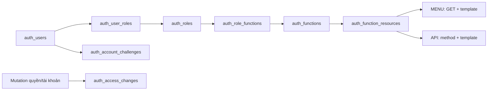

# Schema và phân quyền

Đọc cùng [quy ước backend](QUY_UOC_PHAT_TRIEN.md), [luồng từng thành viên](../05-ke-hoach/PHAN_CONG.md) và [vận hành](../04-van-hanh/VAN_HANH.md). Đây là mô hình source; dữ liệu/migration đã áp môi trường nào tra [tiến độ](../05-ke-hoach/TIEN_DO_VA_KE_HOACH_NHOM.md).

## Tám bảng auth và 40 class

| Bảng | Nội dung và quyết định chính |
|---|---|
| auth_users | Username/email/tên, hash và 2 hash trước, trạng thái, failed_login_attempts/locked_until, token_version, version/audit; system có id0 |
| auth_roles | Code/tên/active/deleted, all_scopes, protected_role và marker init |
| auth_functions | Nhóm chức năng, tên/icon/thứ tự/parent_code, trạng thái và marker init |
| auth_user_roles | User–role toàn cục scope0 và scoped role theo nhà xe; version và FK bảo vệ tập con |
| auth_role_functions | Role–Function, version/audit |
| auth_function_resources | Function–MENU/ENDPOINT, method/route template/handler/nhãn; không nhận URL ID cụ thể làm target |
| auth_account_challenges | Mã theo user/purpose/hash/tokenVersion/expiry; lifecycle còn dùng invalidate, không mở self-registration/email/reset |
| auth_access_changes | Event/actor/target/whitelist before-after/traceId/version trong transaction; không màn/API history |

Auth 40 file:8 entity,8 repo,4 service,3 API,1 page,9 DTO,2 config,4 security,1 initializer. User/Role/Function giữ service CRUD và mapping; JwtService giữ token. Không tạo service/API rỗng cho bảng nối. Một số mapping/challenge có identity kỹ thuật UNIQUE cho JPA nhưng PK/FK nghiệp vụ ghép vẫn giữ.



## Mười hai bảng nghiệp vụ và hạ tầng

| Nhóm | Bảng và quan hệ |
|---|---|
| catalog 1 | category giữ nhóm, giá trị và cây cha–con |
| carrier 3 | carriers → carrier_vehicles/carrier_drivers; hồ sơ tài xế nối auth_users |
| trip 6 | carrier_routes → carrier_route_stops; carrier_trips → trip_stops/trip_segments/trip_events |
| booking 2 | bookings → booking_events; nối trip, cặp điểm, owner và scope |
| report/bootstrap | Không có bảng riêng; report đọc dữ liệu, bootstrap dùng JSON/SQL theo tập |
| common/history 2 | api_request_journal; vietroute_schema_history |

Tổng 8 auth + 12 business + 1 journal + 1 history = 22. Các cột scope nằm trong carriers. Xe/tài xế thuộc nhà xe; trip_stops lưu snapshot độc lập mẫu tuyến, segment là đoạn giữa hai stop liền kề. Booking có pickup_order/dropoff_order để giữ chỗ trên đúng đoạn.

## Xác thực và grant endpoint

Login chỉ username/password. UserService khóa dòng account, so BCrypt12, ghi bộ đếm sai trước trả lỗi;5 lần sai khóa 15 phút. Không ném lỗi password trong callback để rollback bộ đếm. Thành công cấp JWT30 phút; cookie HttpOnly/SameSite=Lax, Secure ở production. Không lưu token/password vào localStorage.

JWT kiểm HS256/issuer/audience/exp/iat/jti và đọc account/tokenVersion/grant từ DB; role trong token không là nguồn cấp quyền. Logout/đổi password/thu hồi liên quan tăng tokenVersion theo luồng. Account inactive/deleted/pending, chưa xác minh hoặc mật khẩu tạm bị chặn private phù hợp lifecycle.

EndpointAccess thu thập MVC sau servlet refresh. Target ví dụ GET /api/v1/admin/accounts/{id}; HEAD chuẩn hóa thành GET. Public/self-service chỉ WebRoutePolicy trong source quyết định; DB/client không được biến một endpoint thành public. Inventory mới không tự cấp grant; endpoint chưa gán default deny, kể cả token mang ADMIN. Sync chủ động mới gán bộ bootstrap vào DB.

Trước handler private, guard đọc lại account/grant; DB lỗi không dùng snapshot/JWT authority cũ để cho qua. Root và servlet context WAR đều bật method security; service kiểm principal/context đã duyệt và nghiệp vụ/trần cấp quyền. Không coi method security tự bảo vệ mọi Java method hoặc việc ẩn menu là bảo mật backend.

GET /docs và GET /v3/api-docs đã được chuyển vào grant bootstrap quản trị ở PR154; source đã nhận phần này trong UI03; trạng thái phát hành xem tiến độ/PR. Khi nghiệm thu phải kiểm bản/commit đang chạy, không khẳng định Swagger đã private trên mọi môi trường. Hai target vẫn là grant DB, không hardcode chuỗi ROLE_ADMIN.

## Scope, owner và trần ủy quyền

scope_id 0 là role toàn cục; scope_id>0 là role trong nhà xe. Scoped role phải là tập con global role cùng user/role qua composite FK. scope_active khác active kinh doanh của nhà xe. UserRoleRepo.visibleSql/bindVisible/require kiểm account/tokenVersion/mapping/scope/role/function/target trên connection caller; scope lọc trước cả count và page.

all_scopes chỉ mở dữ liệu cho endpoint **do chính role đó cấp**; không ghép endpoint roleA với all_scopes roleB. Khách vẫn owner của booking; tài xế phải có hồ sơ và driver_user_id được phân công. Role DRIVER hoặc cùng nhà xe không tự cho xem mọi chuyến tài xế khác. Ngoài scope/owner thường404; thiếu endpoint403.

canUpdate/canAssign kiểm mutation target riêng, không lấy quyền GET của bảng để suy quyền sửa/gán. Mọi grant định cấp phải nằm trong tập actor hiện hành; kiểm cả role/function inactive để tránh bật lại lách quyền. Protected role/system/self/bootstrap có giới hạn riêng, không gán/sửa tùy ý qua CRUD thường.

Thay global role giữ mapping không đổi, thu hồi scoped mapping không còn hợp lệ và tăng mốc membership/token/history theo batch cùng transaction. scope_membership_versions giữ version kể cả khi xóa hết rồi gán lại. Startup ordinary init một lần, không khôi phục grant/membership đã thu hồi.

## Version, audit và xóa

Mutation nhận version hiện hành, stale409; đọc lại bản ghi sau mutation, không tự cộng version ở client. User xóa mềm, thu hồi phiên/challenge/mapping và ghi history. Role/Function còn được tham chiếu bị chặn xóa theo contract. ID/mã/parent/history bất biến theo tài nguyên; không DELETE dữ liệu lịch sử để demo lại.

Audit system0 cho startup/bảo trì; user mutation lấy principal server. Instant/TIMESTAMPTZ, giữ actor/timestamp cũ khi bảo trì history; hash/tokenVersion không trả ra API. JPA/JDBC/history cùng transaction; lỗi history rollback quyền/nghiệp vụ, journal ghi riêng và có thể thất bại.

## Baseline theo cụm bảng

```text
db/migration/postgresql/
  migrations.list
  auth/001_schema.sql
  catalog/001_schema.sql
  carrier/001_schema.sql
  trip/001_schema.sql
  booking/001_schema.sql
  common/001_schema.sql
  foundation/001_system_account.sql
  foundation/002_references.sql
  catalog/002_category.sql
  catalog/003_location_wards.sql
```

Manifest ở [db/migration](../../src/main/resources/db/migration/postgresql/migrations.list) chạy tám bước nền đã có, sau đó chuyển ba bảng danh mục sang `category` ở bước thứ chín; bước thứ mười chuyển cha địa điểm từ tỉnh sang xã/phường và thay tài nguyên quản trị danh mục đã nghỉ. Bước003 chỉ bổ sung bảy grant Category vào ADMIN_CONSOLE hiện hữu, giữ trạng thái function/role/mapping và ghi history khi tập tài nguyên đổi; không nâng quyền các function đọc riêng nhóm cũ. Report và bootstrap dùng các bảng hiện có. History version như trip/001_schema.sql, SHA-256 byte gốc, installed_at; không format SQL đã áp dụng.

DatabaseInitializer/MigrationCatalog giữ advisory lock/transaction/checksum và init. Entity dùng annotation JPA chuẩn; PK/index được đối chiếu trong regression PostgreSQL, không còn validator metadata riêng ở startup. Bốn bảng auth có ID kỹ thuật UNIQUE vẫn giữ PK nghiệp vụ ghép trong migration và test. Connection transaction trước LOCAL search_path, schema qua VIETROUTE_DB_SCHEMA/fallback profile, pg_temp cuối; không prefix schema cứng vào entity/query, không public/$user fallback. pg_trgm tra namespace extension thật. Không tự DDL bằng Hibernate, không migration lúc Maven packaging. Checksum không phát hiện mọi thay đổi cấu trúc DB do sửa tay.

Baseline mới hoặc history sai phải dừng runtime, không sửa checksum để xanh. Bảo trì/rebaseline theo [vận hành](../04-van-hanh/VAN_HANH.md#database-backup-và-rollback): backup kiểm phục hồi, dừng mọi node và kiểm cấu trúc trước đổi history; không đổi dữ liệu/hash/sequence/audit.

## Khởi tạo và bảo vệ bootstrap

| Cờ | Startup khi bật có chủ đích |
|---|---|
| VIETROUTE_DB_INIT_ENABLED | Migration, kiểm checksum, AuthInitializer và nạp danh mục nền theo lô |
| VIETROUTE_ACCESS_SYNC_ENABLED | Inventory và sync bootstrap sau MVC; mặc định theo DB_INIT khi không khai báo |
| VIETROUTE_DEFAULT_ACCOUNTS_ENABLED | Tạo45 account ordinary còn thiếu, verified/active theo JSON/env |
| VIETROUTE_BUSINESS_INIT_ENABLED | Nền catalog/carrier/scope/tuyến; cùng DEFAULT_ACCOUNTS tạo bộ vận hành đầy đủ |

Bootstrap riêng theo identity env/JSON; init có thể chuẩn hóa trạng thái/email đúng bootstrap và giữ hash đã có, sync riêng chỉ sửa role/function/bindings. Ordinary role/function có marker một lần; restart không mở lại account hoặc quyền đã thu hồi. Bốn cờ đầy đủ trên DB mới tạo 46 account và bộ nghiệp vụ; ngày/mã neo lần đầu, không dịch ngày hoặc reset password lúc restart.

AuthInitializer/UserRepo lấy account/scope/link từ [default-access.json](../../src/main/resources/auth/default-access.json); nền và vận hành ở [bootstrap](../../src/main/resources/bootstrap). HTTP /operations/demo và POST /api/v1/admin/demo chỉ seed bộ nền21 bản ghi, không cấp credential hoặc hàng nghìn đơn. Xem đầy đủ [account/key](../01-bat-dau/CHAY_LOCAL.md#tài-khoản-và-dữ-liệu-khởi-tạo). .env chứa secret chỉ local, không Git/WAR; OS/IDE ưu tiên, Oracle vẫn bị chặn trước SQL.

## Danh mục chung và cây hành chính

`category` dùng một bảng vật lý và 10 file Java. `CategoryRequest` dùng cho tạo và sửa. `CategorySearch` nhận bộ lọc phân trang. `CategoryResponse` có audit và version. `CategoryLookupResponse` chỉ trả các trường công khai.

| Cột | Ý nghĩa |
|---|---|
| `id` | Khóa chính số dùng để liên kết bản ghi |
| `code` | Mã ổn định, duy nhất trong `ref_type` |
| `type` | `GROUP` định nghĩa cấu trúc và `VALUE` chứa giá trị |
| `ref_type` | Bắt buộc ở mọi dòng. `GROUP` dùng chính `code` của nhóm. `VALUE` tham chiếu nhóm đó |
| `parent_id` | FK vật lý tới `category.id`. Để trống với mục gốc. `WARD` trỏ tới `PROVINCE`; `LOCATION` trỏ tới `WARD` |
| `description` | Mô tả vật lý, tối đa 1.000 ký tự; dùng chung cho nhóm và giá trị |
| `name`, `props` | Tên Việt và JSONB cho tên Anh, mã hành chính, số chỗ gợi ý, địa chỉ và tọa độ tĩnh |
| `active`, `sort_order`, `version`, audit | Trạng thái, thứ tự, kiểm cập nhật đồng thời và người thực hiện |
| `group_code`, `value_ref` | Cột sinh chỉ đọc. FK nhóm dùng `group_code`. FK nghiệp vụ dùng cặp `(id, value_ref)` để loại bản ghi `GROUP` và nhóm sai |

| ID minh họa | Type | Code | Ref type | Parent ID | Tên |
|---|---|---|---|---|---|
| 1 | GROUP | PROVINCE | PROVINCE | — | Tỉnh/thành |
| 2 | GROUP | WARD | WARD | — | Xã/phường |
| 10 | VALUE | HAIPHONG | PROVINCE | — | Hải Phòng |
| 20 | VALUE | 11383 | WARD | 10 | Phường Lê Chân |
| 21 | VALUE | DLGHAIPHONG | LOCATION | 10 | Điểm đón Duy Long |

Năm nhóm có sẵn gồm `VEHICLE_TYPE`, `BOOKING_SOURCE`, `PROVINCE`, `WARD` và `LOCATION`. `props.fields` định nghĩa kiểu, khoảng giá trị và trường bắt buộc. Nhóm có `parentRefType` yêu cầu cha thuộc nhóm đó. `hierarchical: true` cho phép mục cùng nhóm làm cha. ID, mã, nhóm và cha được giữ cố định sau tạo để bảo toàn cây và khóa nghiệp vụ. Trigger kiểm quy tắc và khóa nhóm/cha trong transaction. Số chỗ gợi ý ở `props.seatCount` hỗ trợ danh mục loại xe. `carrier_vehicles.capacity` và snapshot chuyến là số chỗ dùng để bán.

Bộ [đơn vị hành chính](../../src/main/resources/bootstrap/administrative-divisions.json) ghi nguồn, ngày tải và checksum. Dữ liệu gồm 34 tỉnh/thành và 3.321 đơn vị cấp xã từ bộ sau sáp nhập 2025. Mã và tỉnh cha đối chiếu với bảng chuyển đổi Cục Thống kê. Tên tỉnh lấy theo trang Cục Thống kê lúc thu thập. Mã hành chính lưu chuỗi trong `props.administrativeCode`, giữ số 0 đầu. Các mã nghiệp vụ như `HAIPHONG` tiếp tục nối với tuyến đã có. Khi bật DB_INIT, repo nhập theo tập và bỏ qua mục đã có. [Nguồn JSON](https://provinces.open-api.vn/) · [Cục Thống kê](https://danhmuchanhchinh.nso.gov.vn/).

Trang `/operations/categories` hiện bảng cây. Ban đầu chỉ đọc `/api/v1/admin/categories/groups`. Mở nhóm gốc gọi `GET /api/v1/admin/categories?refType=PROVINCE&size=20`. Mở một tỉnh gọi `GET /api/v1/admin/categories?parentId=<id>&size=20`. **Xem thêm** tải trang tiếp theo trong nhánh. API công khai `GET /api/v1/categories?refType=WARD&parentId=<id>` trả xã/phường của một tỉnh. Thiếu cha thì danh sách xã/phường và địa điểm rỗng. Các endpoint danh mục cũ đã bỏ khỏi source. API quản trị chung có grant riêng trong DB.

Migration `catalog/002_category.sql` giữ ID của loại xe và nguồn đặt chỗ. Tỉnh và địa điểm được cấp ID không trùng qua bảng tạm. Bước này chuyển sáu FK nghiệp vụ, giữ nội dung snapshot và audit, rồi bỏ ba bảng cũ. Kiểm tra áp dụng theo môi trường ở [tiến độ](../05-ke-hoach/TIEN_DO_VA_KE_HOACH_NHOM.md).

`catalog.constant.CategoryRefType` quản lý mã nhóm nền dùng trong Java và ví dụ Swagger. Nhóm bổ sung được định nghĩa bằng dòng GROUP; không cần sửa constant nếu chưa có nghiệp vụ riêng dùng nhóm đó.

Đã bỏ các page/API danh mục cũ, chỉ dùng `/operations/categories`, `/api/v1/categories` và `/api/v1/admin/categories`. API công khai nhận `refType`; xã/phường và điểm đón/trả còn bắt buộc chọn `parentId` để có kết quả. Request tạo/sửa nhận `description`; loại bản ghi dùng `GROUP` hoặc `VALUE`.

Địa điểm thuộc một xã/phường; query tạo tuyến/chuyến JOIN địa điểm → xã/phường → tỉnh để kiểm trạng thái và lấy tỉnh cho snapshot. Bộ chọn tìm chuyến có xã/phường tùy chọn; backend lọc thêm bằng fromWardId/toWardId. Đổi tỉnh xóa xã và địa điểm; đổi xã xóa địa điểm.

Nguồn hành chính giữ trong `bootstrap/administrative-divisions.json`, không có tác vụ chạy ngầm hoặc đồng bộ định kỳ. Khi bật DB_INIT, CategoryRepo đọc JSON và nạp tỉnh/xã bằng hai INSERT theo tập: lần đầu tạo dữ liệu thiếu, lần sau mã đã tồn tại được bỏ qua, giữ trạng thái và nội dung đã sửa. Không gọi API ngoài lúc startup/request. Khi có thay đổi địa giới thì cập nhật JSON có review. Với DB cũ, bước 003 chỉ nhận map mã/cha của bộ giả lập; địa điểm khác làm migration dừng để bổ sung map, không tự đoán xã theo tọa độ.
