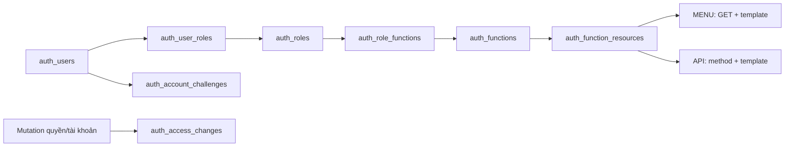

# Schema và phân quyền

Đọc cùng [quy ước backend](QUY_UOC_PHAT_TRIEN.md), [luồng từng thành viên](../05-ke-hoach/PHAN_CONG.md) và [vận hành](../04-van-hanh/VAN_HANH.md). Đây là mô hình source; dữ liệu/migration đã áp môi trường nào tra [tiến độ](../05-ke-hoach/TIEN_DO_VA_KE_HOACH_NHOM.md).

## Tám bảng auth và 40 class

| Bảng | Nội dung và quyết định chính |
|---|---|
| auth_users | Username/email/tên, hash và 2 hash trước, trạng thái, failed_login_attempts/locked_until, token_version, version/audit; system có id0 |
| auth_roles | Code/tên/active/deleted, all_scopes, protected_role và marker init |
| auth_functions | Nhóm chức năng, tên/icon/thứ tự/parent_code, trạng thái và marker init |
| auth_user_roles | User–role toàn cục scope0 và scoped role theo nhà xe; version và FK bảo vệ tập con |
| auth_role_functions | Role–Function, version/audit |
| auth_function_resources | Function–MENU/ENDPOINT, method/route template/handler/nhãn; không nhận URL ID cụ thể làm target |
| auth_account_challenges | Mã theo user/purpose/hash/tokenVersion/expiry; lifecycle còn dùng invalidate, không mở self-registration/email/reset |
| auth_access_changes | Event/actor/target/whitelist before-after/traceId/version trong transaction; không màn/API history |

Auth 40 file:8 entity,8 repo,4 service,3 API,1 page,9 DTO,2 config,4 security,1 initializer. User/Role/Function giữ service CRUD và mapping; JwtService giữ token. Không tạo service/API rỗng cho bảng nối. Một số mapping/challenge có identity kỹ thuật UNIQUE cho JPA nhưng PK/FK nghiệp vụ ghép vẫn giữ.



## Mười bốn bảng nghiệp vụ và hạ tầng

| Nhóm | Bảng và quan hệ |
|---|---|
| catalog 3 | catalog_items; location_provinces → location_places |
| carrier 3 | carriers → carrier_vehicles/carrier_drivers; hồ sơ tài xế nối auth_users |
| trip 6 | carrier_routes → carrier_route_stops; carrier_trips → trip_stops/trip_segments/trip_events |
| booking 2 | bookings → booking_events; nối trip, cặp điểm, owner và scope |
| report/bootstrap | Không có bảng riêng; report đọc dữ liệu, bootstrap dùng JSON/SQL theo tập |
| common/history 2 | api_request_journal; vietroute_schema_history |

Tổng 8 auth +14 business +1 journal +1 history =24. Scope_* nằm trong carriers, không tạo bảng scope thứ25. Xe/tài xế thuộc nhà xe; trip_stops lưu snapshot độc lập mẫu tuyến, segment là đoạn giữa hai stop liền kề. Booking có pickup_order/dropoff_order để giữ chỗ trên đúng đoạn.

## Xác thực và grant endpoint

Login chỉ username/password. UserService khóa dòng account, so BCrypt12, ghi bộ đếm sai trước trả lỗi;5 lần sai khóa 15 phút. Không ném lỗi password trong callback để rollback bộ đếm. Thành công cấp JWT30 phút; cookie HttpOnly/SameSite=Lax, Secure ở production. Không lưu token/password vào localStorage.

JWT kiểm HS256/issuer/audience/exp/iat/jti và đọc account/tokenVersion/grant từ DB; role trong token không là nguồn cấp quyền. Logout/đổi password/thu hồi liên quan tăng tokenVersion theo luồng. Account inactive/deleted/pending, chưa xác minh hoặc mật khẩu tạm bị chặn private phù hợp lifecycle.

EndpointAccess thu thập MVC sau servlet refresh. Target ví dụ GET /api/v1/admin/accounts/{id}; HEAD chuẩn hóa thành GET. Public/self-service chỉ WebRoutePolicy trong source quyết định; DB/client không được biến một endpoint thành public. Inventory mới không tự cấp grant; endpoint chưa gán default deny, kể cả token mang ADMIN. Sync chủ động mới gán bộ bootstrap vào DB.

Trước handler private, guard đọc lại account/grant; DB lỗi không dùng snapshot/JWT authority cũ để cho qua. Root và servlet context WAR đều bật method security; service kiểm principal/context đã duyệt và nghiệp vụ/trần cấp quyền. Không coi method security tự bảo vệ mọi Java method hoặc việc ẩn menu là bảo mật backend.

GET /docs và GET /v3/api-docs đã được chuyển vào grant bootstrap quản trị ở PR154; source đã nhận phần này trong UI03; trạng thái phát hành xem tiến độ/PR. Khi nghiệm thu phải kiểm bản/commit đang chạy, không khẳng định Swagger đã private trên mọi môi trường. Hai target vẫn là grant DB, không hardcode chuỗi ROLE_ADMIN.

## Scope, owner và trần ủy quyền

scope_id 0 là role toàn cục; scope_id>0 là role trong nhà xe. Scoped role phải là tập con global role cùng user/role qua composite FK. scope_active khác active kinh doanh của nhà xe. UserRoleRepo.visibleSql/bindVisible/require kiểm account/tokenVersion/mapping/scope/role/function/target trên connection caller; scope lọc trước cả count và page.

all_scopes chỉ mở dữ liệu cho endpoint **do chính role đó cấp**; không ghép endpoint roleA với all_scopes roleB. Khách vẫn owner của booking; tài xế phải có hồ sơ và driver_user_id được phân công. Role DRIVER hoặc cùng nhà xe không tự cho xem mọi chuyến tài xế khác. Ngoài scope/owner thường404; thiếu endpoint403.

canUpdate/canAssign kiểm mutation target riêng, không lấy quyền GET của bảng để suy quyền sửa/gán. Mọi grant định cấp phải nằm trong tập actor hiện hành; kiểm cả role/function inactive để tránh bật lại lách quyền. Protected role/system/self/bootstrap có giới hạn riêng, không gán/sửa tùy ý qua CRUD thường.

Thay global role giữ mapping không đổi, thu hồi scoped mapping không còn hợp lệ và tăng mốc membership/token/history theo batch cùng transaction. scope_membership_versions giữ version kể cả khi xóa hết rồi gán lại. Startup ordinary init một lần, không khôi phục grant/membership đã thu hồi.

## Version, audit và xóa

Mutation nhận version hiện hành, stale409; đọc lại bản ghi sau mutation, không tự cộng version ở client. User xóa mềm, thu hồi phiên/challenge/mapping và ghi history. Role/Function còn được tham chiếu bị chặn xóa theo contract. ID/mã/parent/history bất biến theo tài nguyên; không DELETE dữ liệu lịch sử để demo lại.

Audit system0 cho startup/bảo trì; user mutation lấy principal server. Instant/TIMESTAMPTZ, giữ actor/timestamp cũ khi bảo trì history; hash/tokenVersion không trả ra API. JPA/JDBC/history cùng transaction; lỗi history rollback quyền/nghiệp vụ, journal ghi riêng và có thể thất bại.

## Baseline theo cụm bảng

```text
db/migration/postgresql/
  migrations.list
  auth/001_schema.sql
  catalog/001_schema.sql
  carrier/001_schema.sql
  trip/001_schema.sql
  booking/001_schema.sql
  common/001_schema.sql
  foundation/001_system_account.sql
  foundation/002_references.sql
```

Manifest ở [db/migration](../../src/main/resources/db/migration/postgresql/migrations.list) quyết định thứ tự: sáu schema → system → FK. Không file SQL rỗng cho report/bootstrap hoặc giữ bộ migration cũ rồi DROP. History version như trip/001_schema.sql, SHA-256 byte gốc, installed_at; không format SQL đã áp dụng.

DatabaseInitializer/MigrationCatalog giữ advisory lock/transaction/checksum/metadata. Connection transaction trước LOCAL search_path, schema qua VIETROUTE_DB_SCHEMA/fallback profile, pg_temp cuối; không prefix schema cứng vào entity/query, không public/$user fallback. pg_trgm tra namespace extension thật. Không tự DDL bằng Hibernate, không migration lúc Maven packaging.

Baseline mới hoặc history sai phải dừng runtime, không sửa checksum để xanh. Bảo trì/rebaseline theo [vận hành](../04-van-hanh/VAN_HANH.md#database-backup-và-rollback): backup kiểm phục hồi, dừng mọi node và kiểm cấu trúc trước đổi history; không đổi dữ liệu/hash/sequence/audit.

## Khởi tạo và bảo vệ bootstrap

| Cờ | Startup khi bật có chủ đích |
|---|---|
| VIETROUTE_DB_INIT_ENABLED | Migration/checksum/metadata + AuthInitializer |
| VIETROUTE_ACCESS_SYNC_ENABLED | Inventory và sync bootstrap sau MVC; mặc định theo DB_INIT khi không khai báo |
| VIETROUTE_DEFAULT_ACCOUNTS_ENABLED | Tạo45 account ordinary còn thiếu, verified/active theo JSON/env |
| VIETROUTE_BUSINESS_INIT_ENABLED | Nền catalog/carrier/scope/tuyến; cùng DEFAULT_ACCOUNTS tạo bộ vận hành đầy đủ |

Bootstrap riêng theo identity env/JSON; init có thể chuẩn hóa trạng thái/email đúng bootstrap và giữ hash đã có, sync riêng chỉ sửa role/function/bindings. Ordinary role/function có marker một lần; restart không mở lại account hoặc quyền đã thu hồi. Bốn cờ đầy đủ trên DB mới tạo 46 account và bộ nghiệp vụ; ngày/mã neo lần đầu, không dịch ngày hoặc reset password lúc restart.

AuthInitializer/UserRepo lấy account/scope/link từ [default-access.json](../../src/main/resources/auth/default-access.json); nền và vận hành ở [bootstrap](../../src/main/resources/bootstrap). HTTP /operations/demo và POST /api/v1/admin/demo chỉ seed bộ nền21 bản ghi, không cấp credential hoặc hàng nghìn đơn. Xem đầy đủ [account/key](../01-bat-dau/CHAY_LOCAL.md#tài-khoản-và-dữ-liệu-khởi-tạo). .env chứa secret chỉ local, không Git/WAR; OS/IDE ưu tiên, Oracle vẫn bị chặn trước SQL.
