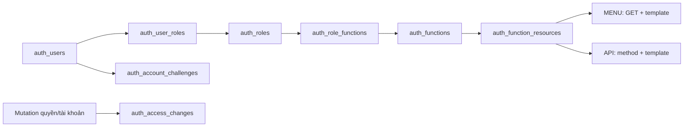

# Schema và phân quyền

Đọc cùng [quy ước backend](QUY_UOC_PHAT_TRIEN.md), [luồng từng thành viên](../05-ke-hoach/PHAN_CONG.md) và [vận hành](../04-van-hanh/VAN_HANH.md). Đây là mô hình source; dữ liệu/migration đã áp môi trường nào tra [tiến độ](../05-ke-hoach/TIEN_DO_VA_KE_HOACH_NHOM.md).

## Tám bảng auth và 46 class

| Bảng | Nội dung và quyết định chính |
|---|---|
| auth_users | Username/email/tên, hash và 2 hash trước, trạng thái, failed_login_attempts/locked_until, token_version, version/audit; system có id0 |
| auth_roles | Code/tên/active/deleted, all_scopes, protected_role và marker init |
| auth_functions | Nhóm chức năng, tên/icon/thứ tự/parent_code, trạng thái và marker init |
| auth_user_roles | User–role toàn cục scope0 và scoped role theo nhà xe; version và FK bảo vệ tập con |
| auth_role_functions | Role–Function, version/audit |
| auth_function_resources | Function–MENU/ENDPOINT, method/route template/handler/nhãn; không nhận URL ID cụ thể làm target |
| auth_account_challenges | Mã theo user/purpose/hash/tokenVersion/expiry; lifecycle còn dùng invalidate, không mở self-registration/email/reset |
| auth_access_changes | Event/actor/target/whitelist before-after/traceId/version trong transaction; không màn/API history |

Auth 46 file gồm 8 entity, 8 repo, 6 CustomRepo ghi batch trong repo/custom, 4 service,3 API,1 page,9 DTO,2 config,4 security,1 initializer. User/Role/Function giữ service CRUD và mapping; JwtService giữ token. Tám Repo là interface Spring Data, query native bằng @Query. Khởi tạo bootstrap do AuthInitializer phối hợp các query và batch. Không tạo service/API rỗng cho bảng nối. Một số mapping/challenge có identity kỹ thuật UNIQUE cho JPA nhưng PK/FK nghiệp vụ ghép vẫn giữ.



## Mười hai bảng nghiệp vụ và hạ tầng

| Nhóm | Bảng và quan hệ |
|---|---|
| catalog 1 | category giữ nhóm, giá trị và cây cha–con |
| carrier 3 | carriers → carrier_vehicles/carrier_drivers; hồ sơ tài xế nối auth_users |
| trip 6 | carrier_routes → carrier_route_stops; carrier_trips → trip_stops/trip_segments/trip_events |
| booking 2 | bookings → booking_events; nối trip, cặp điểm, owner và scope |
| report/bootstrap | Không có bảng riêng; report đọc dữ liệu, bootstrap dùng JSON/SQL theo tập |
| common/history 2 | api_request_journal; vietroute_schema_history |

Tổng 8 auth + 12 business + 1 journal + 1 history = 22. Các cột scope nằm trong carriers. Xe/tài xế thuộc nhà xe; trip_stops lưu snapshot độc lập mẫu tuyến, segment là đoạn giữa hai stop liền kề. Booking có pickup_order/dropoff_order để giữ chỗ trên đúng đoạn.

## Booking đồng thời và ghi nhận tiền

PENDING chỉ tiếp nhận yêu cầu, chưa giữ chỗ. Xác nhận khóa trip → booking → các segment tăng dần, kiểm đủ chặng và cập nhật trong cùng transaction. UPDATE chặng chỉ nhận giá trị `reserved_seats + delta` trong0..capacity; cập nhật thiếu dòng phải lỗi và rollback. CHECK ở DB giữ0 ≤ reserved_seats ≤ capacity. Hủy CONFIRMED trả chỗ một lần theo state/version; hủy PENDING không trả chỗ chưa từng giữ. Khóa PostgreSQL bảo vệ cả các node ứng dụng, không dùng synchronized hoặc bộ đếm RAM làm tồn chỗ.

Tạo đơn và ghi thu/hoàn có UUID requestKey. Replay chỉ hợp lệ với cùng actor/nội dung/đơn; key khác nội dung hoặc dùng cho đơn khác nhận409. Thao tác mới kiểm version, khóa booking trước cộng tiền và ghi history cùng transaction. UPDATE tiền giữ tổng đã thu/hoàn tăng dần, đã thu không vượt giá đơn và đã hoàn không vượt đã thu; CHECK và unique request_key vẫn là lớp bảo vệ DB. History lỗi rollback cả tiền/version/key, nên có thể gửi lại cùng requestKey sau lỗi.

Tiền hiện là ghi nhận thu/hoàn thủ công đã thực hiện bên ngoài. Hủy không tự chuyển tiền cho khách. Chưa có ví, trừ tiền ngân hàng hoặc payment gateway; các phần đó cần hợp đồng giao dịch và đối soát riêng. Ca đồng thời ở BusinessIntegrationTest kiểm8 request tại barrier và hai đơn ở hai chuyến dùng chung key; đây là regression DB local, không là bằng chứng năng lực tải production.

## Xác thực và grant endpoint

Login chỉ username/password. UserService khóa dòng account, so BCrypt12, ghi bộ đếm sai trước trả lỗi;5 lần sai khóa 15 phút. Không ném lỗi password trong callback để rollback bộ đếm. Thành công cấp JWT30 phút; cookie HttpOnly/SameSite=Lax, Secure ở production. Không lưu token/password vào localStorage.

JWT kiểm HS256/issuer/audience/exp/iat/jti và đọc account/tokenVersion/grant từ DB; role trong token không là nguồn cấp quyền. Logout/đổi password/thu hồi liên quan tăng tokenVersion theo luồng. Account inactive/deleted/pending, chưa xác minh hoặc mật khẩu tạm bị chặn private phù hợp lifecycle.

EndpointAccess thu thập MVC sau servlet refresh. Target ví dụ GET /api/v1/admin/accounts/{id}; HEAD chuẩn hóa thành GET. Public/self-service chỉ WebRoutePolicy trong source quyết định; DB/client không được biến một endpoint thành public. Inventory mới không tự cấp grant; endpoint chưa gán default deny, kể cả token mang ADMIN. Sync chủ động mới gán bộ bootstrap vào DB.

Trước handler private, guard đọc lại account/grant; DB lỗi không dùng snapshot/JWT authority cũ để cho qua. Root và servlet context WAR đều bật method security; service kiểm principal/context đã duyệt và nghiệp vụ/trần cấp quyền. Không coi method security tự bảo vệ mọi Java method hoặc việc ẩn menu là bảo mật backend.

GET /docs và GET /v3/api-docs đã được chuyển vào grant bootstrap quản trị ở PR154; source đã nhận phần này trong UI03; trạng thái phát hành xem tiến độ/PR. Khi nghiệm thu phải kiểm bản/commit đang chạy, không khẳng định Swagger đã private trên mọi môi trường. Hai target vẫn là grant DB, không hardcode chuỗi ROLE_ADMIN.

## Scope, owner và trần ủy quyền

scope_id 0 là role toàn cục; scope_id>0 là role trong nhà xe. Scoped role phải là tập con global role cùng user/role qua composite FK. scope_active khác active kinh doanh của nhà xe. UserRoleRepo.visibleSql/bindVisible/require kiểm account/tokenVersion/mapping/scope/role/function/target trên connection caller; scope lọc trước cả count và page.

all_scopes chỉ mở dữ liệu cho endpoint **do chính role đó cấp**; không ghép endpoint roleA với all_scopes roleB. Khách vẫn owner của booking; tài xế phải có hồ sơ và driver_user_id được phân công. Role DRIVER hoặc cùng nhà xe không tự cho xem mọi chuyến tài xế khác. Ngoài scope/owner thường404; thiếu endpoint403.

canUpdate/canAssign kiểm mutation target riêng, không lấy quyền GET của bảng để suy quyền sửa/gán. Mọi grant định cấp phải nằm trong tập actor hiện hành; kiểm cả role/function inactive để tránh bật lại lách quyền. Protected role/system/self/bootstrap có giới hạn riêng, không gán/sửa tùy ý qua CRUD thường.

Thay global role giữ mapping không đổi, thu hồi scoped mapping không còn hợp lệ và tăng mốc membership/token/history theo batch cùng transaction. scope_membership_versions giữ version kể cả khi xóa hết rồi gán lại. Startup ordinary init một lần, không khôi phục grant/membership đã thu hồi.

## Version, audit và xóa

Mutation nhận version hiện hành, stale409; đọc lại bản ghi sau mutation, không tự cộng version ở client. User xóa mềm, thu hồi phiên/challenge/mapping và ghi history. Role/Function còn được tham chiếu bị chặn xóa theo contract. ID/mã/parent/history bất biến theo tài nguyên; không DELETE dữ liệu lịch sử để demo lại.

Audit system0 cho startup/bảo trì; user mutation lấy principal server. Instant/TIMESTAMPTZ, giữ actor/timestamp cũ khi bảo trì history; hash/tokenVersion không trả ra API. JPA/JDBC/history cùng transaction; lỗi history rollback quyền/nghiệp vụ, journal ghi riêng và có thể thất bại.

## Baseline theo cụm bảng

```text
db/migration/postgresql/
  migrations.list
  auth/001_schema.sql
  catalog/001_schema.sql
  carrier/001_schema.sql
  trip/001_schema.sql
  booking/001_schema.sql
  common/001_schema.sql
  foundation/001_system_account.sql
  foundation/002_references.sql
  catalog/002_category.sql
  catalog/003_location_wards.sql
```

Manifest ở [db/migration](../../src/main/resources/db/migration/postgresql/migrations.list) chạy tám bước nền đã có, sau đó chuyển ba bảng danh mục sang `category` ở bước thứ chín; bước thứ mười chuyển cha địa điểm từ tỉnh sang xã/phường và thay tài nguyên quản trị danh mục đã nghỉ. Bước003 chỉ bổ sung bảy grant Category vào ADMIN_CONSOLE hiện hữu, giữ trạng thái function/role/mapping và ghi history khi tập tài nguyên đổi; không nâng quyền các function đọc riêng nhóm cũ. Report và bootstrap dùng các bảng hiện có. History version như trip/001_schema.sql, SHA-256 byte gốc, installed_at; không format SQL đã áp dụng.

DatabaseInitializer/MigrationCatalog giữ advisory lock/transaction/checksum và init. Entity dùng annotation JPA chuẩn; PK/index được đối chiếu trong regression PostgreSQL, không còn validator metadata riêng ở startup. Bốn bảng auth có ID kỹ thuật UNIQUE vẫn giữ PK nghiệp vụ ghép trong migration và test. Connection transaction trước LOCAL search_path, schema qua VIETROUTE_DB_SCHEMA/fallback profile, pg_temp cuối; không prefix schema cứng vào entity/query, không public/$user fallback. pg_trgm tra namespace extension thật. Không tự DDL bằng Hibernate, không migration lúc Maven packaging. Checksum không phát hiện mọi thay đổi cấu trúc DB do sửa tay.

Các native @Query dùng `{h-schema}` từ cùng cấu hình schema Hibernate. Query JPA và batch JDBC tham gia transaction hiện hành; không tạo connection riêng cho phần @Query hoặc đổi schema từ request. Cách xuất SQL đã điền schema nằm ở [quy ước query](QUY_UOC_PHAT_TRIEN.md#query-khai-báo-và-sql-để-kiểm-db).

Baseline mới hoặc history sai phải dừng runtime, không sửa checksum để xanh. Bảo trì/rebaseline theo [vận hành](../04-van-hanh/VAN_HANH.md#database-backup-và-rollback): backup kiểm phục hồi, dừng mọi node và kiểm cấu trúc trước đổi history; không đổi dữ liệu/hash/sequence/audit.

## Khởi tạo và bảo vệ bootstrap

| Cờ | Startup khi bật có chủ đích |
|---|---|
| VIETROUTE_DB_INIT_ENABLED | Migration, kiểm checksum, AuthInitializer và nạp danh mục nền theo lô |
| VIETROUTE_ACCESS_SYNC_ENABLED | Inventory và sync bootstrap sau MVC; mặc định theo DB_INIT khi không khai báo |
| VIETROUTE_DEFAULT_ACCOUNTS_ENABLED | Tạo45 account ordinary còn thiếu, verified/active theo JSON/env |
| VIETROUTE_BUSINESS_INIT_ENABLED | Nền catalog/carrier/scope/tuyến; cùng DEFAULT_ACCOUNTS tạo bộ vận hành đầy đủ |

Bootstrap riêng theo identity env/JSON; init có thể chuẩn hóa trạng thái/email đúng bootstrap và giữ hash đã có, sync riêng chỉ sửa role/function/bindings. Ordinary role/function có marker một lần; restart không mở lại account hoặc quyền đã thu hồi. Bốn cờ đầy đủ trên DB mới tạo 46 account và bộ nghiệp vụ; ngày/mã neo lần đầu, không dịch ngày hoặc reset password lúc restart.

AuthInitializer/UserRepo lấy account/scope/link từ [default-access.json](../../src/main/resources/auth/default-access.json); nền và vận hành ở [bootstrap](../../src/main/resources/bootstrap). HTTP /operations/demo và POST /api/v1/admin/demo chỉ seed bộ nền21 bản ghi, không cấp credential hoặc hàng nghìn đơn. Xem đầy đủ [account/key](../01-bat-dau/CHAY_LOCAL.md#tài-khoản-và-dữ-liệu-khởi-tạo). .env chứa secret chỉ local, không Git/WAR; OS/IDE ưu tiên, Oracle vẫn bị chặn trước SQL.

## Danh mục chung và cây hành chính

`category` dùng một bảng vật lý và 11 file Java. `CategoryRequest` dùng cho tạo và sửa. `CategorySearch` nhận bộ lọc phân trang. `CategoryResponse` có audit và version. `CategoryLookupResponse` chỉ trả các trường công khai.

| Cột | Ý nghĩa |
|---|---|
| `id` | Khóa chính số dùng để liên kết bản ghi |
| `code` | Mã ổn định, duy nhất trong `ref_type` |
| `type` | `GROUP` định nghĩa cấu trúc và `VALUE` chứa giá trị |
| `ref_type` | Bắt buộc ở mọi dòng. `GROUP` dùng chính `code` của nhóm. `VALUE` tham chiếu nhóm đó |
| `parent_id` | FK vật lý tới `category.id`. Để trống với mục gốc. `WARD` trỏ tới `PROVINCE`; `LOCATION` trỏ tới `WARD` |
| `description` | Mô tả vật lý, tối đa 1.000 ký tự; dùng chung cho nhóm và giá trị |
| `name`, `props` | Tên Việt và JSONB cho tên Anh, mã hành chính, số chỗ gợi ý, địa chỉ và tọa độ tĩnh |
| `active`, `sort_order`, `version`, audit | Trạng thái, thứ tự, kiểm cập nhật đồng thời và người thực hiện |
| `group_code`, `value_ref` | Cột sinh chỉ đọc. FK nhóm dùng `group_code`. FK nghiệp vụ dùng cặp `(id, value_ref)` để loại bản ghi `GROUP` và nhóm sai |

| ID minh họa | Type | Code | Ref type | Parent ID | Tên |
|---|---|---|---|---|---|
| 1 | GROUP | PROVINCE | PROVINCE | — | Tỉnh/thành |
| 2 | GROUP | WARD | WARD | — | Xã/phường |
| 10 | VALUE | HAIPHONG | PROVINCE | — | Hải Phòng |
| 20 | VALUE | 11383 | WARD | 10 | Phường Lê Chân |
| 21 | VALUE | DLGHAIPHONG | LOCATION | 10 | Điểm đón Duy Long |

Năm nhóm có sẵn gồm `VEHICLE_TYPE`, `BOOKING_SOURCE`, `PROVINCE`, `WARD` và `LOCATION`. `props.fields` định nghĩa kiểu, khoảng giá trị và trường bắt buộc. Nhóm có `parentRefType` yêu cầu cha thuộc nhóm đó. `hierarchical: true` cho phép mục cùng nhóm làm cha. ID, mã, nhóm và cha được giữ cố định sau tạo để bảo toàn cây và khóa nghiệp vụ. Trigger kiểm quy tắc và khóa nhóm/cha trong transaction. Số chỗ gợi ý ở `props.seatCount` hỗ trợ danh mục loại xe. `carrier_vehicles.capacity` và snapshot chuyến là số chỗ dùng để bán.

Bộ [đơn vị hành chính](../../src/main/resources/bootstrap/administrative-divisions.json) ghi nguồn, ngày tải và checksum. Dữ liệu gồm 34 tỉnh/thành và 3.321 đơn vị cấp xã từ bộ sau sáp nhập 2025. Mã và tỉnh cha đối chiếu với bảng chuyển đổi Cục Thống kê. Tên tỉnh lấy theo trang Cục Thống kê lúc thu thập. Mã hành chính lưu chuỗi trong `props.administrativeCode`, giữ số 0 đầu. Các mã nghiệp vụ như `HAIPHONG` tiếp tục nối với tuyến đã có. Khi bật DB_INIT, repo nhập theo tập và bỏ qua mục đã có. [Nguồn JSON](https://provinces.open-api.vn/) · [Cục Thống kê](https://danhmuchanhchinh.nso.gov.vn/).

Trang `/operations/categories` chọn nhóm bằng tab. Đọc metadata nhóm qua `GET /api/v1/admin/categories/groups?tree=true`. Cây quản trị dùng `GET /api/v1/admin/categories?tree=true&refType=WARD` để lấy tỉnh gốc; thêm `parentId=<id>` chỉ lấy con trực tiếp. `refType=LOCATION` mở đường đi tỉnh → xã/phường → địa điểm. Nhánh trả đủ con, không dùng page/size để cắt dữ liệu. `hasChildren` điều khiển nút mở. Tìm `query` qua CTE `WITH RECURSIVE` trả các mục khớp cùng tổ tiên, có `searchMatch` phân biệt kết quả và đường dẫn. Tên hỗ trợ tìm không dấu, ký tự `%`/`_` được escape thành ký tự tìm literal. Không gửi đồng thời parentId và query trong chế độ cây.

API lookup công khai `GET /api/v1/categories?refType=WARD&parentId=<id>` vẫn phân trang và trả whitelist. Thiếu cha thì xã/phường và địa điểm rỗng. Quyền page và từng API quản trị được kiểm riêng bằng grant DB; tree không tạo endpoint hoặc cấp quyền mới.

Migration `catalog/002_category.sql` giữ ID của loại xe và nguồn đặt chỗ. Tỉnh và địa điểm được cấp ID không trùng qua bảng tạm. Bước này chuyển sáu FK nghiệp vụ, giữ nội dung snapshot và audit, rồi bỏ ba bảng cũ. Kiểm tra áp dụng theo môi trường ở [tiến độ](../05-ke-hoach/TIEN_DO_VA_KE_HOACH_NHOM.md).

`catalog.constant.CategoryRefType` quản lý mã nhóm nền dùng trong Java và ví dụ Swagger. Nhóm bổ sung được định nghĩa bằng dòng GROUP; không cần sửa constant nếu chưa có nghiệp vụ riêng dùng nhóm đó.

Đã bỏ các page/API danh mục cũ, chỉ dùng `/operations/categories`, `/api/v1/categories` và `/api/v1/admin/categories`. API công khai nhận `refType`; xã/phường và điểm đón/trả còn bắt buộc chọn `parentId` để có kết quả. Request tạo/sửa nhận `description`; loại bản ghi dùng `GROUP` hoặc `VALUE`.

Địa điểm thuộc một xã/phường; query tạo tuyến/chuyến JOIN địa điểm → xã/phường → tỉnh để kiểm trạng thái và lấy tỉnh cho snapshot. Bộ chọn tìm chuyến có xã/phường tùy chọn; backend lọc thêm bằng fromWardId/toWardId. Đổi tỉnh xóa xã và địa điểm; đổi xã xóa địa điểm.

Nguồn hành chính giữ trong `bootstrap/administrative-divisions.json`, không có tác vụ chạy ngầm hoặc đồng bộ định kỳ. Khi bật DB_INIT, CategoryRepo đọc JSON và nạp tỉnh/xã bằng hai INSERT theo tập: lần đầu tạo dữ liệu thiếu, lần sau mã đã tồn tại được bỏ qua, giữ trạng thái và nội dung đã sửa. Không gọi API ngoài lúc startup/request. Khi có thay đổi địa giới thì cập nhật JSON có review. Với DB cũ, bước 003 chỉ nhận map mã/cha của bộ giả lập; địa điểm khác làm migration dừng để bổ sung map, không tự đoán xã theo tọa độ.

## Từ điển bảng và cột

Schema vật lý có 22 bảng và 338 cột. Tên tiếng Việt diễn giải nghiệp vụ, tên kỹ thuật giữ nguyên để đối chiếu SQL. Phần này mô tả cấu trúc sau 10 bước migration. Các thuộc tính @Transient chỉ phục vụ projection và không phải cột vật lý.

PK là khóa chính, FK là khóa ngoại. Khóa ghép cần đủ các thành phần. NULL là chưa có giá trị; dữ liệu rỗng và số 0 có ý nghĩa khác. TIMESTAMPTZ lưu mốc thời gian, giao diện hiển thị theo giờ Việt Nam. Giá và tiền dùng VND. Cột do DB sinh chỉ đọc, cột audit do server xác định với system ID 0 cho tác vụ hệ thống.

| Bảng | Tên tiếng Việt | Entity hoặc thành phần quản lý |
|---|---|---|
| `api_request_journal` | Nhật ký yêu cầu API | ApiJournal |
| `auth_access_changes` | Lịch sử thay đổi tài khoản và phân quyền | AccessChange |
| `auth_account_challenges` | Thử thách xác minh tài khoản nội bộ | AccountChallenge |
| `auth_function_resources` | Tài nguyên menu và API của chức năng | FunctionResource |
| `auth_functions` | Chức năng hệ thống | Function |
| `auth_role_functions` | Gán chức năng cho vai trò | RoleFunction |
| `auth_roles` | Vai trò người dùng | Role |
| `auth_user_roles` | Gán vai trò và phạm vi cho người dùng | UserRole |
| `auth_users` | Tài khoản người dùng | User |
| `booking_events` | Lịch sử trạng thái và thu hoàn của đơn | BookingEvent |
| `bookings` | Đơn đặt chỗ theo chặng | Booking |
| `carrier_drivers` | Hồ sơ tài xế nhà xe | Driver |
| `carrier_route_stops` | Các điểm dừng của mẫu tuyến | RouteStop |
| `carrier_routes` | Mẫu tuyến vận tải | Route |
| `carrier_trips` | Chuyến xe cụ thể | Trip |
| `carrier_vehicles` | Phương tiện của nhà xe | Vehicle |
| `carriers` | Nhà xe và phạm vi dữ liệu | Carrier |
| `category` | Danh mục dùng chung | Category |
| `trip_events` | Lịch sử vận hành chuyến | TripEvent |
| `trip_segments` | Tồn chỗ theo đoạn chuyến | TripSegment |
| `trip_stops` | Điểm dừng và tiến độ thực tế của chuyến | TripStop |
| `vietroute_schema_history` | Lịch sử áp dụng cấu trúc cơ sở dữ liệu | DatabaseInitializer |

### 1. Nhật ký yêu cầu API

Bảng `api_request_journal`. Lưu dấu vết xử lý request và các snapshot đã lọc để quản trị đối chiếu lỗi, thời gian và xuất mẫu cURL/Postman. Bản ghi có retention, không thay thế sổ giao dịch đặt chỗ hoặc lưu toàn bộ dữ liệu nhạy cảm.

Ánh xạ tại [ApiJournal](../../src/main/java/vn/vietroute/common/api_journal/entity/ApiJournal.java).

| Cột và tên tiếng Việt | Kiểu và ràng buộc | Ý nghĩa nghiệp vụ |
|---|---|---|
| id<br>Định danh bản ghi | uuid<br>Bắt buộc<br>PK | UUID định danh dòng nhật ký. |
| recorded_at<br>Thời điểm ghi nhật ký | timestamp with time zone<br>Bắt buộc<br>Có mặc định tại DB | Thời điểm DB nhận log, dùng phân trang và retention. |
| started_at<br>Thời điểm bắt đầu request | timestamp with time zone<br>Bắt buộc | Thời điểm request bắt đầu tại ứng dụng. |
| instance_id<br>Định danh node ứng dụng | character varying(36)<br>Bắt buộc | ID node ghi log để phân biệt các tiến trình. |
| trace_id<br>Mã theo dõi request | character varying(64)<br>Bắt buộc | Mã đối chiếu request với nhật ký và phản hồi HTTP. |
| method<br>Phương thức HTTP đã ghi nhận | character varying(12)<br>Bắt buộc | HTTP method đã chuẩn hóa. |
| endpoint<br>Mẫu đường dẫn API | character varying(180)<br>Bắt buộc | Mẫu endpoint đã được nhận diện, không lấy URI tùy ý. |
| controller<br>Hàm xử lý MVC | character varying(200)<br>Bắt buộc | Handler MVC đã nhận request. |
| http_status<br>Mã trạng thái HTTP | integer<br>Bắt buộc | HTTP status cuối cùng của phản hồi. |
| duration_ms<br>Thời gian xử lý mili giây | bigint<br>Bắt buộc | Thời gian xử lý request, đơn vị mili giây. |
| code<br>Mã nghiệp vụ | character varying(16)<br>Bắt buộc | Mã kết quả trong envelope API. |
| message_key<br>Khóa thông báo đa ngôn ngữ | character varying(120)<br>Bắt buộc | Key thông báo để tra bundle vi/en. |
| diagnostic<br>Mã chẩn đoán lỗi | character varying(40)<br>Bắt buộc | Mã chẩn đoán đã lọc, không giữ exception thô. |
| sql_state<br>Mã lỗi SQL đã lọc | character varying(5)<br>Bắt buộc | SQLSTATE đã lọc, không chứa SQL hoặc tham số truy vấn. |
| replay_path<br>Đường dẫn dùng tạo mẫu gọi API | character varying(240)<br>Bắt buộc | Đường dẫn an toàn dùng tạo bản cURL/Postman. |
| query_json<br>Tham số truy vấn đã lọc | jsonb<br>Bắt buộc | Query đã qua whitelist, loại bỏ field nhạy cảm. |
| request_body<br>Snapshot dữ liệu yêu cầu đã lọc | text<br>Bắt buộc | Snapshot request đã lọc, không phải body thô. |
| response_body<br>Snapshot dữ liệu phản hồi đã lọc | text<br>Bắt buộc | Snapshot response đã lọc, không phải body thô. |
| content_kind<br>Loại snapshot nhật ký | character varying(12)<br>Bắt buộc | Loại nội dung snapshot để hiển thị/export. |
| created_by<br>Người tạo | bigint<br>Bắt buộc<br>Có mặc định tại DB<br>FK → auth_users(id) | Actor hệ thống ghi nhật ký, luôn là system (0). |
| updated_by<br>Người sửa gần nhất | bigint<br>Bắt buộc<br>Có mặc định tại DB<br>FK → auth_users(id) | Actor hệ thống của nhật ký, luôn là system (0). |
| request_user_id<br>Người gọi đã xác thực | bigint<br>Cho phép NULL<br>FK → auth_users(id) | ID người gọi đã được server xác thực, null nếu chưa xác thực. |

### 2. Lịch sử thay đổi tài khoản và phân quyền

Bảng `auth_access_changes`. Ghi trạng thái trước/sau của thao tác tài khoản, vai trò, chức năng và gán quyền trong cùng transaction. Lỗi ghi lịch sử làm rollback thao tác liên quan.

Ánh xạ tại [AccessChange](../../src/main/java/vn/vietroute/auth/entity/AccessChange.java).

| Cột và tên tiếng Việt | Kiểu và ràng buộc | Ý nghĩa nghiệp vụ |
|---|---|---|
| id<br>Định danh bản ghi | bigint<br>Bắt buộc<br>PK | Khóa định danh bản ghi. |
| event_type<br>Loại sự kiện | character varying(64)<br>Bắt buộc | Loại sự kiện nghiệp vụ. |
| target_kind<br>Loại đối tượng thay đổi | character varying(20)<br>Bắt buộc | Loại đối tượng bị thay đổi quyền. |
| target_key<br>Khóa đối tượng thay đổi | character varying(240)<br>Bắt buộc | Khóa đối tượng bị thay đổi quyền. |
| actor_id<br>Người thực hiện | bigint<br>Bắt buộc<br>FK → auth_users(id) | ID người thực hiện thay đổi quyền. |
| trace_id<br>Mã theo dõi request | character varying(64)<br>Cho phép NULL | Mã đối chiếu request với nhật ký và phản hồi HTTP. |
| before_state<br>Trạng thái trước thay đổi | jsonb<br>Bắt buộc | Trạng thái trước thay đổi, chỉ giữ field được phép. |
| after_state<br>Trạng thái sau thay đổi | jsonb<br>Bắt buộc | Trạng thái sau thay đổi, chỉ giữ field được phép. |
| created_at<br>Thời điểm tạo | timestamp with time zone<br>Bắt buộc<br>Có mặc định tại DB | Thời điểm tạo, lưu theo UTC. |
| updated_at<br>Thời điểm sửa gần nhất | timestamp with time zone<br>Bắt buộc<br>Có mặc định tại DB | Thời điểm cập nhật gần nhất, lưu theo UTC. |
| created_by<br>Người tạo | bigint<br>Bắt buộc<br>Có mặc định tại DB<br>FK → auth_users(id) | ID người tạo, tác vụ hệ thống dùng tài khoản system (0). |
| updated_by<br>Người sửa gần nhất | bigint<br>Bắt buộc<br>Có mặc định tại DB<br>FK → auth_users(id) | ID người sửa gần nhất, tác vụ hệ thống dùng system (0). |
| version<br>Phiên bản bản ghi | bigint<br>Bắt buộc<br>Có mặc định tại DB | Phiên bản khóa lạc quan, từ chối cập nhật từ dữ liệu đã cũ. |

### 3. Thử thách xác minh tài khoản nội bộ

Bảng `auth_account_challenges`. Lưu hash và thời hạn challenge gắn với phiên bản tài khoản để phục vụ cơ chế vô hiệu hóa nội bộ. Sản phẩm hiện không cung cấp luồng tự đăng ký hoặc khôi phục mật khẩu bằng email.

Ánh xạ tại [AccountChallenge](../../src/main/java/vn/vietroute/auth/entity/AccountChallenge.java).

| Cột và tên tiếng Việt | Kiểu và ràng buộc | Ý nghĩa nghiệp vụ |
|---|---|---|
| user_id<br>Tài khoản liên kết | bigint<br>Bắt buộc<br>Thành phần PK ghép<br>FK → auth_users(id) | ID tài khoản liên kết trong auth_users. |
| purpose<br>Mục đích challenge nội bộ | character varying(16)<br>Bắt buộc<br>Thành phần PK ghép | Mục đích challenge nội bộ, hiện không mở API đăng ký/reset. |
| token_hash<br>Hash token challenge | character varying(64)<br>Bắt buộc | Hash của token challenge, không lưu token thô. |
| token_version<br>Phiên bản phiên tài khoản | bigint<br>Bắt buộc | Phiên bản tài khoản tại lúc cấp challenge. |
| expires_at<br>Thời điểm hết hạn | timestamp with time zone<br>Bắt buộc | Thời điểm challenge hết hạn. |
| created_at<br>Thời điểm tạo | timestamp with time zone<br>Bắt buộc<br>Có mặc định tại DB | Thời điểm tạo, lưu theo UTC. |
| updated_at<br>Thời điểm sửa gần nhất | timestamp with time zone<br>Bắt buộc<br>Có mặc định tại DB | Thời điểm cập nhật gần nhất, lưu theo UTC. |
| created_by<br>Người tạo | bigint<br>Bắt buộc<br>Có mặc định tại DB<br>FK → auth_users(id) | ID người tạo, tác vụ hệ thống dùng tài khoản system (0). |
| updated_by<br>Người sửa gần nhất | bigint<br>Bắt buộc<br>Có mặc định tại DB<br>FK → auth_users(id) | ID người sửa gần nhất, tác vụ hệ thống dùng system (0). |
| id<br>Định danh bản ghi | bigint<br>Bắt buộc<br>Duy nhất | Khóa định danh bản ghi. |

### 4. Tài nguyên menu và API của chức năng

Bảng `auth_function_resources`. Gán từng menu hoặc cặp HTTP method/route template vào một chức năng. Đây là dữ liệu cấp quyền thực thi, khác với danh sách endpoint chỉ được thu thập từ MVC.

Ánh xạ tại [FunctionResource](../../src/main/java/vn/vietroute/auth/entity/FunctionResource.java).

| Cột và tên tiếng Việt | Kiểu và ràng buộc | Ý nghĩa nghiệp vụ |
|---|---|---|
| function_code<br>Mã chức năng | character varying(80)<br>Bắt buộc<br>FK → auth_functions(code)<br>Thành phần PK ghép | Mã chức năng trong auth_functions. |
| kind<br>Loại tài nguyên | character varying(12)<br>Bắt buộc<br>Thành phần PK ghép | Loại tài nguyên MENU hoặc ENDPOINT (API). |
| target<br>Định danh tài nguyên được cấp | character varying(240)<br>Bắt buộc<br>Thành phần PK ghép | Định danh đích được cấp quyền theo loại tài nguyên. |
| handler<br>Tên handler MVC | character varying(240)<br>Bắt buộc | Controller/method thu thập từ MVC để tra cứu endpoint. |
| description<br>Mô tả | character varying(500)<br>Bắt buộc | Mô tả bổ sung. |
| created_at<br>Thời điểm tạo | timestamp with time zone<br>Bắt buộc<br>Có mặc định tại DB | Thời điểm tạo, lưu theo UTC. |
| updated_at<br>Thời điểm sửa gần nhất | timestamp with time zone<br>Bắt buộc<br>Có mặc định tại DB | Thời điểm cập nhật gần nhất, lưu theo UTC. |
| created_by<br>Người tạo | bigint<br>Bắt buộc<br>Có mặc định tại DB<br>FK → auth_users(id) | ID người tạo, tác vụ hệ thống dùng tài khoản system (0). |
| updated_by<br>Người sửa gần nhất | bigint<br>Bắt buộc<br>Có mặc định tại DB<br>FK → auth_users(id) | ID người sửa gần nhất, tác vụ hệ thống dùng system (0). |
| version<br>Phiên bản bản ghi | bigint<br>Bắt buộc<br>Có mặc định tại DB | Phiên bản khóa lạc quan, từ chối cập nhật từ dữ liệu đã cũ. |
| http_method<br>Phương thức HTTP | character varying(10)<br>Bắt buộc | HTTP method của endpoint API. |
| path_template<br>Mẫu đường dẫn được cấp quyền | character varying(240)<br>Bắt buộc | Mẫu đường dẫn MVC, giữ biến như {id}. |
| name_vi<br>Tên tiếng Việt | character varying(500)<br>Bắt buộc<br>Có mặc định tại DB | Tên hiển thị tiếng Việt. |
| name_en<br>Tên tiếng Anh | character varying(500)<br>Bắt buộc<br>Có mặc định tại DB | Tên hiển thị tiếng Anh. |
| icon<br>Biểu tượng | character varying(50)<br>Bắt buộc<br>Có mặc định tại DB | Biểu tượng của mục menu. |
| sort_order<br>Thứ tự hiển thị | integer<br>Bắt buộc<br>Có mặc định tại DB | Thứ tự hiển thị tăng dần. |
| id<br>Định danh bản ghi | bigint<br>Bắt buộc<br>Duy nhất | Khóa định danh bản ghi. |

### 5. Chức năng hệ thống

Bảng `auth_functions`. Định nghĩa chức năng có tên, trạng thái và quan hệ cha/con. Vai trò nhận chức năng qua bảng nối, mỗi chức năng nhận menu/API qua tài nguyên được gán.

Ánh xạ tại [Function](../../src/main/java/vn/vietroute/auth/entity/Function.java).

| Cột và tên tiếng Việt | Kiểu và ràng buộc | Ý nghĩa nghiệp vụ |
|---|---|---|
| code<br>Mã nghiệp vụ | character varying(80)<br>Bắt buộc<br>PK | Mã chức năng, đồng thời là khóa chính. |
| name_vi<br>Tên tiếng Việt | character varying(500)<br>Bắt buộc | Tên hiển thị tiếng Việt. |
| name_en<br>Tên tiếng Anh | character varying(500)<br>Bắt buộc | Tên hiển thị tiếng Anh. |
| active<br>Đang sử dụng | boolean<br>Bắt buộc<br>Có mặc định tại DB | Trạng thái cho phép sử dụng bản ghi. |
| deleted<br>Đã xóa mềm | boolean<br>Bắt buộc<br>Có mặc định tại DB | Đánh dấu xóa mềm, không xóa lịch sử liên quan. |
| version<br>Phiên bản bản ghi | bigint<br>Bắt buộc<br>Có mặc định tại DB | Phiên bản khóa lạc quan, từ chối cập nhật từ dữ liệu đã cũ. |
| created_at<br>Thời điểm tạo | timestamp with time zone<br>Bắt buộc<br>Có mặc định tại DB | Thời điểm tạo, lưu theo UTC. |
| updated_at<br>Thời điểm sửa gần nhất | timestamp with time zone<br>Bắt buộc<br>Có mặc định tại DB | Thời điểm cập nhật gần nhất, lưu theo UTC. |
| created_by<br>Người tạo | bigint<br>Bắt buộc<br>Có mặc định tại DB<br>FK → auth_users(id) | ID người tạo, tác vụ hệ thống dùng tài khoản system (0). |
| updated_by<br>Người sửa gần nhất | bigint<br>Bắt buộc<br>Có mặc định tại DB<br>FK → auth_users(id) | ID người sửa gần nhất, tác vụ hệ thống dùng system (0). |
| description<br>Mô tả | character varying(1000)<br>Bắt buộc<br>Có mặc định tại DB | Mô tả bổ sung. |
| parent_code<br>Mã chức năng cha | character varying(80)<br>Cho phép NULL<br>FK → auth_functions(code) | Mã chức năng cha để tổ chức cây menu. |
| icon<br>Biểu tượng | character varying(50)<br>Bắt buộc<br>Có mặc định tại DB | Tên biểu tượng giao diện. |
| sort_order<br>Thứ tự hiển thị | integer<br>Bắt buộc<br>Có mặc định tại DB | Thứ tự hiển thị tăng dần. |
| resources_initialized<br>Đã khởi tạo gán tài nguyên | boolean<br>Bắt buộc<br>Có mặc định tại DB | Đã khởi tạo tài nguyên, restart không tự phục hồi gán đã thu hồi. |

### 6. Gán chức năng cho vai trò

Bảng `auth_role_functions`. Bảng nối xác định vai trò được sử dụng những chức năng nào. Xóa liên kết làm mất quyền do liên kết đó cung cấp ở lần kiểm tiếp theo.

Ánh xạ tại [RoleFunction](../../src/main/java/vn/vietroute/auth/entity/RoleFunction.java).

| Cột và tên tiếng Việt | Kiểu và ràng buộc | Ý nghĩa nghiệp vụ |
|---|---|---|
| role_code<br>Mã vai trò | character varying(24)<br>Bắt buộc<br>Thành phần PK ghép<br>FK → auth_roles(code) | Mã vai trò trong auth_roles. |
| function_code<br>Mã chức năng | character varying(80)<br>Bắt buộc<br>FK → auth_functions(code)<br>Thành phần PK ghép | Mã chức năng trong auth_functions. |
| created_at<br>Thời điểm tạo | timestamp with time zone<br>Bắt buộc<br>Có mặc định tại DB | Thời điểm tạo, lưu theo UTC. |
| updated_at<br>Thời điểm sửa gần nhất | timestamp with time zone<br>Bắt buộc<br>Có mặc định tại DB | Thời điểm cập nhật gần nhất, lưu theo UTC. |
| created_by<br>Người tạo | bigint<br>Bắt buộc<br>Có mặc định tại DB<br>FK → auth_users(id) | ID người tạo, tác vụ hệ thống dùng tài khoản system (0). |
| updated_by<br>Người sửa gần nhất | bigint<br>Bắt buộc<br>Có mặc định tại DB<br>FK → auth_users(id) | ID người sửa gần nhất, tác vụ hệ thống dùng system (0). |
| version<br>Phiên bản bản ghi | bigint<br>Bắt buộc<br>Có mặc định tại DB | Phiên bản khóa lạc quan, từ chối cập nhật từ dữ liệu đã cũ. |
| id<br>Định danh bản ghi | bigint<br>Bắt buộc<br>Duy nhất | Khóa định danh bản ghi. |

### 7. Vai trò người dùng

Bảng `auth_roles`. Định nghĩa nhóm vai trò và khả năng truy cập toàn bộ phạm vi khi chính vai trò đó có quyền endpoint. Vai trò bảo vệ và cờ khởi tạo phục vụ quản trị bộ quyền nền.

Ánh xạ tại [Role](../../src/main/java/vn/vietroute/auth/entity/Role.java).

| Cột và tên tiếng Việt | Kiểu và ràng buộc | Ý nghĩa nghiệp vụ |
|---|---|---|
| code<br>Mã nghiệp vụ | character varying(24)<br>Bắt buộc<br>PK | Mã vai trò, đồng thời là khóa chính. |
| name_vi<br>Tên tiếng Việt | character varying(120)<br>Bắt buộc | Tên hiển thị tiếng Việt. |
| name_en<br>Tên tiếng Anh | character varying(120)<br>Bắt buộc | Tên hiển thị tiếng Anh. |
| updated_at<br>Thời điểm sửa gần nhất | timestamp with time zone<br>Bắt buộc<br>Có mặc định tại DB | Thời điểm cập nhật gần nhất, lưu theo UTC. |
| updated_by<br>Người sửa gần nhất | bigint<br>Bắt buộc<br>Có mặc định tại DB<br>FK → auth_users(id) | ID người sửa gần nhất, tác vụ hệ thống dùng system (0). |
| created_at<br>Thời điểm tạo | timestamp with time zone<br>Bắt buộc<br>Có mặc định tại DB | Thời điểm tạo, lưu theo UTC. |
| created_by<br>Người tạo | bigint<br>Bắt buộc<br>Có mặc định tại DB<br>FK → auth_users(id) | ID người tạo, tác vụ hệ thống dùng tài khoản system (0). |
| active<br>Đang sử dụng | boolean<br>Bắt buộc<br>Có mặc định tại DB | Trạng thái cho phép sử dụng bản ghi. |
| deleted<br>Đã xóa mềm | boolean<br>Bắt buộc<br>Có mặc định tại DB | Đánh dấu xóa mềm, không xóa lịch sử liên quan. |
| functions_initialized<br>Đã khởi tạo gán chức năng | boolean<br>Bắt buộc<br>Có mặc định tại DB | Đã khởi tạo gán chức năng, restart không tự cấp lại quyền đã thu hồi. |
| all_scopes<br>Cho phép mọi phạm vi | boolean<br>Bắt buộc<br>Có mặc định tại DB | Chính vai trò có endpoint được cấp có thể truy cập mọi scope khi cờ bật, không cộng dồn cờ này từ vai trò khác để mở rộng quyền. |
| protected_role<br>Vai trò được bảo vệ | boolean<br>Bắt buộc<br>Có mặc định tại DB | Đánh dấu vai trò nền được bảo vệ khỏi các thay đổi không được quy tắc quản trị cho phép. |
| version<br>Phiên bản bản ghi | bigint<br>Bắt buộc<br>Có mặc định tại DB | Phiên bản khóa lạc quan, từ chối cập nhật từ dữ liệu đã cũ. |

### 8. Gán vai trò và phạm vi cho người dùng

Bảng `auth_user_roles`. Gắn tài khoản với vai trò ở mức toàn cục hoặc một nhà xe. Ràng buộc yêu cầu gán scoped phải có gán global tương ứng của cùng tài khoản/vai trò.

Ánh xạ tại [UserRole](../../src/main/java/vn/vietroute/auth/entity/UserRole.java).

| Cột và tên tiếng Việt | Kiểu và ràng buộc | Ý nghĩa nghiệp vụ |
|---|---|---|
| user_id<br>Tài khoản liên kết | bigint<br>Bắt buộc<br>Thành phần PK ghép<br>FK → auth_users(id)<br>FK → auth_user_roles(user_id, role_code, scope_id) | ID tài khoản liên kết trong auth_users. |
| role_code<br>Mã vai trò | character varying(24)<br>Bắt buộc<br>Thành phần PK ghép<br>FK → auth_roles(code)<br>FK → auth_user_roles(user_id, role_code, scope_id) | Mã vai trò trong auth_roles. |
| scope_id<br>Định danh phạm vi dữ liệu | bigint<br>Bắt buộc<br>Có mặc định tại DB<br>Thành phần PK ghép | Phạm vi gán vai trò, 0 là gán global, số dương là phạm vi nhà xe. |
| active<br>Đang sử dụng | boolean<br>Bắt buộc<br>Có mặc định tại DB | Trạng thái cho phép sử dụng bản ghi. |
| version<br>Phiên bản bản ghi | bigint<br>Bắt buộc<br>Có mặc định tại DB | Phiên bản khóa lạc quan, từ chối cập nhật từ dữ liệu đã cũ. |
| created_at<br>Thời điểm tạo | timestamp with time zone<br>Bắt buộc<br>Có mặc định tại DB | Thời điểm tạo, lưu theo UTC. |
| updated_at<br>Thời điểm sửa gần nhất | timestamp with time zone<br>Bắt buộc<br>Có mặc định tại DB | Thời điểm cập nhật gần nhất, lưu theo UTC. |
| created_by<br>Người tạo | bigint<br>Bắt buộc<br>Có mặc định tại DB<br>FK → auth_users(id) | ID người tạo, tác vụ hệ thống dùng tài khoản system (0). |
| updated_by<br>Người sửa gần nhất | bigint<br>Bắt buộc<br>Có mặc định tại DB<br>FK → auth_users(id) | ID người sửa gần nhất, tác vụ hệ thống dùng system (0). |
| global_scope_id<br>Khóa phụ thuộc gán toàn cục | bigint<br>Cho phép NULL<br>DB sinh, chỉ đọc<br>FK → auth_user_roles(user_id, role_code, scope_id) | DB sinh 0 cho gán scoped, null cho gán global, ràng buộc scoped phải có global. |
| carrier_scope_id<br>Khóa phạm vi nhà xe | bigint<br>Cho phép NULL<br>DB sinh, chỉ đọc<br>FK → carriers(scope_id) | Cột DB sinh từ scope dương để ràng buộc khóa ngoại nhà xe. |
| id<br>Định danh bản ghi | bigint<br>Bắt buộc<br>Duy nhất | Khóa định danh bản ghi. |

### 9. Tài khoản người dùng

Bảng `auth_users`. Lưu định danh đăng nhập username, hồ sơ liên hệ, hash mật khẩu, khóa sai và vòng đời JWT. Tài khoản system có ID 0 chỉ dùng ghi audit và không đăng nhập.

Ánh xạ tại [User](../../src/main/java/vn/vietroute/auth/entity/User.java).

| Cột và tên tiếng Việt | Kiểu và ràng buộc | Ý nghĩa nghiệp vụ |
|---|---|---|
| id<br>Định danh bản ghi | bigint<br>Bắt buộc<br>PK | Khóa định danh bản ghi. |
| username<br>Tên đăng nhập | character varying(32)<br>Bắt buộc<br>Duy nhất | Tên đăng nhập duy nhất, không đăng nhập bằng email. |
| password_hash<br>Hash mật khẩu hiện tại | character varying(100)<br>Bắt buộc | Hash BCrypt của mật khẩu, không trả qua API hoặc log. |
| display_name<br>Tên hiển thị người dùng | character varying(120)<br>Bắt buộc | Tên người dùng hiển thị trên giao diện. |
| active<br>Đang sử dụng | boolean<br>Bắt buộc<br>Có mặc định tại DB | Trạng thái cho phép sử dụng bản ghi. |
| must_change_password<br>Bắt buộc đổi mật khẩu | boolean<br>Bắt buộc<br>Có mặc định tại DB | Buộc đổi mật khẩu trước khi dùng các chức năng khác. |
| failed_login_attempts<br>Số lần đăng nhập sai | integer<br>Bắt buộc<br>Có mặc định tại DB | Số lần nhập sai liên tiếp để áp dụng khóa tạm thời. |
| locked_until<br>Khóa đăng nhập đến | timestamp with time zone<br>Cho phép NULL | Hạn khóa đăng nhập, null khi không bị khóa. |
| token_version<br>Phiên bản phiên tài khoản | bigint<br>Bắt buộc<br>Có mặc định tại DB | Phiên bản phiên đăng nhập, tăng để vô hiệu hóa JWT đã cấp. |
| created_at<br>Thời điểm tạo | timestamp with time zone<br>Bắt buộc<br>Có mặc định tại DB | Thời điểm tạo, lưu theo UTC. |
| updated_at<br>Thời điểm sửa gần nhất | timestamp with time zone<br>Bắt buộc<br>Có mặc định tại DB | Thời điểm cập nhật gần nhất, lưu theo UTC. |
| created_by<br>Người tạo | bigint<br>Bắt buộc<br>Có mặc định tại DB<br>FK → auth_users(id) | ID người tạo, tác vụ hệ thống dùng tài khoản system (0). |
| updated_by<br>Người sửa gần nhất | bigint<br>Bắt buộc<br>Có mặc định tại DB<br>FK → auth_users(id) | ID người sửa gần nhất, tác vụ hệ thống dùng system (0). |
| version<br>Phiên bản bản ghi | bigint<br>Bắt buộc<br>Có mặc định tại DB | Phiên bản khóa lạc quan, từ chối cập nhật từ dữ liệu đã cũ. |
| email<br>Email liên hệ | character varying(254)<br>Cho phép NULL | Email liên hệ, không dùng làm định danh đăng nhập. |
| email_verified_at<br>Thời điểm xác minh email | timestamp with time zone<br>Cho phép NULL | Mốc ghi nhận đã xác minh của tài khoản. Tài khoản khởi tạo/quản trị được gán theo quy trình hiện hành, không hàm ý có chức năng gửi email. |
| activation_pending<br>Chờ kích hoạt | boolean<br>Bắt buộc<br>Có mặc định tại DB | Tài khoản đang chờ kích hoạt, chưa được đăng nhập. |
| deleted<br>Đã xóa mềm | boolean<br>Bắt buộc<br>Có mặc định tại DB | Đánh dấu xóa mềm, không xóa lịch sử liên quan. |
| previous_password_hash_1<br>Hash mật khẩu trước gần nhất | character varying(100)<br>Cho phép NULL | Hash mật khẩu trước gần nhất để chống sử dụng lại. |
| previous_password_hash_2<br>Hash mật khẩu cũ thứ hai | character varying(100)<br>Cho phép NULL | Hash mật khẩu cũ thứ hai để chống sử dụng lại. |
| bootstrap_scope_pending<br>Chờ khởi tạo phạm vi bootstrap | boolean<br>Bắt buộc<br>Có mặc định tại DB | Cờ khởi tạo phạm vi bootstrap chưa hoàn tất. |
| scope_membership_versions<br>Phiên bản thành viên theo phạm vi | jsonb<br>Bắt buộc<br>Có mặc định tại DB | JSONB lưu phiên bản gán thành viên theo từng phạm vi. Dùng kiểm đồng thời khi thay đổi mapping scope, không nhận giá trị từ client. |

### 10. Lịch sử trạng thái và thu hoàn của đơn

Bảng `booking_events`. Ghi diễn biến xác nhận/hủy/hoàn tất và các khoản thu hoặc hoàn của một đơn. request_key ngăn ghi lại cùng một yêu cầu, sự kiện cùng rollback với thay đổi đơn.

Ánh xạ tại [BookingEvent](../../src/main/java/vn/vietroute/business/booking/entity/BookingEvent.java).

| Cột và tên tiếng Việt | Kiểu và ràng buộc | Ý nghĩa nghiệp vụ |
|---|---|---|
| id<br>Định danh bản ghi | bigint<br>Bắt buộc<br>PK | Khóa định danh bản ghi. |
| booking_id<br>Đơn đặt chỗ | bigint<br>Bắt buộc<br>FK → bookings(id, trip_id, carrier_id, scope_id) | ID đơn phát sinh sự kiện. |
| trip_id<br>Chuyến xe liên quan | bigint<br>Bắt buộc<br>FK → bookings(id, trip_id, carrier_id, scope_id) | ID chuyến trong carrier_trips. |
| carrier_id<br>Nhà xe sở hữu | bigint<br>Bắt buộc<br>FK → bookings(id, trip_id, carrier_id, scope_id) | ID nhà xe sở hữu dữ liệu. |
| scope_id<br>Định danh phạm vi dữ liệu | bigint<br>Bắt buộc<br>FK → bookings(id, trip_id, carrier_id, scope_id) | ID phạm vi nhà xe để kiểm quyền trên dữ liệu. |
| from_status<br>Trạng thái trước sự kiện | character varying(20)<br>Cho phép NULL | Trạng thái đơn trước thao tác. |
| to_status<br>Trạng thái sau sự kiện | character varying(20)<br>Bắt buộc | Trạng thái đơn sau thao tác. |
| event_type<br>Loại sự kiện | character varying(30)<br>Bắt buộc | Loại sự kiện nghiệp vụ. |
| amount<br>Số tiền sự kiện | numeric(15,2)<br>Bắt buộc<br>Có mặc định tại DB | Số tiền VND của sự kiện thu hoặc hoàn, sự kiện chuyển trạng thái không mang khoản tiền mới. Tổng thu/hoàn nằm trên bookings. |
| note<br>Ghi chú sự kiện | character varying(2000)<br>Bắt buộc<br>Có mặc định tại DB | Ghi chú hoặc lý do thao tác. |
| request_key<br>Khóa chống gửi lặp | uuid<br>Cho phép NULL<br>Duy nhất | UUID của thao tác chuyển trạng thái hoặc thu/hoàn, dùng phát hiện và xử lý gửi lặp theo ràng buộc trong DB. |
| created_at<br>Thời điểm tạo | timestamp with time zone<br>Bắt buộc<br>Có mặc định tại DB | Thời điểm tạo, lưu theo UTC. |
| created_by<br>Người tạo | bigint<br>Bắt buộc<br>Có mặc định tại DB<br>FK → auth_users(id) | ID người tạo, tác vụ hệ thống dùng tài khoản system (0). |

### 11. Đơn đặt chỗ theo chặng

Bảng `bookings`. Lưu yêu cầu của khách hoặc đơn do nhân viên nhập, hai điểm đón/trả, số chỗ, đơn giá, tổng tiền và trạng thái. PENDING chưa giữ chỗ, CONFIRMED giữ chỗ trên mọi đoạn khách sử dụng.

Ánh xạ tại [Booking](../../src/main/java/vn/vietroute/business/booking/entity/Booking.java).

| Cột và tên tiếng Việt | Kiểu và ràng buộc | Ý nghĩa nghiệp vụ |
|---|---|---|
| id<br>Định danh bản ghi | bigint<br>Bắt buộc<br>Duy nhất theo tổ hợp<br>PK | Khóa định danh bản ghi. |
| code<br>Mã nghiệp vụ | text<br>Cho phép NULL<br>DB sinh, chỉ đọc<br>Duy nhất | Mã đơn do DB sinh, ứng dụng chỉ đọc. |
| trip_id<br>Chuyến xe liên quan | bigint<br>Bắt buộc<br>FK → trip_stops(id, trip_id, carrier_id, scope_id)<br>Duy nhất theo tổ hợp<br>FK → carrier_trips(id, carrier_id, scope_id) | ID chuyến trong carrier_trips. |
| carrier_id<br>Nhà xe sở hữu | bigint<br>Bắt buộc<br>FK → trip_stops(id, trip_id, carrier_id, scope_id)<br>Duy nhất theo tổ hợp<br>FK → carrier_trips(id, carrier_id, scope_id) | ID nhà xe sở hữu dữ liệu. |
| scope_id<br>Định danh phạm vi dữ liệu | bigint<br>Bắt buộc<br>FK → trip_stops(id, trip_id, carrier_id, scope_id)<br>Duy nhất theo tổ hợp<br>FK → carrier_trips(id, carrier_id, scope_id) | ID phạm vi nhà xe để kiểm quyền trên dữ liệu. |
| customer_id<br>Khách sở hữu đơn | bigint<br>Cho phép NULL<br>FK → auth_users(id) | ID khách sở hữu đơn WEB, đơn PHONE có thể null. |
| source_code<br>Mã nguồn đặt chỗ | character varying(20)<br>Bắt buộc | WEB cho khách tự đặt hoặc PHONE cho nhân viên nhận đặt. Được ràng buộc cùng giá trị nguồn đặt trong category. |
| source_id<br>Giá trị nguồn đặt trong danh mục | bigint<br>Bắt buộc<br>FK → category(id, value_ref) | ID giá trị nguồn đặt trong category. |
| source_type<br>Nhóm danh mục nguồn đặt | character varying(40)<br>Bắt buộc<br>Có mặc định tại DB<br>FK → category(id, value_ref) | Nhóm danh mục ràng buộc giá trị nguồn đặt. |
| pickup_stop_id<br>Điểm đón trên chuyến | bigint<br>Bắt buộc<br>FK → trip_stops(id, trip_id, carrier_id, scope_id) | ID điểm đón trong snapshot trip_stops. |
| dropoff_stop_id<br>Điểm trả trên chuyến | bigint<br>Bắt buộc<br>FK → trip_stops(id, trip_id, carrier_id, scope_id) | ID điểm trả trong snapshot trip_stops. |
| pickup_order<br>Thứ tự điểm đón | integer<br>Bắt buộc | Thứ tự điểm đón trên chuyến. |
| dropoff_order<br>Thứ tự điểm trả | integer<br>Bắt buộc | Thứ tự điểm trả, phải lớn hơn điểm đón. |
| seats<br>Số chỗ khách đặt | integer<br>Bắt buộc | Số chỗ khách đặt trên toàn bộ chặng. |
| unit_price<br>Giá một chỗ trên chặng | numeric(12,2)<br>Bắt buộc | Giá một chỗ của chặng tại lúc đặt. Đơn vị VND. |
| total_price<br>Tổng giá trị đơn | numeric(15,2)<br>Bắt buộc | Tổng giá trị đơn bằng đơn giá chặng nhân số chỗ, đơn vị VND, do server tính, khác tổng tiền thực thu. |
| contact_name<br>Tên người liên hệ | character varying(120)<br>Bắt buộc | Tên người liên hệ của đơn, dữ liệu riêng tư. |
| contact_phone<br>Điện thoại người liên hệ | character varying(30)<br>Bắt buộc | Điện thoại người liên hệ, dữ liệu riêng tư. |
| status<br>Trạng thái nghiệp vụ | character varying(20)<br>Bắt buộc<br>Có mặc định tại DB | PENDING chờ xử lý và chưa giữ chỗ, CONFIRMED đã giữ chỗ, REJECTED bị từ chối, CANCELLED đã hủy, COMPLETED đã hoàn tất chặng. |
| request_key<br>Khóa chống gửi lặp | uuid<br>Bắt buộc<br>Duy nhất | UUID do thao tác tạo đơn gửi kèm. Gửi lại cùng một yêu cầu phải sử dụng cùng khóa để tránh tạo đơn trùng. |
| paid_amount<br>Tổng tiền đã thu | numeric(15,2)<br>Bắt buộc<br>Có mặc định tại DB | Tổng tiền đã ghi nhận thu thủ công, đơn vị VND, không vượt total_price. Giá trị chỉ tăng qua sự kiện PAYMENT hợp lệ. |
| refunded_amount<br>Tổng tiền đã hoàn | numeric(15,2)<br>Bắt buộc<br>Có mặc định tại DB | Tổng tiền đã ghi nhận hoàn thủ công, đơn vị VND, không vượt paid_amount. Hủy đơn không tự tạo khoản hoàn. |
| created_at<br>Thời điểm tạo | timestamp with time zone<br>Bắt buộc<br>Có mặc định tại DB | Thời điểm tạo, lưu theo UTC. |
| updated_at<br>Thời điểm sửa gần nhất | timestamp with time zone<br>Bắt buộc<br>Có mặc định tại DB | Thời điểm cập nhật gần nhất, lưu theo UTC. |
| created_by<br>Người tạo | bigint<br>Bắt buộc<br>Có mặc định tại DB<br>FK → auth_users(id) | ID người tạo, tác vụ hệ thống dùng tài khoản system (0). |
| updated_by<br>Người sửa gần nhất | bigint<br>Bắt buộc<br>Có mặc định tại DB<br>FK → auth_users(id) | ID người sửa gần nhất, tác vụ hệ thống dùng system (0). |
| version<br>Phiên bản bản ghi | bigint<br>Bắt buộc<br>Có mặc định tại DB | Phiên bản khóa lạc quan, từ chối cập nhật từ dữ liệu đã cũ. |

### 12. Hồ sơ tài xế nhà xe

Bảng `carrier_drivers`. Lưu tài xế thuộc nhà xe và liên kết tài khoản để xem đúng chuyến được phân công. Hồ sơ tài xế và tài khoản đăng nhập là hai bản ghi có mục đích khác nhau.

Ánh xạ tại [Driver](../../src/main/java/vn/vietroute/business/carrier/entity/Driver.java).

| Cột và tên tiếng Việt | Kiểu và ràng buộc | Ý nghĩa nghiệp vụ |
|---|---|---|
| id<br>Định danh bản ghi | bigint<br>Bắt buộc<br>Duy nhất theo tổ hợp<br>PK | Khóa định danh bản ghi. |
| carrier_id<br>Nhà xe sở hữu | bigint<br>Bắt buộc<br>Duy nhất theo tổ hợp<br>FK → carriers(id, scope_id) | ID nhà xe sở hữu dữ liệu. |
| scope_id<br>Định danh phạm vi dữ liệu | bigint<br>Bắt buộc<br>FK → carriers(id, scope_id)<br>Duy nhất theo tổ hợp | ID phạm vi nhà xe để kiểm quyền trên dữ liệu. |
| code<br>Mã nghiệp vụ | character varying(40)<br>Bắt buộc<br>Duy nhất theo tổ hợp | Mã nghiệp vụ dùng để tra cứu và đối chiếu. |
| name<br>Tên hiển thị | character varying(120)<br>Bắt buộc | Tên hiển thị. |
| phone<br>Điện thoại liên hệ | character varying(30)<br>Bắt buộc | Số điện thoại liên hệ. |
| user_id<br>Tài khoản liên kết | bigint<br>Cho phép NULL<br>FK → auth_users(id)<br>Duy nhất | ID tài khoản đăng nhập của tài xế, có thể chưa liên kết. |
| active<br>Đang sử dụng | boolean<br>Bắt buộc<br>Có mặc định tại DB | Trạng thái cho phép sử dụng bản ghi. |
| created_at<br>Thời điểm tạo | timestamp with time zone<br>Bắt buộc<br>Có mặc định tại DB | Thời điểm tạo, lưu theo UTC. |
| updated_at<br>Thời điểm sửa gần nhất | timestamp with time zone<br>Bắt buộc<br>Có mặc định tại DB | Thời điểm cập nhật gần nhất, lưu theo UTC. |
| created_by<br>Người tạo | bigint<br>Bắt buộc<br>Có mặc định tại DB<br>FK → auth_users(id) | ID người tạo, tác vụ hệ thống dùng tài khoản system (0). |
| updated_by<br>Người sửa gần nhất | bigint<br>Bắt buộc<br>Có mặc định tại DB<br>FK → auth_users(id) | ID người sửa gần nhất, tác vụ hệ thống dùng system (0). |
| version<br>Phiên bản bản ghi | bigint<br>Bắt buộc<br>Có mặc định tại DB | Phiên bản khóa lạc quan, từ chối cập nhật từ dữ liệu đã cũ. |

### 13. Các điểm dừng của mẫu tuyến

Bảng `carrier_route_stops`. Xác định thứ tự điểm trên tuyến một chiều, thời gian tương đối và giá cộng dồn. Các giá trị này là cơ sở dựng snapshot điểm dừng khi tạo chuyến.

Ánh xạ tại [RouteStop](../../src/main/java/vn/vietroute/business/trip/entity/RouteStop.java).

| Cột và tên tiếng Việt | Kiểu và ràng buộc | Ý nghĩa nghiệp vụ |
|---|---|---|
| id<br>Định danh bản ghi | bigint<br>Bắt buộc<br>PK | Khóa định danh bản ghi. |
| route_id<br>Mẫu tuyến sử dụng | bigint<br>Bắt buộc<br>FK → carrier_routes(id, carrier_id, scope_id)<br>Duy nhất theo tổ hợp | ID tuyến mẫu trong carrier_routes. |
| carrier_id<br>Nhà xe sở hữu | bigint<br>Bắt buộc<br>FK → carrier_routes(id, carrier_id, scope_id) | ID nhà xe sở hữu dữ liệu. |
| scope_id<br>Định danh phạm vi dữ liệu | bigint<br>Bắt buộc<br>FK → carrier_routes(id, carrier_id, scope_id) | ID phạm vi nhà xe để kiểm quyền trên dữ liệu. |
| location_id<br>Giá trị địa điểm danh mục | bigint<br>Bắt buộc<br>FK → category(id, value_ref)<br>Duy nhất theo tổ hợp | ID địa điểm trong location_places. |
| stop_order<br>Thứ tự điểm dừng | integer<br>Bắt buộc<br>Duy nhất theo tổ hợp | Số thứ tự điểm dừng trên hành trình. Dùng xác định thứ tự thực hiện trên hành trình. |
| arrival_offset_minutes<br>Số phút đến so với đầu chuyến | integer<br>Bắt buộc | Số phút đến điểm này tính từ giờ khởi hành tuyến. |
| departure_offset_minutes<br>Số phút rời so với đầu chuyến | integer<br>Bắt buộc | Số phút rời điểm này tính từ giờ khởi hành tuyến. |
| cumulative_fare<br>Giá cộng dồn từ đầu tuyến | numeric(12,2)<br>Bắt buộc | Giá lũy kế từ đầu tuyến, giá chặng là hiệu giá hai điểm. Đơn vị VND. |
| pickup_allowed<br>Cho phép đón khách | boolean<br>Bắt buộc<br>Có mặc định tại DB | Cho phép đón khách tại điểm này. |
| dropoff_allowed<br>Cho phép trả khách | boolean<br>Bắt buộc<br>Có mặc định tại DB | Cho phép trả khách tại điểm này. |
| created_at<br>Thời điểm tạo | timestamp with time zone<br>Bắt buộc<br>Có mặc định tại DB | Thời điểm tạo, lưu theo UTC. |
| updated_at<br>Thời điểm sửa gần nhất | timestamp with time zone<br>Bắt buộc<br>Có mặc định tại DB | Thời điểm cập nhật gần nhất, lưu theo UTC. |
| created_by<br>Người tạo | bigint<br>Bắt buộc<br>Có mặc định tại DB<br>FK → auth_users(id) | ID người tạo, tác vụ hệ thống dùng tài khoản system (0). |
| updated_by<br>Người sửa gần nhất | bigint<br>Bắt buộc<br>Có mặc định tại DB<br>FK → auth_users(id) | ID người sửa gần nhất, tác vụ hệ thống dùng system (0). |
| version<br>Phiên bản bản ghi | bigint<br>Bắt buộc<br>Có mặc định tại DB | Phiên bản khóa lạc quan, từ chối cập nhật từ dữ liệu đã cũ. |
| category_location_ref<br>Nhóm khóa ngoại địa điểm | character varying(64)<br>Cho phép NULL<br>DB sinh, chỉ đọc<br>FK → category(id, value_ref) | Nhóm danh mục cố định do DB sinh, bảo vệ FK không trỏ nhầm loại. |

### 14. Mẫu tuyến vận tải

Bảng `carrier_routes`. Lưu mẫu hành trình một chiều thuộc nhà xe để tái sử dụng cho nhiều ngày chạy. Tuyến chiều về là một mẫu tuyến riêng với thứ tự điểm tương ứng.

Ánh xạ tại [Route](../../src/main/java/vn/vietroute/business/trip/entity/Route.java).

| Cột và tên tiếng Việt | Kiểu và ràng buộc | Ý nghĩa nghiệp vụ |
|---|---|---|
| id<br>Định danh bản ghi | bigint<br>Bắt buộc<br>Duy nhất theo tổ hợp<br>PK | Khóa định danh bản ghi. |
| carrier_id<br>Nhà xe sở hữu | bigint<br>Bắt buộc<br>Duy nhất theo tổ hợp<br>FK → carriers(id, scope_id) | ID nhà xe sở hữu dữ liệu. |
| scope_id<br>Định danh phạm vi dữ liệu | bigint<br>Bắt buộc<br>FK → carriers(id, scope_id)<br>Duy nhất theo tổ hợp | ID phạm vi nhà xe để kiểm quyền trên dữ liệu. |
| code<br>Mã nghiệp vụ | character varying(40)<br>Bắt buộc<br>Duy nhất theo tổ hợp | Mã nghiệp vụ dùng để tra cứu và đối chiếu. |
| name_vi<br>Tên tiếng Việt | character varying(160)<br>Bắt buộc | Tên hiển thị tiếng Việt. |
| name_en<br>Tên tiếng Anh | character varying(160)<br>Bắt buộc | Tên hiển thị tiếng Anh. |
| description<br>Mô tả | character varying(2000)<br>Bắt buộc<br>Có mặc định tại DB | Mô tả bổ sung. |
| active<br>Đang sử dụng | boolean<br>Bắt buộc<br>Có mặc định tại DB | Trạng thái cho phép sử dụng bản ghi. |
| created_at<br>Thời điểm tạo | timestamp with time zone<br>Bắt buộc<br>Có mặc định tại DB | Thời điểm tạo, lưu theo UTC. |
| updated_at<br>Thời điểm sửa gần nhất | timestamp with time zone<br>Bắt buộc<br>Có mặc định tại DB | Thời điểm cập nhật gần nhất, lưu theo UTC. |
| created_by<br>Người tạo | bigint<br>Bắt buộc<br>Có mặc định tại DB<br>FK → auth_users(id) | ID người tạo, tác vụ hệ thống dùng tài khoản system (0). |
| updated_by<br>Người sửa gần nhất | bigint<br>Bắt buộc<br>Có mặc định tại DB<br>FK → auth_users(id) | ID người sửa gần nhất, tác vụ hệ thống dùng system (0). |
| version<br>Phiên bản bản ghi | bigint<br>Bắt buộc<br>Có mặc định tại DB | Phiên bản khóa lạc quan, từ chối cập nhật từ dữ liệu đã cũ. |

### 15. Chuyến xe cụ thể

Bảng `carrier_trips`. Lưu một lần chạy theo thời gian, xe, tài xế, sức chứa và vòng đời. Tên, biển số, loại xe và thông tin tài xế được chụp lại khi tạo chuyến để giữ lịch sử.

Ánh xạ tại [Trip](../../src/main/java/vn/vietroute/business/trip/entity/Trip.java).

| Cột và tên tiếng Việt | Kiểu và ràng buộc | Ý nghĩa nghiệp vụ |
|---|---|---|
| id<br>Định danh bản ghi | bigint<br>Bắt buộc<br>Duy nhất theo tổ hợp<br>PK | Khóa định danh bản ghi. |
| carrier_id<br>Nhà xe sở hữu | bigint<br>Bắt buộc<br>Duy nhất theo tổ hợp<br>FK → carriers(id, scope_id)<br>FK → carrier_drivers(id, carrier_id, scope_id)<br>FK → carrier_routes(id, carrier_id, scope_id)<br>FK → carrier_vehicles(id, carrier_id, scope_id) | ID nhà xe sở hữu dữ liệu. |
| scope_id<br>Định danh phạm vi dữ liệu | bigint<br>Bắt buộc<br>FK → carriers(id, scope_id)<br>FK → carrier_drivers(id, carrier_id, scope_id)<br>Duy nhất theo tổ hợp<br>FK → carrier_routes(id, carrier_id, scope_id)<br>FK → carrier_vehicles(id, carrier_id, scope_id) | ID phạm vi nhà xe để kiểm quyền trên dữ liệu. |
| route_id<br>Mẫu tuyến sử dụng | bigint<br>Bắt buộc<br>FK → carrier_routes(id, carrier_id, scope_id) | ID tuyến mẫu trong carrier_routes. |
| vehicle_id<br>Xe được phân công | bigint<br>Bắt buộc<br>FK → carrier_vehicles(id, carrier_id, scope_id) | ID xe được phân công cho chuyến. |
| driver_id<br>Hồ sơ tài xế | bigint<br>Bắt buộc<br>FK → carrier_drivers(id, carrier_id, scope_id) | ID hồ sơ tài xế được phân công. |
| driver_user_id<br>Tài khoản tài xế được giao chuyến | bigint<br>Bắt buộc<br>FK → auth_users(id) | Snapshot ID tài khoản tài xế, dùng kiểm quyền chuyến được giao. |
| code<br>Mã nghiệp vụ | character varying(40)<br>Bắt buộc<br>Duy nhất theo tổ hợp | Mã nghiệp vụ dùng để tra cứu và đối chiếu. |
| name_vi<br>Tên tiếng Việt | character varying(160)<br>Bắt buộc | Snapshot tên tuyến tiếng Việt lúc tạo chuyến. |
| name_en<br>Tên tiếng Anh | character varying(160)<br>Bắt buộc | Snapshot tên tuyến tiếng Anh lúc tạo chuyến. |
| plate_number<br>Biển số xe | character varying(20)<br>Bắt buộc | Snapshot biển số xe của chuyến. |
| vehicle_type_id<br>Giá trị loại xe trong danh mục | bigint<br>Bắt buộc<br>FK → category(id, value_ref) | Snapshot ID loại xe. |
| vehicle_type_name_vi<br>Tên loại xe tiếng Việt lưu trên chuyến | character varying(120)<br>Bắt buộc | Snapshot tên loại xe tiếng Việt. |
| vehicle_type_name_en<br>Tên loại xe tiếng Anh lưu trên chuyến | character varying(120)<br>Bắt buộc | Snapshot tên loại xe tiếng Anh. |
| driver_name<br>Tên tài xế lưu trên chuyến | character varying(120)<br>Bắt buộc | Snapshot tên tài xế của chuyến. |
| driver_phone<br>Điện thoại tài xế lưu trên chuyến | character varying(30)<br>Bắt buộc | Snapshot số điện thoại tài xế. |
| departure_at<br>Giờ khởi hành | timestamp with time zone<br>Bắt buộc | Giờ khởi hành dự kiến ở điểm đầu, lưu UTC. |
| end_at<br>Giờ kết thúc dự kiến | timestamp with time zone<br>Bắt buộc | Giờ kết thúc dự kiến ở điểm cuối, lưu UTC. |
| capacity<br>Sức chứa thực tế | integer<br>Bắt buộc | Snapshot số chỗ của chuyến, không đổi theo xe sau đó. |
| status<br>Trạng thái nghiệp vụ | character varying(20)<br>Bắt buộc<br>Có mặc định tại DB | Vòng đời DRAFT, OPEN, IN_PROGRESS, COMPLETED hoặc CANCELLED. |
| operation_note<br>Ghi chú vận hành | character varying(2000)<br>Bắt buộc<br>Có mặc định tại DB | Ghi chú điều hành hoặc lý do thay đổi trạng thái chuyến. |
| created_at<br>Thời điểm tạo | timestamp with time zone<br>Bắt buộc<br>Có mặc định tại DB | Thời điểm tạo, lưu theo UTC. |
| updated_at<br>Thời điểm sửa gần nhất | timestamp with time zone<br>Bắt buộc<br>Có mặc định tại DB | Thời điểm cập nhật gần nhất, lưu theo UTC. |
| created_by<br>Người tạo | bigint<br>Bắt buộc<br>Có mặc định tại DB<br>FK → auth_users(id) | ID người tạo, tác vụ hệ thống dùng tài khoản system (0). |
| updated_by<br>Người sửa gần nhất | bigint<br>Bắt buộc<br>Có mặc định tại DB<br>FK → auth_users(id) | ID người sửa gần nhất, tác vụ hệ thống dùng system (0). |
| version<br>Phiên bản bản ghi | bigint<br>Bắt buộc<br>Có mặc định tại DB | Phiên bản khóa lạc quan, từ chối cập nhật từ dữ liệu đã cũ. |
| category_vehicle_ref<br>Nhóm khóa ngoại loại xe | character varying(64)<br>Cho phép NULL<br>DB sinh, chỉ đọc<br>FK → category(id, value_ref) | Nhóm danh mục cố định do DB sinh, bảo vệ FK không trỏ nhầm loại. |

### 16. Phương tiện của nhà xe

Bảng `carrier_vehicles`. Lưu xe theo biển số, loại xe và sức chứa thực tế. Số chỗ trên xe quyết định sức chứa chuyến, số chỗ trong danh mục loại xe chỉ là gợi ý.

Ánh xạ tại [Vehicle](../../src/main/java/vn/vietroute/business/carrier/entity/Vehicle.java).

| Cột và tên tiếng Việt | Kiểu và ràng buộc | Ý nghĩa nghiệp vụ |
|---|---|---|
| id<br>Định danh bản ghi | bigint<br>Bắt buộc<br>Duy nhất theo tổ hợp<br>PK | Khóa định danh bản ghi. |
| carrier_id<br>Nhà xe sở hữu | bigint<br>Bắt buộc<br>Duy nhất theo tổ hợp<br>FK → carriers(id, scope_id) | ID nhà xe sở hữu dữ liệu. |
| scope_id<br>Định danh phạm vi dữ liệu | bigint<br>Bắt buộc<br>FK → carriers(id, scope_id)<br>Duy nhất theo tổ hợp | ID phạm vi nhà xe để kiểm quyền trên dữ liệu. |
| code<br>Mã nghiệp vụ | character varying(40)<br>Bắt buộc<br>Duy nhất theo tổ hợp | Mã nghiệp vụ dùng để tra cứu và đối chiếu. |
| plate_number<br>Biển số xe | character varying(20)<br>Bắt buộc | Biển số hiển thị. |
| plate_key<br>Khóa biển số chuẩn hóa | character varying(20)<br>Bắt buộc<br>DB sinh, chỉ đọc<br>Duy nhất | Biển số chuẩn hóa do DB sinh, dùng kiểm trùng. |
| vehicle_type_id<br>Giá trị loại xe trong danh mục | bigint<br>Bắt buộc<br>FK → category(id, value_ref) | ID loại xe trong category. |
| vehicle_type<br>Nhóm khóa ngoại loại xe | character varying(40)<br>Bắt buộc<br>Có mặc định tại DB<br>FK → category(id, value_ref) | Nhóm danh mục cố định để ràng buộc đúng loại xe. |
| capacity<br>Sức chứa thực tế | integer<br>Bắt buộc | Số chỗ tối đa cho phép. |
| active<br>Đang sử dụng | boolean<br>Bắt buộc<br>Có mặc định tại DB | Trạng thái cho phép sử dụng bản ghi. |
| created_at<br>Thời điểm tạo | timestamp with time zone<br>Bắt buộc<br>Có mặc định tại DB | Thời điểm tạo, lưu theo UTC. |
| updated_at<br>Thời điểm sửa gần nhất | timestamp with time zone<br>Bắt buộc<br>Có mặc định tại DB | Thời điểm cập nhật gần nhất, lưu theo UTC. |
| created_by<br>Người tạo | bigint<br>Bắt buộc<br>Có mặc định tại DB<br>FK → auth_users(id) | ID người tạo, tác vụ hệ thống dùng tài khoản system (0). |
| updated_by<br>Người sửa gần nhất | bigint<br>Bắt buộc<br>Có mặc định tại DB<br>FK → auth_users(id) | ID người sửa gần nhất, tác vụ hệ thống dùng system (0). |
| version<br>Phiên bản bản ghi | bigint<br>Bắt buộc<br>Có mặc định tại DB | Phiên bản khóa lạc quan, từ chối cập nhật từ dữ liệu đã cũ. |

### 17. Nhà xe và phạm vi dữ liệu

Bảng `carriers`. Lưu đơn vị vận tải cùng cấu hình scope dùng cho điều hành/phân quyền. Mỗi xe, tài xế, tuyến, chuyến và đơn thuộc nhà xe được đối chiếu phạm vi ở backend.

Ánh xạ tại [Carrier](../../src/main/java/vn/vietroute/business/carrier/entity/Carrier.java).

| Cột và tên tiếng Việt | Kiểu và ràng buộc | Ý nghĩa nghiệp vụ |
|---|---|---|
| id<br>Định danh bản ghi | bigint<br>Bắt buộc<br>Duy nhất theo tổ hợp<br>PK | Khóa định danh bản ghi. |
| scope_id<br>Định danh phạm vi dữ liệu | bigint<br>Bắt buộc<br>Duy nhất theo tổ hợp<br>Duy nhất | ID phạm vi nhà xe để kiểm quyền trên dữ liệu. |
| code<br>Mã nghiệp vụ | character varying(40)<br>Bắt buộc<br>Duy nhất | Mã nghiệp vụ dùng để tra cứu và đối chiếu. |
| name<br>Tên hiển thị | character varying(120)<br>Bắt buộc | Tên hiển thị. |
| phone<br>Điện thoại liên hệ | character varying(30)<br>Bắt buộc | Số điện thoại liên hệ. |
| description<br>Mô tả | character varying(2000)<br>Bắt buộc<br>Có mặc định tại DB | Mô tả bổ sung. |
| active<br>Đang sử dụng | boolean<br>Bắt buộc<br>Có mặc định tại DB | Trạng thái cho phép sử dụng bản ghi. |
| created_at<br>Thời điểm tạo | timestamp with time zone<br>Bắt buộc<br>Có mặc định tại DB | Thời điểm tạo, lưu theo UTC. |
| updated_at<br>Thời điểm sửa gần nhất | timestamp with time zone<br>Bắt buộc<br>Có mặc định tại DB | Thời điểm cập nhật gần nhất, lưu theo UTC. |
| created_by<br>Người tạo | bigint<br>Bắt buộc<br>Có mặc định tại DB<br>FK → auth_users(id) | ID người tạo, tác vụ hệ thống dùng tài khoản system (0). |
| updated_by<br>Người sửa gần nhất | bigint<br>Bắt buộc<br>Có mặc định tại DB<br>FK → auth_users(id) | ID người sửa gần nhất, tác vụ hệ thống dùng system (0). |
| version<br>Phiên bản bản ghi | bigint<br>Bắt buộc<br>Có mặc định tại DB | Phiên bản khóa lạc quan, từ chối cập nhật từ dữ liệu đã cũ. |
| scope_code<br>Mã phạm vi | character varying(50)<br>Bắt buộc<br>Duy nhất | Mã phạm vi quản trị riêng của nhà xe. |
| scope_name_vi<br>Tên phạm vi tiếng Việt | character varying(120)<br>Bắt buộc | Tên phạm vi tiếng Việt. |
| scope_name_en<br>Tên phạm vi tiếng Anh | character varying(120)<br>Bắt buộc | Tên phạm vi tiếng Anh. |
| scope_active<br>Phạm vi đang hoạt động | boolean<br>Bắt buộc<br>Có mặc định tại DB | Trạng thái bật/tắt phạm vi của nhà xe. |
| scope_version<br>Phiên bản phạm vi | bigint<br>Bắt buộc<br>Có mặc định tại DB | Phiên bản phạm vi để tránh ghi đè thay đổi gán quyền. |

### 18. Danh mục dùng chung

Bảng `category`. Lưu định nghĩa nhóm GROUP và các giá trị VALUE trong một bảng. ref_type bắt buộc xác định nhóm, parent_id tạo cây; props chứa thuộc tính riêng, description chứa diễn giải cho người sử dụng.

Ánh xạ tại [Category](../../src/main/java/vn/vietroute/business/catalog/entity/Category.java).

| Cột và tên tiếng Việt | Kiểu và ràng buộc | Ý nghĩa nghiệp vụ |
|---|---|---|
| id<br>Định danh bản ghi | bigint<br>Bắt buộc<br>Duy nhất theo tổ hợp<br>PK | Khóa định danh bản ghi. |
| code<br>Mã nghiệp vụ | character varying(64)<br>Bắt buộc<br>Duy nhất theo tổ hợp | Mã ổn định, GROUP dùng làm định danh nhóm, VALUE duy nhất trong ref_type. |
| type<br>Loại bản ghi danh mục | character varying(8)<br>Bắt buộc | GROUP định nghĩa một nhóm, VALUE là mục thuộc nhóm. Cột ref_type của GROUP bằng code, của VALUE trỏ tới nhóm đã định nghĩa. |
| name<br>Tên hiển thị | character varying(120)<br>Bắt buộc | Tên tiếng Việt, tên Anh được giữ trong props.nameEn. |
| description<br>Mô tả | character varying(1000)<br>Bắt buộc<br>Có mặc định tại DB | Mô tả mục đích hoặc hướng dẫn sử dụng danh mục. |
| ref_type<br>Mã nhóm danh mục | character varying(64)<br>Bắt buộc<br>FK → category(group_code)<br>Duy nhất theo tổ hợp | Bắt buộc ở mọi dòng. Ví dụ PROVINCE, WARD, LOCATION, VEHICLE_TYPE hoặc BOOKING_SOURCE, xác định tập danh mục mà VALUE thuộc về. |
| parent_id<br>Định danh giá trị cha | bigint<br>Cho phép NULL<br>FK → category(id) | ID giá trị cha trong chính category. Tỉnh/thành ở gốc, xã/phường thuộc tỉnh và địa điểm thuộc xã/phường, nhóm cây khác dùng cùng quan hệ này. |
| props<br>Thuộc tính riêng dạng JSON | jsonb<br>Bắt buộc<br>Có mặc định tại DB | JSONB chứa thuộc tính theo nhóm, ví dụ seatCount cho loại xe, address/latitude/longitude cho địa điểm, administrativeCode/divisionType cho hành chính, GROUP giữ hợp đồng fields và parentRefType. |
| active<br>Đang sử dụng | boolean<br>Bắt buộc<br>Có mặc định tại DB | Ngừng dùng không xóa khóa đã được lịch sử nghiệp vụ tham chiếu. |
| sort_order<br>Thứ tự hiển thị | integer<br>Bắt buộc<br>Có mặc định tại DB | Thứ tự dùng chung, được index cùng nhóm/cha/trạng thái. |
| created_at<br>Thời điểm tạo | timestamp with time zone<br>Bắt buộc<br>Có mặc định tại DB | Thời điểm tạo, lưu theo UTC. |
| updated_at<br>Thời điểm sửa gần nhất | timestamp with time zone<br>Bắt buộc<br>Có mặc định tại DB | Thời điểm cập nhật gần nhất, lưu theo UTC. |
| created_by<br>Người tạo | bigint<br>Bắt buộc<br>Có mặc định tại DB<br>FK → auth_users(id) | ID người tạo, tác vụ hệ thống dùng tài khoản system (0). |
| updated_by<br>Người sửa gần nhất | bigint<br>Bắt buộc<br>Có mặc định tại DB<br>FK → auth_users(id) | ID người sửa gần nhất, tác vụ hệ thống dùng system (0). |
| version<br>Phiên bản bản ghi | bigint<br>Bắt buộc<br>Có mặc định tại DB | Phiên bản khóa lạc quan, từ chối cập nhật từ dữ liệu đã cũ. |
| group_code<br>Mã định nghĩa nhóm | character varying(64)<br>Cho phép NULL<br>DB sinh, chỉ đọc<br>Duy nhất | Cột sinh chỉ đọc làm đích FK của ref_type. |
| value_ref<br>Nhóm của giá trị danh mục | character varying(64)<br>Cho phép NULL<br>DB sinh, chỉ đọc<br>Duy nhất theo tổ hợp | Khóa sinh chỉ cho VALUE, FK nghiệp vụ không thể trỏ nhầm bản ghi định nghĩa GROUP. |

### 19. Lịch sử vận hành chuyến

Bảng `trip_events`. Ghi sự kiện khởi hành, đến/rời điểm, hoàn tất hoặc hủy chuyến theo thao tác được phép. Đây là tiến độ do tài xế/điều hành xác nhận.

Ánh xạ tại [TripEvent](../../src/main/java/vn/vietroute/business/trip/entity/TripEvent.java).

| Cột và tên tiếng Việt | Kiểu và ràng buộc | Ý nghĩa nghiệp vụ |
|---|---|---|
| id<br>Định danh bản ghi | bigint<br>Bắt buộc<br>PK | Khóa định danh bản ghi. |
| trip_id<br>Chuyến xe liên quan | bigint<br>Bắt buộc<br>FK → carrier_trips(id, carrier_id, scope_id)<br>FK → trip_stops(trip_id, stop_order) | ID chuyến trong carrier_trips. |
| carrier_id<br>Nhà xe sở hữu | bigint<br>Bắt buộc<br>FK → carrier_trips(id, carrier_id, scope_id) | ID nhà xe sở hữu dữ liệu. |
| scope_id<br>Định danh phạm vi dữ liệu | bigint<br>Bắt buộc<br>FK → carrier_trips(id, carrier_id, scope_id) | ID phạm vi nhà xe để kiểm quyền trên dữ liệu. |
| stop_order<br>Thứ tự điểm dừng | integer<br>Cho phép NULL<br>FK → trip_stops(trip_id, stop_order) | Số thứ tự điểm dừng trên hành trình. Dùng xác định thứ tự thực hiện trên hành trình. |
| event_type<br>Loại sự kiện | character varying(30)<br>Bắt buộc | Loại sự kiện nghiệp vụ. |
| note<br>Ghi chú sự kiện | character varying(2000)<br>Bắt buộc<br>Có mặc định tại DB | Ghi chú hoặc lý do thao tác. |
| created_at<br>Thời điểm tạo | timestamp with time zone<br>Bắt buộc<br>Có mặc định tại DB | Thời điểm tạo, lưu theo UTC. |
| created_by<br>Người tạo | bigint<br>Bắt buộc<br>Có mặc định tại DB<br>FK → auth_users(id) | ID người tạo, tác vụ hệ thống dùng tài khoản system (0). |

### 20. Tồn chỗ theo đoạn chuyến

Bảng `trip_segments`. Mỗi dòng giữ sức chứa và số chỗ đã đặt của một đoạn giữa hai điểm liên tiếp. Xác nhận hoặc hủy đơn cập nhật toàn bộ đoạn liên quan dưới khóa trong cùng transaction.

Ánh xạ tại [TripSegment](../../src/main/java/vn/vietroute/business/trip/entity/TripSegment.java).

| Cột và tên tiếng Việt | Kiểu và ràng buộc | Ý nghĩa nghiệp vụ |
|---|---|---|
| trip_id<br>Chuyến xe liên quan | bigint<br>Bắt buộc<br>Thành phần PK ghép<br>FK → carrier_trips(id, carrier_id, scope_id) | ID chuyến trong carrier_trips. |
| carrier_id<br>Nhà xe sở hữu | bigint<br>Bắt buộc<br>FK → carrier_trips(id, carrier_id, scope_id) | ID nhà xe sở hữu dữ liệu. |
| scope_id<br>Định danh phạm vi dữ liệu | bigint<br>Bắt buộc<br>FK → carrier_trips(id, carrier_id, scope_id) | ID phạm vi nhà xe để kiểm quyền trên dữ liệu. |
| segment_order<br>Thứ tự đoạn chuyến | integer<br>Bắt buộc<br>Thành phần PK ghép | Thứ tự đoạn nối hai điểm dừng liên tiếp. Khóa chính ghép với trip_id để mỗi đoạn của chuyến có đúng một dòng tồn chỗ. |
| capacity<br>Sức chứa thực tế | integer<br>Bắt buộc | Số chỗ tối đa cho phép. |
| reserved_seats<br>Số chỗ đang được giữ | integer<br>Bắt buộc<br>Có mặc định tại DB | Số chỗ của các đơn đã được xác nhận trên đoạn này. Cập nhật nguyên tử khi xác nhận/trả chỗ, luôn từ 0 đến capacity. |
| updated_at<br>Thời điểm sửa gần nhất | timestamp with time zone<br>Bắt buộc<br>Có mặc định tại DB | Thời điểm cập nhật gần nhất, lưu theo UTC. |
| updated_by<br>Người sửa gần nhất | bigint<br>Bắt buộc<br>Có mặc định tại DB<br>FK → auth_users(id) | ID người sửa gần nhất, tác vụ hệ thống dùng system (0). |
| version<br>Phiên bản bản ghi | bigint<br>Bắt buộc<br>Có mặc định tại DB | Phiên bản khóa lạc quan, từ chối cập nhật từ dữ liệu đã cũ. |

### 21. Điểm dừng và tiến độ thực tế của chuyến

Bảng `trip_stops`. Lưu snapshot địa điểm, giá cộng dồn, giờ dự kiến và các mốc đến/rời thực tế. Đơn đặt chỗ tham chiếu các ID điểm của chuyến để xác định chặng.

Ánh xạ tại [TripStop](../../src/main/java/vn/vietroute/business/trip/entity/TripStop.java).

| Cột và tên tiếng Việt | Kiểu và ràng buộc | Ý nghĩa nghiệp vụ |
|---|---|---|
| id<br>Định danh bản ghi | bigint<br>Bắt buộc<br>Duy nhất theo tổ hợp<br>PK | Khóa định danh bản ghi. |
| trip_id<br>Chuyến xe liên quan | bigint<br>Bắt buộc<br>Duy nhất theo tổ hợp<br>FK → carrier_trips(id, carrier_id, scope_id) | ID chuyến trong carrier_trips. |
| carrier_id<br>Nhà xe sở hữu | bigint<br>Bắt buộc<br>Duy nhất theo tổ hợp<br>FK → carrier_trips(id, carrier_id, scope_id) | ID nhà xe sở hữu dữ liệu. |
| scope_id<br>Định danh phạm vi dữ liệu | bigint<br>Bắt buộc<br>Duy nhất theo tổ hợp<br>FK → carrier_trips(id, carrier_id, scope_id) | ID phạm vi nhà xe để kiểm quyền trên dữ liệu. |
| location_id<br>Giá trị địa điểm danh mục | bigint<br>Bắt buộc<br>FK → category(id, value_ref)<br>Duy nhất theo tổ hợp | ID địa điểm trong location_places. |
| province_id<br>Giá trị tỉnh thành danh mục | bigint<br>Bắt buộc<br>FK → category(id, value_ref) | ID tỉnh/thành trong location_provinces. |
| stop_order<br>Thứ tự điểm dừng | integer<br>Bắt buộc<br>Duy nhất theo tổ hợp | Số thứ tự điểm dừng trên hành trình. Dùng xác định thứ tự thực hiện trên hành trình. |
| name_vi<br>Tên tiếng Việt | character varying(120)<br>Bắt buộc | Snapshot tên địa điểm tiếng Việt. |
| name_en<br>Tên tiếng Anh | character varying(120)<br>Bắt buộc | Snapshot tên địa điểm tiếng Anh. |
| address<br>Địa chỉ | character varying(300)<br>Bắt buộc | Snapshot địa chỉ điểm dừng. |
| latitude<br>Vĩ độ | numeric(9,6)<br>Bắt buộc | Snapshot vĩ độ địa điểm tĩnh. |
| longitude<br>Kinh độ | numeric(9,6)<br>Bắt buộc | Snapshot kinh độ địa điểm tĩnh. |
| scheduled_arrival_at<br>Giờ đến dự kiến | timestamp with time zone<br>Bắt buộc | Giờ đến dự kiến tại điểm dừng, lưu UTC. |
| scheduled_departure_at<br>Giờ rời dự kiến | timestamp with time zone<br>Bắt buộc | Giờ rời dự kiến tại điểm dừng, lưu UTC. |
| actual_arrival_at<br>Giờ đến thực tế | timestamp with time zone<br>Cho phép NULL | Giờ tài xế xác nhận đã đến, null khi chưa đến. |
| actual_departure_at<br>Giờ rời thực tế | timestamp with time zone<br>Cho phép NULL | Giờ tài xế xác nhận đã rời, null khi chưa rời. |
| cumulative_fare<br>Giá cộng dồn từ đầu tuyến | numeric(12,2)<br>Bắt buộc | Giá lũy kế từ đầu tuyến, giá chặng là hiệu giá hai điểm. Đơn vị VND. |
| pickup_allowed<br>Cho phép đón khách | boolean<br>Bắt buộc | Cho phép đón khách tại điểm này. |
| dropoff_allowed<br>Cho phép trả khách | boolean<br>Bắt buộc | Cho phép trả khách tại điểm này. |
| created_at<br>Thời điểm tạo | timestamp with time zone<br>Bắt buộc<br>Có mặc định tại DB | Thời điểm tạo, lưu theo UTC. |
| updated_at<br>Thời điểm sửa gần nhất | timestamp with time zone<br>Bắt buộc<br>Có mặc định tại DB | Thời điểm cập nhật gần nhất, lưu theo UTC. |
| created_by<br>Người tạo | bigint<br>Bắt buộc<br>Có mặc định tại DB<br>FK → auth_users(id) | ID người tạo, tác vụ hệ thống dùng tài khoản system (0). |
| updated_by<br>Người sửa gần nhất | bigint<br>Bắt buộc<br>Có mặc định tại DB<br>FK → auth_users(id) | ID người sửa gần nhất, tác vụ hệ thống dùng system (0). |
| version<br>Phiên bản bản ghi | bigint<br>Bắt buộc<br>Có mặc định tại DB | Phiên bản khóa lạc quan, từ chối cập nhật từ dữ liệu đã cũ. |
| category_location_ref<br>Nhóm khóa ngoại địa điểm | character varying(64)<br>Cho phép NULL<br>DB sinh, chỉ đọc<br>FK → category(id, value_ref) | Nhóm danh mục cố định do DB sinh, bảo vệ FK không trỏ nhầm loại. |
| category_province_ref<br>Nhóm khóa ngoại tỉnh thành | character varying(64)<br>Cho phép NULL<br>DB sinh, chỉ đọc<br>FK → category(id, value_ref) | Nhóm danh mục cố định do DB sinh, bảo vệ FK không trỏ nhầm loại. |

### 22. Lịch sử áp dụng cấu trúc cơ sở dữ liệu

Bảng `vietroute_schema_history`. Bảng hạ tầng do DatabaseInitializer quản lý, lưu từng bước SQL và checksum sau khi áp dụng thành công. Bảng này không có entity JPA riêng và không phải dữ liệu cho người dùng sửa trên giao diện.

Ánh xạ tại [DatabaseInitializer](../../src/main/java/vn/vietroute/common/initializer/DatabaseInitializer.java).

| Cột và tên tiếng Việt | Kiểu và ràng buộc | Ý nghĩa nghiệp vụ |
|---|---|---|
| version<br>Tên bước migration | character varying(40)<br>Bắt buộc<br>PK | Tên bước SQL theo manifest, ví dụ catalog/002_category.sql. Là khóa phiên bản migration, khác version khóa lạc quan của entity. |
| checksum<br>Mã kiểm tra nội dung SQL | character varying(64)<br>Bắt buộc | SHA-256 nội dung SQL để phát hiện sửa file đã áp dụng. |
| installed_at<br>Thời điểm áp dụng SQL | timestamp with time zone<br>Bắt buộc<br>Có mặc định tại DB | Thời điểm áp dụng migration thành công. |
