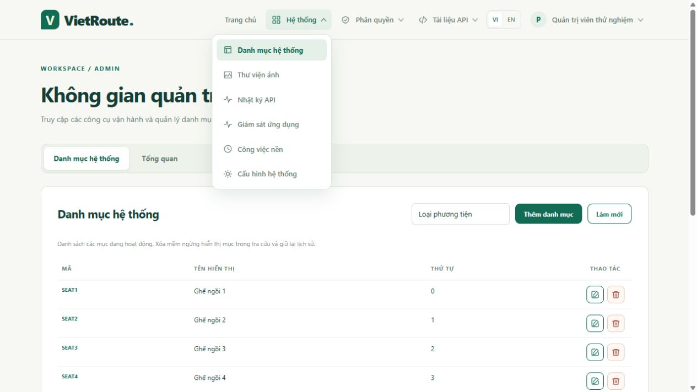
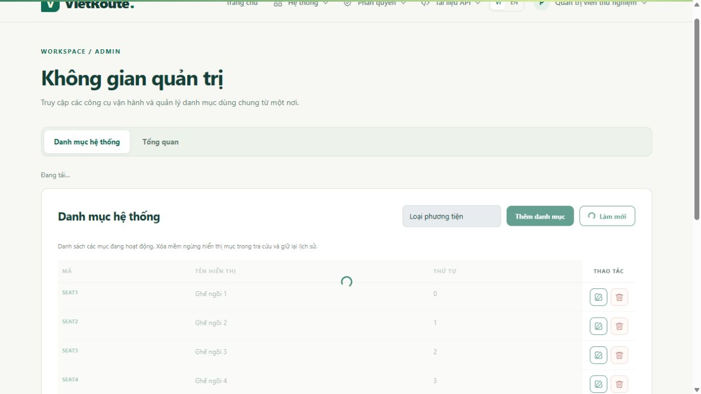

# Quy ước UI: tab, modal, bảng và validation

Đọc sau [luồng request](../02-phat-trien/LUONG_XU_LY_BASE.md) khi làm màn business. Tái sử dụng layout/Bootstrap/Axios trong WAR; không thêm CDN, jQuery hoặc thư viện chỉ để tạo pager/modal. API vẫn phân trang PostgreSQL; quyền backend không thay bằng ẩn menu/nút.

## 1. Chọn tab và modal

| Trang | Nhóm trên trang | Modal |
|---|---|---|
| `/admin` | Danh mục / Tổng quan | Thêm/sửa danh mục |
| `/operations/access` | Quyền role / Vai trò tài khoản (ADMIN) | Chỉnh quyền role thường, gán role user |
| `/operations/configuration` | Ứng dụng / Pool / Bảo vệ request / Worker / Tính năng / Giám sát | Chỉ đọc, không chỉnh env/secret |
| `/account`, `/media` | Một nhóm, không thêm tab thừa | Đổi mật khẩu, upload ảnh; ảnh tắt thì khóa nút mở |
| `/operations/jobs` | Danh sách có lọc trạng thái | Chi tiết/retry theo quyền và version |

Role ADMIN chỉ xem; gán role bản thân bị khóa. Modal có tên/đối tượng rõ ràng; kiểm CSRF, version, scope, quyền và thu hồi token vẫn ở API/service.

`workspace.js` nạp trước `app.js`, cung cấp `VietRouteUI`; dùng `workspace-tabs`, `workspace-dialog`, `dialog-heading`, `dialog-controls`, `dialog-actions`. Form danh mục hai cột desktop, một cột mobile.

- Nhóm tab dùng `data-tabs`, button id duy nhất và `data-tab-target`; `role=tablist` có tên vi/en. Helper quản lý tab/tabpanel, ARIA, roving tabindex và hidden; Left/Right/Home/End chuyển tab. Refresh giữ tab hiện tại, không lưu tab/token vào storage.
- Tab động gọi `initializeTabs(container)`; `tabs(group).show(panelId, visible)` đổi hiển thị theo quyền, không tự gỡ hidden làm lộ nhiều panel.
- Dialog native có `aria-labelledby`; gọi `modal(id, {busy, onClose})`, hủy/đóng dùng `data-dialog-close`. Native giữ focus bên trong; helper trả focus về nút mở. Nếu mở sau await, giữ trigger rồi `open(trigger)` để không mất focus.
- Input/button nằm trong fieldset `dialog-controls`; khóa lúc gửi. `busy()` chặn Escape/đóng, khóa cuộn nền; không đóng do click backdrop hoặc lỗi request.

## 2. Bảng và phân trang

`fragments/pagination.html` nhận prefix riêng; `table.js` cung cấp `VietRouteTable`. Dùng cho catalog/users/jobs/journal/media:

```html
<div th:replace="~{fragments/pagination :: pager('catalog', 10)}"></div>
```

```javascript
const pager = window.VietRouteTable.pager('catalog', {
    busy: () => busy,
    onChange: (query) => perform(() => load(query)),
});
// load đọc page/size, dựng bảng rồi pager.update(result) khi thành công.
// perform khóa controls, catch lỗi và mở lại trong finally.
```

Pager có size, khoảng bản ghi/tổng, đầu/trước/tối đa 5 số trang/sau/cuối và ô đến trang; không tạo option cho mọi trang. Danh sách size 10/20/50/100, media 12/24/48/96; UI đếm từ 1, API từ 0, size không quá 100, page không quá giới hạn backend.

Chỉ update pager sau khi tải thành công; lỗi giữ trang/size đã xác nhận. `readPage(fetcher, query)` chỉ đọc lại một lần nếu trang cuối biến mất, dựa vào totalPages của DB. Đổi size/submit lọc về trang đầu, refresh giữ trang/size. Không nối sort/tên cột client vào SQL.

| Thành phần | Quy tắc |
|---|---|
| Cột thao tác | `table-actions` ở th/td, 96px, căn giữa/sticky bên phải khi cuộn ngang; nhiều nút dùng `row-actions` |
| Nút icon | `actionButton(label, icon, handler, danger)`: SVG nội bộ 16px trong nút 32px; edit/delete/view/assign; title/aria-label dịch và có đối tượng |
| Bảng nhỏ/rộng | Cuộn trong `table-responsive` có tabindex/role/aria-label, không làm tràn toàn trang hoặc ép mã xuống từng ký tự |
| Toolbar | `table-filter`/`toolbar-actions`, nút bên phải; ít trường lọc đặt cùng hàng nút như `catalog-toolbar`, chỉ xuống dòng khi thiếu chỗ |
| Footer modal | `dialog-actions`, Hủy trước/Lưu sau, cùng hàng bên phải; mobile được wrap |
| Menu Hệ thống | Các mục cách nhau 6px; vùng hover/focus/mục đang chọn không chạm nhau |

## 3. Validation và xử lý request

`forms.js` cung cấp `VietRouteForms`. Control có id/name/label và required/min/max/minlength/maxlength/pattern đúng hợp đồng; pattern riêng có `data-pattern-message` vi/en. Helper tắt bubble native, hiện lỗi cạnh field, aria-invalid/describedby, giữ hint và focus lỗi đầu tiên.

Dấu `*` đỏ tự lấy từ required ngay khi tải trang, kể cả dialog chưa mở. Nhóm `data-required-selection` đánh dấu legend, không đánh dấu từng checkbox; role có `data-validation-key="roles"` và cần ít nhất một lựa chọn. Dấu trang trí aria-hidden, control giữ required native; reset giữ đúng một dấu. Mã danh mục tự sinh là tùy chọn, không thêm dấu thủ công vào label/bản dịch.

Gọi `VietRouteForms.validate(form)` và lấy FormData **trước khi disable fieldset**. Input lỗi không gửi request; khi sửa, lỗi được tính lại; reset xóa lỗi. `VietRoute.failure` ánh xạ field tường minh và hiện mã lỗi/traceId; không đưa rejected value/HTML/mật khẩu từ server vào DOM. Validation UI không thay kiểm DTO/nghiệp vụ/backend.

- 401: có link đăng nhập lại, giữ bản nháp; không tự redirect/refresh token/tăng hạn JWT.
- 403/409/timeout: feedback có role alert ở modal; giữ nội dung/selection/version, không tự đóng, replay mutation hoặc lấy version mới rồi ghi đè. Timeout chưa chứng minh rollback; xem dữ liệu trước khi gửi lại.
- Hủy/đóng bỏ bản nháp; mở lại đọc bản hiện hành. Mật khẩu reset khi đóng hoặc thành công, không nạp sẵn/ghi URL/log/storage.
- Server xác nhận thành công mới đóng và tải lại danh sách; caller được đóng trong luồng thành công dù busy chưa hạ, người dùng vẫn bị khóa đóng tới khi request kết thúc.
- Lưu quyền trong modal có đối tượng/version không thêm confirm trình duyệt; xóa mềm/retry job giữ xác nhận hiện hành.

Home “Vào hệ thống” và trang login chọn đích từ principal: khách → login, ADMIN → admin, role khác → account; giữ locale/context WAR. Đây là điều hướng, kiểm quyền trực tiếp ở backend vẫn bắt buộc.

## 4. Bằng chứng và giới hạn

Các đợt UI đã có tại [PR #29](https://github.com/hieuv526034/vietroute-web/pull/29)/[#30](https://github.com/hieuv526034/vietroute-web/pull/30); trạng thái/test theo [nghiệm thu](../05-ke-hoach/NGHIEM_THU_NEN_TANG.md). Java kiểm Home/login với root/servlet tách biệt, khách/ADMIN/CUSTOMER, vi/en và context ROOT/`/vietroute`; Docker CI dùng cookie JWT/PostgreSQL tạm. Node kiểm pager lớn, giới hạn, trang biến mất và lỗi không tự retry.

Browser dùng HTML Thymeleaf thật + API fixture riêng: tab bàn phím, modal/focus, paging/filter, CSRF/version, 409/401 giữ draft, request chậm chặn Escape/đóng, reset mật khẩu khi hủy, dấu bắt buộc trước submit và không nhân đôi sau mở lại. Mobile 390px không tràn ngang toàn trang; bảng quyền cuộn trong dialog. Không thử đổi mật khẩu/gán quyền, gửi Cloudinary hoặc ghi Neon thật để kiểm UI; fixture không thay kiểm SQL/provider, không chứng nhận mọi thiết bị/trình đọc màn hình.

Ảnh dùng dữ liệu kiểm thử, mở khi cần: [menu và toolbar](../images/catalog-toolbar-menu.png), [modal bắt buộc](../images/modal-required.png), [bảng/phân trang](../images/table-pagination.png), [validation](../images/modal-validation.png).


## Điều hướng và trạng thái request — FOUNDATION05

Header tách Hệ thống (danh mục/ảnh/journal/giám sát/job/cấu hình), Phân quyền (role/quyền/user/policy/danh bạ), API (Swagger/OpenAPI) và menu tên/avatar cá nhân. Các mục theo quyền DB/policy, không chỉ theo role mặc định; quản trị phân quyền/journal vẫn cần ADMIN. Khách có đăng nhập/đăng ký; Home thêm quên mật khẩu/xác minh email. Người đã xác thực vào login/account-access được chuyển về workspace/account; header không hiện nút login. Logout dùng POST+CSRF rồi về Home. Menu hỗ trợ một menu mở, Escape/click ngoài/focus; không gộp logout với link public.

Hồ sơ có modal sửa tên/ảnh, đổi mật khẩu và gắn email riêng. Ảnh chọn JPEG/PNG gửi qua media dùng chung, không giữ URL/token ở storage. Lỗi giữ bản nháp/ảnh đã upload; 409 cần làm mới dữ liệu có chủ đích. Mọi ảnh là public, không dùng làm giấy tờ xác minh.

request-state.js gắn interceptor Axios để hiển thị thanh tải trang, spinner nút và overlay bảng, đếm đúng nhiều request đồng thời và dọn trên cả success/error. Trạng thái disabled gốc được giữ; các workspace vẫn khóa controls/tabs/modal trong mutation. Single-flight theo method/path chỉ hợp nhất mutation đang chạy, không cache payload hay tự gửi lại sau lỗi; đây không phải idempotency server. Registry/search/refresh chặn bấm lặp; UI không chứng minh server rollback khi mất mạng. Input/select được thu gọn, cột thao tác giữ 96px/icon và toolbar bên phải, reduced-motion tắt animation. Kiểm bằng response chậm/lỗi có kiểm soát; không gửi dữ liệu UI fixture tới provider/Neon.

Heartbeat dùng uiSilent để không nháy loading/mờ bảng khi đọc; CSRF/quota vẫn áp dụng. Popup trên khung hẹp neo theo header để nằm trong viewport. Bằng chứng fixture có dữ liệu giả, không phải ảnh production:





## Cây quyền, menu và capabilities — ACCESS03

Header dựng từ AccessFeatures sau khi lọc VIEW bằng cùng guard/policy với API capabilities. Nút dữ liệu dùng actions và target cụ thể, không chỉ kiểm tên role. VIEW-only mở được trang nhưng không gọi API READ; API-only có thể có hành động mà không có menu. Các giới hạn journal/online ADMIN vẫn giữ theo hợp đồng dữ liệu nhạy cảm.

Component access-tree.js giữ một Set cho các bản hiển thị của quyền dùng chung; tìm kiếm không làm mất lựa chọn ngoài kết quả. Nhóm ba trạng thái, chọn trong kết quả hiển thị, gợi VIEW đúng nhánh, preview mã thêm/bỏ/số user snapshot, endpoint ANY/ALL và mã inactive để ADMIN loại bỏ. Dùng details/summary, checkbox/label và search native cho bàn phím; modal giữ focus, vùng cây cuộn riêng và footer bên phải. Lỗi 403/409/timeout không đóng/replay và không làm mất draft. Nguồn quyền của user được tải theo yêu cầu, không lưu lịch sử/quyền/token vào storage.

Ảnh kiểm bằng HTML thật và API fixture cô lập: [cây quyền/preview](../images/access03-tree.png). Không dùng dữ liệu/token production để chụp.
