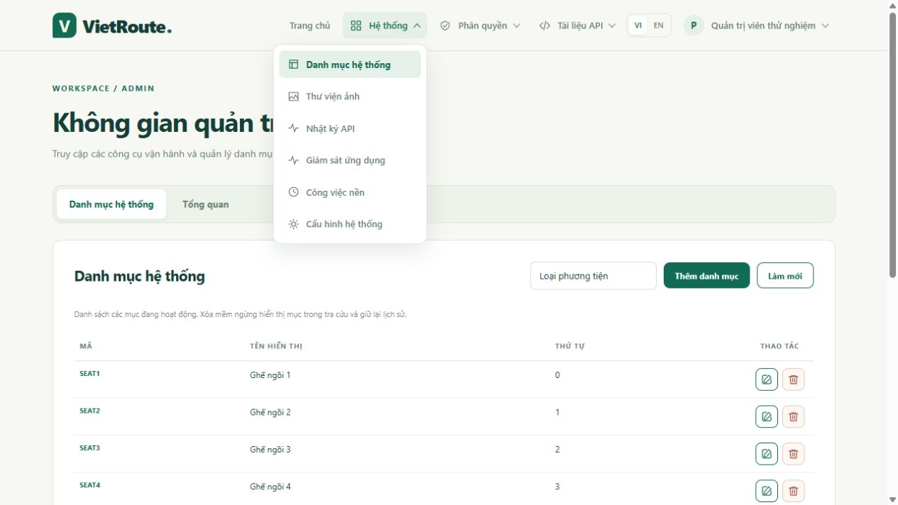
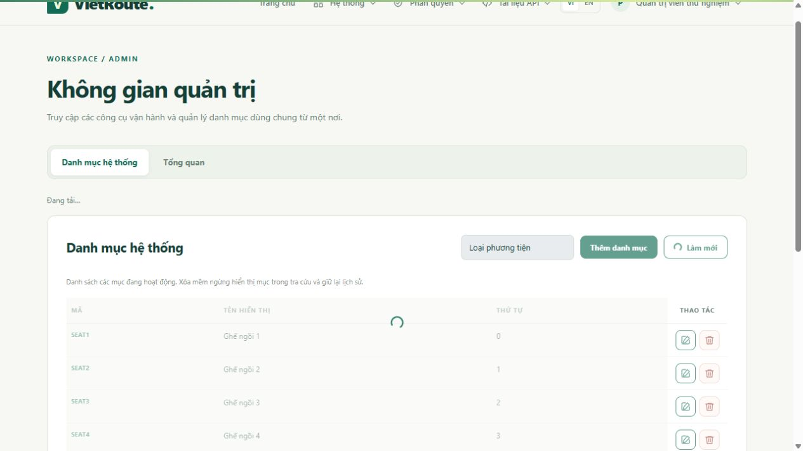

# Quy ước UI: tab, modal, bảng và validation

Đọc sau [luồng request](../02-phat-trien/LUONG_XU_LY_BASE.md) khi làm màn business. Tái sử dụng layout/Bootstrap/Axios trong WAR; không thêm CDN, jQuery hoặc thư viện chỉ để tạo pager/modal. API vẫn phân trang PostgreSQL; quyền backend không thay bằng ẩn menu/nút.

## 1. Chọn tab và modal

| Trang | Nhóm trên trang | Modal |
|---|---|---|
| `/admin` | Tổng quan | Không |
| `/catalogs/vehicle-types`, `/catalogs/booking-sources` | Từng danh mục riêng | Thêm/sửa/ngừng sử dụng |
| `/operations/accounts` | User: danh tính, role và preview quyền | Thêm, sửa tên, gán role, trạng thái; xóa mềm có xác nhận |
| `/operations/access` | Role / Function / Phạm vi nhà xe | CRUD role/chức năng; gán chức năng cho role, chọn Menu/API trong chức năng; public/self-service chỉ đọc |
| `/operations/access/resources` | Inventory menu/API phân trang | Chỉ đọc nguồn; chọn Menu/API trong Chức năng rồi gán chức năng cho Role |
| `/operations/reports` | Bộ lọc ngày/nhà xe và hai tab số liệu | Chọn nhà xe qua modal tìm/phân trang riêng |

Trong Chức năng chọn target Menu/API chính xác, sau đó gán chức năng cho Role; không có ma trận action phải gán thêm. Tìm kiếm/phân trang giữ lựa chọn ngoài kết quả; không wildcard tương lai. Public/self-service không có lựa chọn cấp quyền. Modal gán hiển thị số thêm/bỏ và giữ version/bản nháp khi lỗi; Protected role chỉ xem. Tải mapping và danh sách chức năng phải hoàn tất trước khi cho lưu. Footer Lưu/Hủy nằm ngoài vùng nội dung cuộn để không bị cắt ở viewport thấp.

Protected role chỉ xem; gán role bản thân bị khóa. Modal có tên/đối tượng rõ ràng; kiểm CSRF, version, scope, quyền và thu hồi token vẫn ở API/service.

`workspace.js` nạp trước `app.js`, cung cấp `VietRouteUI`; dùng `workspace-tabs`, `workspace-dialog`, `dialog-heading`, `dialog-controls`, `dialog-actions`. Form danh mục hai cột desktop, một cột mobile.

- Nhóm tab dùng `data-tabs`, button id duy nhất và `data-tab-target`; `role=tablist` có tên vi/en. Helper quản lý tab/tabpanel, ARIA, roving tabindex và hidden; Left/Right/Home/End chuyển tab. Refresh giữ tab hiện tại, không lưu tab/token vào storage.
- Tab động gọi `initializeTabs(container)`; `tabs(group).show(panelId, visible)` đổi hiển thị theo quyền, không tự gỡ hidden làm lộ nhiều panel.
- Dialog native có `aria-labelledby`; gọi `modal(id, {busy, onClose})`, hủy/đóng dùng `data-dialog-close`. Native giữ focus bên trong; helper trả focus về nút mở. Nếu mở sau await, giữ trigger rồi `open(trigger)` để không mất focus.
- Input/button nằm trong fieldset `dialog-controls`; khóa lúc gửi. `busy()` chặn Escape/đóng, khóa cuộn nền; không đóng do click backdrop hoặc lỗi request.

## 2. Bảng và phân trang

hướng dẫn dài đặt trong cửa sổ riêng qua `fragments/help :: guide(id, title, keys)` và `help.js`, mở bằng nút Hướng dẫn sử dụng. Dùng câu hướng dẫn thao tác cho người dùng, không giải thích framework/source trên màn nghiệp vụ. Không tự bật hướng dẫn khi tải trang; modal dùng helper workspace để Escape/Đóng trả focus, nội dung dài cuộn riêng và giữ nút đóng trong viewport. Mỗi guide có ID riêng, tiêu đề/nhãn và nội dung đủ vi/en. Nhật ký giữ tab hướng dẫn hiện có. Lỗi, trạng thái dữ liệu và cảnh báo ngắn ảnh hưởng quyết định (chưa giữ chỗ, tiền thực thu/hoàn, thiết lập tài khoản và thu hồi phiên) vẫn đặt cạnh thao tác.


`fragments/pagination.html` nhận prefix riêng; `table.js` cung cấp `VietRouteTable`. Dùng cho catalog/users/journal và các bảng business:

```html
<div th:replace="~{fragments/pagination :: pager('catalog', 10)}"></div>
```

```javascript
const pager = window.VietRouteTable.pager('catalog', {
    busy: () => busy,
    onChange: (query) => perform(() => load(query)),
});
// load đọc page/size, dựng bảng rồi pager.update(result) khi thành công.
// perform khóa controls, catch lỗi và mở lại trong finally.
```

Pager có size, khoảng bản ghi/tổng, đầu/trước/tối đa 5 số trang/sau/cuối và ô đến trang; không tạo option cho mọi trang. Danh sách size 10/20/50/100, media 12/24/48/96; UI đếm từ 1, API từ 0, size không quá 100, page không quá giới hạn backend.

Chỉ update pager sau khi tải thành công; lỗi giữ trang/size đã xác nhận. `readPage(fetcher, query)` chỉ đọc lại một lần nếu trang cuối biến mất, dựa vào totalPages của DB. Đổi size/submit lọc về trang đầu, refresh giữ trang/size. Không nối sort/tên cột client vào SQL.

| Thành phần | Quy tắc |
|---|---|
| Cột thao tác | `table-actions` ở th/td, tối thiểu 64px, tự giãn theo nội dung; căn giữa/sticky bên phải khi cuộn ngang; `row-actions` không wrap |
| Nút icon | `actionButton(label, icon, handler, danger)`: SVG nội bộ 14px trong nút 28px; edit/delete/view/assign; title/aria-label dịch và có đối tượng |
| Bảng nhỏ/rộng | Cuộn trong `table-responsive` có tabindex/role/aria-label, không làm tràn toàn trang hoặc ép mã xuống từng ký tự |
| Toolbar | `table-filter`/`toolbar-actions`, nút bên phải; ít trường lọc đặt cùng hàng nút như `catalog-toolbar`, chỉ xuống dòng khi thiếu chỗ |
| Footer modal | `dialog-actions`, Hủy trước/Lưu sau, cùng hàng bên phải; mobile được wrap |
| Menu Hệ thống | Các mục cách nhau 6px; vùng hover/focus/mục đang chọn không chạm nhau |

UI28 (31/10/2026) thay dải cuộn của UI27: mọi kích thước dùng nút Menu mở bảng chức năng dưới header. `details/summary` native đóng ngay trong HTML, dùng được khi không có JS; không đo chiều rộng để đổi layout hoặc hiện toàn bộ menu lúc chuyển trang. Bảng chia nhóm Khám phá/chức năng theo registry/Tài liệu, tự xếp cột theo chỗ, cao giới hạn trong viewport và chỉ cuộn dọc khi quá nhiều mục. Logo và tài khoản ở thanh đầu. `navigation.js` đóng menu khác/click ngoài/Tab ra ngoài/Escape, Escape trả focus nút mở, pageshow dọn trạng thái; giữ menu khi resize và cập nhật vị trí popup tài khoản. Summary giữ ngữ nghĩa disclosure native, links dùng Tab thông thường; không gán role menu/menuitem khi chưa có cơ chế phím tương ứng. Quyền/locale/icon/active link tiếp tục từ server. Không cache menu/quyền hoặc đổi document navigation thành SPA.

MENUUI01 (02/11/2026): bảng menu có tiêu đề Điều hướng nhanh và mô tả vi/en, mỗi nhóm là thẻ trắng trên nền xanh nhạt, icon nhóm trong ô riêng và khoảng cách nhất quán. Nhóm hiện hành có viền nhấn; link aria-current có nền xanh/vạch trái/chữ đậm và mũi tên, hover/focus rõ. Grid tự xếp theo chỗ (tối thiểu230px/thẻ nhưng không vượt chiều rộng khả dụng), thu về một cột trên điện thoại; panel cuộn dọc trong viewport. Không thêm JS, thư viện hoặc thay cách lọc quyền. Bỏ link đăng ký /account-access còn sót trong footer menu vì luồng đó đã bị gỡ; khách vẫn có nút Đăng nhập. Bằng chứng kiểm preview/giới hạn ở [tiến độ](../05-ke-hoach/TIEN_DO_VA_KE_HOACH_NHOM.md).

PAGERUI01: phân biệt pager bảng kết quả (số trang/size/nhảy trang dùng fragment chung) và phân trang danh sách trong bộ chọn. Bộ chọn điểm đón/trả, nhà xe/loại xe, tuyến/xe/tài xế và chuyến đặt chỗ dùng cụm nhỏ với mũi tên có title/aria-label, nhãn tổng kết quả và trang vi/en; hai mũi tên ẩn khi chỉ có một trang hoặc chưa có dữ liệu. Kết quả rỗng dùng nhãn trống, không hiện0/0. Giữ paging server/size/khóa busy và lựa chọn ngoài trang; không đổi thành tải toàn bộ option. Enter trong ô tìm vẫn thực hiện lọc, chuyển trang không gửi form nghiệp vụ. Trang chủ không giữ link self-registration/recovery cũ.

## 3. Validation và xử lý request

`forms.js` cung cấp `VietRouteForms`. Control có id/name/label và required/min/max/minlength/maxlength/pattern đúng hợp đồng; pattern riêng có `data-pattern-message` vi/en. Helper tắt bubble native, hiện lỗi cạnh field, aria-invalid/describedby, giữ hint và focus lỗi đầu tiên.

Dấu `*` đỏ tự lấy từ required ngay khi tải trang, kể cả dialog chưa mở. Nhóm `data-required-selection` đánh dấu legend, không đánh dấu từng checkbox; role có `data-validation-key="roles"` và cần ít nhất một lựa chọn. Dấu trang trí aria-hidden, control giữ required native; reset giữ đúng một dấu. Mã danh mục tự sinh là tùy chọn, không thêm dấu thủ công vào label/bản dịch.

Gọi `VietRouteForms.validate(form)` và lấy FormData **trước khi disable fieldset**. Input lỗi không gửi request; khi sửa, lỗi được tính lại; reset xóa lỗi. `VietRoute.failure` ánh xạ field tường minh và hiện mã lỗi/traceId; không đưa rejected value/HTML/mật khẩu từ server vào DOM. Validation UI không thay kiểm DTO/nghiệp vụ/backend.

- 401: có link đăng nhập lại, giữ bản nháp; không tự redirect/refresh token/tăng hạn JWT.
- 403/409/timeout: feedback có role alert ở modal; giữ nội dung/selection/version, không tự đóng, replay mutation hoặc lấy version mới rồi ghi đè. Timeout chưa chứng minh rollback; xem dữ liệu trước khi gửi lại.
- Hủy/đóng bỏ bản nháp; mở lại đọc bản hiện hành. Mật khẩu reset khi đóng hoặc thành công, không nạp sẵn/ghi URL/log/storage.
- Server xác nhận thành công mới đóng và tải lại danh sách; caller được đóng trong luồng thành công dù busy chưa hạ, người dùng vẫn bị khóa đóng tới khi request kết thúc.
- Lưu quyền trong modal có đối tượng/version không thêm confirm trình duyệt; xóa mềm/retry job giữ xác nhận hiện hành.

Home “Vào hệ thống” và trang login chọn đích từ principal: chưa đăng nhập → login; đã đăng nhập → `/dashboard`, giữ locale/context WAR. Phiên cần đổi mật khẩu hoặc xác minh email vẫn về `/account` để thiết lập trước nghiệp vụ. Đây là điều hướng, kiểm quyền trực tiếp ở backend vẫn bắt buộc.

Sau POST đổi mật khẩu thành công, client xóa input và chuyển document `/login` để xác thực lại vì mọi token đã thu hồi. Không tải `/account` với giả định có cookie mới. Lỗi vẫn giữ modal/bản nháp, không tự gửi lại. Query thông báo trên URL không cấp quyền hoặc bỏ AUTH011.


## Điều hướng và trạng thái request

Header hiện hành theo UI28 bên trên: menu/nhãn/icon lấy từ FunctionResource và target được server lọc; popup tài khoản chứa hồ sơ/đổi password/logout. Không có link đăng ký/quên mật khẩu/xác minh email hoặc trang account-access trong auth hiện hành. Đăng nhập xong chọn đích theo trạng thái phiên; logout dùng POST+CSRF. Menu chính và popup không khóa focus/scroll như modal, hỗ trợ một menu mở, Escape/click ngoài/focus.

Trang `/account` chỉ sửa tên hiển thị và đổi mật khẩu qua modal; không avatar/upload hoặc recovery/email self-service. Thông tin `dl`/controls co về một cột trên mobile. Lỗi giữ bản nháp, 409 cần làm mới có chủ đích; không giữ password/token trong storage.

request-state.js gắn interceptor Axios để hiển thị thanh tải trang, spinner nút và overlay bảng, đếm đúng nhiều request đồng thời và dọn trên cả success/error. Trạng thái disabled gốc được giữ; các workspace vẫn khóa controls/tabs/modal trong mutation. Single-flight theo method/path chỉ hợp nhất mutation đang chạy, không cache payload hay tự gửi lại sau lỗi; đây không phải idempotency server. Registry/search/refresh chặn bấm lặp; UI không chứng minh server rollback khi mất mạng. Input/select được thu gọn, cột thao tác tự giãn theo nhóm icon một hàng và toolbar bên phải, reduced-motion tắt animation. Kiểm bằng response chậm/lỗi có kiểm soát; không gửi dữ liệu UI fixture tới provider/Neon.

Heartbeat dùng uiSilent để không nháy loading/mờ bảng khi đọc; CSRF/quota vẫn áp dụng. Popup trên khung hẹp neo theo header để nằm trong viewport. Bằng chứng fixture có dữ liệu giả, không phải ảnh production:





## Auth hiện hành

User → Role → Function → Menu/API là luồng cấu hình duy nhất. `/operations/access` có ba tab Role, Function, Phạm vi nhà xe; không có ma trận action/policy, danh bạ permission, tab history hoặc recovery riêng. Các màn/nút kiểm capabilities theo đúng method + template, không suy từ chuỗi ADMIN hoặc tên role. Protected role do DB đánh dấu chỉ xem. Hướng dẫn vận hành tại [quản trị hệ thống](../04-van-hanh/QUAN_TRI_HE_THONG.md); cấu trúc và ranh giới guard tại [schema auth](../02-phat-trien/SCHEMA_VA_PHAN_QUYEN.md).

Role có CRUD và modal gán function. Function có CRUD và chọn từng MENU/ENDPOINT từ GET `/api/v1/admin/access/targets`; public/self-service chỉ đọc, không là grant cấu hình. Giữ một tập lựa chọn khi tìm để không mất mục ngoài kết quả; lưu kèm version. Phải tải đủ inventory/mapping trước khi cho lưu, lỗi giữ dialog/bản nháp. Trang `/operations/access/resources` dùng `/resources` xem inventory có lọc kind/query và phân trang trên danh sách MVC của node; đây không phải bảng DB hoặc API `/resource-catalog` cũ. Nút thao tác/loading/focus dùng component chung.

`/operations/accounts` tách danh tính khỏi cấu hình role/function. Bộ lọc username/role/active và phân trang ở DB; các nút xem/gán/sửa tên/state/xóa theo capabilities. Tạo yêu cầu username, tên hiển thị, password và ít nhất một role; email tùy chọn theo hợp đồng API. Account quản trị cấp được xác minh, bắt đổi password; không có bước gửi mã email. Role picker hiển thị tên vi/en cùng mã, giữ lựa chọn khi lọc và loại protected role khỏi lựa chọn gán. Preview gọi API của đúng user đích, không lấy snapshot quyền của người đang xem. Không nạp lại credential từ API/storage; đóng hoặc thành công xóa password khỏi form.

### Phạm vi nhà xe

Danh sách scope lọc/phân trang server; chọn thành viên mở modal đúng scope, gán/sửa ở dialog riêng. Chọn user đã có global role rồi gán tập con tại scope; tìm prefix username tối đa 20 kết quả, thu hẹp từ khóa khi cần. Lưu version thành viên hiện hành và active; khi lỗi giữ bản nháp/version, không tự replay. Scope security và trạng thái kinh doanh nhà xe là hai thuộc tính riêng. Nút business cần cả capabilities target chung và cờ canUpdate/canAssign của đúng dòng/scope; không dùng quyền tại nhà xe A để mở nút tại B.

### Đăng nhập, hồ sơ và phiên

Login giữ trạng thái đang xác thực/đang chuyển trang; hành vi giữ/xóa credential khi chuyển document theo quy tắc trạng thái request bên dưới. Khi phải đổi password hoặc account sẵn có chưa xác minh, đích là `/account`; không có nút gửi mã/xác minh/recovery. Đổi password thành công thu hồi token, xóa cookie và chuyển `/login`, không cấp cookie phiên mới. Giữ locale/context và không lưu password/token trong tab/storage. Tài khoản sẵn có chưa xác minh cần quy trình vận hành trước chuyển đổi vì self-service email đã bỏ.


## Quản lý địa điểm

Trang `/operations/locations` có hai tab Địa điểm/Tỉnh thành, dùng workspace.js cho bàn phím/ARIA và modal thêm/sửa. Danh sách tìm/trạng thái/phân trang server qua table.js; cột thao tác tự giãn theo nhóm icon một hàng, mỗi icon có aria-label. Modal dùng grid chung, tự về một cột trên mobile, mã/tỉnh của địa điểm đã có bị khóa. Tìm tỉnh tạo địa điểm dùng public lookup tối đa 20 kết quả, có thể tìm tiếp mà giữ lựa chọn ngoài trang; tỉnh tắt không được dùng tạo địa điểm mới. Bật/ngừng sử dụng ngay trong form có version; không có nút xóa dữ liệu/tham chiếu.

Nút và API đọc dựa trên đúng capabilities/target, không suy từ ADMIN hoặc tên hành động. Lỗi giữ modal/draft/version, không tự replay; busy khóa form/tab và chặn đóng modal. Thiếu quyền/401 xóa bảng riêng tư, 401 vẫn có link đăng nhập lại và giữ bản nháp. Ghi chú tỉnh/địa điểm tách riêng; trạng thái tỉnh tắt được hiển thị cùng địa điểm quản trị.


## Menu danh mục và nghiệp vụ

Menu Danh mục có Loại xe/Nguồn đặt chỗ/Tỉnh thành/Địa điểm với URL và capabilities riêng. Các màn một nhóm không thêm tab thừa; URL địa điểm cũ giữ hai tab tương thích. Header thu gọn tại 1399px (CSS/navigation.js cùng breakpoint) để chứa đủ các nhóm mới; panel mobile giữ trái/phải 12px, submenu nằm trong panel cuộn. Nút nghiệp vụ dùng `.button`, outline và danger chung, không dùng btn-primary xanh Bootstrap lẫn với xanh VietRoute.

Các màn `/operations/carriers`, `/operations/vehicles`, `/operations/drivers` dùng modal, form hai cột desktop/một cột mobile, server paging và icon có aria-label và cột thao tác tự giãn theo nhóm nút một hàng. Bảng phương tiện có min-width 900px và cuộn ngang trong vùng có tên; không bó chữ từng ký tự. Picker nhà xe và loại xe tìm tại server tối đa 20 kết quả, giữ lựa chọn ngoài kết quả. Lỗi/409 giữ draft + version; busy chặn đóng/mutation lặp, focus đặt lại sau khi mở fieldset. `/operations/demo` chỉ seed theo nút tường minh khi actor có endpoint và phạm vi global tương ứng, hiện số tạo mới/giữ nguyên và số lượng từng loại.


## Tuyến và thứ tự điểm


## Điều hành chuyến

Trang `/operations/trips` có bộ lọc từ khóa/trạng thái/ngày Việt Nam, bảng cuộn riêng và modal Thông tin chuyến/Điểm dừng/Lịch sử. Tạo nháp chọn nhà xe/tuyến/xe/tài xế bằng picker có từ khóa và trang server; phụ thuộc bị xóa khi đổi nhà xe, lựa chọn ngoài trang vẫn được giữ. Chỉnh sửa giữ code/carrier/route, giờ chỉ sửa khi DRAFT; các thao tác đổi phân công/mở/hủy dùng endpoint và version riêng. Hủy cần lý do, lỗi giữ modal/draft; busy khóa tab/form và chặn đóng. Quyền UI lấy capabilities/endpoint cộng canUpdate scoped; VIEW không thay READ.

Form chung gắn dấu bắt buộc vào span tiêu đề của label bọc control, tránh dấu nằm riêng một hàng; label không có span giữ cách cũ. Timestamp lưu UTC, UI hiển thị/nhập giờ Việt Nam kể cả trình duyệt dùng múi giờ khác. Preview app thật/PostgreSQL cô lập đã kiểm tạo/lưu/mở bán, lỗi capacity TRIP001 giữ giá trị 30 và sửa lại lưu được, tab snapshot/lịch sử vi/en. 390px: page width 390, modal width 352/scrollWidth 335, không tràn trang. Ảnh [snapshot điểm](../images/trip01-stops.png), [chi tiết mobile tiếng Anh](../images/trip01-mobile.png); trạng thái triển khai ở tiến độ, không suy từ ảnh localhost là đã có trên Render.

## Chuyến được giao

Màn `/driver/trips` dùng cùng table/pager và modal Thông tin/Điểm/Lịch sử. SQL backend giới hạn đúng tài xế đang được giao; UI chỉ gợi ý một bước tiến độ kế tiếp, luôn gửi version và không gửi thời gian actual. Sau lưu thành công giữ modal để xem bước tiếp, lỗi giữ ghi chú/draft; không tự retry mutation. Chuyến hoàn thành/hủy không còn nút tiến độ. Hiển thị tách dự kiến/đã xác nhận và ghi rõ đây không phải GPS.

Preview thật với account DRIVER trong DB local riêng đã đi đủ START → ARRIVE 2 → DEPART 2 → ARRIVE 3 → COMPLETE; lịch sử đủ và actual timestamp từ server. Tiếng Việt/Anh, 390px không tràn trang (page 390/modal 352), tab/feedback dùng workspace chung. Ảnh [tiến độ](../images/driver-trip-progress.png), [lịch sử mobile](../images/driver-trip-mobile.png). Dữ liệu và tài khoản trong ảnh chỉ là fixture preview, không là chuyến vận tải thật.

## Tìm chuyến và đặt chỗ

`/journeys` công khai: picker điểm/tỉnh tìm và phân trang server, ngày tại pickup Việt Nam, số chỗ; kết quả chỉ rõ cặp điểm, giờ qua đêm, giá một chỗ và chỗ còn. Modal thông tin/điểm hiển thị lịch dự kiến, actual do tài xế xác nhận, thông báo và link Maps từng điểm. Nút đặt lấy MY_BOOKING capabilities, chuyển lựa chọn sang `/my-bookings`; anonymous có đăng nhập, không gán staff membership cho khách. Quote và giá/tồn chỗ luôn tính ở server, JavaScript không tự dựng thuật toán tồn chỗ.

`/my-bookings` chỉ owner và `/operations/bookings` scoped staff dùng chung bảng/pager và modal. Tạo WEB từ hành trình, tạo PHONE qua picker có BOOKING_CREATE độc lập TRIP_READ; UI giải thích PENDING chưa giữ chỗ và chỉ một WEB active. UUID giữ trong bộ nhớ form cho lần gửi lặp, không lưu contact/token vào storage. Lỗi server/409 giữ draft/modal/key; không tự gửi lại. Chi tiết có tab thông tin/lịch sử; staff thêm thu/hoàn trực tiếp, chỉ ghi nhận thực tế, hủy không tự coi đã hoàn. Tiền thu/hoàn và trạng thái tách riêng. Nút state theo capabilities/canUpdate/version; hủy/từ chối thiếu lý do đặt focus đúng trường.

Tab danh sách đón/trả trong `/driver/trips` dùng API assigned và phân trang server, chỉ CONFIRMED/COMPLETED với chặng/tên/điện thoại/số chỗ. Cập nhật tiến độ tải lại danh sách để phản ánh tự đóng/hoàn thành đơn. Bảng cuộn trong vùng riêng, cột icon tự giãn, form/modal giữ chuẩn workspace, vi/en và 390px (page 390/modal 352/scrollWidth 335). Bằng chứng app local với fixture giả: [lỗi WEB thứ hai giữ bản nháp](../images/booking01-draft.png), [lịch sử đơn tiếng Anh mobile](../images/booking01-mobile.png), [danh sách khách được giao](../images/booking01-passengers.png), [tìm chuyến còn 18 chỗ sau xác nhận PHONE 2 chỗ](../images/search01-results.png). Trạng thái triển khai/dữ liệu thật ghi ở tiến độ, không suy từ ảnh local.

## Tra cứu nhà xe và lọc chuyến

`/carriers` xuất hiện độc lập trên header cho khách; bảng server paging/từ khóa có cột thao tác icon 96px và vùng cuộn riêng. Modal đọc tên/giới thiệu/điện thoại được công bố, logo READY nếu có, nút gọi tel và tìm chuyến của nhà xe; giữ một nút chính, Close phụ, không thêm tab thừa cho một nhóm thông tin. Liên kết chức năng gốc không có con dùng đúng tên chức năng trong menu, tránh gọi Đơn của tôi thành Tổng quan. [Menu khách 390px](../images/detail01-menu-mobile.png) có panel 351px từ trái 12 đến phải 363 trong vùng trang 375px, các link kéo đủ chiều ngang; không co về phải.

Trang tìm chuyến gom nhà xe/loại xe/giá vào nhóm Lọc thêm, mặc định thu gọn và tự mở khi đến từ nhà xe. Hai picker có tìm/trang và giữ lựa chọn ngoài trang, tải song song với địa điểm. Khoảng giá dùng server validation VAL015, lỗi đặt tại giá tối đa và giữ lựa chọn; sửa một trong hai cận bỏ lỗi quan hệ cũ để gửi lại chủ động. Bảng kết quả/quote luôn lấy dữ liệu server. Hai ngôn ngữ và mobile 390px giữ vùng cuộn bảng riêng, không tràn trang. Bằng chứng fixture local: [lọc nhà xe/loại xe/giá và kết quả](../images/search02-filters.png), [chi tiết nhà xe mobile](../images/detail01-mobile.png). Bằng chứng dữ liệu Neon nằm ở tiến độ.

## Báo cáo vận hành

`/operations/reports` có bộ lọc ngày khởi hành Việt Nam/nhà xe và picker có tìm kiếm/phân trang REPORT_READ riêng. Hai tab Chuyến và đặt chỗ / Giá trị và thu-hoàn tái sử dụng workspace.js, ARIA và bàn phím. Số liệu trạng thái là tập 5 mã hữu hạn; không lấy trang đơn rồi cộng trên JavaScript. API trả aggregate có scope và snapshot. Nhãn phân biệt lượt chỗ/ghế vật lý, giá trị đặt/tiền đã thu, tiền đơn hủy còn phải hoàn và nhóm chuyến/ngày thu.

Lỗi giữ bộ lọc, 401 có link đăng nhập lại; báo cáo cũ bị ẩn lúc gửi điều kiện mới, không ghép số cũ với khoảng ngày mới. Có GET menu nhưng thiếu GET API dữ liệu chỉ hiện giải thích thiếu quyền. Nút dùng component màu chung, filter/money card co theo màn hình; không tự gọi mutation khi đọc.

Bằng chứng preview PostgreSQL cô lập: [thu/hoàn desktop](../images/report01-money.png), [báo cáo tiếng Anh 390px](../images/report01-mobile.png). Kiểm VAL016 giữ filter, sửa cận gửi lại và ArrowLeft chuyển tab đạt. Fixture tiền 100 nghìn thu/hoàn trong ảnh chỉ ở local, không là giao dịch Neon.

## Cấp tài khoản tài xế

Bảng Hồ sơ tài xế thêm icon cấp tài khoản chỉ cho hồ sơ chưa liên kết khi capability POST account và canAssign scoped đều đúng. Modal riêng nêu rõ nhà xe/hồ sơ, username/email/mật khẩu tạm và việc hồ sơ tạm ngừng đến khi đổi mật khẩu và được người có quyền bật lại. Form/feedback/modal/focus/busy dùng component chung, không lưu password vào tab/storage. Lỗi giữ draft/version, không tự retry; đóng hoặc thành công xóa credential khỏi form. Backend tạo account ở trạng thái đã xác minh theo hợp đồng AUTHDB04; UI không tự bật hồ sơ hoặc coi tài xế đã sẵn sàng phân công chỉ vì tạo account thành công.


## Breadcrumb và khoảng cách khối

Các trang dùng fragment breadcrumb chung, dữ liệu từ cây menu đã lọc endpoint tại server. Trang chủ, nhóm và trang hiện tại là link giữ context WAR/locale; nhóm không có trang riêng trỏ tới trang con đầu tiên được phép mở. Không suy URL từ query, không hiện đường tới trang bị ẩn quyền. Nhãn hiện tại có aria-current=page; danh sách wrap trên điện thoại. URL địa lý cũ dẫn về mục danh mục tương ứng.

Các panel cùng cấp cách nhau 24px, grid dùng gap thay vì ép card sát nhau. Không thêm margin vào panel đang hidden hoặc làm hiện nhiều tab; kiểm desktop và 390px bằng dữ liệu thật/fixture riêng. Không thay guard hoặc mutation khi sửa layout.

Dashboard `/dashboard` dùng các API nghiệp vụ hiện hành, không có API tổng hợp/quyền/schema mới. Tài khoản CUSTOMER thấy tổng đơn riêng, chờ/xác nhận và 5 đơn gần đây; DRIVER thấy chuyến đang chạy, khởi hành hôm nay và mở bán được giao. ADMIN/nhân sự có grant GET báo cáo thấy báo cáo từ đầu tháng hiện tại tới hết tháng kế tiếp theo lịch Việt Nam; Có grant GET quản trị booking thì thấy số đơn chờ xử lý toàn phạm vi. Khoảng ngày chỉ áp dụng số liệu báo cáo; tiền thực thu tách khỏi giá chốt. Mỗi khối cần đúng endpoint GET trong capabilities, link cần GET menu riêng; điều kiện role CUSTOMER/DRIVER bổ sung theo rào owner/phân công hiện hành, ADMIN không tự thành khách/tài xế.


## Báo cáo và trạng thái chuyển trang

Báo cáo có ba trường bằng nhau trên desktop, một cột trên mobile; nút Chọn nhà xe/Xem báo cáo luôn ở hàng riêng dưới bộ lọc. Chỉ Xem báo cáo áp dụng khoảng ngày và nhà xe; tìm kiếm nằm trong modal Chọn nhà xe, chỉ tải danh sách, không gọi lại API tổng hợp. Phân trang dùng fragment chung dưới bảng nhà xe, giữ bộ lọc đã submit và lựa chọn dù sang trang/tìm lại; chọn Tất cả xóa riêng carrierId. Chỉ mở modal mới tải picker để giảm một request nạp sớm. Đổi ngày/nhà xe ẩn snapshot cũ; lỗi không tự gửi lại request. Modal có vùng bảng cuộn riêng và giữ pager/footer trong viewport; fieldset disabled được giữ với wrapper flex bên trong để không cắt phần nút do layout đặc biệt của fieldset.

Login giữ tài khoản/mật khẩu trong DOM hiện tại sau khi API thành công và trong lúc chờ document đích, khóa submit lặp và báo đang mở trang. Không reset form ngay khi API trả về; pagehide mới xóa dữ liệu khi document thực sự rời màn hình, pageshow từ bfcache tiếp tục xóa và giải phóng trạng thái. Không lưu credential vào storage, URL, tab hoặc log. Kiểm bằng API/document giả chậm và unit client; không dùng dữ liệu thật để chụp ảnh. Link chuyển document có thanh tiến trình ngay khi click và dọn khi pageshow; không bắt modified click, link tải file hoặc mở tab khác.

## Metadata Tài khoản và Role theo nhu cầu

Workspace Tài khoản chờ me/capabilities (song song) rồi tải bảng; role metadata chỉ tải khi dùng filter/modal gán. Preview chi tiết đọc quyền của đúng user qua `/{id}/access`, không tải cây action cũ. Workspace Role/Function chờ capabilities rồi bảng riêng; modal Role đọc danh sách function cùng mapping, modal Function đọc `/targets` và chi tiết hiện hành. không cache credential/authority hoặc thay guard backend.

Modal mở ngay, xóa nội dung của đối tượng cũ, khóa controls và Lưu tới khi đủ snapshot. `VietRouteRequests.allReads` đợi toàn bộ nhóm đọc kết thúc rồi mới báo lỗi/mở khóa: `Promise.all` reject sớm để request còn lại ghi đè trạng thái disabled của nút mở modal. Lỗi giữ modal và bảng, bỏ dòng đang tải, không gửi mutation hoặc tự retry; đóng/mở lại là lần tải mới. Helper modal `focus()` đưa focus về tiêu đề nếu khóa fieldset làm focus rơi ra body, giữ nguyên focus đang nằm trong dialog; đóng trả focus đúng nút mở.  dùng dữ liệu giả; kết quả kiểm browser/CI ở [tiến độ PERF03](../05-ke-hoach/TIEN_DO_VA_KE_HOACH_NHOM.md).
