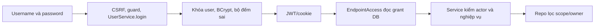
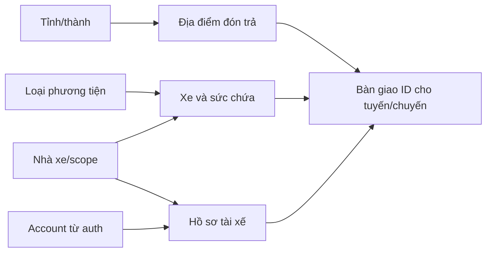
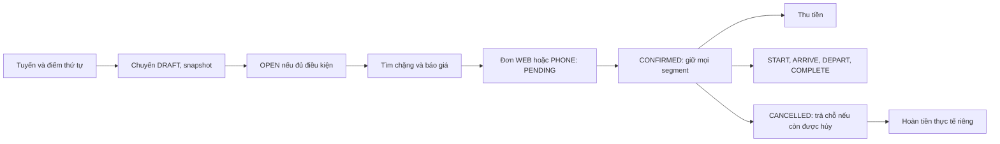
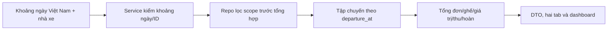

# Phân công và đường học của từng thành viên

Mỗi người đọc [tổng quan](../01-bat-dau/TONG_QUAN_HE_THONG.md), chạy app theo [local](../01-bat-dau/CHAY_LOCAL.md), rồi vào phần tên mình dưới đây. Tập trả lời [bộ hỏi–đáp](DEMO_VA_HOI_DAP.md) bằng một tình huống và một chỗ source có thể chỉ ra. Phân công là trách nhiệm bảo trì/nghiệm thu, không tự biến thành đóng góp đã viết; bằng chứng ở [tiến độ](TIEN_DO_VA_KE_HOACH_NHOM.md)/commit/PR.

## Thông tin thành viên

| Username GitHub | Email tác giả commit | Khối phụ trách trọn luồng |
|---|---|---|
| hieuv526034 | hieuv526034@gmail.com | Auth, common, DB, bootstrap, CI/deploy và review nền |
| anhhoang104 | hanh104204@gmail.com | catalog + carrier, cả backend/UI/test |
| BangPhamIT | bangpham.it@gmail.com | trip + booking, cả backend/UI/test |
| hiencoi250404-design | hiencoi250404@gmail.com | report + dashboard, cả query/API/UI/test |

Không suy email từ tên nhánh hoặc đổi author lịch sử. Username Git không phải username app. Nhánh mới <username>/<mã-việc>, từ dev; PR/check/review → dev, chỉ phát hành main khi có lệnh mới. Common/JS fragment/shared config phối hợp Hieu, không tự nhân bản lớp nền trong module.

## hieuv526034

**Mục tiêu:** giải thích một người được đăng nhập, được mở endpoint và được thấy dữ liệu nào; bảo đảm ứng dụng khởi động/transaction/log/deploy đúng. Account demo: admin để quản trị, custom01/operator01 để kiểm bị chặn. Không dùng role ADMIN thay câu trả lời về grant.

| Cần học | Mở source và giải thích |
|---|---|
| Auth 8 bảng/40 lớp | [auth](../../src/main/java/vn/vietroute/auth): User/Role/Function service và 8 repo; bảng ở schema |
| Xác thực | SecurityConfig, UserService.login/logout/password, JwtService, JwtAuthenticationFilter/AuthCookies |
| Quyền | EndpointAccess, UserRoleRepo.visibleSql/bindVisible/require, RoleService và FunctionService; mapping DB không enum/action registry |
| Transaction | [config/database](../../src/main/java/vn/vietroute/common/config/database), JdbcTransactions/SchemaDataSource, BaseRepository |
| Khởi tạo | [initializer](../../src/main/java/vn/vietroute/common/initializer), AuthInitializer, BusinessDataInitializer; manifest8 bước |
| Log và vận hành | [api_journal](../../src/main/java/vn/vietroute/common/api_journal), [Dockerfile](../../Dockerfile), [render.yaml](../../render.yaml), workflow |

Demo: tạo một account/phân role/function/membership trong DB test → vào đúng page và API → thu hồi một grant → nhập URL trực tiếp bị chặn ở lần kiểm tiếp theo. Mở journal bằng tài khoản được cấp, xem trace/snapshot che dữ liệu và export placeholder; không show password/JWT. Trình bày startup seed một lần, .env local không Git, DB hiện hành và bằng chứng Render đúng commit.

Tự kiểm:401/403/CSRF,5 lần sai/khóa 15 phút, tokenVersion sau logout, role có menu thiếu API, ngoài scope, all_scopes không ghép role khác, version409, history lỗi rollback; guard cả root/servlet context. Không cố tình khóa tài khoản thật hoặc thay grant production chỉ để demo.

Bàn giao cho Anh/Bang/Hien: principal + endpoint đã duyệt, contract ApiResponse/DTO/locale/traceId và hàm scope trên connection caller. Học sâu hỏi–đáp Q07–Q18, Q35–Q45.

## anhhoang104

**Mục tiêu:** chuẩn bị đúng dữ liệu nguồn để Bang lập chuyến được; chịu page/API/Request/DTO/service/repo/entity/UI của catalog/carrier. Account demo: admin cho danh mục toàn cục; operator01 Miền Nam và operator02 Bắc Nam để đối chiếu nhà xe.

Sáu bảng: catalog_items, location_provinces, location_places, carriers, carrier_vehicles, carrier_drivers. Mỗi nhà xe chứa scope metadata; hồ sơ tài xế nối account, không tự giữ password/role trong form driver.

| Đi từ UI xuống DB | Source cần mở |
|---|---|
| Danh mục/tỉnh/địa điểm | [catalog](../../src/main/java/vn/vietroute/business/catalog): CatalogItemAPI/LocationAPI → service → repo/entity; Search/public DTO tách audit/PII |
| Nhà xe/xe/tài xế | [carrier](../../src/main/java/vn/vietroute/business/carrier): CarrierAPI/VehicleAPI/DriverAPI và service/repo tương ứng |
| Khách tra nhà xe | CarrierPublicAPI/PublicCarrierService, projection công khai |
| UI | [fleet.js](../../src/main/webapp/assets/js/fleet.js), [catalog.js](../../src/main/webapp/assets/js/catalog.js), [location.js](../../src/main/webapp/assets/js/location.js), views catalog/fleet |

API tiêu biểu: /api/v1/admin/catalogs, /api/v1/admin/provinces, /api/v1/admin/locations, /api/v1/admin/carriers, /api/v1/admin/vehicles, /api/v1/admin/drivers; tra cứu công khai GET /api/v1/provinces, /locations, /catalogs/{type}, /carriers. Method/template thực đọc controller/Swagger, page grant và mutation grant riêng.

Demo: chuẩn bị tỉnh/địa điểm → loại xe → nhà xe → xe có sức chứa → hồ sơ tài xế gắn account. Sửa tên với version mới, thử trùng mã/biển số hoặc parent inactive; operator01 không được đọc/sửa ID Bắc Nam. Bàn giao **ID**, trạng thái active, scope, capacity và account liên kết cho Bang; không bàn giao tên tự do để Bang tự suy ID.

Tự kiểm: CRUD/version/unique/type/FK, inactive cha, public projection, scope trước count/page, cấp account tài xế đúng scope và rollback. Phần credential/role gọi luồng auth trong cùng transaction, không ghi hash trực tiếp.

Học sâu Q19–Q22; cần trả lời thêm Q11–Q14 về scope/owner/version và Q39 về dữ liệu giả lập.

## BangPhamIT

**Mục tiêu:** giải thích vòng đời tuyến/chuyến/đơn và vì sao chỗ/tiền không bị cập nhật sai khi có cạnh tranh. Chịu trip + booking trọn backend/UI/test; không GPS. Account demo: operator01 điều hành, driver01 tài xế và custom01 khách; operator02/driver02 thuộc Bắc Nam để thử ngoài scope. Không suy driver03 cùng phạm vi driver02 theo số username, xem bảng account local.

Tám bảng: carrier_routes/carrier_route_stops/carrier_trips/trip_stops/trip_segments/trip_events và bookings/booking_events. TripStop giữ lịch/giá/tên snapshot, TripSegment giữ capacity/reserved_seats; không lấy số đơn làm số ghế hay dùng một tồn chung toàn tuyến.

| Luồng | Điểm đọc source |
|---|---|
| Tuyến/chuyến | [trip](../../src/main/java/vn/vietroute/business/trip): RouteAPI/RouteService/RouteRepo; TripAPI/TripService/TripRepo |
| Khách tìm | TripSearchAPI → JourneyService/JourneyRepo, JourneySearch và quote DTO |
| Tài xế | TripDriverAPI → DriverTripService → TripRepo.assigned/TripStopRepo; BookingRepo danh sách đón/trả |
| Đơn/tiền | [BookingService](../../src/main/java/vn/vietroute/business/booking/service/BookingService.java), BookingRepo và TripSegmentRepo; BookingAPI dùng một BookingRequest |
| UI | routes.js/trips.js/journeys.js/bookings.js/driver-trips.js trong [assets/js](../../src/main/webapp/assets/js) |

API tiêu biểu: /api/v1/admin/routes, /api/v1/admin/trips, GET /api/v1/trips và /{id}/quote; /api/v1/my-bookings; /api/v1/admin/bookings với /{id}/state và /{id}/payment; /api/v1/driver/trips/{id}/progress và /{id}/passengers. Không suy quyền từ prefix/verb.

Demo: tuyến A→B→C → tạo chuyến tương lai, phân xe/tài xế hợp lệ → mở chuyến → custom01 tìm và tạo WEB PENDING → operator01 xác nhận, chỗ giảm trên đúng đoạn → ghi thu → driver01 xác nhận tiến độ theo thứ tự → Hien xem báo cáo. Muốn đặt WEB mới phải xử lý đơn active đang có của custom01 trước. Nhánh hủy/hoàn demo bằng đơn khác để không phá luồng tài xế.

Tự kiểm: điểm/chiều/ngày đón, snapshot không đổi theo mẫu, chồng lịch xe/tài xế, version/trạng thái sai, race xác nhận còn 1 chỗ, requestKey thu tiền lặp, hủy chuyến batch/history rollback, owner/scope/assignment và tiến độ sai thứ tự. Khóa trip → booking → segments; thao tác tiền không gọi payment gateway.

Bàn giao cho Hien: ID chuyến/đơn, status, giá trị đặt, paid/refunded và ngày khởi hành. Bộ [Duy Long bốn lượt/ngày](../01-bat-dau/CHAY_LOCAL.md#nhà-xe-duy-long) dùng các account riêng để tập luồng này. Học sâu Q20–Q34; luôn minh họa bằng số chỗ/giá ví dụ, không chỉ đọc tên method.

## hiencoi250404-design

**Mục tiêu:** giải thích đúng số liệu và giúp người xem điều hướng theo quyền; chịu report + dashboard trọn query/API/UI/test, không nhận toàn bộ UI của các khối khác. Account demo: operator03 Miền Trung và admin để so sánh phạm vi.

Report không thêm bảng: đọc carrier_trips, bookings và carriers, nối scope/grant auth. [ReportAPI](../../src/main/java/vn/vietroute/business/report/controller/api/ReportAPI.java) → [ReportService](../../src/main/java/vn/vietroute/business/report/service/ReportService.java) → [ReportRepo](../../src/main/java/vn/vietroute/business/report/repo/ReportRepo.java). Đọc ReportSearch/ReportSummaryResponse, DashboardPageController và [reports.js](../../src/main/webapp/assets/js/reports.js).

API chính GET /api/v1/admin/reports?fromDate=...&toDate=...&carrierId=... và GET /api/v1/admin/reports/carriers. Page /operations/reports có grant riêng. Picker chỉ chọn nhà xe trong phạm vi, không gọi API tổng hợp để tìm tên.

Demo: chọn khoảng có chuyến → operator03 thấy số liệu Miền Trung → cùng khoảng admin thấy toàn tập được cấp → mở đơn/chuyến đối chiếu1–2 con số. Ghi rõ báo cáo hiện lọc **ngày khởi hành chuyến**, không phải sổ doanh thu theo ngày thu tiền. Nhấn xem lại sau thao tác bên Bang; báo cáo không tự refresh hoặc tự cộng số trên client.

| Chỉ tiêu | Phải nói đúng |
|---|---|
| confirmedValue | Tổng giá trị đơn CONFIRMED/COMPLETED, chưa đồng nghĩa đã thu tiền |
| paidAmount/refundedAmount/netAmount | Tiền đã ghi thu/hoàn; thực thu ròng = thu − hoàn |
| refundOutstanding | Đơn CANCELLED còn paid − refunded phải hoàn |
| confirmedSeats | Lượt chỗ trên các đơn CONFIRMED/COMPLETED, không số ghế vật lý duy nhất |
| asOf | Mốc snapshot của một statement tổng hợp, không cam kết không thay đổi ngay sau đó |

Tự kiểm: khoảng ngày/biên cuối ngày Việt Nam, range đảo/quá rộng, không có dữ liệu trả0, cùng scope cho picker/count/tổng, không nhân đôi số chuyến khi join nhiều đơn, còn nợ hoàn sau hủy và 403/404. Phối hợp Bang đối soát bằng đơn cụ thể, Hieu review scope/transaction/shared layout.

Học sâu Q30–Q34 và Q40–Q45; chuẩn bị giải thích ví dụ giá đặt1.000.000, thu 600.000, hoàn 100.000 thì net 500.000, không gọi doanh thu 1.000.000.

## Cách cả nhóm học và bàn giao

Mỗi người chuẩn bị: một câu mở đầu30 giây → một luồng đúng 2 phút → một lỗi có kiểm soát → chỉ 1 controller/service/query/test → trả lời hai câu ngoài khối mình. Người sau nhận ID/trạng thái từ người trước, dùng tài khoản của đúng tác nhân và DB demo riêng. Ghi kết quả thật, ảnh/PR và phần chưa có vào tiến độ; không đổi author để khớp bảng phân công.

Thứ tự đọc chung: tổng quan → account/local → phần tên mình → câu hỏi được gợi ý → tập kịch bản cả nhóm. Chưa hiểu một method thì đi từ page/API xuống Request, Service, Repo và constraint, không học thuộc câu trả lời tách source.
