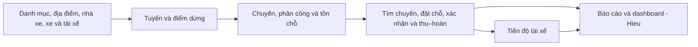

# Phân công và bàn giao của nhóm

Áp dụng từ02/11/2026 theo yêu cầu chủ dự án: **hai người phát triển source; hai người làm báo cáo Word, sơ đồ, ảnh chức năng và test thủ công**. Đây là trách nhiệm từ thời điểm phân công, không nhận lại tác giả hoặc đóng góp source đã có. Bằng chứng thực hiện nằm ở commit/PR/test trong [tiến độ](TIEN_DO_VA_KE_HOACH_NHOM.md).

Mỗi người đọc [tổng quan](../01-bat-dau/TONG_QUAN_HE_THONG.md), [local/tài khoản](../01-bat-dau/CHAY_LOCAL.md), rồi vào phần tên mình. Cả bốn cùng tập [lời thoại demo và55 hỏi–đáp](DEMO_VA_HOI_DAP.md); người viết tài liệu hoặc kiểm thử vẫn cần hiểu luồng màn hình/API và chỉ được bằng chứng thực tế.

## Thông tin thành viên

| Username GitHub | Email tác giả commit | Vai trò và phạm vi chính |
|---|---|---|
| hieuv526034 | hieuv526034@gmail.com | Dev nền: auth/common, DB/migration, cơ chế init, CI/deploy; báo cáo/dashboard và tích hợp |
| BangPhamIT | bangpham.it@gmail.com | Dev nghiệp vụ: catalog/carrier/trip/booking và UI tương ứng |
| anhhoang104 | hanh104204@gmail.com | Chủ trì báo cáo Word: nội dung, sơ đồ, bố cục và tổng hợp bản nộp |
| hiencoi250404-design | hiencoi250404@gmail.com | Test thủ công, chụp ảnh chức năng, bảng kết quả và hoàn thiện Word cùng Anh |

Không suy email từ nhánh hoặc sửa author lịch sử. Username Git không phải username app. Cả bốn dùng nhánh riêng <username>/<mã-việc> từ dev; PR/check/review → dev, main/deploy chỉ khi có lệnh phát hành mới. Tài liệu/test cũng có commit/PR của người thực hiện, không tạo commit hộ để đổi thống kê đóng góp.

## hieuv526034

**Phụ trách source nền, vận hành và chức năng báo cáo/dashboard.** Bảo trì luồng username/password → CSRF/guard → JWT → quyền endpoint từ DB → scope/owner → transaction/repo. Account để học: admin, custom01, operator01/operator02; dùng DB test cho thay đổi quyền/khóa account.

| Phần việc | Source và đầu ra |
|---|---|
| Auth | [auth](../../src/main/java/vn/vietroute/auth):40 lớp/8 bảng; tài khoản, role/function/menu/API, lifecycle và bootstrap |
| Common | [common](../../src/main/java/vn/vietroute/common): config, transaction JPA/JDBC, API response/lỗi/locale, validation và journal |
| Database | [migration](../../src/main/resources/db/migration/postgresql): schema/history/index, review bước mới và backup/restore; giữ checksum8 baseline |
| Khởi tạo | DatabaseInitializer/AuthInitializer/BusinessDataInitializer; cờ init, account/quyền, idempotence và audit system |
| CI/deploy | [Dockerfile](../../Dockerfile), [render.yaml](../../render.yaml), workflow/env; đúng SHA Live, health/login/API và bằng chứng phát hành |
| Báo cáo/dashboard | [report](../../src/main/java/vn/vietroute/business/report): query/DTO/API/service, bộ lọc, UI báo cáo và dashboard; tổng hợp bảng hiện có, không thêm bảng báo cáo |
| UI chung | Review shared layout/JS fragment cùng Bang; giữ contract và quyền backend khi giao diện đổi |

Tự kiểm:401/403/CSRF, tokenVersion, khóa sai password, thu hồi grant, all_scopes cùng role, hai context Spring, JPA/JDBC rollback, schema LOCAL/pooler và journal che dữ liệu. Không cache grant để bỏ kiểm DB hoặc reset DB thật để kiểm build.

Tự kiểm báo cáo: cùng kỳ theo ngày khởi hành Việt Nam và scope; tách giá trị đơn/thu/hoàn/nợ hoàn, dữ liệu rỗng trả0, không nhân đôi chuyến khi join đơn; confirmedSeats là lượt chỗ. Đối soát bằng đơn/chuyến cụ thể với Bang và Hien.

Bàn giao Bang: principal/endpoint đã duyệt, ApiResponse/DTO/locale/traceId, scope trên connection caller và quy tắc migration. Review thay đổi ảnh hưởng auth/common/schema của Bang. Cung cấp nội dung kỹ thuật cho Anh, môi trường demo và hướng dẫn thao tác để Hien test thủ công/chụp ảnh. Hai dev viết/chạy test tự động và xác nhận nội dung kỹ thuật trong Word. Học sâu Q07–Q18, Q30–Q34 và Q35–Q44; tập H1–H7 và Q46/Q50–Q52/Q54–Q55 trong kịch bản hai dev.

## BangPhamIT

**Phụ trách catalog/carrier/trip/booking, cả backend/UI và test của thay đổi mình viết.** Hieu phụ trách báo cáo/dashboard và phối hợp cơ chế nền/schema. Hai người tài liệu/test phụ trách đầu ra theo vai trò riêng.

| Khối | Source, bảng và công việc |
|---|---|
| catalog | [catalog](../../src/main/java/vn/vietroute/business/catalog): một bảng category, CRUD, lookup theo nhóm và bảng cây tải theo cha |
| carrier | [carrier](../../src/main/java/vn/vietroute/business/carrier): carriers/carrier_vehicles/carrier_drivers; scope, xe/sức chứa, tài xế/account và tra cứu công khai |
| trip | [trip](../../src/main/java/vn/vietroute/business/trip):6 bảng tuyến/điểm/chuyến/snapshot/segment/event; tìm chặng, phân công, lịch và tiến độ tài xế |
| booking | [booking](../../src/main/java/vn/vietroute/business/booking): bookings/booking_events; WEB/PHONE, xác nhận/hủy, thu–hoàn thủ công và owner |
| Dữ liệu nghiệp vụ | [bootstrap](../../src/main/resources/bootstrap): nhiều nhà xe/tuyến/lịch/tình huống; phối hợp Hieu khi đổi initializer/account/quyền hoặc schema |
| UI nghiệp vụ | [assets/js](../../src/main/webapp/assets/js) và views: catalog/location/fleet/routes/trips/journeys/bookings/driver-trips, tab/modal/draft/paging và locale |

Mỗi thay đổi đi đủ page/API → Request/Search/Response → Service → Repo/Entity → UI → test phù hợp. Query/scope/count/page/lock tại repo; service giữ nghiệp vụ/transaction, không for query/save từng bản ghi. Shared JS/common và migration cần phối hợp Hieu trước khi tích hợp.

Tự kiểm: parent inactive/mã trùng/version, cấp account đúng scope, snapshot, chồng lịch, race giữ chỗ, requestKey tiền lặp, history rollback, thứ tự tiến độ và ngày Việt Nam. Khóa trip → booking → segments. Bàn giao Hieu contract/trạng thái/ý nghĩa tiền và dữ liệu đối soát cho report/dashboard.

Account để học: operator01/driver01/custom01 cho Thiên Hành, operator02/driver02 cho An Phúc; bộ Duy Long dùng account riêng trong [local](../01-bat-dau/CHAY_LOCAL.md#nhà-xe-duy-long). Driver03 thuộc Thiên Hành, không suy scope từ số username. Duy Long là một đơn vị trong bộ demo đa nhà xe, không là mặc định chung của nghiệp vụ.

Bàn giao Anh: contract/màn hình/luồng/giới hạn và ID ví dụ. Bàn giao Hien: commit/môi trường, testcase đã chạy, đầu vào và kết quả mong đợi. Học sâu Q19–Q29 và Q33–Q34; nắm Q30–Q32 để bàn giao dữ liệu báo cáo, Q11–Q15/Q39–Q44 để phối hợp. Tập B1–B8 và Q47–Q49/Q53–Q55 trong kịch bản hai dev.

## anhhoang104

**Chủ trì hoàn thiện báo cáo Word để nộp.** Cùng Hien thu thập sơ đồ, hình chức năng và kết quả test thủ công; hai dev cung cấp và xác nhận nội dung kỹ thuật.

| Phần việc | Đầu ra đưa vào Word |
|---|---|
| Nội dung | Giới thiệu đề tài, yêu cầu, tác nhân, chức năng, công nghệ, kết luận và hướng phát triển theo [mẫu báo cáo](DEMO_VA_HOI_DAP.md#báo-cáo-sản-phẩm-theo-mẫu-công-nghệ-java) |
| Sơ đồ | Thu thập/vẽ lại use case, kiến trúc, ERD và luồng đăng nhập–phân quyền/đặt chỗ; ghi nguồn hoặc tự dựng, nhờ dev kiểm đúng bản |
| Hướng dẫn chức năng | Viết các bước sử dụng theo role, ghép ảnh Hien chụp, thêm chú thích và liên hệ với sơ đồ |
| Tổng hợp bản nộp | Ghép chương, mục lục tự động, danh mục hình/bảng, số trang, định dạng và tài liệu tham khảo; kiểm bố cục khi xuất PDF |

Bàn giao file Word chỉnh sửa được và bản PDF đối chiếu; giữ nguồn sơ đồ/ảnh để sửa khi giao diện đổi. Phối hợp Hien test lại các bước hướng dẫn. Thông tin họ tên/MSSV chỉ dùng khi đã xác nhận, không suy từ GitHub. Đọc tổng quan/local và nội dung dev bàn giao để viết đúng; không cần nhận phần lập trình hoặc test tự động.

## hiencoi250404-design

**Test thủ công, chụp hình chức năng và cùng Anh hoàn thiện báo cáo Word.** Thao tác trên giao diện theo hướng dẫn dev, ghi kết quả thật và kiểm lại sau khi dev sửa lỗi.

| Phần việc | Đầu ra đưa vào Word |
|---|---|
| Test thao tác | Đăng nhập theo role, menu/quyền, select/tìm chuyến, danh mục/nhà xe, tuyến/chuyến, đặt–xác nhận–hủy, thu–hoàn, tiến độ tài xế và báo cáo/dashboard |
| Bảng kết quả | Mã ca, role, bước/đầu vào, kết quả mong đợi/thực tế và Đạt/Không đạt/Chưa kiểm; mô tả ngắn lỗi để dev tái hiện |
| Ảnh chức năng | Chụp màn hình rõ, dữ liệu giả lập phù hợp, đúng phiên bản; đặt tên theo chức năng/role, có chú thích, che thông tin nhạy cảm |
| Sơ đồ và Word | Hỗ trợ Anh thu thập/vẽ sơ đồ, viết phần kiểm thử/hướng dẫn, ghép ảnh/bảng và rà lỗi trình bày bản nộp |

Bàn giao Anh ảnh gốc, chú thích và bảng test; gửi lỗi cho Hieu nếu auth/common/DB/report/dashboard, cho Bang nếu catalog/carrier/trip/booking/UI tương ứng. Test có ghi dữ liệu chỉ trên môi trường demo đã được phép; dev chuẩn bị dữ liệu/role và hỗ trợ ca khó. Hai dev phụ trách toàn bộ code, script/test tự động, kiểm DB và CI/deploy. Hien không phải tự viết JUnit/Postman script, chạy regression DB hoặc kiểm tải.

## Bộ tài liệu cần chốt để nộp

Anh tổng hợp, Hien bổ sung ảnh/test và cùng rà bản cuối: Word theo mẫu, PDF kiểm bố cục, sơ đồ rõ chữ có nguồn sửa, ảnh chức năng theo role và bảng test thủ công. Không cần thêm nhiều tài liệu kỹ thuật riêng; đưa nội dung cần thiết vào đúng chương/phụ lục. Hieu/Bang xác nhận phần kỹ thuật trước khi chốt. Phân công này chưa phải bằng chứng đã soạn xong Word hoặc đã chạy các ca test.

## Phối hợp và điều kiện bàn giao

1. Hieu/Bang thống nhất phạm vi, contract/scope/schema và acceptance trước khi sửa source. Anh chuẩn bị chương/sơ đồ, Hien chuẩn bị các bước test thủ công và danh sách ảnh cần chụp.
2. Dev làm trên nhánh riêng, tự kiểm và bàn giao commit/test thực tế. Hien test thao tác/chụp ảnh, Anh đối chiếu và đưa kết quả đúng bản vào Word.
3. Lỗi nền/auth/DB/deploy về Hieu; lỗi báo cáo/dashboard về Hieu; lỗi catalog/carrier/trip/booking và UI tương ứng về Bang. Lỗi giao nhau do hai dev phối hợp, không giao người tài liệu sửa production theo suy đoán.
4. PR/check/review → dev khi đạt; còn lỗi/chưa kiểm thì ghi rõ. Main/Render chỉ khi có lệnh phát hành mới. Không coi phân công hoặc review AI là nghiệm thu thành viên.
5. Anh tổng hợp Word/sơ đồ, Hien bổ sung ảnh/bảng test thủ công; Hieu/Bang xác nhận kỹ thuật. Giữ tác giả đóng góp thật, không viết lại lịch sử theo vai trò mới.

Mỗi người trình bày vai trò hiện tại, một luồng hiểu rõ, một ca lỗi và bằng chứng. Thứ tự: Anh mở bài/phạm vi → Hieu nền/quyền → Bang nghiệp vụ → Hieu báo cáo/dashboard → Hien kiểm thử/giới hạn. Chi tiết15 phút ở bộ demo; cả bốn cùng trả lời câu hỏi ngoài phần chính của mình.
