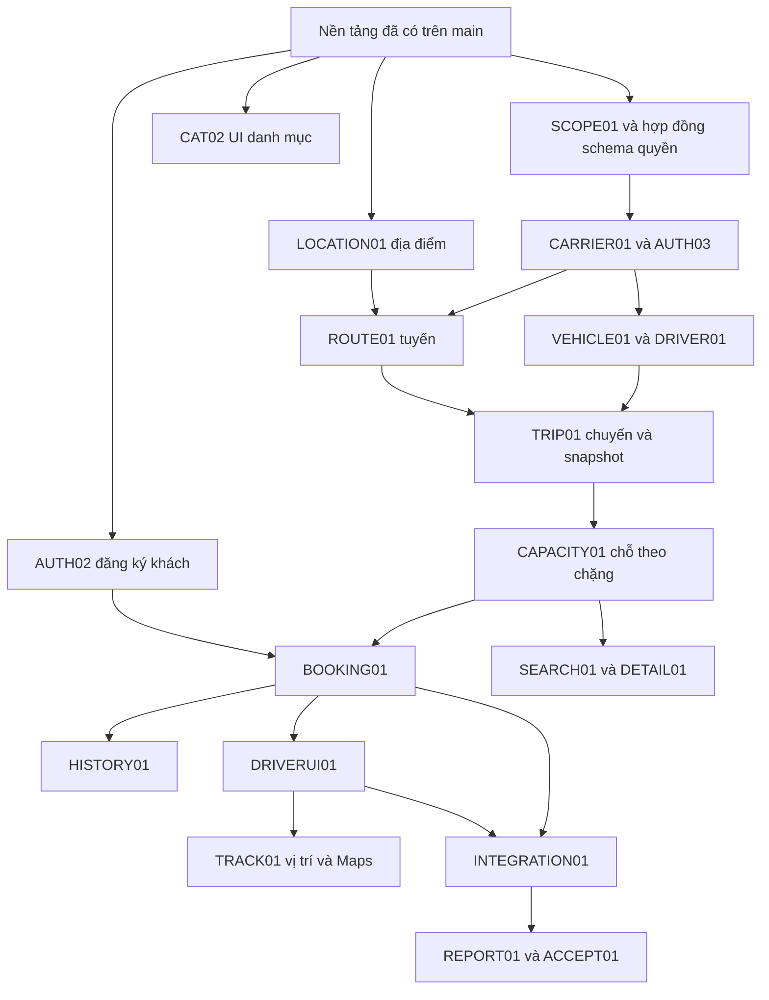

# Tiến độ và kế hoạch triển khai của nhóm VietRoute

## FOUNDATION05 — đang thực hiện, chưa có trên main

[Issue #43](https://github.com/hieuv526034/vietroute-web/issues/43), hieuv526034, nhánh `hieuv526034/access-annotations-profile-ui`. Annotation AccessFunction mô tả nhóm/quyền cùng mapping Spring; metadata vẫn không cấp quyền hoặc nới guard. ADMIN bất biến, role khác sửa/tắt và xóa mềm có chặn user/policy, dọn mapping trong transaction. V012 thêm tombstone, liên kết avatar và metadata. Menu Hệ thống/Phân quyền/API/tài khoản tách riêng; hồ sơ tự phục vụ dùng media chung, loading/single-flight và form gọn. Local đạt 112 test Java/18 Node, formatter/rules/docs, local compile và WAR production sạch test/dev/env. Docker/SQL tại d6955fb và 2712513 đạt; đầu nhánh đang chốt CSS dropdown 390px trước khi kiểm lại. UI fixture vi/en kiểm menu, ADMIN không sửa/xóa, metadata nhóm/quyền, loading nút/bảng, 409 giữ bản nháp và cập nhật tên header. Khung iframe 390px đã phát hiện/sửa dropdown bị cắt; chưa thay nghiệm thu thiết bị thật. Chưa áp dụng V012 lên Neon hoặc gửi/upload provider thật. Giữ tác giả thật; sau khi tất cả kiểm/merge/bàn giao hoàn tất mới đặt lịch tắt máy 5 phút theo yêu cầu chủ dự án ngày 24/10.

## FOUNDATION04 — Đã có trên main

[PR #41](https://github.com/hieuv526034/vietroute-web/pull/41), merge `0237ad3`, head đã kiểm `b435d65`, [Issue #40](https://github.com/hieuv526034/vietroute-web/issues/40), hieuv526034. Bổ sung chẩn đoán nguồn DB/local JVM property/BOM; đăng ký CUSTOMER chờ email, resend/kích hoạt, bind email cho user cũ, quên/reset, lịch sử hai mật khẩu cũ; journal lưu/filter/hiển thị user đã xác minh. Giữ 5 sai/khóa 15 phút theo chủ dự án, role là nhóm quyền, không SMS/provider trả phí. V011 mới, giữ nguyên V001–V010.

Ba check đúng head đạt: [Docker/PostgreSQL](https://github.com/hieuv526034/vietroute-web/actions/runs/39997687026), [format/quy tắc](https://github.com/hieuv526034/vietroute-web/actions/runs/39997686907), [tài liệu](https://github.com/hieuv526034/vietroute-web/actions/runs/39997687083). SQL thật kiểm 11 migration, đăng ký pending/CUSTOMER, giả mạo role, activation/reset/replay/expiry, current + hai hash cũ, JWT cũ bị thu hồi, encrypted outbox/retry SMTP loopback và journal filter đúng user. Regression cũ về hai node/schema/quyền/DB mất-phục hồi vẫn đạt. Lượt CI đầu phát hiện tên V011 dài hơn history VARCHAR(40); đã rút gọn trước khi merge và thêm regression giới hạn tên, không đổi migration đã áp dụng.

Kiểm local đạt 109 Java test/16 Node test, npm ci/format/format:check/rules/docs, local compile, production package/WAR sạch test/dev/env, actionlint/bash syntax. UI fixture vi/en đã kiểm required, modal lỗi 409 giữ bản nháp/khóa link khi bận, journal user/khách/filter ID; không thiếu locale hoặc lỗi console. Kiểm Neon chỉ SELECT xác nhận kết nối/admin/hash/history tại thời điểm chẩn đoán, không ghi/seed/reset. Chưa tái hiện lỗi cụ thể của IDE hay nghiệm thu Gmail/Render Live/tải production.

Runtime cần chủ động áp dụng V011 bằng initializer; luồng email mặc định tắt, cần bật self-service/mail/worker và cấu hình Gmail, chưa nghiệm thu inbox thật. Log cũ/khách/chưa xác minh giữ actor NULL; không suy ngược user. Không còn phần code dở của FOUNDATION04. Bước tiếp: nghiệm thu provider khi có cấu hình, SCOPE01/hợp đồng cấp tài khoản trước nghiệp vụ. Hợp đồng và giới hạn tại [API](../02-phat-trien/API_BASE.md), [chạy local](../01-bat-dau/CHAY_LOCAL_VA_CLOUDINARY.md), [nhật ký](../04-van-hanh/NHAT_KY_API_VA_DEBUG.md).

Cập nhật 24/10/2026, đối chiếu main tại `0237ad3` sau PR #41. Nền tảng ban đầu ở [PR #13](https://github.com/hieuv526034/vietroute-web/pull/13), kế hoạch nhóm ở [PR #21](https://github.com/hieuv526034/vietroute-web/pull/21), UI quản trị ở [PR #22](https://github.com/hieuv526034/vietroute-web/pull/22); các đợt bổ sung gần nhất ghi bên dưới. Cửa nghiệm thu trước nghiệp vụ tại [NGHIEM_THU_NEN_TANG.md](NGHIEM_THU_NEN_TANG.md). Chức năng mới chỉ trở thành Đã có trên main khi PR tương ứng merge. Tài liệu này theo dõi trạng thái; [PHAN_CONG.md](PHAN_CONG.md) là nguồn username/email và phạm vi phụ trách, [đặc tả](DAC_TA_HE_THONG_XE_KHACH.md) là nguồn luồng F01–F19 và ca nghiệm thu T01–T21. Chuyển máy/tiếp tục phiên mới theo [hướng dẫn bàn giao](../06-ai-va-ban-giao/AI_VA_BAN_GIAO.md).

## FOUNDATION03 — Đã có trên main

[PR #38](https://github.com/hieuv526034/vietroute-web/pull/38), merge `2a2e410`, head đã kiểm `599b8a4`, [Issue #37](https://github.com/hieuv526034/vietroute-web/issues/37), hieuv526034. Toàn bộ media chuyển về common, chữ ký controller ApiResult<T>, config có comment tiếng Việt và danh bạ UI/API tự đồng bộ vào DB lúc startup. Role là nhóm quyền; không tạo tầng nhóm trùng. V010 mới; V001–V009 giữ nguyên byte/checksum. Không tự cấp quyền, sửa public từ DB hoặc xóa route vắng trên một node khác phiên bản.

Bằng chứng tại đúng head: [Docker + PostgreSQL](https://github.com/hieuv526034/vietroute-web/actions/runs/39990109186), [format/quy tắc](https://github.com/hieuv526034/vietroute-web/actions/runs/39990108496), [tài liệu](https://github.com/hieuv526034/vietroute-web/actions/runs/39990108606) đều đạt. SQL thật kiểm 10 migration, sync hai node, audit system, public/read-only, phân trang, thiếu quyền, route bản cũ còn sau restart và toàn bộ regression auth/schema. Lượt CI đầu dừng vì fixture dùng JWT đã bị thu hồi; đã lấy token mới để kiểm đúng 403, giữ assertion token cũ trả 401. Không nới xác thực để làm check xanh.

Kiểm local: 103 Java test (0 lỗi), 16 Node test, npm ci/format/format:check/rules/docs, local compile, production package/WAR loại test/dev/env, actionlint/bash -n đều đạt. UI fixture vi/en: tab tài nguyên, next, chọn size, nhảy trang cuối bằng Enter, không lỗi console/thiếu locale; bảng rộng cuộn trong vùng riêng. Không chạy migration/test lên Neon; chưa nghiệm thu Cloudinary/Gmail/Render Live hoặc tải production. Runtime cần áp dụng V010 trước khi bật sync; cờ sync không khai báo mặc định theo DB_INIT. Bước tiếp: SCOPE01/hợp đồng cấp tài khoản và nghiệp vụ theo phân công; không còn phần code dở của FOUNDATION03.

FOUNDATION02 — **Đã có trên main**, `hieuv526034`, merge `df22688` qua [PR #35](https://github.com/hieuv526034/vietroute-web/pull/35), [Issue #34](https://github.com/hieuv526034/vietroute-web/issues/34). Registry role/quyền động, chính sách menu/endpoint và UI, launcher đọc env riêng, config theo trách nhiệm, lõi media dùng chung/sửa metadata, online/bất thường PostgreSQL đã được tích hợp. Kiểm local: `mvnw clean verify` và bộ Surefire cách ly đạt 100 test Java; 16 test Node, format/rule/docs đạt; UI vi/en fixture 390px gồm validation, 409 giữ bản nháp, phân trang online và sửa ảnh. Launcher local biên dịch, WAR production sạch test/launcher/env. Parser `.env` riêng đã được kiểm trong RAM, không mở connection hoặc in secret.

Ba check CI tại head `bb1d806` đều đạt: [Docker + PostgreSQL tạm](https://github.com/hieuv526034/vietroute-web/actions/runs/39984093703), [format/quy tắc](https://github.com/hieuv526034/vietroute-web/actions/runs/39984093458), [tài liệu](https://github.com/hieuv526034/vietroute-web/actions/runs/39984093477). SQL thật kiểm migration/seed hai node, registry/mapping, vô hiệu hóa quyền live, policy menu/endpoint, metadata owner/version, online/counter chia sẻ, schema tùy chọn/rename và phục hồi DB/node. V001–V006 giữ byte/checksum; V007–V009 chưa chạy trên Neon để kiểm build, chỉ áp dụng khi runtime startup bật initializer. Không nghiệm thu tải production/provider/Render Live từ CI này. Hợp đồng tại [nền tảng mở rộng](../02-phat-trien/NEN_TANG_MO_RONG.md). Chưa bắt đầu nghiệp vụ nhà xe/chuyến/booking.

## 1. Cách đọc trạng thái

| Trạng thái | Ý nghĩa |
|---|---|
| Đã có trên main | Có code đã merge và bằng chứng PR/kiểm tra; không tự có nghĩa đã deploy hoặc thử provider production |
| Một phần | Có API/base hoặc UI giới hạn; cột còn thiếu ghi rõ phần chưa triển khai |
| Chưa triển khai | Chưa có chức năng tương ứng trong source main đã đối chiếu; được giao trong kế hoạch |
| Chờ cấu hình ngoài app | Source/adapter/mẫu đã có; credentials, collector/receiver hoặc dịch vụ vận hành thật chưa được xác nhận |

Không tính phần trăm tiến độ bằng số dòng code, số nhánh hoặc số task. Có nhánh chuẩn bị, đặc tả, enum/role hoặc adapter không đồng nghĩa đã có nghiệp vụ hoàn chỉnh. Tài liệu chỉ xác nhận những gì có trên main tại mốc nêu trên, không kết luận về công việc chưa push hoặc nhánh riêng của thành viên.

APIJOURNAL01 đã có trên main qua [PR #25](https://github.com/hieuv526034/vietroute-web/pull/25), sau đó chuyển lịch sử từ RAM sang PostgreSQL tại `dee2af5` qua [PR #27](https://github.com/hieuv526034/vietroute-web/pull/27), do `hieuv526034` thực hiện. V005, retention mặc định 7 ngày, mục tiêu 10.000 dòng, filter/paging SQL và cleanup batch/lock; không cache/queue lịch sử trong RAM. Có UI filter/modal và xuất cURL/Postman, kiểm ADMIN + SYSTEM_READ. Không coi journal là gateway/audit bất biến hoặc cam kết ghi đủ khi storage lỗi; xem [hợp đồng và giới hạn](../04-van-hanh/NHAT_KY_API_VA_DEBUG.md).

Onboarding và rule format IntelliJ đã merge qua [PR #26](https://github.com/hieuv526034/vietroute-web/pull/26): [mục lục đọc theo nhóm/thứ tự](../README.md), [Format IntelliJ](../01-bat-dau/FORMAT_INTELLIJ.md), codeStyles/EditorConfig và Run Format/Format Check. Đợt DOCS02 chia thư mục 01–06/99, gộp hướng dẫn UI/AI và rút gọn lộ trình theo [PR #33](https://github.com/hieuv526034/vietroute-web/pull/33); kiểm trạng thái PR để xác nhận merge. Mọi lượt sửa source chạy format/check trước commit. Không đổi người phụ trách/tác giả của module hoặc coi bổ sung tài liệu là nghiệp vụ đã triển khai.

Audit system đã merge tại `ce13d75` qua [PR #28](https://github.com/hieuv526034/vietroute-web/pull/28): V006, actor system (ID 0), audit không NULL cho seed/tác vụ tự động và chặn đăng nhập/gán role cho định danh kỹ thuật. Quy tắc học và triển khai nằm tại [audit và system](../02-phat-trien/AUDIT_VA_SYSTEM.md).

UI dùng chung và tài liệu công nghệ đã merge tại `6f038ec` qua [PR #29](https://github.com/hieuv526034/vietroute-web/pull/29): phân trang chọn size/nhảy trang, cột thao tác 96px, nút bên phải, validation cạnh field, giữ bản nháp khi 401, Home/login điều hướng theo principal. Export debug dùng URL thực từ origin/context và token placeholder theo lựa chọn chủ dự án. [PR #30](https://github.com/hieuv526034/vietroute-web/pull/30) tiếp tục chỉnh khoảng cách menu, gom bộ lọc/nút danh mục và dấu bắt buộc từ lúc mở modal. Xem [quy ước bảng/form](../03-giao-dien/QUY_UOC_UI.md), [công nghệ và thư viện](../01-bat-dau/CONG_NGHE_VA_THU_VIEN.md). Hai đợt do `hieuv526034` thực hiện; không bắt đầu nghiệp vụ nhà xe/chuyến/booking.

Mốc kiểm PR #30: 91 test Java và 10 test Node đạt, format/tài liệu đạt, ba check CI đạt gồm Docker/PostgreSQL tạm. Kiểm giao diện vi/en và mobile 390px bằng fixture riêng; không xác nhận provider/Render Live hoặc tải production từ kết quả này. Các số test tại mốc cũ bên dưới được giữ nguyên làm bằng chứng lịch sử.

Ngữ cảnh bàn giao đã merge tại `ce2088e` qua [PR #31](https://github.com/hieuv526034/vietroute-web/pull/31). AI01 tiếp tục chuẩn hóa điểm đọc Codex/Copilot/Cursor/Claude/Gemini và checker phát triển tại [PR #32](https://github.com/hieuv526034/vietroute-web/pull/32), do `hieuv526034` thực hiện; kiểm trạng thái merge/CI của PR để xác nhận có trên main. [Quy trình AI](../06-ai-va-ban-giao/AI_VA_BAN_GIAO.md) chốt thứ tự đọc, nguồn quy tắc/trạng thái/quyết định, mẫu bàn giao và giới hạn tự nạp. Mốc kiểm của đợt AI01: format đạt, rule checker đạt trên 182 file Java, 15 test Node và 303 link/36 tài liệu đạt trước bổ sung dòng tiến độ này; không chạy lại Maven hoặc thử trên Neon. Bộ checker chỉ kiểm tĩnh, không chứng minh AI thực sự hiểu hoặc branch protection đã được bật.

## 2. Nền tảng đã thực hiện và phần còn thiếu

Phần code nền tảng bên dưới hiện được commit dưới định danh `hieuv526034 <hieuv526034@gmail.com>`. Không phân bổ lại các commit này cho người khác. Cột chủ trì tiếp theo ở mục 4 là kế hoạch, không phải tác giả đã hoàn thành.

| Mã | Phần việc | Trạng thái thực tế | Còn thiếu/giới hạn | Bằng chứng |
|---|---|---|---|---|
| BASE01 | Base entity/DTO/request/response/page, audit Instant, locale vi/en, validation, lỗi/API envelope và Swagger | Đã có trên main | Module mới phải dùng lại và bổ sung key/permission riêng | [PR #3](https://github.com/hieuv526034/vietroute-web/pull/3), [#4](https://github.com/hieuv526034/vietroute-web/pull/4), [#5](https://github.com/hieuv526034/vietroute-web/pull/5) |
| DB01 | JDBC/HikariCP, transaction, schema cấu hình một nơi, migration V001–V011/checksum/lock, seed admin/catalog và audit system | Đã có trên main | Chưa có bảng carrier/route/trip/booking/tracking; không tự chạy test trên Neon | [PR #7](https://github.com/hieuv526034/vietroute-web/pull/7), [#9](https://github.com/hieuv526034/vietroute-web/pull/9), [#11](https://github.com/hieuv526034/vietroute-web/pull/11), [#27](https://github.com/hieuv526034/vietroute-web/pull/27), [#28](https://github.com/hieuv526034/vietroute-web/pull/28) |
| AUTH01 | Đăng nhập/me/đổi mật khẩu/logout, JWT/BCrypt, CSRF, khóa sai và thu hồi token | Đã có trên main | Đăng ký/email/reset đã có tại AUTH02/FOUNDATION04; cấp tài khoản theo nhà xe và SMS/phone OTP chưa triển khai | [PR #3](https://github.com/hieuv526034/vietroute-web/pull/3), [#8](https://github.com/hieuv526034/vietroute-web/pull/8) |
| ACCESS01 | Registry role/quyền, API/UI ma trận/gán, policy menu/endpoint và hành động riêng | Đã có trên main | Cấp tài khoản mới/membership/scope nhà xe thuộc nghiệp vụ tiếp theo; policy chỉ siết thêm guard nền | [PR #8](https://github.com/hieuv526034/vietroute-web/pull/8), [#9](https://github.com/hieuv526034/vietroute-web/pull/9), [UI quản trị](../04-van-hanh/QUAN_TRI_HE_THONG.md) |
| CAT01 | Catalog VEHICLE_TYPE/BOOKING_SOURCE: API đọc/tạo/sửa/xóa mềm, audit/version và seed | Một phần | UI `/admin` đã merge: tạo/sửa/xóa mềm/version, lọc nhóm, phân trang và validation chung. Chưa có khôi phục UI hoặc danh mục địa điểm | [PR #3](https://github.com/hieuv526034/vietroute-web/pull/3), [#9](https://github.com/hieuv526034/vietroute-web/pull/9), [#29](https://github.com/hieuv526034/vietroute-web/pull/29), [#30](https://github.com/hieuv526034/vietroute-web/pull/30) |
| TRAFFIC01 | Quota IP, semaphore request/login/upload, giới hạn byte/pixel, timeout và trusted proxy | Đã có trên main | Quota memory theo từng node; chưa nghiệm thu tải production. Không bật Kafka/Redis | [PR #8](https://github.com/hieuv526034/vietroute-web/pull/8), [#11](https://github.com/hieuv526034/vietroute-web/pull/11), [#13](https://github.com/hieuv526034/vietroute-web/pull/13) |
| JOB01 | Queue PostgreSQL, SKIP LOCKED/lease/retry/DEAD, API/UI xem và retry, shutdown/retention | Đã có trên main | Worker tắt mặc định. UI thêm lọc trạng thái/phân trang/chi tiết/retry có version; at least once, chưa có gia hạn lease cho tác vụ dài | [PR #8](https://github.com/hieuv526034/vietroute-web/pull/8), [#13](https://github.com/hieuv526034/vietroute-web/pull/13), [UI quản trị](../04-van-hanh/QUAN_TRI_HE_THONG.md) |
| MAIL01 | Gmail HTTPS OAuth2 và SMTP adapter, enqueue/outbox, trạng thái job | Chờ cấu hình ngoài app | Mail tắt mặc định; chưa thử gửi thật, chưa có template thư nghiệp vụ hay UI gửi mail riêng | [PR #8](https://github.com/hieuv526034/vietroute-web/pull/8), [hướng dẫn](../02-phat-trien/NEN_TANG_MO_RONG.md) |
| MEDIA01 | Lõi common.media + public controller, API/UI upload/xem/sửa metadata/xóa, JPEG/PNG, owner/version và cleanup | Chờ cấu hình ngoài app | Media tắt mặc định; chưa thử Cloudinary thật. Chưa gắn ảnh vào nhà xe/xe; không dùng cho giấy tờ riêng tư | [PR #11](https://github.com/hieuv526034/vietroute-web/pull/11), [hướng dẫn](../01-bat-dau/CHAY_LOCAL_VA_CLOUDINARY.md) |
| MONITOR01 | UI `/monitoring` vi/en; tài nguyên và online/bất thường DB, token scrape riêng và probe DB opt-in | Đã có trên main | Tab tài nguyên giữ 30 mẫu trong tab; tab online dùng DB và ADMIN + SYSTEM_READ. Online là cửa sổ 3 phút, có missed writes; heap không phải tổng RAM container | [PR #13](https://github.com/hieuv526034/vietroute-web/pull/13) |
| ALERT01 | Dashboard Grafana mẫu, 12 luật cảnh báo và kiểm thử rule | Chờ cấu hình ngoài app | Chưa có collector/receiver thật hoặc thử thông báo end-to-end; DB probe tắt mặc định | [PR #13](https://github.com/hieuv526034/vietroute-web/pull/13), [vận hành](../04-van-hanh/GIAM_SAT_VA_VAN_HANH.md) |
| BUILD01 | Maven WAR/Docker, cache CI, Render main/checksPass, loại test/launcher khỏi production | Đã có trên main | Chưa xác nhận Render service Live trong tài khoản; CI xanh không tự chứng minh deploy hoàn tất | [PR #1](https://github.com/hieuv526034/vietroute-web/pull/1), [#13](https://github.com/hieuv526034/vietroute-web/pull/13) |
| DEV01 | Run/Debug IntelliJ, formatter, constants và quy hoạch common, tài liệu tiếng Việt | Đã có trên main | Nâng Spring major là đợt riêng; không gọi stack hiện tại là toàn bộ công nghệ mới nhất | [PR #10](https://github.com/hieuv526034/vietroute-web/pull/10), [#11](https://github.com/hieuv526034/vietroute-web/pull/11), [#12](https://github.com/hieuv526034/vietroute-web/pull/12), [#13](https://github.com/hieuv526034/vietroute-web/pull/13) |

Bằng chứng kiểm tra tại PR #13: 73 test Java, 2 test Swagger, formatter, WAR production, smoke HTTP, kiểm rule và Docker integration đã qua. CI có DB tạm/mất-phục hồi DB, hai node và dừng một node; đây không phải nghiệm thu tải production, backup hay provider thật. Không có dữ liệu nhà xe/chuyến/booking demo được tạo chỉ vì base seed đã chạy.

## 3. Tổng quan theo từng thành viên

| Thành viên | Phần đã được xác nhận trên main | Công việc tiếp theo theo phân công | Điểm phối hợp |
|---|---|---|---|
| `hieuv526034` | Phần nền tảng ở mục 2, theo lịch sử commit/PR | Tenant/scope và cấp tài khoản nhà xe; cơ chế chỗ theo chặng, transaction tích hợp, Geolocation/Maps, vận hành và nghiệm thu | Chốt schema/permission/service contract; review phần khó; không nhận thay đóng góp thực của nhóm |
| `BangPhamIT` | Chưa ghi nhận commit nghiệp vụ của thành viên này tại mốc đối chiếu | Chuyến/phân xe-tài xế/lịch chồng/snapshot; booking WEB/PHONE và vòng đời đơn; tổng hợp báo cáo cùng Hieu | Dùng chung transaction/tồn chỗ với Hieu, không viết bộ đếm chỗ khác |
| `anhhoang104` | Chưa ghi nhận commit nghiệp vụ của thành viên này tại mốc đối chiếu | Nghiệm thu/tích hợp catalog đã có; CRUD nhà xe, xe và thông tin tài xế, validation/trạng thái/phân trang | Auth cấp credential/quyền; Anh quản lý hồ sơ nghiệp vụ, không sửa password hash |
| `hiencoi250404-design` | Chưa ghi nhận commit nghiệp vụ của thành viên này tại mốc đối chiếu | Địa điểm, tuyến một chiều, điểm dừng/giờ/giá vi/en; UI tìm/chi tiết/lịch sử đơn khách | Gọi service chung của Bang/Hieu; phối hợp Maps, không tự tính lại chỗ ở JS |

Nhánh đã chuẩn bị chưa phải bằng chứng đã viết code. Dùng đúng email trong [PHAN_CONG.md](PHAN_CONG.md), commit/PR tiếng Việt, không đổi author để chia đóng góp trên giấy.

## 4. Backlog nghiệp vụ và đầu ra bàn giao

Các dòng dưới là **chưa triển khai**, trừ CAT02 có UI và AUTH02 có source email lifecycle đã merge; xem PR #29/#30 và #41, bằng chứng nghiệm thu tại [NGHIEM_THU_NEN_TANG.md](NGHIEM_THU_NEN_TANG.md). Người chủ trì là người dự kiến triển khai thực tế; khi PR merge phải cập nhật bằng chứng và tác giả thực, không đánh dấu xong theo kế hoạch.

| Mã | Chủ trì / phối hợp | API, UI và quy tắc cần hoàn thành | Phụ thuộc | Nghiệm thu gắn đặc tả |
|---|---|---|---|---|
| SCOPE01 | Hieu / Anh, Bang | Chốt quan hệ tài khoản–nhà xe, nguồn scope từ DB/principal, quyền theo resource; đọc/ghi có WHERE scope và kiểm quan hệ cha/con. ADMIN tạo/cấp OPERATOR qua auth, operator không tự chọn nhà xe khác | DB01, AUTH01, ACCESS01 | F02/F04; T01/T11: hai nhà xe không đọc/sửa chéo bằng cách đổi ID |
| AUTH02 | Hieu đã triển khai API/UI; Hien phối hợp tích hợp luồng khách | Đã có trên main qua PR #41: đăng ký CUSTOMER pending, xác minh email, quên/reset, lịch sử mật khẩu; không nhận role/audit/tenant client | Cần cấu hình Gmail và bật self-service/mail/worker để dùng thật | F01/giả mạo role đã kiểm CI; inbox/provider thật và SMS/phone OTP chưa nghiệm thu/triển khai |
| AUTH03 | Hieu / Anh | API cấp/khóa tài khoản OPERATOR/DRIVER gắn membership và hồ sơ đúng nhà xe; giữ credential trong auth, quy tắc admin cuối/token revocation | SCOPE01, hợp đồng CARRIER01/DRIVER01 | F02/F04; không cấp tài khoản ngoài scope, khóa không xóa lịch sử |
| CAT02 | Hieu đã merge UI / Anh nghiệm thu, tích hợp tiếp | UI tạo/sửa/xóa mềm/xác nhận/version/conflict, lọc nhóm, phân trang và validation đã có; cập nhật gần nhất [PR #29](https://github.com/hieuv526034/vietroute-web/pull/29)/[#30](https://github.com/hieuv526034/vietroute-web/pull/30). Anh kiểm/tích hợp khi dùng cho xe; không phân bổ commit của Hieu thành đóng góp đã làm của Anh | CAT01 | F03; conflict 409, thiếu quyền bị chặn cả API, không phá tham chiếu |
| CARRIER01 | Anh / Hieu | Nhà xe CRUD, hồ sơ/liên hệ/trạng thái, UI ADMIN/OPERATOR theo phạm vi, code duy nhất và ảnh logo public qua mediaId được kiểm owner | SCOPE01, AUTH03 contract; MEDIA01 khi bật ảnh | F02; T01/T11, khóa thay vì xóa dữ liệu còn liên quan |
| VEHICLE01 | Anh / Hieu | Xe thuộc nhà xe: mã/biển số/loại xe/sức chứa/trạng thái/ảnh public, API+form+phân trang+version | CARRIER01, CAT02; MEDIA01 khi dùng ảnh | F04; biển số trùng, capacity <=0, đổi carrierId giả và xe đang được sử dụng |
| DRIVER01 | Anh / Hieu sở hữu auth | Hồ sơ tài xế/liên hệ/trạng thái, liên kết tài khoản do auth cấp, UI đúng nhà xe; không upload giấy tờ riêng tư qua media public | CARRIER01, AUTH03 | F04; tài khoản/hồ sơ khác nhà xe, khóa và giữ lịch sử |
| LOCATION01 | Hien / Hieu review schema | Tỉnh/thành/địa điểm, tên vi/en, địa chỉ/tọa độ hợp lệ, UI CRUD và trạng thái; dữ liệu đang tham chiếu không bị xóa mất | BASE01, chốt schema/quyền | F03; địa điểm không tồn tại, tọa độ sai, dữ liệu đang dùng |
| ROUTE01 | Hien / Anh, Bang | Tuyến một chiều thuộc nhà xe, >=2 điểm theo thứ tự, ngày-giờ tương đối qua đêm và giá theo mốc, API+UI thêm/sắp điểm; hai chiều là hai bản ghi riêng | SCOPE01, CARRIER01, LOCATION01 | F05; T02/T03/T09/T13; không đảo dữ liệu cũ khi sửa tuyến |
| TRIP01 | Bang / Anh, Hien | Tạo chuyến từ tuyến, snapshot điểm/giờ/giá, phân xe/tài xế, vòng đời DRAFT/OPEN/IN_PROGRESS/COMPLETED/CANCELLED, API+UI; kiểm lịch chồng trong transaction để hai request không lọt | VEHICLE01, DRIVER01, ROUTE01 | F06; T03/T13/T14/T17; Instant và cùng nhà xe, active, trạng thái đúng |
| CAPACITY01 | Hieu / Bang | Tồn chỗ theo từng chặng, min số chỗ còn trên đoạn; transaction/khóa dùng chung và rollback. Thống nhất thứ tự khóa trip → booking → segments tăng dần; API/service nhận cùng Connection | Chốt schema TRIP01/BOOKING01 trước, sau đó dữ liệu chuyến | T04–T08/T10/T15; xác nhận đồng thời chỗ cuối không oversell, trả chỗ đúng một lần |
| BOOKING01 | Bang / Hieu | Tạo yêu cầu WEB PENDING, OPERATOR xác nhận/từ chối, CUSTOMER/OPERATOR hủy, PHONE không bắt buộc tài khoản khách, history/idempotency/audit và UI; gọi CAPACITY01 cùng transaction | AUTH02, SCOPE01, TRIP01, CAPACITY01 | F09–F12/F19; T06–T12/T15/T19–T21; PENDING không giữ chỗ |
| SEARCH01 | Hien / Bang, Hieu | UI+API tìm theo ngày tại điểm đón/số chỗ/nhà xe/loại xe/giá, phân trang; đúng chiều và điểm chưa đóng. Chỗ/giá do server tính | TRIP01, LOCATION01, CAPACITY01 | F07; T02–T05/T09/T19; chuyến qua đêm và hết chỗ một chặng |
| DETAIL01 | Hien / Hieu phụ trách Maps | Trang danh sách/chi tiết nhà xe và chuyến, điểm dừng/giờ/giá/chỗ/liên hệ, form yêu cầu đặt; phần Maps/tracking ghép khi API có, luôn có danh sách văn bản | CARRIER01, SEARCH01, BOOKING01; TRACK01 cho vị trí thật | F08; T16; không giả định đã có Maps chỉ vì có khung giao diện |
| HISTORY01 | Hien / Bang | Lịch sử và chi tiết đơn khách, trạng thái/lý do/timeline/liên hệ, gọi hủy theo API chung; API chỉ đọc đơn của chủ sở hữu | BOOKING01 | F17; T11/T20; không lộ đơn người khác khi đổi ID |
| DRIVERUI01 | Hieu / Hien phối hợp giao diện | Chuyến được giao và khách đón/trả theo điểm, bắt đầu/đến/rời/kết thúc với quyền tài xế, cập nhật trạng thái đúng thứ tự | DRIVER01, TRIP01, BOOKING01; hợp đồng tích hợp Bang | F13/F14; T10/T12/T17; tài xế không thấy khách chuyến khác |
| TRACK01 | Hieu / Hien ghép chi tiết | Google Maps + Geolocation website, lấy vị trí khi tài xế cho phép, lưu thời điểm nhận/độ chính xác; marker thật, stale/fallback/mất mạng. Không suy luận đóng điểm hoặc hủy đơn chỉ từ tọa độ | TRIP01, DRIVERUI01, LOCATION01; cấu hình Maps/HTTPS bên ngoài | F15/F08 và mục 17; T16; thử từ chối quyền, tab nền, mẫu cũ/sai thứ tự và sai tài xế |
| INTEGRATION01 | Hieu + Bang / cả nhóm nghiệm thu | Hủy chuyến/đóng điểm và đơn liên quan trong luồng transaction thống nhất; không để xác nhận lọt, không trả chỗ hai lần; history/outbox nếu dùng thông báo | TRIP01, CAPACITY01, BOOKING01, DRIVERUI01 | F16; T07/T08/T10/T15/T17 |
| REPORT01 | Hieu + Bang / Anh, Hien phối hợp UI | Báo cáo cơ bản chuyến/đơn/chỗ/giá trị đặt và tiền thực thu nếu có nghiệp vụ ghi nhận thu; ADMIN toàn hệ thống, OPERATOR chỉ nhà xe mình | Dữ liệu TRIP01/BOOKING01 và quy tắc ghi nhận thu được chốt | F18; T18; không coi PENDING/giá niêm yết là tiền đã thu, không thêm cổng thanh toán vào bản đầu |
| ACCEPT01 | Cả nhóm, Hieu tổng hợp | Dữ liệu demo tách production, ca T01–T21 và tracking mục 17, hướng dẫn chạy/bảo vệ, minh chứng từng PR và báo cáo mỗi người | Các module liên quan đã merge | Chạy nhiều phiên, concurrency/rollback/scope thật, không gắn dữ liệu giả với doanh nghiệp thật |

## 5. Phần UI quản trị và công việc vận hành

OPSUI01/ACCESSUI01/CONFIGUI01 đã được Hieu bổ sung source UI theo các hàng dưới; việc phối hợp của thành viên khác vẫn là kế hoạch. Các dòng provider/cảnh báo/backup còn là backlog ngoài app, không coi đã vận hành chỉ vì có UI hoặc file mẫu.

| Mã | Chủ trì / phối hợp | Đã có | Cần làm và giới hạn |
|---|---|---|---|
| OPSUI01 | Hieu triển khai / Anh phối hợp nghiệm thu dự kiến | API và UI list/status filter/page/detail/retry DEAD có xác nhận, version và JOB_READ/JOB_RETRY | Đã có trên main qua PR #22. Không hiện payload/PII, không retry hàng loạt; cần bật worker để xử lý job |
| ACCESSUI01 | Hieu triển khai / Hien phối hợp nghiệm thu dự kiến | UI ma trận/gán quyền và tra/gán role tài khoản, version/conflict/CSRF, service kiểm quyền | Đã có trên main qua PR #22. ADMIN role bảo vệ, không tự sửa role; tra tài khoản chỉ ADMIN + ACCESS_READ; chưa tạo tài khoản mới hoặc scope nhà xe |
| CONFIGUI01 | Hieu triển khai | API/UI snapshot cấu hình whitelist với SYSTEM_READ | Đã có trên main qua PR #22, chỉ đọc, không serialize Settings/secret. Sửa Environment vẫn qua IDE/Render và restart; chưa có lưu cấu hình runtime hoặc API sửa env |
| MAILTPL01 | Hieu + Bang | Outbox và transport Gmail/SMTP | Template vi/en cho sự kiện booking theo scope đã chốt; thử bằng transport giả rồi staging. Template auth/reset đã có tại PR #41; chưa có UI gửi mail tùy ý hoặc SMS/phone OTP |
| DEPLOY01 | Hieu | Docker/Blueprint và adapter | Xác nhận service Live/env, bật worker/mail/media khi đủ điều kiện; không tự mua dịch vụ hoặc coi credentials có sẵn |
| ALERTLIVE01 | Hieu | Metrics, dashboard/rule mẫu | Collector/receiver ngoài app, thử thông báo down/recovered và đối chiếu RAM container. Chưa kích hoạt nhận cảnh báo thật |
| RECOVERY01 | Hieu / cả nhóm nghiệm thu | Hướng dẫn xử lý sự cố | Chốt RPO/RTO/backup/retention, thử restore DB staging; chưa có backup tự động hoặc restore production trong CI |
| SCALE01 | Hieu + Bang | Khóa/lease/CI hai node và quota local | Kiểm tải staging, tổng pool, rolling deploy/schema tương thích, ingress quota toàn cụm khi cần; chưa cần Kafka/Redis |
| UPGRADE01 | Hieu | Stack Spring MVC 6/Tomcat 10.1 theo quy ước | Đánh giá vòng đời/nâng major bằng PR riêng và kiểm tương thích; chưa quyết định chuyển stack trong backlog nghiệp vụ |

## 6. Thứ tự bắt đầu và điểm bàn giao

Theo yêu cầu ngày 23/10: hoàn thiện và nghiệm thu source nền tảng/UI quản trị trước khi khởi động các đợt nghiệp vụ dưới đây. Việc bổ sung UI không tự bật provider/cảnh báo thật hoặc bắt đầu module nhà xe.

**Đợt 1 sau nền tảng:** Hieu chốt SCOPE01 và hợp đồng cấp tài khoản, auth/schema; Anh nghiệm thu/tích hợp CAT02 đã bổ sung và chuẩn bị form nhà xe theo hợp đồng; Hien làm LOCATION01; Bang đọc luồng, chuẩn bị thiết kế trạng thái/snapshot/lịch chồng và ca test TRIP01/BOOKING01. Thiết kế chưa được ghi thành chức năng hoàn thành. Hieu có thể khảo sát rủi ro Geolocation sớm nhưng chưa ghép tracking giả vào nghiệp vụ.

**Đợt 2:** Nhà xe/xe/tài xế và tuyến; Hieu hỗ trợ AUTH03 và review scope. Trước khi merge chốt migration version mới, permission/key vi/en, ID/quan hệ và contract; không hai người cùng viết migration trùng số. Các migration đã có giữ nguyên.

**Đợt 3:** Bang triển khai chuyến, Hieu triển khai tồn chỗ dựa trên schema/hợp đồng thống nhất; sau đó booking, tìm kiếm và chi tiết. Frontend có thể dựng layout nhưng chưa đánh dấu API dùng được khi còn mock. Mọi dữ liệu mô phỏng phải gắn nhãn.

**Đợt 4:** Lịch sử khách, tài xế/Maps, hủy chuyến xuyên module, báo cáo và nghiệm thu. Chưa ấn định lại ngày hoàn thành cá nhân; kế hoạch 14 ngày trong đặc tả là phương án ban đầu, không tự suy diễn rằng các mốc ấy đã đạt.

## 7. Quy trình cập nhật và định nghĩa hoàn thành

1. Trước khi code: lấy main mới nhất, chọn một mã việc và tạo nhánh `<username>/<mã-việc>-<mô-tả>`. Nhánh mới của Bang dùng `BangPhamIT/`, không lấy nhãn cũ `bangpham.it/` làm username. Không tạo nhánh codex hoặc thay author cho người khác.
2. Ghi đầu ra: API/DTO/Swagger, quyền/scope, UI và trạng thái lỗi, migration mới nếu cần, luồng transaction, ca kiểm tra và tài liệu tiếng Việt. Chủ trì chịu cả code và phần giải thích để bảo vệ, không chỉ giao một người làm báo cáo.
3. PR ghi mã task, tác giả thực tế và kết quả kiểm tra; Hieu review schema/security/transaction, Bang review chuyến/booking, Anh/Hien review UI/validation theo phạm vi. Issue/assignee trên GitHub phải được tạo/gán thực tế mới ghi liên kết; bảng này không tự tạo Issue hoặc gửi thông báo cho thành viên.
4. Chỉ chuyển thành Đã có trên main khi PR đã merge, check liên quan qua, đủ các đầu ra cam kết. Task có UI thì API-only là Một phần; provider chưa cấu hình ghi Chờ cấu hình ngoài app. Docs/test-only không build Docker/Render; check tài liệu riêng chỉ kiểm liên kết nội bộ.
5. Cập nhật dòng task với ngày, PR/commit, người thực hiện, ca đã kiểm, phần còn thiếu và phụ thuộc được mở. Không sửa lùi số test lịch sử hoặc đánh dấu mọi ca đặc tả đã qua chỉ vì base CI xanh.

Mẫu ghi bàn giao cho mỗi task:

| Mã | Trạng thái | Người thực hiện | PR/commit | API/UI/SQL | Kiểm tra thực tế | Còn thiếu | Phụ thuộc được mở |
|---|---|---|---|---|---|---|---|
| `<mã>` | `<trạng thái>` | `<username thực>` | `<liên kết>` | `<đầu ra>` | `<lệnh/ca/kết quả>` | `<giới hạn>` | `<mã task>` |

Ưu tiên hiện tại là nghiệm thu nền tảng/UI quản trị. Khi chốt xong mới bắt đầu SCOPE01, AUTH02, LOCATION01 và các hạng mục theo phụ thuộc; lượt hoàn thiện UI này chưa bắt đầu code nghiệp vụ nhà xe/chuyến/booking.
