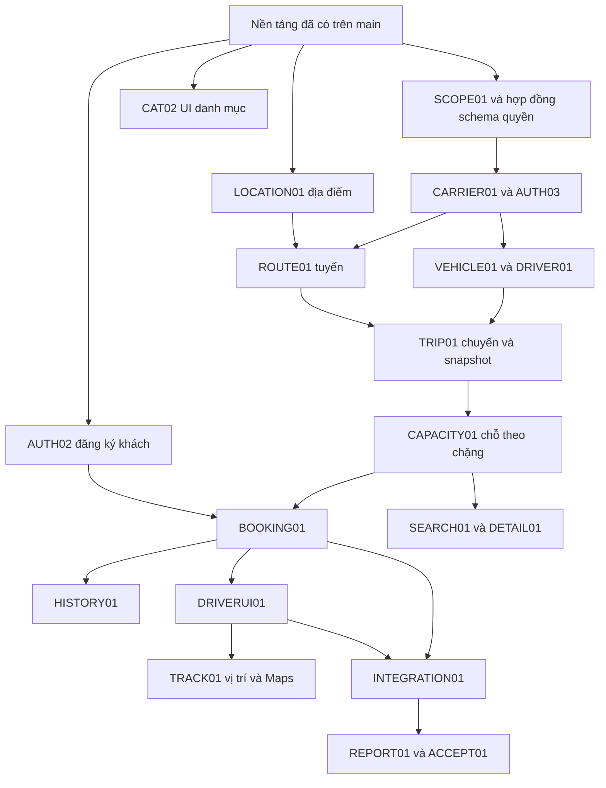

# Tiến độ và kế hoạch triển khai của nhóm VietRoute

## AUTH16 — Đang làm: cập nhật menu sau đổi mật khẩu

hieuv526034, nhánh `hieuv526034/auth16-dieu-huong-doi-mat-khau`, base b38dfcd, [Issue #81](https://github.com/hieuv526034/vietroute-web/issues/81). Rà soát yêu cầu đăng nhập admin phát hiện client đổi mật khẩu chỉ tải lại `/me`, không dựng lại header đã render với phiên mật khẩu tạm. Sửa điều hướng về `/account` sau thành công bằng cookie mới, giữ context/locale và thông báo; diễn giải rõ bước đổi mật khẩu lần đầu. Fixture client thật tái hiện thiếu điều hướng trước sửa, sau sửa kiểm thành công/CSRF/bấm lặp, 401/409/503 giữ bản nháp và query không cấp quyền. Local verify 140 Java/33 Node, format/check/rules/docs/diff đạt; hai context kiểm HTML thông báo vi/en dưới ROOT và context WAR. Trình duyệt thật đăng nhập được admin và về `/account`, vẫn hiện mật khẩu khởi tạo; chưa nhập/đổi mật khẩu tài khoản thật hoặc bỏ AUTH011. Đang chờ PR/CI, chưa ghi có trên main. Bước tiếp: PR qua kiểm tra rồi mở đúng form để chủ tài khoản nhập mật khẩu mới.

## ACCESS15 — Đã có trên main: khôi phục tài khoản bootstrap

Kiểm runtime theo yêu cầu chủ dự án ngày 24/10/2026, nguồn main 85a2074: biên dịch launcher local, khởi động ứng dụng thật với init/sync được cho phép và worker/mail tắt, không chạy fixture/test ghi lên Neon. Đăng nhập một lần bằng cấu hình bootstrap thành công, admin active/role ADMIN. Chẩn đoán JDBC transaction read-only xác nhận đủ 15 migration, 31/31 permission active, không thiếu mapping ADMIN/quyền source và VIEW 8/8 menu. Account hiện còn must_change_password=true nên AUTH011 vẫn chặn chức năng quản trị cho tới khi chủ tài khoản đổi mật khẩu lần đầu trên /account. Không reset hash, tự tắt cờ mật khẩu tạm, phát token mạo danh hoặc lưu JWT/password. Chưa xác nhận phiên sau đổi mật khẩu hay thao tác đầy đủ UI/provider; localhost là phiên chạy máy hiện tại, không phải dịch vụ luôn sẵn có trên máy khác. Render/provider/tải thật và business scope vẫn còn theo phụ thuộc.

Bổ sung đã có trên main qua [PR #78](https://github.com/hieuv526034/vietroute-web/pull/78), merge 538736a, head đã kiểm ed24838, hieuv526034, nhánh hieuv526034/access15-duong-cuu-ho. Loại /account khỏi target policy để policy từ chối cũ không khóa màn cứu hộ khi mất ADMIN; regression hai context tái hiện trước sửa rồi đạt sau sửa. Modal không lặp context khi WAR chạy dưới /demo; anonymous không được gọi recovery. Local verify 140 Java/30 Node, format/check/rules/docs/actionlint/bash/diff đạt. Ba CI đúng head đạt: [Docker/PostgreSQL](https://github.com/hieuv526034/vietroute-web/actions/runs/40079527467), [format/quy tắc](https://github.com/hieuv526034/vietroute-web/actions/runs/40079527523), [tài liệu](https://github.com/hieuv526034/vietroute-web/actions/runs/40079527461). Job 120829976097 kiểm policy cũ cùng ca mất role/permission/mapping, sửa nguyên tử/history lỗi rollback, restart giữ hash và toàn bộ regression nền. Không còn source dở ACCESS15; bàn giao sau chỉ cập nhật hướng dẫn local/khôi phục và bằng chứng này. Chưa kiểm trực quan browser hoặc chạy lại trên Neon/Render; không thay migration V001–V015.

[PR #77](https://github.com/hieuv526034/vietroute-web/pull/77), merge 3b4748d, head đã kiểm 29829e4, [Issue #76](https://github.com/hieuv526034/vietroute-web/issues/76), hieuv526034, nhánh hieuv526034/access15-khoi-phuc-admin, base d1fe84e. Theo yêu cầu chủ dự án: root init/servlet sync sửa role/permission/mapping ADMIN và tài khoản bootstrap thiếu, giữ hash/trạng thái/khóa/mật khẩu tạm của account đã có. Nút cứu hộ ở /account chỉ chính username bootstrap; API kiểm ID/username/tokenVersion/mật khẩu DB, không cần quyền đang mất, giữ CSRF/quota và AUTH011. Giữ tên bootstrap khỏi đăng ký/managed create, không cho gỡ ADMIN của account gốc; history ADMIN_RECOVERED cùng transaction và thu hồi phiên sau thành công. Chuyên đề phân quyền/API/UI đã ghi hợp đồng và giới hạn.

Local Maven verify 140 Java/30 Node đạt; formatter/check/rules/docs, actionlint/bash syntax/diff đạt. Helper CI biên dịch, renderer hai context xuất vi/en không thiếu key. Modal fixture kiểm submit lặp/busy, 503 giữ bản nháp và thành công xóa password/hiện đăng nhập lại. Ba CI đúng head đạt: [Docker/PostgreSQL](https://github.com/hieuv526034/vietroute-web/actions/runs/40077642164), [format/quy tắc](https://github.com/hieuv526034/vietroute-web/actions/runs/40077641931), [tài liệu](https://github.com/hieuv526034/vietroute-web/actions/runs/40077641927). Job 120824370609 kiểm mất cả role ADMIN/permission/mapping, mật khẩu tạm/ADMIN khác bị chặn, history lỗi rollback toàn bộ, sửa lại bằng nút và startup giữ hash, initializer username tùy cấu hình/idempotent; toàn bộ regression nền/chi phí cũng đạt. Không còn code dở ACCESS15. Không thay V001–V015, ghi/test Neon hoặc nghiệm thu browser/provider/Render thật. Bước tiếp: nghiệm thu UI trực quan và business scope theo phụ thuộc; nâng đồng nhất node/cấu hình username bootstrap trước khi cam kết bảo vệ tài khoản gốc trên toàn cụm.

## Mốc bàn giao nền phân quyền

Guard chung/registry động (ACCESS08), lịch sử DB (ACCESS09), picker/quota/phân trang (ACCESS10), chi phí query (ACCESS11), auth scope (SCOPE01) và snapshot service (ACCESS13) đã merge, bằng chứng ở các mục dưới. Thực hiện dưới identity hieuv526034; không phân bổ lại đóng góp đã có cho thành viên khác. Source đợt hoàn thiện này đã chốt, không có việc code dang dở chỉ giữ trong chat/.tools.

Bước tiếp: nghiệm thu trực quan picker/registry/scope khi có browser được phép (phiên hiện tại bị URL policy chặn); khi triển khai V015 cần drain/nâng toàn bộ node trước gán membership. Nghiệp vụ CARRIER01/AUTH03/DRIVER01/TRIP01/BOOKING01 vẫn theo bảng phụ thuộc, phải tích hợp scope/owner/tài xế trong DAO. Provider/Render, tải production, cảnh báo ngoài app và backup chỉ được đánh dấu hoạt động khi có bằng chứng riêng; smoke workload CI không thay nghiệm thu đó. Quyết định/hợp đồng ở chuyên đề, không nhân bản tại mốc bàn giao này.

## ACCESS13 — Đã có trên main

[PR #74](https://github.com/hieuv526034/vietroute-web/pull/74), merge `c1defff`, head đã kiểm `3aa49fc`, [Issue #73](https://github.com/hieuv526034/vietroute-web/issues/73), hieuv526034, nhánh `hieuv526034/access13-dong-bo-quyen-service`, base `b8b7289`. Rà soát chốt phát hiện lời gọi bean trực tiếp: guard đọc DB nhưng kiểm ủy quyền trong thân AccessService có thể nhìn Authentication cũ nếu không qua interceptor HTTP. Regression hai context với DB chỉ ACCESS_ASSIGN và principal/authority cũ ADMIN/CATALOG_DELETE tái hiện đi tới transaction; fixture chặn ngay, không có SQL. Sau sửa guard cho phép thì context dùng chính snapshot vừa đọc, actor role cũ bị AccessActors từ chối và quyền cũ không lọt kiểm tập con. Không thêm query hoặc cache quyền, giữ fail closed.

5 test guard/direct-service sau sửa và full verify 138 Java/28 Node đạt; helper biên dịch, format/check/rules/docs/diff đạt. Ba CI đúng head đạt: [Docker/PostgreSQL](https://github.com/hieuv526034/vietroute-web/actions/runs/40073857805), [format/quy tắc](https://github.com/hieuv526034/vietroute-web/actions/runs/40073857741), [tài liệu](https://github.com/hieuv526034/vietroute-web/actions/runs/40073857742). Job 120812912574 kiểm thân bean không còn ADMIN/BOOKING_DETAIL giả, 8 trạng thái guard, scope/quyền chéo/rollback và workload chi phí đều đạt. Đồng bộ mô tả tổng quan/nền mở rộng/quản trị từng bị cũ với guard động, tài khoản và scope hiện hành. Không còn code dở của ACCESS13. Không migration/query/cache mới hoặc ghi Neon; source cơ sở tại merge c1defff đã được kiểm, bản bàn giao sau chỉ cập nhật tài liệu. Phần auth scope SCOPE01 đã merge, business scope/owner/driver/booking tiếp tục theo phụ thuộc; UI picker/scope mới chưa kiểm trực quan do browser policy, không benchmark Neon/Render.

## SCOPE01 — Nền auth scope đã có trên main

[PR #72](https://github.com/hieuv526034/vietroute-web/pull/72), merge `b8b7289`, head đã kiểm `3686c53`, [Issue #71](https://github.com/hieuv526034/vietroute-web/issues/71), hieuv526034, nhánh `hieuv526034/scope01-nen-pham-vi`, base `0703a02`. V015 scope/membership/role scoped FK tập con role toàn cục; API/tab/modal ADMIN, version và lịch sử cùng transaction. DataScopeGuard đọc account/tokenVersion/scope/membership/đúng quyền DB; endpoint quyền scoped để UI không lấy quyền A hiện nút tại B. Thu hồi global role dọn FK, tăng version và ghi từng membership ảnh hưởng, không làm mất mapping không đổi. Chưa tạo CRUD nhà xe/chuyến/booking; DAO business vẫn phải tích hợp WHERE scope/quan hệ cha/con và owner/tài xế.

Local verify 137 Java/28 Node đạt; hai context kiểm ADMIN-only/query/payload và self-service, helper DataScopeInspector biên dịch, renderer xuất vi/en không thiếu key. Ba CI đúng head đạt: [Docker/PostgreSQL](https://github.com/hieuv526034/vietroute-web/actions/runs/40073012076), [format/quy tắc](https://github.com/hieuv526034/vietroute-web/actions/runs/40073012079), [tài liệu](https://github.com/hieuv526034/vietroute-web/actions/runs/40073012077). Job 120810328953 kiểm ba scope/quyền chéo/row ID/version/thu hồi/FK/rollback, API permission scoped và toàn bộ regression/chi phí đều đạt. Lượt CI trước fixture TEMP tham chiếu FK bảng thường bị PostgreSQL từ chối; chỉ sửa fixture, giữ V015 và mọi assertion. Browser vẫn bị policy chặn, chưa có nghiệm thu trực quan UI scope mới. Không ghi Neon hoặc đổi V001–V014. Bắt buộc nâng/drain tất cả node cũ trước khi gán membership vì code cũ thay global role bằng xóa toàn bộ mapping. Không đánh dấu business scope/BOOKING01/AUTH03 đã xong theo nền auth này.

## ACCESS11 — Đã có trên main

[PR #70](https://github.com/hieuv526034/vietroute-web/pull/70), merge `0703a02`, head đã kiểm `754aacb`, [Issue #69](https://github.com/hieuv526034/vietroute-web/issues/69), hieuv526034, nhánh `hieuv526034/access11-chi-phi-kiem-quyen`, base `69dbbf4`. Filter/me dùng một snapshot user/role/quyền không hash thay hai SELECT; guard dùng mảng thay lặp cột user theo mapping. Không cache hoặc bỏ lần kiểm DB interceptor/service. Verify local 135 Java đạt; helper biên dịch bằng dependency hiện có, formatter/check/rules/docs/actionlint/bash/diff đạt.

Ba CI đúng head đạt: [Docker/PostgreSQL](https://github.com/hieuv526034/vietroute-web/actions/runs/40070748548), [format/quy tắc](https://github.com/hieuv526034/vietroute-web/actions/runs/40070748565), [tài liệu](https://github.com/hieuv526034/vietroute-web/actions/runs/40070748545). JDBC 4 worker ×25 lượt, pool 2: 100 lượt/0 lỗi, p95 9,13ms, mean borrow 1,04ms/max 7ms. Projection user 2 statement gồm search_path so với nhánh credential 3; mỗi lượt user+guard 4 statement. HTTP 4 worker ×20 GET hai node: 80 request/0 lỗi, p95 24,91ms/p99 413,27ms, 114,98rps trong 0,696s. Pool waiting sau workload đều 0; max acquire tích lũy app khoảng 104/114ms, gồm hoạt động khác.

Đây là smoke workload nhỏ trên runner/DB cách ly, không điểm chịu tải tối đa hoặc SLA/benchmark Neon Free/Render/provider. Không có code dở ACCESS11; SCOPE01/AUTH03 và nghiệm thu production tiếp tục theo phụ thuộc, không coi quyền chức năng là scope nhà xe. Hợp đồng phép đo ở chuyên đề phân quyền.

## ACCESS10 — Đã có trên main

[PR #68](https://github.com/hieuv526034/vietroute-web/pull/68), merge `69dbbf4`, head đã kiểm `1287b48`, [Issue #67](https://github.com/hieuv526034/vietroute-web/issues/67), hieuv526034, nhánh `hieuv526034/access10-tra-cuu-registry`, base `31a30fd`. Role picker tên vi/en kèm mã, tìm không dấu và giữ lựa chọn khi lọc; registry tìm/trạng thái/count/phân trang PostgreSQL, quota hữu hạn từ cấu hình và không tính tombstone role. API danh sách tương thích đọc đủ trong trần an toàn, không cắt ở 512. Giữ ADMIN/delegation/version/history, không migration mới. Local verify 135 Java/28 Node, format/check/rules/docs/actionlint/bash/diff đạt; renderer hai context xuất vi/en không thiếu key. Ba CI đúng head đạt: [Docker/PostgreSQL](https://github.com/hieuv526034/vietroute-web/actions/runs/40070195877), [format/quy tắc](https://github.com/hieuv526034/vietroute-web/actions/runs/40070195818), [tài liệu](https://github.com/hieuv526034/vietroute-web/actions/runs/40070195795). SQL kiểm search/count/page, danh sách 599 mã, quota 600, hai request tranh suất cuối (chỉ một 201, một COM016/409) và tombstone trả suất đều đạt. Browser URL policy chặn mở lại fixture, chưa nghiệm thu trực quan picker/registry mới; ảnh ACCESS09 không thay bằng chứng này. Scope/chi phí DB còn tiếp tục.

## ACCESS09 — Đã có trên main

[PR #66](https://github.com/hieuv526034/vietroute-web/pull/66), merge `31a30fd`, head đã kiểm `92c6e10`, [Issue #65](https://github.com/hieuv526034/vietroute-web/issues/65), hieuv526034, nhánh `hieuv526034/access09-lich-su-va-ux`, base `230344f`. V014 auth_access_changes ghi projection whitelist/delta, actor/trace/version cùng transaction gán/quản trị/khóa tài khoản; lỗi lịch sử rollback mutation. API/tab/modal ADMIN + ACCESS_READ, retention mặc định 7 ngày/mục tiêu 1.000 sự kiện, cleanup batch/lock. V001–V013 nguyên vẹn, không ghi Neon.

Local verify 133 Java/27 Node; formatter/check/rules/docs/actionlint/bash syntax/diff đạt. Hai context kiểm quyền/query/delta/trace. HTML thật/API fixture riêng kiểm vi/en, filter/paging, modal/focus, 390px không tràn, loading, 503 giữ filter và 403 xóa dòng cũ/console sạch. Renderer/fixture nằm src/test/resources/dev để máy khác chạy lại, không đọc .env. Ba CI đúng head đạt: [Docker/PostgreSQL](https://github.com/hieuv526034/vietroute-web/actions/runs/40068782664), [format/quy tắc](https://github.com/hieuv526034/vietroute-web/actions/runs/40068782661), [tài liệu](https://github.com/hieuv526034/vietroute-web/actions/runs/40068782669). SQL xác nhận delta/actor, trigger từ chối audit làm rollback mapping/version, stale không ghi giả, ADMIN-only, role tắt, khóa tài khoản, retention/capacity và regression nền. CI đầu phát hiện xóa lại policy đổi 409 thành 404; đã sửa code giữ STALE_VERSION và chạy lại toàn bộ, không nới assertion.

Không còn code dở ACCESS09; đây là lịch sử app có retention, không audit bất biến/backfill SQL trực tiếp/bootstrap. Hợp đồng/ảnh tại chuyên đề phân quyền/API/UI. Tiếp theo ACCESS10, nền scope và chi phí DB; chưa coi mọi tải/provider/Render được nghiệm thu. Quy tắc khách một chuyến đang hoạt động ở BOOKING01 mới là đặc tả, chưa business implementation.

## ACCESS08 — Đã có trên main

[PR #64](https://github.com/hieuv526034/vietroute-web/pull/64), merge `230344f`, head đã kiểm `9ac28b1`, [Issue #63](https://github.com/hieuv526034/vietroute-web/issues/63), hieuv526034, nhánh `hieuv526034/access08-quan-ly-quyen-dong`, base `1fe53b0`. Bỏ lớp AccessRules và các biểu thức theo từng quyền; AccessResource/AccessOperation dùng chung một meta-PreAuthorize với MethodInvocation thật, HTTP actions sinh RESOURCE_ACTION. Startup thu thập cả service và mapping HTTP, registry/ADMIN vẫn sync có cờ/transaction; không tự cấp role thường. Giữ ADMIN/required/legacy alias, nhánh tạo/sửa, self-service và hai context. UI gợi VIEW trong tập ủy quyền và giải thích khi thiếu; không đổi schema/migration.

Đạt clean verify 129 Java và 27 Node tại mốc local; helper CI đã biên dịch với thư viện WAR, không còn class AccessRules cũ trong target. npm ci/format/format:check/rules/docs, actionlint/bash syntax/diff đạt. Có ca module mới không cần hằng Rule/Permission, upsert CREATE/UPDATE, collector service-only và gợi VIEW đơn/nhóm/bộ. Ba CI đúng head đạt: [Docker/PostgreSQL](https://github.com/hieuv526034/vietroute-web/actions/runs/40064924626), [format/quy tắc](https://github.com/hieuv526034/vietroute-web/actions/runs/40064924667), [tài liệu](https://github.com/hieuv526034/vietroute-web/actions/runs/40064924578). Job `120786037542` gọi generic meta-annotation qua proxy với PostgreSQL thật qua 8 trạng thái DB; regression auth/schema/cây/quyền/worker/hai node/phục hồi vẫn đạt. Hợp đồng tại [ACCESS08](../02-phat-trien/SCHEMA_VA_PHAN_QUYEN.md#guard-chung-theo-metadata-hàm--access08).

Tiếp tục theo yêu cầu chủ dự án: lịch sử trước–sau, UX/quota registry, nền scope và nghiệm thu chi phí DB vẫn phải xử lý sau phần guard chung, chưa hoàn thành bởi việc đổi annotation. Quy tắc khách chỉ một chuyến đặt/theo dõi đang hoạt động, hoàn tất mới đặt tiếp nhưng tra cứu đầy đủ nhà xe/chuyến đã ghi vào đặc tả BOOKING01; khác với membership quản trị. Không ghi/test trên Neon hoặc coi đặc tả booking là đã có code nghiệp vụ.

## ACCESS07 — Rà soát mức sẵn sàng, phần bổ sung chưa triển khai

[Issue #61](https://github.com/hieuv526034/vietroute-web/issues/61), hieuv526034, nhánh `hieuv526034/access07-ra-soat-phan-quyen`, đối chiếu source main `0c7ce42` ngày 24/10/2026. Phạm vi lượt này là đánh giá, không sửa hành vi phân quyền. Lõi RBAC, nhiều role/user, cây menu/hành động, guard DB ở HTTP/service, version/transaction, bảo vệ ADMIN và preview user đích đã có tại ACCESS03–06. Không kết luận đã sẵn sàng cho mọi tải hoặc mọi nghiệp vụ từ các bằng chứng đó.

Các việc còn lại, phân biệt lỗi tái hiện và phần cần bổ sung:

| Ưu tiên/phần | Kết quả rà soát và bằng chứng | Tiêu chí xử lý tiếp |
|---|---|---|
| P2 — lỗi UI ủy quyền | `access-tree.js` model.toggle tự thêm viewPermission khi tick hành động, không xét options.allowed của render. Tái hiện Node: actor chỉ được gán CATALOG_CREATE, tick CREATE tạo draft có cả CATALOG_VIEW. AccessService.replace chặn quyền ngoài actor, nên có thể trả 403 thay vì lưu lựa chọn hợp lệ; không phải đường nâng quyền backend | Chỉ gợi VIEW trong tập được gán; nếu thiếu thì giải thích, giữ CREATE độc lập. Kiểm tick đơn/nhóm/chọn bộ/tìm kiếm, không lặng bỏ quyền hoặc nới service |
| Bổ sung — lịch sử phân quyền | Có actor/time/version hiện tại, nhưng replacePermissions xóa rồi chèn mapping, replaceRoles thay mapping và deletePolicy xóa bản ghi; chưa có lịch sử trước–sau bền vững cho từng lần gán/thu hồi | Lưu sự kiện actor/đối tượng/quyền thêm-bỏ/thời điểm/kết quả trong cùng transaction; phân quyền xem, retention và giới hạn dung lượng rõ ràng. Nhật ký API đã lọc không thay thế lịch sử này |
| Bổ sung — UX và quy mô registry | Ma trận có tìm kiếm/checkbox nhóm/preview, nhưng picker role ở operations.js vẫn là select/checkbox toàn bộ mã role; chưa tìm theo tên vi/en như nhãn ở màn Tài khoản. Registry đang giới hạn 512 role/quyền mỗi bảng, policy 256; tombstone role vẫn tính quota tạo mới | Tên thân thiện kèm mã, tìm/lọc role và phân trang registry khi cần; hiển thị giới hạn có lý do. Không bỏ quota hoặc xóa tombstone tùy tiện để tuyên bố mở rộng không giới hạn |
| Cần nghiệm thu — chi phí DB | JWT filter, interceptor refresh và từng method guard đều có truy vấn; một request có thể đọc quyền nhiều lần. CI chức năng/hai node không phải benchmark Neon Free | Đo số query, p95, pool wait và 5xx trên môi trường cách ly/staging; tối ưu truy vấn trùng mà giữ kiểm DB hiện hành và fail closed. Không thêm Redis/Kafka theo suy đoán |
| Phụ thuộc nghiệp vụ — SCOPE01/AUTH03 | Role DRIVER/OPERATOR chưa gắn membership nhà xe; quyền chức năng không tự giới hạn dữ liệu theo nhà xe/tài xế/khách | Chốt mô hình quan hệ, lọc scope trong DAO và kiểm quan hệ cha/con; regression hai nhà xe không đọc/sửa chéo bằng đổi ID trước CRUD nghiệp vụ |

Kiểm lượt rà soát: 18 Java thuộc DatabaseAccessGuardTest/AccessTreeTest/AccessPolicyTest/ManagedAccountSecurityTest/AccessProfileSecurityTest đạt (0 lỗi); Node tái hiện riêng lỗi VIEW đạt assertion. Bằng chứng 129 Java/25 Node và Docker/PostgreSQL của nền hiện tại ở ACCESS06 phía dưới, không coi là đã kiểm benchmark hoặc UI với người dùng thật. Lượt này đọc code/UI và bằng chứng UI vi/en/390px đã có tại ACCESS05; chưa thao tác lại trình duyệt/provider hoặc DB production. Bước tiếp: sửa lỗi VIEW trước, bổ sung lịch sử/UX, nghiệm thu tải và hoàn thành scope trước nghiệp vụ. Các việc trong bảng chưa được đánh dấu hoàn thành chỉ vì đã ghi kế hoạch.

## ACCESS06 — Đã có trên main

[PR #59](https://github.com/hieuv526034/vietroute-web/pull/59), merge `f89fbef`, head đã kiểm `6db2de4`, [Issue #58](https://github.com/hieuv526034/vietroute-web/issues/58), hieuv526034, nhánh `hieuv526034/access06-kiem-quyen-db`, base `d8074c8`. Thay các biểu thức AccessRules bằng hàm `accessGuard` đọc account/tokenVersion và mapping role/quyền active trực tiếp DB; refresh trước guard HTTP/policy, giữ method security hai context và bảo vệ ADMIN/scope. Không cache quyền hoặc thay schema, không ghi trên Neon. Hợp đồng, chi phí SELECT và giới hạn thu hồi với thao tác đang chạy tại [thiết kế](../02-phat-trien/SCHEMA_VA_PHAN_QUYEN.md#hàm-kiểm-db-trong-preauthorize--access06).

Local Maven verify đạt 129 Java (0 lỗi), gồm state DB độc lập authorities, ANY/ALL, tokenVersion, mật khẩu tạm, hai context WAR/URL trực tiếp và DB lỗi đúng lúc PreAuthorize trả 503 trước controller. Đạt 25 Node, npm ci/format/format:check/rules/docs, actionlint/bash syntax/diff; helper CI đã biên dịch local. Ba CI đúng head đạt: [Docker/PostgreSQL](https://github.com/hieuv526034/vietroute-web/actions/runs/40061898876), [format/quy tắc](https://github.com/hieuv526034/vietroute-web/actions/runs/40061898880), [tài liệu](https://github.com/hieuv526034/vietroute-web/actions/runs/40061898882). Job `120777020078` gọi class production với PostgreSQL thật và Authentication cũ qua 8 trạng thái: mapping cấp/thu hồi, role/quyền/account tắt, mật khẩu tạm, stale/current tokenVersion. Regression schema/bootstrap/auth/email loopback/journal/cây VIEW/delegation/worker/hai node/mất-phục hồi DB tiếp tục đạt; WAR sạch test/dev/env.

Không còn code dở của ACCESS06. Không đổi UI/API payload, migration hoặc JWT key. Nâng các node trước khi xác nhận tất cả dùng guard mới; mỗi guard có truy vấn DB, thu hồi không hủy thao tác đã qua kiểm/đang chạy. Chưa nghiệm thu tải production/provider/Render Live. Bước tiếp: SCOPE01/AUTH03 và nghiệm thu provider/tải theo kế hoạch; không coi role DRIVER là membership hoặc phạm vi nhà xe.

## ACCESS05 — Đã có trên main

[PR #56](https://github.com/hieuv526034/vietroute-web/pull/56), merge `37343f8`, head đã kiểm `973c69f`, [Issue #55](https://github.com/hieuv526034/vietroute-web/issues/55), hieuv526034, nhánh `hieuv526034/access05-tai-khoan-va-cay-quyen`, base `3b5b933`. ADMIN cấp DRIVER/CUSTOMER/nhiều role nguyên tử; khu Tài khoản lọc/phân trang, khóa/mở + revoke JWT/challenge, preview capabilities theo policy user đích. Ma trận menu/hành động có checkbox nhóm, tìm giữ draft, gợi VIEW, quyền đã tắt vẫn gỡ được và tạo role trực tiếp. Bắt đổi mật khẩu tạm trước chức năng, gồm bootstrap còn flag; GET không chiếm quota credential. Hợp đồng tại [thiết kế](../02-phat-trien/SCHEMA_VA_PHAN_QUYEN.md#quản-trị-tài-khoản-và-ma-trận-menu--access05).

Đạt local 125 Java/25 Node; npm ci/format/format:check/rules/docs, actionlint/bash syntax/diff. UI HTML thật/API fixture vi/en: desktop/390px không tràn toàn trang, dấu bắt buộc, nhiều role, loading chặn Escape, 409 giữ draft, lọc nhóm/gợi VIEW, nhãn thao tác, gỡ quyền cũ, preset role tắt và console sạch; ảnh ở chuyên đề UI. Ba CI đúng head đạt: [Docker/PostgreSQL](https://github.com/hieuv526034/vietroute-web/actions/runs/40056779696), [format/quy tắc](https://github.com/hieuv526034/vietroute-web/actions/runs/40056779714), [tài liệu](https://github.com/hieuv526034/vietroute-web/actions/runs/40056779699). PostgreSQL thật kiểm cấp DRIVER/nhiều role, trùng/role sai không tạo dở, mật khẩu tạm/đổi và revoke JWT, bộ lọc rỗng/role/trạng thái, policy user đích, khóa/mở/version/challenge và giữ tombstone; tiếp tục đạt bộ nền/cây/quyền chéo hai node. Fixture tạo tài xế độc lập với bộ kiểm xóa role DRIVER, không nới guard để vượt bài kiểm.

Không còn code dở của ACCESS05. Không migration mới hoặc ghi Neon/provider; V001–V013 nguyên vẹn. Nâng/drain tất cả node trước khi cấp mật khẩu tạm; app local hiện bật DB_INIT nên restart sẽ sync menu/quyền mới. Chưa nghiệm thu Render/provider/tải production hoặc email mời tự động. Bước tiếp: SCOPE01/AUTH03 hồ sơ, membership và OPERATOR cấp tài xế trong đúng nhà xe; role DRIVER không tự tạo phạm vi dữ liệu nghiệp vụ.

## ACCESS04 — Đã có trên main

[PR #53](https://github.com/hieuv526034/vietroute-web/pull/53), merge `70fea08`, head đã kiểm `0a06d35`, [Issue #52](https://github.com/hieuv526034/vietroute-web/issues/52), hieuv526034, nhánh `hieuv526034/access04-resources-swagger`, base `87a831a`. Lọc kind/query ở PostgreSQL trước paging; UI tìm/giữ bộ lọc; spinner icon giữ 32×32; Swagger mô tả path/query/header, DTO kế thừa và payload/response. Mẫu chọn bộ quyền hệ thống lưu mapping cụ thể, giữ ADMIN theo lựa chọn chủ dự án; Permission nhận thêm LIST/DETAIL để nghiệp vụ mới tách danh sách/chi tiết. Không đổi quyền đã gán, lookup công khai, schema/migration hoặc ghi Neon.

Đạt 120 Java/24 Node; npm ci/format/format:check/rules/docs, actionlint/bash syntax/diff check. OpenAPI đối chiếu mọi mapping API và field/query/payload/response, giữ đúng header alias; hai context từ chối input lọc sai. UI fixture vi/en kiểm filter+paging/trang đầu/kết quả rỗng, mẫu gán 14 quyền không gom CRUD/ADMIN-only, loading nút Sửa 32×32 và mở modal/focus; iframe 390px không tràn filter, nút bên phải, không thay thiết bị thật. Ảnh ở [quy ước UI](../03-giao-dien/QUY_UOC_UI.md#lọc-resource-và-loading-icon--access04).

Ba CI đúng head đạt: [Docker/PostgreSQL](https://github.com/hieuv526034/vietroute-web/actions/runs/40051656672), [format/quy tắc](https://github.com/hieuv526034/vietroute-web/actions/runs/40051656685), [tài liệu](https://github.com/hieuv526034/vietroute-web/actions/runs/40051656653). PostgreSQL thật kiểm lọc/count/paging/từ khóa literal/validation; lấy bộ quyền từ cây, tạo role/user và gán qua API rồi mở các màn/API hệ thống; vẫn từ chối ADMIN-only và CRUD danh mục/ảnh. Registry DB nhận BOOKING_LIST/BOOKING_DETAIL độc lập, không giới hạn ở bootstrap. Regression hai node/nâng V013/auth/worker/phục hồi DB vẫn đạt. WAR không có test/dev/env.

Không còn code dở của ACCESS04. Không thay migration hoặc kiểm ghi Neon; provider/Render/tải production chưa nghiệm thu. Đồng nhất bản hỗ trợ LIST/DETAIL trên mọi node trước khi tạo/gán các mã mới. Quyết định/hợp đồng tại [phân quyền](../02-phat-trien/SCHEMA_VA_PHAN_QUYEN.md#bộ-quyền-hệ-thống-và-quyền-db--access04) và [API](../02-phat-trien/API_BASE.md#resource-và-swagger--access04). Bước tiếp: nghiệm thu runtime/provider, chốt SCOPE01/AUTH03 rồi mới làm nghiệp vụ; không coi quyền chức năng là scope nhà xe.

## ACCESS03 — Đã có trên main

[PR #50](https://github.com/hieuv526034/vietroute-web/pull/50), merge `4f116e9`, head đã kiểm `a29a942`, [Issue #49](https://github.com/hieuv526034/vietroute-web/issues/49), hieuv526034, nhánh `hieuv526034/access-tree-authorization`, base `c929705`. V013 VIEW/backfill/version; Java validate/sync function/action/endpoint/ADMIN; guard HTTP + AccessRules service; capabilities/menu động, cây gán và nguồn quyền. Quản trị ACCESS_* được ủy quyền trong tập quyền hiện có, chặn actor giả/overgrant/tự kích hoạt role-permission mạnh đã tắt. CONFIGURATION_READ tách khỏi SYSTEM_READ; role tắt được chuẩn bị mapping, danh sách role dùng một query; metadata bất biến theo context, quyền user đọc DB mỗi request.

Đạt 118 Java và 23 Node test; npm ci/format/format:check/rules/docs, actionlint/bash syntax/diff check. UI fixture HTML thật đã kiểm vi/en, khung iframe 390px, checkbox một phần/search/preview, endpoint, ADMIN chỉ đọc, loading/409 giữ draft và không có console error; ảnh ở [quy ước UI](../03-giao-dien/QUY_UOC_UI.md#cây-quyền-menu-và-capabilities--access03). Ba CI đúng head đạt: [Docker/PostgreSQL](https://github.com/hieuv526034/vietroute-web/actions/runs/40049405680), [format/quy tắc](https://github.com/hieuv526034/vietroute-web/actions/runs/40049405739), [tài liệu](https://github.com/hieuv526034/vietroute-web/actions/runs/40049405823). PostgreSQL thật đã kiểm VIEW+CREATE từ chối READ/UPDATE/DELETE, nhiều role/nguồn quyền, cùng JWT bị thu hồi chéo hai node, delegation/overgrant/kích hoạt quyền mạnh đã tắt, role inactive/số user, SYSTEM_READ không đọc cấu hình và clone V012 → V013/restart giữ hash/mapping/backfill một lần. Hai lỗi fixture version sau login và container đã bị bộ kiểm trước xóa được sửa trước khi CI đạt; không bỏ assertion hoặc làm yếu guard.

Không còn code dở của ACCESS03. V001–V012 giữ nguyên, không kiểm ghi/migrate trên Neon; Render/provider Live và tải production chưa nghiệm thu. V013 cần drain/dừng toàn bộ code trước VIEW khi nâng môi trường; chưa hỗ trợ rolling V012/V013 không gián đoạn. Quyết định và cách thêm module tại [chuyên đề](../02-phat-trien/SCHEMA_VA_PHAN_QUYEN.md#cây-chức-năng-và-quyền-hành-động--access03). Bước tiếp: nâng runtime có kiểm soát, nghiệm thu provider thật và chốt SCOPE01/AUTH03 trước nghiệp vụ; không coi role chức năng là scope nhà xe.

## ACCESS02 — Constants và thiết kế đã có trên main

[PR #47](https://github.com/hieuv526034/vietroute-web/pull/47), merge `6aed2fb`, head đã kiểm `a0ac82e`, [Issue #46](https://github.com/hieuv526034/vietroute-web/issues/46), hieuv526034, nhánh `hieuv526034/access-function-constants`. Gom group/mã quyền của AccessFunction về common.constant.AccessConstants dùng chung với Permission, giữ nguyên mã/guard. Phân tích hiện trạng, mô hình menu → hành động → endpoint, bootstrap/sync/guard và màn gán tại [chuyên đề phân quyền](../02-phat-trien/SCHEMA_VA_PHAN_QUYEN.md#phân-tích-cây-chức-năng-và-quyền-hành-động--access02). PR #47 chỉ chứa thiết kế, chưa có cây/VIEW/ủy quyền quản trị; triển khai tiếp được theo dõi riêng ở ACCESS03 phía trên.

Tại mốc PR #47 đã đạt: npm ci/format/format:check/rules/docs, Maven verify (112 Java test), 18 Node test và git diff --check. Ba CI đúng head đạt: [Docker/PostgreSQL](https://github.com/hieuv526034/vietroute-web/actions/runs/40038260502), [format/quy tắc](https://github.com/hieuv526034/vietroute-web/actions/runs/40038260421), [tài liệu](https://github.com/hieuv526034/vietroute-web/actions/runs/40038260487). Không thay migration hoặc chạy ghi trên Neon. Phần thiết kế cây/function/action/VIEW và ủy quyền của mốc này đã được triển khai tiếp tại ACCESS03, không phải backlog còn thiếu trên main hiện tại.

## FOUNDATION05 — Đã có trên main

[PR #44](https://github.com/hieuv526034/vietroute-web/pull/44), merge `46d0243`, head đã kiểm `6318e38`, [Issue #43](https://github.com/hieuv526034/vietroute-web/issues/43), hieuv526034. AccessFunction thu thập nhóm/quyền cùng mapping; quyền hiệu lực vẫn đọc DB/guard service. ADMIN bất biến, role khác sửa/tắt/xóa mềm có chặn user/policy, dọn mapping và giữ tombstone qua bootstrap. Đăng ký dùng chung khóa gán/xóa role. V012 bổ sung metadata và avatar FK/index, giữ nguyên V001–V011.

Ba check đúng head đạt: [Docker/PostgreSQL](https://github.com/hieuv526034/vietroute-web/actions/runs/40006060760), [format/quy tắc](https://github.com/hieuv526034/vietroute-web/actions/runs/40006060747), [tài liệu](https://github.com/hieuv526034/vietroute-web/actions/runs/40006060759). SQL thật kiểm 12 migration, role mặc định sửa/tắt/xóa/version/restart, user nhiều role/quyền thu hồi, user/policy chặn xóa và own/foreign avatar/profile. Ca song song giữ khóa từ session riêng xác nhận đăng ký phải chờ trước khi tạo CUSTOMER. Regression auth/schema/worker/mất-phục hồi DB và hai node vẫn đạt.

Local đạt 112 Java test/18 Node, npm ci/format/format:check/rules/docs, local compile và production WAR sạch test/dev/env; actionlint/bash syntax đạt. Hai Spring context kiểm URL trực tiếp của custom role, ADMIN bất biến, profile CSRF/mass assignment/required version, JWT cookie thật trên Swagger và OpenAPI upload 201. UI fixture vi/en kiểm menu/tab/required, loading nút/bảng, 409 giữ bản nháp và cập nhật tên header; khung iframe 390px đã sửa dropdown bị cắt. Tab UI mới không lỗi console; kiểm iframe không thay thiết bị thật. Ảnh minh họa ở quy ước UI.

Không còn code dở của đợt này. Runtime cần áp dụng V012; Cloudinary/Gmail/Render Live và tải production chưa nghiệm thu. Avatar là ảnh public, dùng MediaService chung, chỉ own READY/version; ảnh đang tham chiếu bị chặn xóa. Hoàn tất cập nhật tất cả node trước khi dùng avatar để tránh code cũ chưa kiểm liên kết. Bước tiếp: provider staging và SCOPE01/hợp đồng cấp tài khoản trước nghiệp vụ. Commit giữ tác giả thực tế, không phân bổ lại lịch sử theo kế hoạch nhóm.

## FOUNDATION04 — Đã có trên main

[PR #41](https://github.com/hieuv526034/vietroute-web/pull/41), merge `0237ad3`, head đã kiểm `b435d65`, [Issue #40](https://github.com/hieuv526034/vietroute-web/issues/40), hieuv526034. Bổ sung chẩn đoán nguồn DB/local JVM property/BOM; đăng ký CUSTOMER chờ email, resend/kích hoạt, bind email cho user cũ, quên/reset, lịch sử hai mật khẩu cũ; journal lưu/filter/hiển thị user đã xác minh. Giữ 5 sai/khóa 15 phút theo chủ dự án, role là nhóm quyền, không SMS/provider trả phí. V011 mới, giữ nguyên V001–V010.

Ba check đúng head đạt: [Docker/PostgreSQL](https://github.com/hieuv526034/vietroute-web/actions/runs/39997687026), [format/quy tắc](https://github.com/hieuv526034/vietroute-web/actions/runs/39997686907), [tài liệu](https://github.com/hieuv526034/vietroute-web/actions/runs/39997687083). SQL thật kiểm 11 migration, đăng ký pending/CUSTOMER, giả mạo role, activation/reset/replay/expiry, current + hai hash cũ, JWT cũ bị thu hồi, encrypted outbox/retry SMTP loopback và journal filter đúng user. Regression cũ về hai node/schema/quyền/DB mất-phục hồi vẫn đạt. Lượt CI đầu phát hiện tên V011 dài hơn history VARCHAR(40); đã rút gọn trước khi merge và thêm regression giới hạn tên, không đổi migration đã áp dụng.

Kiểm local đạt 109 Java test/16 Node test, npm ci/format/format:check/rules/docs, local compile, production package/WAR sạch test/dev/env, actionlint/bash syntax. UI fixture vi/en đã kiểm required, modal lỗi 409 giữ bản nháp/khóa link khi bận, journal user/khách/filter ID; không thiếu locale hoặc lỗi console. Kiểm Neon chỉ SELECT xác nhận kết nối/admin/hash/history tại thời điểm chẩn đoán, không ghi/seed/reset. Chưa tái hiện lỗi cụ thể của IDE hay nghiệm thu Gmail/Render Live/tải production.

Runtime cần chủ động áp dụng V011 bằng initializer; luồng email mặc định tắt, cần bật self-service/mail/worker và cấu hình Gmail, chưa nghiệm thu inbox thật. Log cũ/khách/chưa xác minh giữ actor NULL; không suy ngược user. Không còn phần code dở của FOUNDATION04. Bước tiếp: nghiệm thu provider khi có cấu hình, SCOPE01/hợp đồng cấp tài khoản trước nghiệp vụ. Hợp đồng và giới hạn tại [API](../02-phat-trien/API_BASE.md), [chạy local](../01-bat-dau/CHAY_LOCAL_VA_CLOUDINARY.md), [nhật ký](../04-van-hanh/NHAT_KY_API_VA_DEBUG.md).

Cập nhật 24/10/2026, đối chiếu main tại `f89fbef` sau PR #59. Nền tảng ban đầu ở [PR #13](https://github.com/hieuv526034/vietroute-web/pull/13), kế hoạch nhóm ở [PR #21](https://github.com/hieuv526034/vietroute-web/pull/21), UI quản trị ở [PR #22](https://github.com/hieuv526034/vietroute-web/pull/22); các đợt bổ sung gần nhất ghi bên dưới. Cửa nghiệm thu trước nghiệp vụ tại [NGHIEM_THU_NEN_TANG.md](NGHIEM_THU_NEN_TANG.md). Chức năng mới chỉ trở thành Đã có trên main khi PR tương ứng merge. Tài liệu này theo dõi trạng thái; [PHAN_CONG.md](PHAN_CONG.md) là nguồn username/email và phạm vi phụ trách, [đặc tả](DAC_TA_HE_THONG_XE_KHACH.md) là nguồn luồng F01–F19 và ca nghiệm thu T01–T21. Chuyển máy/tiếp tục phiên mới theo [hướng dẫn bàn giao](../06-ai-va-ban-giao/AI_VA_BAN_GIAO.md).

## FOUNDATION03 — Đã có trên main

[PR #38](https://github.com/hieuv526034/vietroute-web/pull/38), merge `2a2e410`, head đã kiểm `599b8a4`, [Issue #37](https://github.com/hieuv526034/vietroute-web/issues/37), hieuv526034. Toàn bộ media chuyển về common, chữ ký controller ApiResult<T>, config có comment tiếng Việt và danh bạ UI/API tự đồng bộ vào DB lúc startup. Role là nhóm quyền; không tạo tầng nhóm trùng. V010 mới; V001–V009 giữ nguyên byte/checksum. Không tự cấp quyền, sửa public từ DB hoặc xóa route vắng trên một node khác phiên bản.

Bằng chứng tại đúng head: [Docker + PostgreSQL](https://github.com/hieuv526034/vietroute-web/actions/runs/39990109186), [format/quy tắc](https://github.com/hieuv526034/vietroute-web/actions/runs/39990108496), [tài liệu](https://github.com/hieuv526034/vietroute-web/actions/runs/39990108606) đều đạt. SQL thật kiểm 10 migration, sync hai node, audit system, public/read-only, phân trang, thiếu quyền, route bản cũ còn sau restart và toàn bộ regression auth/schema. Lượt CI đầu dừng vì fixture dùng JWT đã bị thu hồi; đã lấy token mới để kiểm đúng 403, giữ assertion token cũ trả 401. Không nới xác thực để làm check xanh.

Kiểm local: 103 Java test (0 lỗi), 16 Node test, npm ci/format/format:check/rules/docs, local compile, production package/WAR loại test/dev/env, actionlint/bash -n đều đạt. UI fixture vi/en: tab tài nguyên, next, chọn size, nhảy trang cuối bằng Enter, không lỗi console/thiếu locale; bảng rộng cuộn trong vùng riêng. Không chạy migration/test lên Neon; chưa nghiệm thu Cloudinary/Gmail/Render Live hoặc tải production. Runtime cần áp dụng V010 trước khi bật sync; cờ sync không khai báo mặc định theo DB_INIT. Bước tiếp: SCOPE01/hợp đồng cấp tài khoản và nghiệp vụ theo phân công; không còn phần code dở của FOUNDATION03.

FOUNDATION02 — **Đã có trên main**, `hieuv526034`, merge `df22688` qua [PR #35](https://github.com/hieuv526034/vietroute-web/pull/35), [Issue #34](https://github.com/hieuv526034/vietroute-web/issues/34). Registry role/quyền động, chính sách menu/endpoint và UI, launcher đọc env riêng, config theo trách nhiệm, lõi media dùng chung/sửa metadata, online/bất thường PostgreSQL đã được tích hợp. Kiểm local: `mvnw clean verify` và bộ Surefire cách ly đạt 100 test Java; 16 test Node, format/rule/docs đạt; UI vi/en fixture 390px gồm validation, 409 giữ bản nháp, phân trang online và sửa ảnh. Launcher local biên dịch, WAR production sạch test/launcher/env. Parser `.env` riêng đã được kiểm trong RAM, không mở connection hoặc in secret.

Ba check CI tại head `bb1d806` đều đạt: [Docker + PostgreSQL tạm](https://github.com/hieuv526034/vietroute-web/actions/runs/39984093703), [format/quy tắc](https://github.com/hieuv526034/vietroute-web/actions/runs/39984093458), [tài liệu](https://github.com/hieuv526034/vietroute-web/actions/runs/39984093477). SQL thật kiểm migration/seed hai node, registry/mapping, vô hiệu hóa quyền live, policy menu/endpoint, metadata owner/version, online/counter chia sẻ, schema tùy chọn/rename và phục hồi DB/node. V001–V006 giữ byte/checksum; V007–V009 chưa chạy trên Neon để kiểm build, chỉ áp dụng khi runtime startup bật initializer. Không nghiệm thu tải production/provider/Render Live từ CI này. Hợp đồng tại [nền tảng mở rộng](../02-phat-trien/NEN_TANG_MO_RONG.md). Chưa bắt đầu nghiệp vụ nhà xe/chuyến/booking.

## 1. Cách đọc trạng thái

| Trạng thái | Ý nghĩa |
|---|---|
| Đã có trên main | Có code đã merge và bằng chứng PR/kiểm tra; không tự có nghĩa đã deploy hoặc thử provider production |
| Một phần | Có API/base hoặc UI giới hạn; cột còn thiếu ghi rõ phần chưa triển khai |
| Chưa triển khai | Chưa có chức năng tương ứng trong source main đã đối chiếu; được giao trong kế hoạch |
| Chờ cấu hình ngoài app | Source/adapter/mẫu đã có; credentials, collector/receiver hoặc dịch vụ vận hành thật chưa được xác nhận |

Không tính phần trăm tiến độ bằng số dòng code, số nhánh hoặc số task. Có nhánh chuẩn bị, đặc tả, enum/role hoặc adapter không đồng nghĩa đã có nghiệp vụ hoàn chỉnh. Tài liệu chỉ xác nhận những gì có trên main tại mốc nêu trên, không kết luận về công việc chưa push hoặc nhánh riêng của thành viên.

APIJOURNAL01 đã có trên main qua [PR #25](https://github.com/hieuv526034/vietroute-web/pull/25), sau đó chuyển lịch sử từ RAM sang PostgreSQL tại `dee2af5` qua [PR #27](https://github.com/hieuv526034/vietroute-web/pull/27), do `hieuv526034` thực hiện. V005, retention mặc định 7 ngày, mục tiêu 10.000 dòng, filter/paging SQL và cleanup batch/lock; không cache/queue lịch sử trong RAM. Có UI filter/modal và xuất cURL/Postman, kiểm ADMIN + SYSTEM_READ. Không coi journal là gateway/audit bất biến hoặc cam kết ghi đủ khi storage lỗi; xem [hợp đồng và giới hạn](../04-van-hanh/NHAT_KY_API_VA_DEBUG.md).

Onboarding và rule format IntelliJ đã merge qua [PR #26](https://github.com/hieuv526034/vietroute-web/pull/26): [mục lục đọc theo nhóm/thứ tự](../README.md), [Format IntelliJ](../01-bat-dau/FORMAT_INTELLIJ.md), codeStyles/EditorConfig và Run Format/Format Check. Đợt DOCS02 chia thư mục 01–06/99, gộp hướng dẫn UI/AI và rút gọn lộ trình theo [PR #33](https://github.com/hieuv526034/vietroute-web/pull/33); kiểm trạng thái PR để xác nhận merge. Mọi lượt sửa source chạy format/check trước commit. Không đổi người phụ trách/tác giả của module hoặc coi bổ sung tài liệu là nghiệp vụ đã triển khai.

Audit system đã merge tại `ce13d75` qua [PR #28](https://github.com/hieuv526034/vietroute-web/pull/28): V006, actor system (ID 0), audit không NULL cho seed/tác vụ tự động và chặn đăng nhập/gán role cho định danh kỹ thuật. Quy tắc học và triển khai nằm tại [audit và system](../02-phat-trien/AUDIT_VA_SYSTEM.md).

UI dùng chung và tài liệu công nghệ đã merge tại `6f038ec` qua [PR #29](https://github.com/hieuv526034/vietroute-web/pull/29): phân trang chọn size/nhảy trang, cột thao tác 96px, nút bên phải, validation cạnh field, giữ bản nháp khi 401, Home/login điều hướng theo principal. Export debug dùng URL thực từ origin/context và token placeholder theo lựa chọn chủ dự án. [PR #30](https://github.com/hieuv526034/vietroute-web/pull/30) tiếp tục chỉnh khoảng cách menu, gom bộ lọc/nút danh mục và dấu bắt buộc từ lúc mở modal. Xem [quy ước bảng/form](../03-giao-dien/QUY_UOC_UI.md), [công nghệ và thư viện](../01-bat-dau/CONG_NGHE_VA_THU_VIEN.md). Hai đợt do `hieuv526034` thực hiện; không bắt đầu nghiệp vụ nhà xe/chuyến/booking.

Mốc kiểm PR #30: 91 test Java và 10 test Node đạt, format/tài liệu đạt, ba check CI đạt gồm Docker/PostgreSQL tạm. Kiểm giao diện vi/en và mobile 390px bằng fixture riêng; không xác nhận provider/Render Live hoặc tải production từ kết quả này. Các số test tại mốc cũ bên dưới được giữ nguyên làm bằng chứng lịch sử.

Ngữ cảnh bàn giao đã merge tại `ce2088e` qua [PR #31](https://github.com/hieuv526034/vietroute-web/pull/31). AI01 tiếp tục chuẩn hóa điểm đọc Codex/Copilot/Cursor/Claude/Gemini và checker phát triển tại [PR #32](https://github.com/hieuv526034/vietroute-web/pull/32), do `hieuv526034` thực hiện; kiểm trạng thái merge/CI của PR để xác nhận có trên main. [Quy trình AI](../06-ai-va-ban-giao/AI_VA_BAN_GIAO.md) chốt thứ tự đọc, nguồn quy tắc/trạng thái/quyết định, mẫu bàn giao và giới hạn tự nạp. Mốc kiểm của đợt AI01: format đạt, rule checker đạt trên 182 file Java, 15 test Node và 303 link/36 tài liệu đạt trước bổ sung dòng tiến độ này; không chạy lại Maven hoặc thử trên Neon. Bộ checker chỉ kiểm tĩnh, không chứng minh AI thực sự hiểu hoặc branch protection đã được bật.

## 2. Nền tảng đã thực hiện và phần còn thiếu

Phần code nền tảng bên dưới hiện được commit dưới định danh `hieuv526034 <hieuv526034@gmail.com>`. Không phân bổ lại các commit này cho người khác. Cột chủ trì tiếp theo ở mục 4 là kế hoạch, không phải tác giả đã hoàn thành.

| Mã | Phần việc | Trạng thái thực tế | Còn thiếu/giới hạn | Bằng chứng |
|---|---|---|---|---|
| BASE01 | Base entity/DTO/request/response/page, audit Instant, locale vi/en, validation, lỗi/API envelope và Swagger | Đã có trên main | Module mới phải dùng lại và bổ sung key/permission riêng | [PR #3](https://github.com/hieuv526034/vietroute-web/pull/3), [#4](https://github.com/hieuv526034/vietroute-web/pull/4), [#5](https://github.com/hieuv526034/vietroute-web/pull/5) |
| DB01 | JDBC/HikariCP, transaction, schema cấu hình một nơi, migration V001–V013/checksum/lock, seed admin/catalog và audit system | Đã có trên main | Chưa có bảng carrier/route/trip/booking/tracking; không tự chạy test trên Neon | [PR #7](https://github.com/hieuv526034/vietroute-web/pull/7), [#9](https://github.com/hieuv526034/vietroute-web/pull/9), [#11](https://github.com/hieuv526034/vietroute-web/pull/11), [#27](https://github.com/hieuv526034/vietroute-web/pull/27), [#28](https://github.com/hieuv526034/vietroute-web/pull/28), [#50](https://github.com/hieuv526034/vietroute-web/pull/50) |
| AUTH01 | Đăng nhập/me/đổi mật khẩu/logout, JWT/BCrypt, CSRF, khóa sai và thu hồi token | Đã có trên main | Đăng ký/email/reset đã có tại AUTH02/FOUNDATION04; cấp tài khoản theo nhà xe và SMS/phone OTP chưa triển khai | [PR #3](https://github.com/hieuv526034/vietroute-web/pull/3), [#8](https://github.com/hieuv526034/vietroute-web/pull/8) |
| ACCESS01 | Registry role/quyền, API/UI ma trận/gán, policy menu/endpoint và hành động riêng | Đã có trên main | Cấp tài khoản mới/membership/scope nhà xe thuộc nghiệp vụ tiếp theo; policy chỉ siết thêm guard nền | [PR #8](https://github.com/hieuv526034/vietroute-web/pull/8), [#9](https://github.com/hieuv526034/vietroute-web/pull/9), [UI quản trị](../04-van-hanh/QUAN_TRI_HE_THONG.md) |
| ACCESS03 | Cây function/action/endpoint, VIEW tách READ, startup sync, capabilities/menu/nút, nguồn quyền và ủy quyền ACCESS_* | Đã có trên main | V013 cần dừng code cũ trước khi nâng; scope nhà xe thuộc SCOPE01, không tự cấp quyền mới cho role thường | [PR #50](https://github.com/hieuv526034/vietroute-web/pull/50), [chuyên đề](../02-phat-trien/SCHEMA_VA_PHAN_QUYEN.md#cây-chức-năng-và-quyền-hành-động--access03) |
| CAT01 | Catalog VEHICLE_TYPE/BOOKING_SOURCE: API đọc/tạo/sửa/xóa mềm, audit/version và seed | Một phần | UI `/admin` đã merge: tạo/sửa/xóa mềm/version, lọc nhóm, phân trang và validation chung. Chưa có khôi phục UI hoặc danh mục địa điểm | [PR #3](https://github.com/hieuv526034/vietroute-web/pull/3), [#9](https://github.com/hieuv526034/vietroute-web/pull/9), [#29](https://github.com/hieuv526034/vietroute-web/pull/29), [#30](https://github.com/hieuv526034/vietroute-web/pull/30) |
| TRAFFIC01 | Quota IP, semaphore request/login/upload, giới hạn byte/pixel, timeout và trusted proxy | Đã có trên main | Quota memory theo từng node; chưa nghiệm thu tải production. Không bật Kafka/Redis | [PR #8](https://github.com/hieuv526034/vietroute-web/pull/8), [#11](https://github.com/hieuv526034/vietroute-web/pull/11), [#13](https://github.com/hieuv526034/vietroute-web/pull/13) |
| JOB01 | Queue PostgreSQL, SKIP LOCKED/lease/retry/DEAD, API/UI xem và retry, shutdown/retention | Đã có trên main | Worker tắt mặc định. UI thêm lọc trạng thái/phân trang/chi tiết/retry có version; at least once, chưa có gia hạn lease cho tác vụ dài | [PR #8](https://github.com/hieuv526034/vietroute-web/pull/8), [#13](https://github.com/hieuv526034/vietroute-web/pull/13), [UI quản trị](../04-van-hanh/QUAN_TRI_HE_THONG.md) |
| MAIL01 | Gmail HTTPS OAuth2 và SMTP adapter, enqueue/outbox, trạng thái job | Chờ cấu hình ngoài app | Mail tắt mặc định; chưa thử gửi thật, chưa có template thư nghiệp vụ hay UI gửi mail riêng | [PR #8](https://github.com/hieuv526034/vietroute-web/pull/8), [hướng dẫn](../02-phat-trien/NEN_TANG_MO_RONG.md) |
| MEDIA01 | Lõi common.media + public controller, API/UI upload/xem/sửa metadata/xóa, JPEG/PNG, owner/version và cleanup | Chờ cấu hình ngoài app | Media tắt mặc định; chưa thử Cloudinary thật. Chưa gắn ảnh vào nhà xe/xe; không dùng cho giấy tờ riêng tư | [PR #11](https://github.com/hieuv526034/vietroute-web/pull/11), [hướng dẫn](../01-bat-dau/CHAY_LOCAL_VA_CLOUDINARY.md) |
| MONITOR01 | UI `/monitoring` vi/en; tài nguyên và online/bất thường DB, token scrape riêng và probe DB opt-in | Đã có trên main | Tab tài nguyên giữ 30 mẫu trong tab; tab online dùng DB và ADMIN + SYSTEM_READ. Online là cửa sổ 3 phút, có missed writes; heap không phải tổng RAM container | [PR #13](https://github.com/hieuv526034/vietroute-web/pull/13) |
| ALERT01 | Dashboard Grafana mẫu, 12 luật cảnh báo và kiểm thử rule | Chờ cấu hình ngoài app | Chưa có collector/receiver thật hoặc thử thông báo end-to-end; DB probe tắt mặc định | [PR #13](https://github.com/hieuv526034/vietroute-web/pull/13), [vận hành](../04-van-hanh/GIAM_SAT_VA_VAN_HANH.md) |
| BUILD01 | Maven WAR/Docker, cache CI, Render main/checksPass, loại test/launcher khỏi production | Đã có trên main | Chưa xác nhận Render service Live trong tài khoản; CI xanh không tự chứng minh deploy hoàn tất | [PR #1](https://github.com/hieuv526034/vietroute-web/pull/1), [#13](https://github.com/hieuv526034/vietroute-web/pull/13) |
| DEV01 | Run/Debug IntelliJ, formatter, constants và quy hoạch common, tài liệu tiếng Việt | Đã có trên main | Nâng Spring major là đợt riêng; không gọi stack hiện tại là toàn bộ công nghệ mới nhất | [PR #10](https://github.com/hieuv526034/vietroute-web/pull/10), [#11](https://github.com/hieuv526034/vietroute-web/pull/11), [#12](https://github.com/hieuv526034/vietroute-web/pull/12), [#13](https://github.com/hieuv526034/vietroute-web/pull/13) |

Bằng chứng kiểm tra tại PR #13: 73 test Java, 2 test Swagger, formatter, WAR production, smoke HTTP, kiểm rule và Docker integration đã qua. CI có DB tạm/mất-phục hồi DB, hai node và dừng một node; đây không phải nghiệm thu tải production, backup hay provider thật. Không có dữ liệu nhà xe/chuyến/booking demo được tạo chỉ vì base seed đã chạy.

## 3. Tổng quan theo từng thành viên

| Thành viên | Phần đã được xác nhận trên main | Công việc tiếp theo theo phân công | Điểm phối hợp |
|---|---|---|---|
| `hieuv526034` | Phần nền tảng ở mục 2, theo lịch sử commit/PR | Tenant/scope và cấp tài khoản nhà xe; cơ chế chỗ theo chặng, transaction tích hợp, Geolocation/Maps, vận hành và nghiệm thu | Chốt schema/permission/service contract; review phần khó; không nhận thay đóng góp thực của nhóm |
| `BangPhamIT` | Chưa ghi nhận commit nghiệp vụ của thành viên này tại mốc đối chiếu | Chuyến/phân xe-tài xế/lịch chồng/snapshot; booking WEB/PHONE và vòng đời đơn; tổng hợp báo cáo cùng Hieu | Dùng chung transaction/tồn chỗ với Hieu, không viết bộ đếm chỗ khác |
| `anhhoang104` | Chưa ghi nhận commit nghiệp vụ của thành viên này tại mốc đối chiếu | Nghiệm thu/tích hợp catalog đã có; CRUD nhà xe, xe và thông tin tài xế, validation/trạng thái/phân trang | Auth cấp credential/quyền; Anh quản lý hồ sơ nghiệp vụ, không sửa password hash |
| `hiencoi250404-design` | Chưa ghi nhận commit nghiệp vụ của thành viên này tại mốc đối chiếu | Địa điểm, tuyến một chiều, điểm dừng/giờ/giá vi/en; UI tìm/chi tiết/lịch sử đơn khách | Gọi service chung của Bang/Hieu; phối hợp Maps, không tự tính lại chỗ ở JS |

Nhánh đã chuẩn bị chưa phải bằng chứng đã viết code. Dùng đúng email trong [PHAN_CONG.md](PHAN_CONG.md), commit/PR tiếng Việt, không đổi author để chia đóng góp trên giấy.

## 4. Backlog nghiệp vụ và đầu ra bàn giao

Các dòng dưới là **nghiệp vụ còn triển khai**, trừ CAT02 có UI, AUTH02 có email lifecycle, quản trị danh tính ADMIN của AUTH03 tại ACCESS05 và nền auth scope/membership của SCOPE01 tại PR #72; xem PR #29/#30, #41 và #56, bằng chứng nghiệm thu tại [NGHIEM_THU_NEN_TANG.md](NGHIEM_THU_NEN_TANG.md). Người chủ trì là người dự kiến triển khai thực tế; khi PR merge phải cập nhật bằng chứng và tác giả thực, không đánh dấu xong theo kế hoạch.

| Mã | Chủ trì / phối hợp | API, UI và quy tắc cần hoàn thành | Phụ thuộc | Nghiệm thu gắn đặc tả |
|---|---|---|---|---|
| SCOPE01 | Hieu / Anh, Bang | Đã có nền auth scope/membership/role scoped và DataScopeGuard tại PR #72. Còn gắn FK scope duy nhất vào nhà xe/DAO business, WHERE ID + scope, quan hệ cha/con/owner/tài xế và luồng OPERATOR theo nhà xe; chưa coi bảng TEMP CI là business đã làm | DB01, AUTH01, ACCESS01 | F02/F04; T01/T11: hai nhà xe không đọc/sửa chéo bằng cách đổi ID |
| AUTH02 | Hieu đã triển khai API/UI; Hien phối hợp tích hợp luồng khách | Đã có trên main qua PR #41: đăng ký CUSTOMER pending, xác minh email, quên/reset, lịch sử mật khẩu; không nhận role/audit/tenant client | Cần cấu hình Gmail và bật self-service/mail/worker để dùng thật | F01/giả mạo role đã kiểm CI; inbox/provider thật và SMS/phone OTP chưa nghiệm thu/triển khai |
| AUTH03 | Hieu / Anh | Đã có ADMIN cấp/khóa danh tính và gán nhiều role tại ACCESS05/PR #56. Còn OPERATOR cấp DRIVER gắn membership/hồ sơ đúng nhà xe; credential ở auth, quy tắc admin cuối/token revocation | SCOPE01, hợp đồng CARRIER01/DRIVER01 | F02/F04; không cấp tài khoản ngoài scope, khóa không xóa lịch sử |
| CAT02 | Hieu đã merge UI / Anh nghiệm thu, tích hợp tiếp | UI tạo/sửa/xóa mềm/xác nhận/version/conflict, lọc nhóm, phân trang và validation đã có; cập nhật gần nhất [PR #29](https://github.com/hieuv526034/vietroute-web/pull/29)/[#30](https://github.com/hieuv526034/vietroute-web/pull/30). Anh kiểm/tích hợp khi dùng cho xe; không phân bổ commit của Hieu thành đóng góp đã làm của Anh | CAT01 | F03; conflict 409, thiếu quyền bị chặn cả API, không phá tham chiếu |
| CARRIER01 | Anh / Hieu | Nhà xe CRUD, hồ sơ/liên hệ/trạng thái, UI ADMIN/OPERATOR theo phạm vi, code duy nhất và ảnh logo public qua mediaId được kiểm owner | SCOPE01, AUTH03 contract; MEDIA01 khi bật ảnh | F02; T01/T11, khóa thay vì xóa dữ liệu còn liên quan |
| VEHICLE01 | Anh / Hieu | Xe thuộc nhà xe: mã/biển số/loại xe/sức chứa/trạng thái/ảnh public, API+form+phân trang+version | CARRIER01, CAT02; MEDIA01 khi dùng ảnh | F04; biển số trùng, capacity <=0, đổi carrierId giả và xe đang được sử dụng |
| DRIVER01 | Anh / Hieu sở hữu auth | Hồ sơ tài xế/liên hệ/trạng thái, liên kết tài khoản do auth cấp, UI đúng nhà xe; không upload giấy tờ riêng tư qua media public | CARRIER01, AUTH03 | F04; tài khoản/hồ sơ khác nhà xe, khóa và giữ lịch sử |
| LOCATION01 | Hien / Hieu review schema | Tỉnh/thành/địa điểm, tên vi/en, địa chỉ/tọa độ hợp lệ, UI CRUD và trạng thái; dữ liệu đang tham chiếu không bị xóa mất | BASE01, chốt schema/quyền | F03; địa điểm không tồn tại, tọa độ sai, dữ liệu đang dùng |
| ROUTE01 | Hien / Anh, Bang | Tuyến một chiều thuộc nhà xe, >=2 điểm theo thứ tự, ngày-giờ tương đối qua đêm và giá theo mốc, API+UI thêm/sắp điểm; hai chiều là hai bản ghi riêng | SCOPE01, CARRIER01, LOCATION01 | F05; T02/T03/T09/T13; không đảo dữ liệu cũ khi sửa tuyến |
| TRIP01 | Bang / Anh, Hien | Tạo chuyến từ tuyến, snapshot điểm/giờ/giá, phân xe/tài xế, vòng đời DRAFT/OPEN/IN_PROGRESS/COMPLETED/CANCELLED, API+UI; kiểm lịch chồng trong transaction để hai request không lọt | VEHICLE01, DRIVER01, ROUTE01 | F06; T03/T13/T14/T17; Instant và cùng nhà xe, active, trạng thái đúng |
| CAPACITY01 | Hieu / Bang | Tồn chỗ theo từng chặng, min số chỗ còn trên đoạn; transaction/khóa dùng chung và rollback. Thống nhất thứ tự khóa trip → booking → segments tăng dần; API/service nhận cùng Connection | Chốt schema TRIP01/BOOKING01 trước, sau đó dữ liệu chuyến | T04–T08/T10/T15; xác nhận đồng thời chỗ cuối không oversell, trả chỗ đúng một lần |
| BOOKING01 | Bang / Hieu | Tạo yêu cầu WEB PENDING, OPERATOR xác nhận/từ chối, CUSTOMER/OPERATOR hủy, PHONE không bắt buộc tài khoản khách, history/idempotency/audit và UI; gọi CAPACITY01 cùng transaction | AUTH02, SCOPE01, TRIP01, CAPACITY01 | F09–F12/F19; T06–T12/T15/T19–T21; PENDING không giữ chỗ |
| SEARCH01 | Hien / Bang, Hieu | UI+API tìm theo ngày tại điểm đón/số chỗ/nhà xe/loại xe/giá, phân trang; đúng chiều và điểm chưa đóng. Chỗ/giá do server tính | TRIP01, LOCATION01, CAPACITY01 | F07; T02–T05/T09/T19; chuyến qua đêm và hết chỗ một chặng |
| DETAIL01 | Hien / Hieu phụ trách Maps | Trang danh sách/chi tiết nhà xe và chuyến, điểm dừng/giờ/giá/chỗ/liên hệ, form yêu cầu đặt; phần Maps/tracking ghép khi API có, luôn có danh sách văn bản | CARRIER01, SEARCH01, BOOKING01; TRACK01 cho vị trí thật | F08; T16; không giả định đã có Maps chỉ vì có khung giao diện |
| HISTORY01 | Hien / Bang | Lịch sử và chi tiết đơn khách, trạng thái/lý do/timeline/liên hệ, gọi hủy theo API chung; API chỉ đọc đơn của chủ sở hữu | BOOKING01 | F17; T11/T20; không lộ đơn người khác khi đổi ID |
| DRIVERUI01 | Hieu / Hien phối hợp giao diện | Chuyến được giao và khách đón/trả theo điểm, bắt đầu/đến/rời/kết thúc với quyền tài xế, cập nhật trạng thái đúng thứ tự | DRIVER01, TRIP01, BOOKING01; hợp đồng tích hợp Bang | F13/F14; T10/T12/T17; tài xế không thấy khách chuyến khác |
| TRACK01 | Hieu / Hien ghép chi tiết | Google Maps + Geolocation website, lấy vị trí khi tài xế cho phép, lưu thời điểm nhận/độ chính xác; marker thật, stale/fallback/mất mạng. Không suy luận đóng điểm hoặc hủy đơn chỉ từ tọa độ | TRIP01, DRIVERUI01, LOCATION01; cấu hình Maps/HTTPS bên ngoài | F15/F08 và mục 17; T16; thử từ chối quyền, tab nền, mẫu cũ/sai thứ tự và sai tài xế |
| INTEGRATION01 | Hieu + Bang / cả nhóm nghiệm thu | Hủy chuyến/đóng điểm và đơn liên quan trong luồng transaction thống nhất; không để xác nhận lọt, không trả chỗ hai lần; history/outbox nếu dùng thông báo | TRIP01, CAPACITY01, BOOKING01, DRIVERUI01 | F16; T07/T08/T10/T15/T17 |
| REPORT01 | Hieu + Bang / Anh, Hien phối hợp UI | Báo cáo cơ bản chuyến/đơn/chỗ/giá trị đặt và tiền thực thu nếu có nghiệp vụ ghi nhận thu; ADMIN toàn hệ thống, OPERATOR chỉ nhà xe mình | Dữ liệu TRIP01/BOOKING01 và quy tắc ghi nhận thu được chốt | F18; T18; không coi PENDING/giá niêm yết là tiền đã thu, không thêm cổng thanh toán vào bản đầu |
| ACCEPT01 | Cả nhóm, Hieu tổng hợp | Dữ liệu demo tách production, ca T01–T21 và tracking mục 17, hướng dẫn chạy/bảo vệ, minh chứng từng PR và báo cáo mỗi người | Các module liên quan đã merge | Chạy nhiều phiên, concurrency/rollback/scope thật, không gắn dữ liệu giả với doanh nghiệp thật |

## 5. Phần UI quản trị và công việc vận hành

OPSUI01/ACCESSUI01/CONFIGUI01 đã được Hieu bổ sung source UI theo các hàng dưới; việc phối hợp của thành viên khác vẫn là kế hoạch. Các dòng provider/cảnh báo/backup còn là backlog ngoài app, không coi đã vận hành chỉ vì có UI hoặc file mẫu.

| Mã | Chủ trì / phối hợp | Đã có | Cần làm và giới hạn |
|---|---|---|---|
| OPSUI01 | Hieu triển khai / Anh phối hợp nghiệm thu dự kiến | API và UI list/status filter/page/detail/retry DEAD có xác nhận, version và JOB_READ/JOB_RETRY | Đã có trên main qua PR #22. Không hiện payload/PII, không retry hàng loạt; cần bật worker để xử lý job |
| ACCESSUI01 | Hieu triển khai / Hien phối hợp nghiệm thu dự kiến | UI ma trận/gán quyền và tra/gán role tài khoản, version/conflict/CSRF, service kiểm quyền | Bản đầu PR #22, mở rộng qua ACCESS03–15: đã có tạo/quản lý tài khoản ADMIN, registry động, auth scope/membership và cứu hộ bootstrap. Business scope còn tích hợp vào DAO nhà xe/chuyến/đơn; UI picker/scope mới còn nghiệm thu trực quan |
| CONFIGUI01 | Hieu triển khai | API/UI snapshot cấu hình whitelist với SYSTEM_READ | Đã có trên main qua PR #22, chỉ đọc, không serialize Settings/secret. Sửa Environment vẫn qua IDE/Render và restart; chưa có lưu cấu hình runtime hoặc API sửa env |
| MAILTPL01 | Hieu + Bang | Outbox và transport Gmail/SMTP | Template vi/en cho sự kiện booking theo scope đã chốt; thử bằng transport giả rồi staging. Template auth/reset đã có tại PR #41; chưa có UI gửi mail tùy ý hoặc SMS/phone OTP |
| DEPLOY01 | Hieu | Docker/Blueprint và adapter | Xác nhận service Live/env, bật worker/mail/media khi đủ điều kiện; không tự mua dịch vụ hoặc coi credentials có sẵn |
| ALERTLIVE01 | Hieu | Metrics, dashboard/rule mẫu | Collector/receiver ngoài app, thử thông báo down/recovered và đối chiếu RAM container. Chưa kích hoạt nhận cảnh báo thật |
| RECOVERY01 | Hieu / cả nhóm nghiệm thu | Hướng dẫn xử lý sự cố | Chốt RPO/RTO/backup/retention, thử restore DB staging; chưa có backup tự động hoặc restore production trong CI |
| SCALE01 | Hieu + Bang | Khóa/lease/CI hai node và quota local | Kiểm tải staging, tổng pool, rolling deploy/schema tương thích, ingress quota toàn cụm khi cần; chưa cần Kafka/Redis |
| UPGRADE01 | Hieu | Stack Spring MVC 6/Tomcat 10.1 theo quy ước | Đánh giá vòng đời/nâng major bằng PR riêng và kiểm tương thích; chưa quyết định chuyển stack trong backlog nghiệp vụ |

## 6. Thứ tự bắt đầu và điểm bàn giao

Theo yêu cầu ngày 23/10: hoàn thiện và nghiệm thu source nền tảng/UI quản trị trước khi khởi động các đợt nghiệp vụ dưới đây. Việc bổ sung UI không tự bật provider/cảnh báo thật hoặc bắt đầu module nhà xe.

**Đợt 1 sau nền tảng:** Hieu chốt SCOPE01 và hợp đồng cấp tài khoản, auth/schema; Anh nghiệm thu/tích hợp CAT02 đã bổ sung và chuẩn bị form nhà xe theo hợp đồng; Hien làm LOCATION01; Bang đọc luồng, chuẩn bị thiết kế trạng thái/snapshot/lịch chồng và ca test TRIP01/BOOKING01. Thiết kế chưa được ghi thành chức năng hoàn thành. Hieu có thể khảo sát rủi ro Geolocation sớm nhưng chưa ghép tracking giả vào nghiệp vụ.

**Đợt 2:** Nhà xe/xe/tài xế và tuyến; Hieu hỗ trợ AUTH03 và review scope. Trước khi merge chốt migration version mới, permission/key vi/en, ID/quan hệ và contract; không hai người cùng viết migration trùng số. Các migration đã có giữ nguyên.

**Đợt 3:** Bang triển khai chuyến, Hieu triển khai tồn chỗ dựa trên schema/hợp đồng thống nhất; sau đó booking, tìm kiếm và chi tiết. Frontend có thể dựng layout nhưng chưa đánh dấu API dùng được khi còn mock. Mọi dữ liệu mô phỏng phải gắn nhãn.

**Đợt 4:** Lịch sử khách, tài xế/Maps, hủy chuyến xuyên module, báo cáo và nghiệm thu. Chưa ấn định lại ngày hoàn thành cá nhân; kế hoạch 14 ngày trong đặc tả là phương án ban đầu, không tự suy diễn rằng các mốc ấy đã đạt.

## 7. Quy trình cập nhật và định nghĩa hoàn thành

1. Trước khi code: lấy main mới nhất, chọn một mã việc và tạo nhánh `<username>/<mã-việc>-<mô-tả>`. Nhánh mới của Bang dùng `BangPhamIT/`, không lấy nhãn cũ `bangpham.it/` làm username. Không tạo nhánh codex hoặc thay author cho người khác.
2. Ghi đầu ra: API/DTO/Swagger, quyền/scope, UI và trạng thái lỗi, migration mới nếu cần, luồng transaction, ca kiểm tra và tài liệu tiếng Việt. Chủ trì chịu cả code và phần giải thích để bảo vệ, không chỉ giao một người làm báo cáo.
3. PR ghi mã task, tác giả thực tế và kết quả kiểm tra; Hieu review schema/security/transaction, Bang review chuyến/booking, Anh/Hien review UI/validation theo phạm vi. Issue/assignee trên GitHub phải được tạo/gán thực tế mới ghi liên kết; bảng này không tự tạo Issue hoặc gửi thông báo cho thành viên.
4. Chỉ chuyển thành Đã có trên main khi PR đã merge, check liên quan qua, đủ các đầu ra cam kết. Task có UI thì API-only là Một phần; provider chưa cấu hình ghi Chờ cấu hình ngoài app. Docs/test-only không build Docker/Render; check tài liệu riêng chỉ kiểm liên kết nội bộ.
5. Cập nhật dòng task với ngày, PR/commit, người thực hiện, ca đã kiểm, phần còn thiếu và phụ thuộc được mở. Không sửa lùi số test lịch sử hoặc đánh dấu mọi ca đặc tả đã qua chỉ vì base CI xanh.

Mẫu ghi bàn giao cho mỗi task:

| Mã | Trạng thái | Người thực hiện | PR/commit | API/UI/SQL | Kiểm tra thực tế | Còn thiếu | Phụ thuộc được mở |
|---|---|---|---|---|---|---|---|
| `<mã>` | `<trạng thái>` | `<username thực>` | `<liên kết>` | `<đầu ra>` | `<lệnh/ca/kết quả>` | `<giới hạn>` | `<mã task>` |

Ưu tiên hiện tại là nghiệm thu trực quan nền tảng/UI quản trị và vận hành có bằng chứng. Nền auth SCOPE01, lifecycle AUTH02 và cứu hộ ACCESS15 đã có source; tiếp theo gắn scope vào CARRIER01/AUTH03/DRIVER01, triển khai LOCATION01 và các hạng mục theo phụ thuộc. Chưa bắt đầu CRUD nghiệp vụ nhà xe/chuyến/booking chỉ bởi việc hoàn thiện nền auth.
