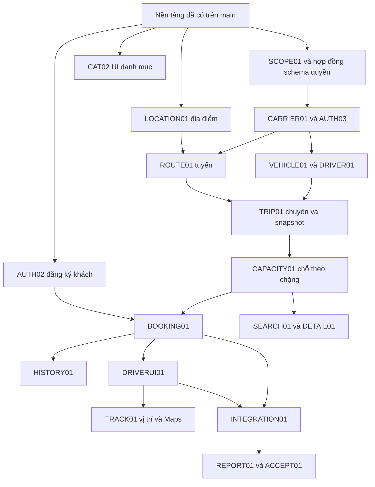

# Tiến độ và kế hoạch triển khai của nhóm VietRoute

## ACCESS24 — Đã có trên main và kiểm Render: User → Role → Menu/API

Đã merge [PR #128](https://github.com/hieuv526034/vietroute-web/pull/128), main `d418b5a`, head nguồn cuối `5331c58`, tác giả hieuv526034 từ base `8996677`, [Issue #127](https://github.com/hieuv526034/vietroute-web/issues/127). Ba CI head cuối đạt: [container/PostgreSQL](https://github.com/hieuv526034/vietroute-web/actions/runs/40196629452), [format/quy tắc](https://github.com/hieuv526034/vietroute-web/actions/runs/40196629548), [tài liệu](https://github.com/hieuv526034/vietroute-web/actions/runs/40196629480). CI merge commit cũng đạt đủ [container](https://github.com/hieuv526034/vietroute-web/actions/runs/40197477219), [format](https://github.com/hieuv526034/vietroute-web/actions/runs/40197477186), [docs](https://github.com/hieuv526034/vietroute-web/actions/runs/40197477188).

V022 thêm tập/mapping tài nguyên tường minh, marker rỗng là deny; gán từng target menu/API, không wildcard hoặc tự nhận API tương lai. HTTP và refresh service kiểm target nguồn; scope đòi cùng scoped role cấp target, không mượn API ở nhà xe khác. Projection semantic chỉ còn nội bộ/service/scope và tương thích; không bắt vận hành cấu hình ma trận action lần hai. Giữ ADMIN/bootstrap/system, public/self-service do source, owner/driver, CSRF, tokenVersion và giới hạn ủy quyền. Lưu lại target ALL legacy không âm thầm lấp quyền thiếu; lịch sử ghi đủ target/projection, API tương thích, xóa role/phục hồi ADMIN và thu hồi membership khi xóa account. V001–V021 giữ nguyên.

Ba menu chính là User, Role và Menu/API. User thêm/sửa tên/gán role/trạng thái/xóa mềm, giữ ID/FK/lịch sử; Role CRUD và cây modal, scope/lịch sử ở tab; inventory chỉ đọc nguồn. Bỏ xử lý UI ma trận cũ khỏi operations.js. Tìm cây giữ lựa chọn ngoài bộ lọc; chọn cha chỉ chọn các mục hiện có trong kết quả; public/self-service không cần cấp. Source vẫn sở hữu route/menu/điều kiện bắt buộc, API chỉ ADMIN có nhãn riêng; không phải tất cả cấu hình đều trở thành DB-editable. Hợp đồng, 14 bảng và các giới hạn ở [schema](../02-phat-trien/SCHEMA_VA_PHAN_QUYEN.md), [API](../02-phat-trien/API_BASE.md), [UI](../03-giao-dien/QUY_UOC_UI.md), [hướng dẫn vận hành](../04-van-hanh/QUAN_TRI_HE_THONG.md).

Local cuối đạt Maven verify **210/210**, gồm **46** ca PostgreSQL loopback với hai context WAR; Node **66/66**. Đã chạy npm ci, format/format:check/check:rules/check:docs và diff check. Ca mới gồm nâng V021 → V022, menu/list/detail độc lập, revoke khi READ còn từ API khác, scope chéo role, ủy quyền, ALL cũ, lịch sử/rollback/soft delete. Browser vi/en, 1280/390px kiểm Role CRUD/lưu hai target, lọc không mất lựa chọn, User sửa/gán, inventory có sáu kết quả, scope/history và focus quay về đúng nút. Đã sửa vùng cuộn modal để nút lưu không ra ngoài; viewport đã trả mặc định. [Cây desktop](../images/access24-role-tree.png), [390px](../images/access24-role-mobile.png) là fixture local, không ảnh dữ liệu Neon. Tự review và CI, chưa có review độc lập thành viên khác.

Render đã nhận source: toàn bộ roles.js khớp byte sau chuẩn hóa xuống dòng. Sau khi thấy asset mới đã chờ hơn 370 giây trước nghiệm thu, không chỉnh native grants trong cửa sổ thay node. [Quy trình Render](https://render.com/docs/deploys) có giai đoạn 60 giây rồi SIGTERM và shutdown delay; không dùng việc thấy asset mới để khẳng định node cũ đã dừng tức thì. Kiểm đăng nhập/GET admin và ba account thật: CUSTOMER giữ 4 projection/6 target/version 1; DRIVER 3/9/version 1; OPERATOR 26/43/version 6. Tập target khớp backfill từ inventory/quyền hiện có, không gán lại role hoặc mở rộng projection trong nghiệm thu. Ba page User/Role/Menu–API trả HTML đúng cấu trúc mới.

`custom01`, `driver01`, `operator01` đều active, không pending/temp/email barrier, giữ đúng CUSTOMER/DRIVER/OPERATOR. Đăng nhập thực tế và capabilities/GET nghiệp vụ: khách 4 đơn/scope nhân viên rỗng; tài xế 8 chuyến/scope 1; điều hành 10 đơn/scope 1; cả ba không có menu quản trị truy cập và API admin accounts trả 403. Admin vẫn thấy 8 chuyến/10 đơn; báo cáo 01/10–30/11 có 6 lượt chỗ/giá trị chốt 4,5 triệu/thu-hoàn 0. Lượt nghiệm thu chỉ đăng nhập và đọc: không tạo/hủy đơn, tiền, GPS, grant hay seed; không sửa hash/ngoại lệ xác minh email. Bootstrap/migration chạy qua ứng dụng triển khai, không dùng Neon để kiểm ghi build.

Lượt CI đầu `fd7d491` đã qua Java/image/Tomcat/WAR nhưng dừng ở assertion markup cũ; đã sửa assertion đúng ba màn và fixture phá ADMIN tuân FK V022, giữ đầy đủ kiểm bảo mật. Review tiếp `d285686`/`d119663` và head cuối `5331c58` đã kiểm lại; kết quả nghiệm thu là CI cuối và runtime ở trên, không là lượt đỏ ban đầu.

Đã hoàn tất phạm vi ACCESS24. Mail/provider, Maps và hạ tầng vẫn theo ưu tiên để sau của chủ dự án; không coi lần này là xác nhận thương mại/SLA hoặc xác thực cá nhân/nhà xe. Account mới vẫn theo lifecycle email/mật khẩu tạm; ngoại lệ ba account cũ không tự áp dụng cho người mới. Không rollback node V021 sau gán native nếu chưa có kế hoạch chuyển mapping. Không xóa account để tự hủy nghiệp vụ đang mở; xử lý phân công/đơn trước theo hướng dẫn vận hành.

## BUSINESS05 — Đã có trên main: dữ liệu chuẩn, breadcrumb và dashboard theo nghiệp vụ

Đã merge [PR #125](https://github.com/hieuv526034/vietroute-web/pull/125), main `b4d919f`, head đã kiểm `28e5df9`. Ba CI cuối đạt: [container/PostgreSQL](https://github.com/hieuv526034/vietroute-web/actions/runs/40184861098), [format/quy tắc](https://github.com/hieuv526034/vietroute-web/actions/runs/40184861113), [tài liệu](https://github.com/hieuv526034/vietroute-web/actions/runs/40184861104). Bản source gồm breadcrumb `066c4d6`, dashboard `4d9c922` và đồng bộ assertion container `28e5df9`; giữ tác giả hieuv526034. Các đoạn dưới ghi lại mốc source/dữ liệu và cách kiểm, không coi lượt CI đầu thất bại là nghiệm thu cuối.

CI main `b4d919f` cũng đạt: [container/PostgreSQL](https://github.com/hieuv526034/vietroute-web/actions/runs/40185538031), [format](https://github.com/hieuv526034/vietroute-web/actions/runs/40185538037), [docs](https://github.com/hieuv526034/vietroute-web/actions/runs/40185538014). Render đã nhận bản mới; so sánh toàn bộ nội dung app.js/dashboard.js với source khớp. Nghiệm thu đăng nhập/GET trên ADMIN/CUSTOMER/DRIVER/OPERATOR đều về `/dashboard?lang=vi`, breadcrumb/menu đúng role, số liệu owner/phân công/scope 4/8/10 khớp DB; ba tài khoản thường quản trị account trả 403. Báo cáo ADMIN/OPERATOR cùng khớp 8 chuyến/10 đơn/6 lượt chỗ/giá chốt 4,5 triệu/thu-hoàn 0. Đợt nghiệm thu chỉ đọc nghiệp vụ, không tạo thêm đơn/chuyến/tiền/GPS.

Browser Render đã kiểm dashboard ba tài khoản thường, liên kết vào màn nghiệp vụ và breadcrumb cha, vi/en, 390px gap 24px/page 375px không tràn. Ảnh dữ liệu Neon: [điều hành](../images/business05-neon-operator.png), [tài xế](../images/business05-neon-driver.png), [khách](../images/business05-neon-customer.png), [390px](../images/business05-neon-mobile.png), [menu mobile](../images/business05-neon-menu.png), [tìm chuyến chuẩn 05/11](../images/business05-neon-search.png). Tìm thực tế Miền Đông mới → Nước Ngầm trả VR20261105HN, 900.000 đồng/chỗ, còn 29 chỗ và đủ ba bến/giờ qua ngày. Đã hoàn tất phạm vi BUSINESS05; provider/hạ tầng giữ ưu tiên để sau theo chủ dự án. Render Free có cold start/timeout từng lần đọc, không lấy một lượt nghiệm thu thành cam kết độ trễ/SLA.

Ngày 25/10/2026, chủ dự án chốt ưu tiên luồng và dữ liệu, chưa xử lý provider/hạ tầng; “demo” là cách mô tả yêu cầu, dữ liệu phải đúng quan hệ/nghiệp vụ, được dùng tên/liên hệ cá nhân giả hợp lệ. Thêm breadcrumb bấm được trên các màn, giãn card và chỉ làm dashboard sau rà nghiệp vụ. hieuv526034 thực hiện `hieuv526034/business14-luong-du-lieu-dieu-huong` từ main `e0a2bb7`, [Issue #124](https://github.com/hieuv526034/vietroute-web/issues/124); không đổi tác giả lịch sử hoặc cấp ngoại lệ account mới. Mốc dưới đây là nghiệm thu source trước PR; kết quả CI/merge/Render được cập nhật trên PR của Issue.

Đã chuẩn hóa 25 bản ghi nền Neon bằng API versioned: tên danh mục/tỉnh, ba bến xe/địa chỉ/tọa độ tham chiếu, hai nhà xe VietRoute, bốn biển số, bốn hồ sơ tài xế và bốn mẫu tuyến. Mã/ID legacy giữ để không phá FK; lịch sử/snapshot chuyến cũ không viết lại. Ba tên hiển thị được đổi qua API hồ sơ của chính account; email/hash/role/membership không đổi. Dữ liệu người/liên hệ/biển số là tổng hợp theo yêu cầu, không là bằng chứng đã xác thực cá nhân/đơn vị vận tải. Địa chỉ công khai đối chiếu [Bến xe Miền Đông mới](https://www.benxemiendongmoi.com.vn/Map/Rental), [Bến xe Trung tâm Đà Nẵng](https://benxedanang.vn/); tọa độ là điểm tham chiếu cấu hình, không GPS thiết bị hoặc xác nhận cổng đón chính xác. Thời gian/giá là chính sách nhà xe cấu hình, không biểu giá/lịch vận tải công bố của bến.

Đã tạo VR20261105HN/08SG/11HN/14SG OPEN từ mẫu đã chuẩn hóa, capacity 29/40/29/40, cùng driver01 và cách 3 ngày, không trùng lịch cũ. VR8 WEB custom01 PENDING 1 chỗ; VR9 PHONE PENDING 2 chỗ; VR10 PHONE CONFIRMED 3 chỗ. VR3 khởi tạo cũ được custom01 hủy qua service với lý do thay yêu cầu theo lịch đã chuẩn hóa, giữ lịch sử và giải phóng đúng chặng. Không xóa đơn/chuyến hoặc giả actual/thu-hoàn/GPS. Kiểm chỉ đọc: chuyến mới còn 29/37/29/40 chỗ, custom01 có 4 đơn/1 active, driver01 có 8 chuyến, operator01 có 10 đơn đúng scope, cả ba không quản trị account. Báo cáo 01/10–30/11 có 8 chuyến/10 đơn/6 lượt chỗ/giá trị 4,5 triệu/thu-hoàn 0. Lặp lại plan chỉ đọc không còn cập nhật cần áp dụng. Không chạy lại helper khởi tạo cũ để ép ghi đè tên hoặc trạng thái.

Breadcrumb dùng cây menu đã lọc quyền, nhóm không có page trỏ tới trang con được mở, giữ context/locale và trang hiện tại. UI chung bỏ mô tả DEMO trên luồng sử dụng. Test nghiệp vụ dùng PostgreSQL loopback; một lượt dừng do portable PG ngừng, đã khởi động lại đúng 15439 và chạy lại, không kiểm ghi Neon. Sau khôi phục PG loopback, BusinessIntegrationTest 40/40, PageBreadcrumbsTest 2/2 và AuthNavigationTest 1/1 đạt. Commit breadcrumb `066c4d6` được chốt trước khi làm dashboard.

Dashboard dùng lại API dữ liệu thật, giao role owner/phân công với capabilities/VIEW, lỗi từng khối và đọc tuần tự; không số liệu giả hoặc API/schema mới. ADMIN không tự thấy khối khách/tài xế. Đã sửa helper route dùng chung và lỗi location.js truyền ID string vào tabs thay vì DOM element; cả tỉnh/địa điểm tải đủ 3 dòng fixture. Browser PostgreSQL cô lập kiểm login → dashboard khách/tài xế/admin, vi/en, breadcrumb mở Đơn của tôi → Trang chủ, Địa điểm → Danh mục; menu 390px mở đúng chiều rộng, card gap 24px, trang không tràn ngang. [Dashboard fixture desktop](../images/business05-dashboard-preview.png), [390px](../images/business05-dashboard-mobile-preview.png); số tiền trong ảnh là fixture cách ly, không dữ liệu Neon.

Local cuối: Maven verify 201/201 (gồm 40 ca business PostgreSQL), Node 64/64; npm ci/format/format:check/check:rules/check:docs và diff check đạt. Kiểm root/servlet tách biệt, locale/context WAR, endpoint capability độc lập VIEW, dữ liệu danh sách có bản ghi, partial error và single-flight. Hai kỳ vọng Node login cũ đã đổi sang dashboard theo hợp đồng mới, giữ assertion rào email/mật khẩu tạm. Tự review source, chưa có review độc lập thành viên khác. Bước còn lại ở mốc source này: CI đúng head, merge main và kiểm Render đăng nhập/breadcrumb/số liệu ba account; không phát GPS hoặc tạo giao dịch tiền thật để nghiệm thu UI.

[PR #125](https://github.com/hieuv526034/vietroute-web/pull/125) có lượt CI đầu `4d9c922`: Java/PostgreSQL, image, Tomcat và WAR đạt; verify-auth.sh dừng ở assertion Home/login còn kỳ vọng `/admin` hoặc `/account`. Đã cập nhật đúng đích `/dashboard`, giữ assertion 302/200, quyền API và thêm kiểm ADMIN không có link owner/tài xế, CUSTOMER không có quản trị account. Không bỏ bước hoặc chấp nhận CI đỏ; chạy lại cả container suite trên head mới. CI/merge/Render cuối được ghi tại PR này để tránh nhầm lượt kiểm đầu với kết quả nghiệm thu cuối.

## BUSINESS04 — Đã có trên main và kiểm Render: tuyến, chuyến, đặt vé và tài khoản dùng ngay

Ngày 25/10/2026, chủ dự án yêu cầu hoàn thiện nghiệp vụ còn thiếu, cấp sẵn ba account đã tạo và nạp dữ liệu/quyền lên Neon để sử dụng ngay. hieuv526034 thực hiện trên `hieuv526034/business04-tuyen-chuyen-dat-ve`, base main `892b17d`, [Issue #113](https://github.com/hieuv526034/vietroute-web/issues/113). Tác giả thực giữ nguyên; phân công tương lai không là lý do đổi author. Kiểm source bằng PostgreSQL cô lập, PR/CI trước triển khai và dữ liệu vận hành trên Neon.

ROUTE01 đã merge [PR #114](https://github.com/hieuv526034/vietroute-web/pull/114), head `5c47502`, main `34f354a`: V018 carrier_routes/carrier_route_stops, API/page tuyến một chiều 2–32 điểm, offset phút qua nhiều ngày, giá cộng dồn, parent active/scope/version/rollback. Local 169 Java/44 Node và browser vi/en/390px đạt. CI cuối [container/PostgreSQL](https://github.com/hieuv526034/vietroute-web/actions/runs/40162586903), [format](https://github.com/hieuv526034/vietroute-web/actions/runs/40162586904), [docs](https://github.com/hieuv526034/vietroute-web/actions/runs/40162586873) đạt. Đã xử lý fixture phân trang registry và SIGPIPE docker exec/head, giữ assertion và pipefail. Render đã nhận endpoint tuyến V018. Đã nạp DEMOAOUT/DEMOARETURN/DEMOBOUT/DEMOBRETURN bằng API chuẩn (4 tuyến/12 điểm) và OPERATOR đủ ROUTE_VIEW/READ/CREATE/UPDATE, tổng 15 mapping, version 2; không ghi đè dữ liệu sẵn; lần chạy lại reused đủ 4 tuyến và không tăng mapping/version.

TRIP01 đã merge [PR #115](https://github.com/hieuv526034/vietroute-web/pull/115), head `1fd9f75`, main `5b2a03a`, nhánh `hieuv526034/business05-chuyen-va-ton-cho`: V019 trip/stop snapshot/segment/event, API staff DRAFT/phân công/mở/hủy, picker action TRIP, SQL scope/count/date/CAS/khóa lịch và rollback lịch sử. Local 173 Java/44 Node, BusinessIntegrationTest 14/14 và browser vi/en/390px đạt. Ba CI đúng head đạt: [container](https://github.com/hieuv526034/vietroute-web/actions/runs/40163870951), [format](https://github.com/hieuv526034/vietroute-web/actions/runs/40163870956), [docs](https://github.com/hieuv526034/vietroute-web/actions/runs/40163870947). Đã kiểm triển khai/nạp quyền và chuyến trên Neon tại mốc DRIVER02 phía dưới.

DRIVER02 đã merge [PR #116](https://github.com/hieuv526034/vietroute-web/pull/116), head `120739a`, main `4020317`, nhánh `hieuv526034/business06-luong-tai-xe`: màn/API chuyến được giao kiểm global/scoped DRIVER + profile/link hiện hành, không bypass ADMIN; START/ARRIVE/DEPART/COMPLETE theo thứ tự, version và actual/history nguyên tử; staff NOTICE giữ trạng thái OPEN/IN_PROGRESS. Local 176 Java/44 Node, BusinessIntegrationTest 17/17 và browser DRIVER đủ 5 bước vi/en/390px đạt. Ba CI đúng head đạt: [container](https://github.com/hieuv526034/vietroute-web/actions/runs/40164522004), [format](https://github.com/hieuv526034/vietroute-web/actions/runs/40164522134), [docs](https://github.com/hieuv526034/vietroute-web/actions/runs/40164522032).

Render đã có TRIP01/DRIVER02. Đã gán OPERATOR thêm TRIP_VIEW/READ/CREATE/UPDATE (tổng 19 mapping, version 3), DRIVER 3 quyền DRIVER_TRIP_VIEW/READ/UPDATE (version 1). Bốn chuyến DEMOTRIP01–04 OPEN, carrier/scope 1, driver01 #3: đi/về luân phiên, mỗi chuyến cách 3 ngày để không chồng lịch 30 giờ; capacity 10/20/20/20, mốc đầu 25/10/2026 12:37 giờ Việt Nam. Seed bằng API chuẩn, không gán account thứ tư hoặc bỏ guard. Kiểm login thực tế cả ba ready; operator01 chỉ thấy 2 tuyến/4 chuyến carrier 1, driver01 thấy đúng 4 chuyến được giao, cả ba bị chặn quản trị account.

BOOKING01/SEARCH01 đã merge [PR #117](https://github.com/hieuv526034/vietroute-web/pull/117), nhánh `hieuv526034/business07-dat-ve-theo-chang`, head `1365ae8`, main `e27922d`: V020 bookings/booking_events, một WEB PENDING/CONFIRMED mỗi customer, API khách/staff/PHONE/thu-hoàn thủ công và một thuật toán chặng. Hủy trip/rời pickup/đến dropoff cùng transaction; tìm theo ngày tại pickup/hướng/MIN chỗ, public projection không PII; passenger chỉ đúng driver. Maven verify 186/186 (BusinessIntegrationTest 27/27), Node 44/44, format/check/rules/docs/diff đạt. Ba ca latch kiểm một WEB qua hai trip, hủy/xác nhận và START/xác nhận đồng thời đạt. CI đúng head: [container](https://github.com/hieuv526034/vietroute-web/actions/runs/40167417669), [format](https://github.com/hieuv526034/vietroute-web/actions/runs/40167417708), [docs](https://github.com/hieuv526034/vietroute-web/actions/runs/40167417665). Browser local vi/en/390px đạt WEB/hủy/chặn active giữ draft, PHONE/xác nhận, thu-hoàn fixture/refundDue và passenger; sửa nhãn lịch sử/giá/chỗ. Một lần PG portable bị exception đã dọn đúng schema test loopback và chạy lại đạt, không ghi kiểm thử lên Neon.

Render đã có V020 sau CI main [container](https://github.com/hieuv526034/vietroute-web/actions/runs/40168034080). Đã gán CUSTOMER 4 MY_BOOKING quyền (version 1), OPERATOR tổng 23 quyền (version 4); DRIVER giữ 3 quyền. Nạp VR1–VR7 qua API chuẩn bằng custom01/operator01: 3 WEB (hủy/từ chối/xác nhận) và 4 PHONE (chờ/xác nhận/hủy/từ chối), đều contact DEMO và tiền thu/hoàn 0. Chạy lại reused đủ 7, không tăng mapping/version hoặc ghi đè trạng thái. Login thực tế cả ba ready: custom01 thấy đúng 3 WEB và một active, operator01 thấy đúng 7 đơn scope/carrier 1, driver01 thấy 4 trip và 1 passenger ở mỗi DEMOTRIP02/03; cả ba bị chặn quản trị account, CUSTOMER/DRIVER không đọc staff booking, OPERATOR không đọc đơn khách hoặc quản trị quyền. Public quote hai trip còn đúng 19/17 chỗ. [Màn đơn custom01 trên Render](../images/booking01-neon-customer.png) kiểm chứng riêng dữ liệu Neon, không chứa credential/email.

Chủ dự án đã xác nhận rõ cấp sẵn đúng custom01/driver01/operator01 sau câu hỏi về ngoại lệ AUTH011/AUTH17. Đã cập nhật ba account trong một transaction vận hành có kiểm ID/username/role/email/mật khẩu hiện tại, khóa và version: active=true, activation_pending=false, must_change_password=false, email_verified_at do chủ dự án xác nhận; thu hồi phiên/challenge cũ, updated_by=admin #1. Giữ hash/history/role/membership và mọi guard runtime; không sửa trạng thái account khác hoặc bật provider giả. Đây là cấp sẵn thủ công một lần, không chứng minh đã xác minh qua Gmail và không ghi giả sự kiện auth_access_changes. Giữ nguyên quy tắc AGENTS cho luồng tạo tài khoản thông thường; bản ghi vận hành này không cho phép các phiên sau tự cấp sẵn thêm tài khoản. Đã kiểm login/ready cả ba, CUSTOMER/DRIVER không vào quản trị, OPERATOR thấy đúng nhà xe/hai xe; đã gắn driver01 vào DEMODRIVER01 bằng API chuẩn.

DETAIL01/SEARCH02 đã merge [PR #118](https://github.com/hieuv526034/vietroute-web/pull/118), head `dfe2f29`, main `f4830ff`, trên `hieuv526034/business08-tra-cuu-nha-xe`, từ main `4020317` và đã merge `e27922d`: public API/page nhà xe theo projection riêng, carrier/scope active, count/trang/từ khóa DB, logo READY theo lô qua MediaService; không mở metadata thư viện. Tìm chuyến có picker nhà xe/loại xe và khoảng giá bao gồm cận, VAL015 khoảng đảo; link nhà xe chọn sẵn filter. Maven verify 188/188 (BusinessIntegrationTest 29/29), Node 44/44, gồm anonymous/projection/publication/logo, filter giá/type/carrier và OpenAPI đủ tham số kế thừa. Browser vi/en đạt liên hệ/tìm theo nhà xe, lọc đúng cận/loại xe, hết kết quả dưới giá và VAL015 sửa riêng một cận gửi lại được. Mobile 390px không tràn trang, modal 352px; menu khách vẫn kéo đủ ngang, nhãn Đơn của tôi rõ ràng; ảnh ở quy ước UI. CI đúng head đạt: [container](https://github.com/hieuv526034/vietroute-web/actions/runs/40170159750), [format](https://github.com/hieuv526034/vietroute-web/actions/runs/40170159745), [docs](https://github.com/hieuv526034/vietroute-web/actions/runs/40170159742). CI main [container](https://github.com/hieuv526034/vietroute-web/actions/runs/40170725748) đạt; Render đã nhận public carrier/bộ lọc mới, API trả 2 DEMO, browser mở chi tiết/liên hệ/link tìm theo nhà xe thành công. Bộ lọc nhà xe/type/giá 600000 đúng cận trên Render trả DEMOTRIP03 còn 17 chỗ ngày 31/10, khớp đơn đã xác nhận. [Chi tiết nhà xe trên Render](../images/detail01-neon-carrier.png) kiểm chứng riêng Neon. Chủ dự án đã chọn để Google Maps chưa cấu hình vì chưa có key; không bật provider hoặc chặn công việc độc lập. Các phần báo cáo, cấp nhân sự và tracking/fallback tiếp tục ở các mốc REPORT01/AUTH03/TRACK01 bên dưới; Gmail tạm hoãn.

REPORT01 đã merge [PR #119](https://github.com/hieuv526034/vietroute-web/pull/119), head `7fe8b33`, main `5a10b98`, trên `hieuv526034/business09-bao-cao-van-hanh`, từ main `e27922d`: API/report page có REPORT_VIEW/READ riêng, picker scoped và một statement snapshot theo ngày khởi hành Việt Nam tối đa 366 ngày. Tổng chuyến/đơn/trạng thái, lượt chỗ CONFIRMED/COMPLETED, giá trị đặt và tiền thu/hoàn/phải hoàn tách rõ; không PII, không migration hoặc grant role thường tự động. Maven verify 189/189 (BusinessIntegrationTest 30/30) đạt trên PostgreSQL cô lập: số liệu nhiều đơn/hai nhà xe/cận ngày/tiền đơn hủy, VIEW độc lập READ, thu hồi tức thời và OpenAPI/VAL016. Format/check/rules/docs đạt. Đã merge main `f4830ff` từ PR #118, kiểm hồi quy cuối 191/191 Java (BusinessIntegrationTest 32/32) và 44/44 Node đạt. Browser báo cáo vi/en đạt số liệu 2 chuyến/3 đơn/2 lượt chỗ, 1,2 triệu giá trị đặt và 100 nghìn thu/hoàn fixture local; VAL016 giữ filter, sửa cận gửi lại được, tab bàn phím. Mobile 390px/page 375px không tràn; CI đúng head đạt: [container](https://github.com/hieuv526034/vietroute-web/actions/runs/40171369875), [format](https://github.com/hieuv526034/vietroute-web/actions/runs/40171369910), [docs](https://github.com/hieuv526034/vietroute-web/actions/runs/40171369932). CI main [container](https://github.com/hieuv526034/vietroute-web/actions/runs/40172080896) đạt; Render đã có báo cáo. Qua API chuẩn gán OPERATOR tổng 25 quyền/version 5, giữ mapping cũ; đọc thực tế 01/10–30/11 có 4 trip/7 đơn/4 lượt chỗ, giá trị 2,4 triệu và thu/hoàn 0. OPERATOR chỉ picker DEMOMIENNAM, carrier 2 trả 404, quản trị account 403; CUSTOMER/DRIVER báo cáo 403. [Báo cáo operator01 trên Render](../images/report01-neon-operator.png) khớp API. Gmail và Maps vẫn chưa cấu hình theo lựa chọn chủ dự án.

AUTH03 đã merge [PR #120](https://github.com/hieuv526034/vietroute-web/pull/120), head `9f7f9ae`, main `869c000`, trên `hieuv526034/business10-cap-tai-khoan-tai-xe`, từ main `f4830ff`: DRIVER_ASSIGN scoped cấp account/membership/link/history nguyên tử cho hồ sơ chưa liên kết, trần role DRIVER chỉ chuyến được giao, không ACCOUNT/ACCESS quyền cho OPERATOR. Account phải đổi mật khẩu/xác minh email; hồ sơ tạm ngừng, không mở rộng ngoại lệ ba account. Chặn đổi identity khi còn trip DRAFT/OPEN/IN_PROGRESS. Đã biên dịch và 4/4 ca PostgreSQL cô lập đạt (tạo pending, scope/role/thu hồi, rollback lịch sử 503, cạnh tranh và chặn đổi identity đang có chuyến); format/check/rules/docs đạt. Sau merge main `5a10b98`, Maven verify 195/195 (BusinessIntegrationTest 36/36), Node 44/44, format/check/rules/docs/diff đạt. Browser modal vi/en/390px đạt validation cạnh field/focus, đóng xóa bản nháp, page 390/modal 352 không tràn. Ba CI đúng head đạt: [container](https://github.com/hieuv526034/vietroute-web/actions/runs/40172919361), [format](https://github.com/hieuv526034/vietroute-web/actions/runs/40172919343), [docs](https://github.com/hieuv526034/vietroute-web/actions/runs/40172919388). CI main [container](https://github.com/hieuv526034/vietroute-web/actions/runs/40174387196) đạt; Render đã có AUTH03, đã gán DRIVER_ASSIGN qua API chuẩn: OPERATOR tổng 26 quyền/version 6, hai profile scoped canAssign=true và capability POST account. Profile nhà xe khác404/account administration403; vẫn đúng bốn account admin + ba DEMO, không tạo thứ tư. Browser Render operator01 thấy đúng hai hồ sơ, chỉ DEMODRIVER02 chưa liên kết có nút cấp; modal hiển thị điều kiện đổi mật khẩu/email và đóng không tạo account. Không tạo thêm tài khoản Neon.

TRACK01 đã merge [PR #121](https://github.com/hieuv526034/vietroute-web/pull/121), head `9102107`, main `0a30eea`, trên `hieuv526034/business11-vi-tri-va-tien-do`, từ main `5a10b98` và đã merge AUTH03 `869c000`: V021 consent/snapshot/trace trực tiếp PostgreSQL, API private assigned/scoped/owner CONFIRMED; nonce/lease/time/rate/replay/retention, hooks hủy/phân công/hoàn tất và thu hồi quyền tài xế ẩn vị trí. Tab vị trí/shared fragment/watchPosition chủ động, Maps UNCONFIGURED, stop khi đóng/ẩn/offline và không tự bật lại. Full Maven verify 199/199 Java (BusinessIntegrationTest 40/40), Node 52/52 (8 ca geo giả), format/check/rules/docs đạt. Browser vi/en kiểm staff OFF, tài xế khóa bật trước 30 phút, khách đơn hủy UNAVAILABLE không có nút phát; mobile 390/page390/modal352/scroll335 không tràn, không lỗi console. Ba CI đúng head đạt: [container](https://github.com/hieuv526034/vietroute-web/actions/runs/40177166173), [format](https://github.com/hieuv526034/vietroute-web/actions/runs/40177166166), [docs](https://github.com/hieuv526034/vietroute-web/actions/runs/40177166201). CI main đạt: [container](https://github.com/hieuv526034/vietroute-web/actions/runs/40177719486), [format](https://github.com/hieuv526034/vietroute-web/actions/runs/40177719546), [docs](https://github.com/hieuv526034/vietroute-web/actions/runs/40177719560). Render đã nhận V021; đã kiểm bằng ba account: driver01 bốn chuyến OFF, operator01 bốn chuyến đúng scope OFF, custom01 VR3 CONFIRMED/OFF và VR1–VR2 UNAVAILABLE. ID đơn khác404, anonymous private401, public GPS404; không bật consent hoặc tạo mẫu. Browser Render staff chỉ Làm mới, Maps chưa cấu hình; [ảnh desktop](../images/track01-neon-unconfigured.png), [390px](../images/track01-neon-mobile.png) với page390/modal352/scroll350. [Menu điện thoại](../images/business04-neon-mobile-menu.png) mở đủ chiều ngang và danh sách chức năng đúng quyền. Đã chạy lại full 199/199 Java sau chỉnh effective permission của nhiều role trong cùng scope, kiểm role ở nhà xe khác không cấp quyền vị trí. Không lấy GPS thiết bị thật hoặc tạo mẫu Neon. Một lượt PG portable ngừng đã khởi động lại loopback và chạy lại đạt; một lượt test locale chạy lúc đang bổ sung key đã được chạy lại full trên source chốt đạt. Gmail và Google Maps tiếp tục chưa cấu hình theo lựa chọn chủ dự án; nghiệm thu GPS vật lý và provider là bước riêng, không chặn dùng lộ trình/tiến độ văn bản.

ACCEPT01 đối chiếu ngày 25/10/2026, nhánh `hieuv526034/business12-nghiem-thu-ban-giao`, [PR #122](https://github.com/hieuv526034/vietroute-web/pull/122): tổng quan module, bảng T01–T21, 12 bảng phân quyền và ranh giới cấu hình/source, hướng dẫn ba account và nhận việc đúng tác giả đã cập nhật. Hồi quy chỉ đọc sau V021: custom01 đúng 3 WEB/1 active; operator01 đúng 7 đơn, không quản trị account; driver01 đúng 4 trip và 1 passenger projection ở mỗi DEMOTRIP02/03; public còn19/17 chỗ. Không đổi quyền/dữ liệu hoặc dựng GPS/tiền giả trong nghiệm thu cuối. Dữ liệu DEMO vẫn là dữ liệu minh họa có nhãn, không đồng nghĩa giao dịch vận tải thật.

Phạm vi hiện có sẵn sàng chạy thử, nghiệm thu từng role và để thành viên phát triển tiếp trên main. Gmail/Maps được chủ dự án hoãn; Cloudinary/inbox/GPS thiết bị thật/khóa màn hình, backup-restore, alerts và tải production chưa nghiệm thu. Không tuyên bố go-live thương mại. Render Free đã gặp cold start và một lần502, sau đó API và browser phục hồi; source không có sửa riêng để biến cold start thành cam kết không gián đoạn. Cấp account mới vẫn cần email, không thừa hưởng ngoại lệ ba account. Không còn source dở trong phạm vi nghiệp vụ cốt lõi đã triển khai; việc ngoài app được giữ rõ giới hạn và không tự mua gói/provider.

TRACK01 UI bổ sung trên `hieuv526034/business13-nhan-tai-vi-tri`, từ main `8f0be73`: mở tab dùng `ui.loading` vi/en thay vì WAITING “đã bật” trước GET. Hủy hiệu lực GET cũ khi bật/dừng/ẩn để không tự thu hồi consent mới hoặc đưa lại tọa độ sau dừng; không poll trong POST, dừng xóa watch/tọa độ ngay và khóa thao tác lặp. Lỗi GET cũ tự xóa khi phục hồi, không xóa lỗi mutation mới; phản hồi lỗi sau đóng/mở không ghi sang chuyến khác. Không thay API, quyền, schema hoặc xin GPS thật. Browser preview vi/en xác nhận loadingLabel và khách đơn hủy UNAVAILABLE. Sáu ca DOM/API giả bổ sung cùng 8 ca engine tracking kiểm race/phục hồi; toàn bộ Node 58/58, format/check/rules/docs/diff đạt. Theo [PR #123](https://github.com/hieuv526034/vietroute-web/pull/123), kết quả CI/merge/Render cuối lưu tại PR; không test hoặc seed Neon. Quan sát Render một lần COM013, sau đó snapshot runtime đọc được: quota memory/concurrent16, active request1/connection0/wait0, không nới giới hạn hoặc kết luận nguyên nhân chỉ từ một snapshot. Giới hạn latency/cold start/503 vẫn cần đo staging trước go-live thương mại.

## BUSINESS03 — Đã cấp sẵn ba tài khoản theo xác nhận vận hành

Ngày 25/10/2026, hieuv526034 thực hiện theo yêu cầu chủ dự án trên Neon hiện tại qua API quản trị của [website Render](https://vietroute-web.onrender.com), tiếp tục source main `553c36b` của BUSINESS02. [Issue #110](https://github.com/hieuv526034/vietroute-web/issues/110), nhánh bàn giao `hieuv526034/business02-ban-giao`. Không tạo credential trong source/seed, không đặt lại mật khẩu tài khoản có sẵn; mật khẩu được nhận riêng từ chủ dự án và chỉ truyền vào API trong bộ nhớ.

| Tài khoản | ID | Role toàn cục | Membership nhà xe | Trạng thái thực tế |
|---|---|---|---|---|
| custom01 | 2 | CUSTOMER | Không có; khách hàng không là nhân sự nhà xe | Đã cấp sẵn theo xác nhận BUSINESS04; đăng nhập được bằng mật khẩu hiện tại |
| driver01 | 3 | DRIVER | DEMOMIENNAM, scope 1, DRIVER, active, version 1 | Đã cấp sẵn; đã liên kết DEMODRIVER01, đã có bốn chuyến được giao tại BUSINESS04 |
| operator01 | 4 | OPERATOR | DEMOMIENNAM, scope 1, OPERATOR, active, version 1 | Đã cấp sẵn; kiểm thực tế thấy đúng DEMOMIENNAM và hai xe, không nhà xe khác |

Đã gán OPERATOR 11 quyền bằng API thay mapping có version và lịch sử: CARRIER_VIEW/READ/UPDATE, VEHICLE_VIEW/READ/CREATE/UPDATE và DRIVER_VIEW/READ/CREATE/UPDATE. Không cấp tạo nhà xe, quản trị tài khoản/quyền, danh mục ADMIN hoặc quyền toàn hệ thống. Ở mốc BUSINESS03 ban đầu, DRIVER/CUSTOMER không có quyền quản trị; BUSINESS04 đã bổ sung đúng quyền chuyến được giao/đơn khách, không giả bằng quyền CRUD nhân sự. Mỗi lần cấp account, mapping và membership dùng transaction/history hiện có; actor là admin #1.

Trước xác nhận cấp sẵn BUSINESS04: đăng nhập thật đủ ba tài khoản bằng mật khẩu yêu cầu thành công; API riêng tư đều trả 403/AUTH011 và preview tài khoản đích trả 0 chức năng/0 hành động khi chưa thiết lập. Response hồ sơ OPERATOR vẫn mô tả 11 mapping DB; không suy luận chúng có hiệu lực trước khi account ready. [Ảnh tài khoản Render trước cấp sẵn](../images/business03-neon-accounts.jpg) ghi nhận ba role và hai cảnh báo ở thời điểm cũ; không chứa credential.

Ngày 25/10, chủ dự án bổ sung bốn mailbox. Đã gắn ba địa chỉ đầu theo đúng thứ tự custom01 → driver01 → operator01 trên Neon; địa chỉ thứ tư giữ dự phòng, không tự tạo tài khoản/role thứ tư. Không đưa địa chỉ riêng tư vào Git/Issue. Bàn giao trước đã merge tại [PR #111](https://github.com/hieuv526034/vietroute-web/pull/111), main `cf22be8`; lượt cập nhật email thực hiện trên `hieuv526034/business03-email-demo`.

Do POST auth/email yêu cầu mail/self-service/worker đang bật và luôn tạo challenge/outbox, lượt chuẩn bị dữ liệu này dùng transaction vận hành tường minh trên đúng ba account DEMO. Trước ghi đã kiểm schema, ID/username/role, mật khẩu hiện tại, email chưa được account khác dùng, khóa gán quyền/registration/user và version. Chỉ lưu email chưa xác minh, tăng tokenVersion/version, thu hồi challenge cũ và ghi updated_by=admin #1. Không đổi hash/history/active/must-change/role/membership, không tạo challenge hoặc thư chờ gửi. Đây là cập nhật SQL vận hành được yêu cầu, không là mutation qua API hoặc sự kiện auth_access_changes; không ghi giả lịch sử quản trị. Không sửa Java/schema/default hay bật provider. Kiểm sau ghi qua Render: cả ba đăng nhập thành công và response hồ sơ khớp email yêu cầu/verified=null; role và 11 mapping OPERATOR giữ nguyên, API riêng tư vẫn 403/AUTH011 và preview 0 chức năng/0 hành động.

BUSINESS04 đã xử lý bước dùng ngay theo xác nhận rõ của chủ dự án: cả ba login trả active=true/mustChangePassword=false/emailVerificationRequired=false; OPERATOR đọc được đúng DEMOMIENNAM và 2 xe, CUSTOMER/DRIVER bị chặn quản trị tài khoản bằng AUTH003. PUT hồ sơ tài xế qua API chuẩn đã gắn DEMODRIVER01 với driver01 #3 tại carrier/scope 1. Không bỏ guard runtime cho account khác, không coi thao tác cấp sẵn là gửi thư xác minh thành công. BUSINESS04 đã bổ sung đơn/chuyến/màn tài xế và dữ liệu tương ứng; xem mốc phía trên. Gmail vẫn tạm hoãn.

## BUSINESS02 — Đã có trên main và DEMO trên Neon: danh mục riêng, UI, nhà xe/xe/tài xế

Ngày 25/10/2026, hieuv526034 thực hiện trên `hieuv526034/business02-danh-muc-nha-xe`, base `9c9c924`, [Issue #108](https://github.com/hieuv526034/vietroute-web/issues/108), [PR #109](https://github.com/hieuv526034/vietroute-web/pull/109), head `d85b6c9`, merge main `553c36b`. Chủ dự án tạm gác Gmail và chọn rõ tạo dữ liệu DEMO trên Neon hiện tại. Source/thử nghiệm dùng PostgreSQL cô lập; thao tác vận hành Neon riêng chạy sau CI/merge, không xóa hoặc ghi đè dữ liệu có sẵn, không miễn xác minh cho account thường.

Đã triển khai menu gốc Danh mục với Loại xe/Nguồn đặt/Tỉnh thành/Địa điểm; quyền VIEW/READ/CREATE/UPDATE/DELETE riêng từng loại, giữ alias CATALOG/LOCATION có phạm vi tương thích cũ và không tự gán role thường. `/admin` chuyển về tổng quan; CRUD dùng màn URL riêng và component nút màu xanh chung (màn địa điểm trước dùng btn-primary Bootstrap nên lệch chuẩn). API typed không cho sửa ID/type của nhóm khác.

Đợt nghiệp vụ nhà xe thêm V017 (giữ V001–V016), scope duy nhất cho nhà xe, xe/tài xế gắn FK ID + carrier + scope, SQL count/paging cùng predicate quyền scoped hiện hành. ADMIN tạo/đổi trạng thái nhà xe; OPERATOR có scope sửa thông tin/quản lý xe/hồ sơ tài xế. Profile DRIVER chỉ gắn account DRIVER đã ready và có membership đúng nhà xe; không tạo account giả hoặc bỏ bước email khi Gmail tạm hoãn. Ảnh dùng media chung/owner/READY và bảo vệ tham chiếu khi xóa.

Kiểm local: Maven verify 165/165 (gồm 6 integration), sau bổ sung ca quota/history chạy riêng BusinessIntegrationTest 7/7; Node 44/44; format/check đạt. Bảy ca PostgreSQL 17 thật kiểm hai context, scope count/ID/picker/revoke và quyền UPDATE không union, độc lập VIEW/READ/type, version/race, plate/capacity, parent inactive, account driver, media reference, seed rollback/idempotence và lỗi lịch sử/quota scope. Browser app thật/PostgreSQL preview riêng đạt: menu 390px, bố cục/bảng/bộ lọc và modal; ảnh trong quy ước UI. CI đúng head và main đã đạt: [container/PostgreSQL](https://github.com/hieuv526034/vietroute-web/actions/runs/40151943034), [format](https://github.com/hieuv526034/vietroute-web/actions/runs/40151943064), [docs](https://github.com/hieuv526034/vietroute-web/actions/runs/40151943037).

Render đã phục vụ menu/trang nghiệp vụ mới; Neon đọc được 17 migration đến V017. POST `/api/v1/admin/demo` thực tế trả created=21/reused=0; chạy lại trả created=0/reused=21. Gồm 5 danh mục, 3 tỉnh, 3 địa điểm, 2 nhà xe DEMOMIENNAM/DEMOBACNAM (scope 1/2), 4 xe và 4 hồ sơ tài xế chưa liên kết account. Không gửi mail, không tự tạo role/membership trong seed; cấp ba account là BUSINESS03 riêng phía trên. [Ảnh xe trên Render](../images/business02-render-vehicles.jpg), [menu Danh mục 390px](../images/business02-render-menu-mobile.jpg). Tuyến/chuyến/tồn chỗ/booking/tracking tiếp tục theo phụ thuộc, chưa có source trong đợt này. AUTH03 OPERATOR cấp tài khoản còn thiếu; không dùng file generator/process trong target/.tools làm nguồn bàn giao.

## MAIL03 — Chuyển SMTP local, đang chờ mật khẩu ứng dụng

Ngày 25/10/2026 theo yêu cầu chủ dự án tạm hoãn OAuth. hieuv526034 thực hiện cấu hình local; nhánh tài liệu `hieuv526034/mail03-cau-hinh-smtp`, base main `dbf2202`, tiếp tục [Issue #104](https://github.com/hieuv526034/vietroute-web/issues/104). Source SMTP/HTML đã có tại MAIL02, không sửa Java/schema/default Render hoặc tạo adapter mới. Hướng dẫn dùng lại ở [nền mail](../02-phat-trien/NEN_TANG_MO_RONG.md#smtp-tài-khoản-và-mật-khẩu--mail03).

Đã chuyển `.env` local bị ignore sang smtp.gmail.com:587 STARTTLS, provider smtp, sender/user đúng mailbox chủ dự án. Thử đúng một lần bằng SmtpTransport hiện có, đọc đường dẫn env tường minh trong chẩn đoán riêng; chỉ cho gửi thư thử về chính sender nếu đăng nhập được, không khởi tạo app/DB hoặc đọc/ghi Neon. Kết quả đã lọc: SMTP_AUTHENTICATION_REJECTED (exit 2), chưa gửi thư. Không lưu raw lỗi provider hoặc credential vào tài liệu/log. Mật khẩu vừa thử đã bỏ khỏi `.env`, SMTP_PASSWORD để trống chờ App Password; MAIL_ENABLED/WORKER_ENABLED/AUTH_SELF_SERVICE_ENABLED local vẫn false.

Còn dở: chủ mailbox tạo Gmail App Password theo chính sách Google rồi nhập trực tiếp vào môi trường riêng; sau đó kiểm gửi/inbox/template thực trước bật worker/luồng tài khoản. SMTP vẫn không chạy trên Render Free vì cổng outbound bị chặn; cấu hình/deploy Render không thay trong phiên này, OAuth tạm hoãn chứ không xóa adapter. Java/template, bảo mật và lịch sử kiểm 159 Java/44 Node tại MAIL02 giữ nguyên; không chạy lại Maven vì chỉ sửa tài liệu/cấu hình bị ignore. Bản chẩn đoán trong target không phải artifact bàn giao; khi tiếp tục dùng source/settings và hướng dẫn chính, không dựa file tạm. Kiểm rules/docs/diff cho bàn giao này đạt; PR của nhánh tài liệu giữ commit và CI đối chiếu.

## MAIL02 — Template email tài khoản và sender Gmail

Đã có source trên main qua [PR #105](https://github.com/hieuv526034/vietroute-web/pull/105), merge `76f5615`, head đã kiểm `de6632a`, nhánh `hieuv526034/mail02-template-email`, base main `ad49425`, người thực hiện thực tế hieuv526034, ngày 24/10/2026. Phạm vi theo yêu cầu chủ dự án: báo đúng phần nghiệp vụ đã có và làm email đẹp từ mailbox được chỉ định. [Issue #104](https://github.com/hieuv526034/vietroute-web/issues/104) giữ mở cho cấu hình/nghiệm thu provider; source template hoàn thành không có nghĩa Gmail đã gửi thật.

Đã triển khai template HTML vi/en cho kích hoạt/gắn email và reset, plain-text dự phòng, escape biến và mã xuống dòng; Gmail/SMTP dùng chung multipart MIME, job ba field cũ vẫn đọc được. Giữ challenge 256 bit, thời hạn và outbox AES-GCM/transaction, không thêm schema hoặc API HTML. Fixture/test ở src/test, không dùng secret/Neon/provider thật. Hợp đồng/quy trình cấu hình trong [nền mail](../02-phat-trien/NEN_TANG_MO_RONG.md#template-email-tài-khoản--mail02).

Local: 159 Java/44 Node đạt; MIME round-trip UTF-8/plain/HTML/Message-ID, escape, locale/thời hạn, outbox mã hóa và chặn thư hết hạn; API quản trị từ chối html. Formatter/check/rules/docs và diff đạt. Browser bốn template vi/en ở 320px không tràn ngang, mã giữ nguyên; thêm preview 390px/1000px, ảnh [desktop](../images/mail02-desktop.jpg)/[điện thoại](../images/mail02-mobile.jpg) chỉ dùng mã giả. Ba CI trên đúng head de6632a đạt: [container/PostgreSQL](https://github.com/hieuv526034/vietroute-web/actions/runs/40112697351), [format](https://github.com/hieuv526034/vietroute-web/actions/runs/40112697503), [docs](https://github.com/hieuv526034/vietroute-web/actions/runs/40112697395). Inspector đã kiểm HTML/mã khớp trong outbox thực của luồng auth; các stage activation/reset/history/encryption và LOCATION01 đạt, không gửi provider thật.

Giới hạn còn dở: đã chuẩn bị sender trong `.env` local bị ignore; chưa có bộ OAuth Gmail để gửi thật, mail/worker local vẫn tắt. Mật khẩu đăng nhập web không dùng làm credential gửi; Render Free chặn SMTP. Chưa xác nhận deploy/Environment Render, giao email, Spam/Inbox hoặc hiển thị trong client Gmail/Outlook thật. Cần dừng worker cũ khi nâng cấp trước khi producer tạo payload HTML. Tự review source, chưa có review độc lập của thành viên khác. Bàn giao không sao chép secret sang máy mới; người vận hành nhập riêng theo hướng dẫn nền mail rồi nghiệm thu hộp thư.

Tại mốc MAIL02, nghiệp vụ mới có catalog và LOCATION01 cùng nền auth/quản trị; CARRIER01/VEHICLE01/DRIVER01 được bổ sung sau đó tại BUSINESS02 phía trên. ROUTE01/TRIP01/CAPACITY01/BOOKING01/SEARCH01/TRACK01/REPORT01 vẫn chưa có. “Sẵn sàng nhận việc nghiệp vụ” nghĩa là có nền để bắt đầu các module, không phải toàn hệ thống đã hoàn chỉnh. Provider và các phần tiếp theo theo phụ thuộc/identity thật ở [phân công](PHAN_CONG.md).

## LOCATION01 — Đã có trên main: nghiệp vụ địa điểm đầu tiên

Đã merge [PR #102](https://github.com/hieuv526034/vietroute-web/pull/102), merge `3f3105d`, head đã kiểm `998e96a`, nhánh `hiencoi250404-design/location01-dia-diem`, [Issue #101](https://github.com/hieuv526034/vietroute-web/issues/101), base main `b50aa19` ngày 24/10/2026. Phần phụ trách theo kế hoạch là Hien; người thực sự triển khai đợt này là hieuv526034 và giữ nguyên identity đó trên commit, không ghi thành đóng góp đã làm của Hien.

Đã có source V016 hai bảng địa lý, API/service/JDBC tỉnh–địa điểm, projection public chỉ active, quản trị ADMIN + LOCATION_* hai context, version/audit và khóa tỉnh khi tạo/bật con. Hai tab/modal UI vi/en dùng table/forms/workspace chung, tìm tỉnh theo trang và giữ draft khi lỗi; dữ liệu ngừng dùng giữ ID/tham chiếu. Hợp đồng ở [API base](../02-phat-trien/API_BASE.md#danh-mục-địa-lý--location01), [schema](../02-phat-trien/SCHEMA_VA_PHAN_QUYEN.md#danh-mục-địa-lý-dùng-chung--location01), [UI](../03-giao-dien/QUY_UOC_UI.md#quản-lý-địa-điểm--location01).

Local 153 Java/44 Node, formatter/check/rules/docs, bash/node syntax/diff đạt; renderer vi/en không thiếu key. Browser fixture đạt tạo tỉnh và địa điểm, chặn tọa độ sai, picker giữ lựa chọn khi tìm tiếp, 409 giữ modal/draft, tab bàn phím; 320/390/768/1280px không tràn ngang trang, bảng cuộn riêng. Ảnh fixture ở chuyên đề UI. Ba CI đúng head đạt: [Docker/PostgreSQL](https://github.com/hieuv526034/vietroute-web/actions/runs/40109992973), [format/quy tắc](https://github.com/hieuv526034/vietroute-web/actions/runs/40109993033), [tài liệu](https://github.com/hieuv526034/vietroute-web/actions/runs/40109992996). Job `120919517369` xác nhận trạng thái cha/con, giữ tham chiếu/ID, tọa độ DB, mã trùng, hai UPDATE cùng version chỉ một thành công, search/paging/projection/locale, registry/nhãn module mới và rào ADMIN dù tài khoản thường có đủ LOCATION_*; toàn bộ regression auth/scope/history/recovery/PgBouncer đạt. Đã tự review, chưa có review độc lập của thành viên khác. Không còn code dở LOCATION01. Không test/ghi Neon hoặc xác nhận Render đã chạy V016; giữ V001–V015 nguyên vẹn, không seed địa lý hoặc tích hợp Maps giả.

Bước tiếp: Hien nghiệm thu/tích hợp LOCATION01 vào tuyến khi CARRIER01 có API dùng được. CARRIER01/AUTH03 của Anh/Hieu là phụ thuộc tiếp theo để mở ROUTE01 và xe/tài xế; Bang chuẩn bị trạng thái/snapshot/lịch chồng trước TRIP01/BOOKING01. Chưa coi các nghiệp vụ đó đã được triển khai cùng LOCATION01. Bản bàn giao sau chỉ đồng bộ trạng thái/phân công/tổng quan với source đã merge.

## ACCESS23 — Đã có trên main: sẵn sàng bắt đầu nghiệp vụ

Đã merge [PR #99](https://github.com/hieuv526034/vietroute-web/pull/99), merge `9718487`, head đã kiểm `693eb2a`, hieuv526034, nhánh `hieuv526034/access23-hoan-thien-quyen-module`, [Issue #98](https://github.com/hieuv526034/vietroute-web/issues/98), base main `ce690a2` ngày 24/10/2026. Đã xử lý ba phát hiện source của ACCESS22: nguồn quyền nhiều role không bị cắt ở 512 (đủ tới 2048, vượt trần COM016); bảo vệ registry/UI và sync dùng chung tập permission source gồm HTTP/service-only/VIEW/alias kể cả khi tắt ghi startup; key nhãn module mới theo `permission.<CODE>`, thiếu key hiện mã và sync giữ tên đã sửa. Không thêm quyền bypass hoặc tự cấp cho role thường. Hợp đồng ở [chuyên đề phân quyền](../02-phat-trien/SCHEMA_VA_PHAN_QUYEN.md#bản-đồ-bảng-và-ranh-giới-cấu-hình-phân-quyền).

Regression mới dựng root/servlet như WAR, module không có Permission constant vẫn bị chặn khi nhập URL tắt quyền; unit kiểm metadata HTTP/extra/service và nhãn vi/en. Local Maven verify 149 Java/44 Node đạt; formatter/check/rules/docs, biên dịch helper PostgreSQL và bash syntax/diff đạt. Ba CI đúng head đạt: [Docker/PostgreSQL](https://github.com/hieuv526034/vietroute-web/actions/runs/40106294746), [format/quy tắc](https://github.com/hieuv526034/vietroute-web/actions/runs/40106294766), [tài liệu](https://github.com/hieuv526034/vietroute-web/actions/runs/40106294759). Job `120908563025` xác nhận 513/2048 quyền trả đủ, 2049 báo COM016, gom đủ nguồn đa role, mật khẩu tạm không có quyền, sync HTTP/service builtIn và giữ tên/ADMIN-only; toàn bộ auth/scope/history/recovery/PgBouncer đạt. Local không có Docker nên SQL thực kiểm trong CI cách ly. Không thay V001–V015, đọc .env hoặc ghi Neon; không chạy lại browser vì không đổi layout. Đã tự review source/CI, chưa có review độc lập từ thành viên khác. Không còn code dở ACCESS23.

Bước tiếp: đủ điều kiện bắt đầu đợt 1 theo [phân công](PHAN_CONG.md), không còn ba lỗi nguồn quyền/metadata/nhãn này cản mở rộng. Hien triển khai LOCATION01; Anh nghiệm thu CAT02 và chuẩn bị CARRIER01 cùng hợp đồng scope; Hieu phối hợp AUTH03/schema/scope; Bang chuẩn bị thiết kế chuyến/snapshot/lịch chồng, chờ các API phụ thuộc trước TRIP01/BOOKING01. CARRIER01/AUTH03 và các DAO nghiệp vụ vẫn phải tích hợp scope/ID/quan hệ/owner/driver, có ca truy cập chéo trước nghiệm thu; chưa coi nền phân quyền đã tạo CRUD nghiệp vụ. Provider/Render và tải môi trường thật được nghiệm thu riêng. Thành viên commit bằng identity của chính mình theo bảng phân công; đợt nền này vẫn thuộc hieuv526034.

## ACCESS22 — Rà soát cấu hình cố định và tổng hợp bảng phân quyền

hieuv526034, nhánh `hieuv526034/access22-tong-hop-cau-hinh-quyen`, [PR #97](https://github.com/hieuv526034/vietroute-web/pull/97), commit tổng hợp `f8d1a47`, đối chiếu main `bfccc95` sau PR #96 ngày 24/10/2026. Phạm vi là review/tổng hợp, không đổi hành vi quyền hoặc schema. [Bản đồ bảng và ranh giới cấu hình](../02-phat-trien/SCHEMA_VA_PHAN_QUYEN.md#bản-đồ-bảng-và-ranh-giới-cấu-hình-phân-quyền) tổng hợp 11 bảng chuyên trách + auth_users, hai bảng bảo mật liên quan, khóa/quan hệ và phần DB/UI so với phần source/annotation/env. Authority user lấy mapping DB, không bị giới hạn ở Role/Permission.values(); cây chức năng/action, public/adminOnly, ADMIN/system/bootstrap và giới hạn payload vẫn là hợp đồng server cố định.

Phát hiện tại thời điểm review ACCESS22 (ba lỗi source đầu được xử lý tiếp tại ACCESS23 phía trên; các phạm vi nghiệp vụ/vận hành vẫn theo phụ thuộc):

- **Nguồn quyền bị cắt khi mở rộng:** AccessFeatureRepository.effective có ORDER BY p.code LIMIT 512, trong khi registry có thể nâng đến 2048 và user có nhiều role (mỗi role tối đa 512 permission). Một tài khoản có hơn 512 quyền có thể bị thiếu dòng ở API/modal nguồn quyền; projection authority/DatabaseAccessGuard dùng truy vấn khác không có LIMIT này. Đây là lệch hợp đồng hiển thị xác định từ source, chưa chạy fixture >512 trên PostgreSQL trong phiên này. Cần bỏ cắt âm thầm, trả đủ trong trần phù hợp hoặc phân trang/báo vượt trần và thêm regression 513+ quyền từ nhiều role.
- **Bảo vệ permission source khi thêm module:** AccessRegistryRepository.builtIn chỉ nhận Permission.values(), còn AccessFeatureRepository.synchronize bật lại mọi permission được annotation/source khai báo. Mã action mới ngoài hằng bootstrap có thể được UI/API tắt nhưng sync lần sau bật lại. 31 mã lõi hiện tại thuộc bộ hằng đã bảo vệ; đây là điểm cần thống nhất trước mở rộng: cùng một tập source-declared cho bảo vệ registry/nhãn UI, hoặc hợp đồng bật lại phải được thông báo rõ. Chưa thêm ca regression restart cho module mới trong phiên này.
- **Tên quyền mới:** Permission.messageKey cũng dựa trên values(); action khai báo mới ngoài hằng bootstrap mặc định lấy permission.custom khi sync, không tự dùng key permission.<mã> chỉ vì đã thêm vào bundle. Registry cho sửa tên thủ công; cần thống nhất nguồn nhãn metadata để module mới không sinh hàng loạt nhãn chung khó cấu hình.
- **Scope nghiệp vụ:** nền DataScopeGuard/FK đã có, nhưng business hiện chỉ có catalog; nhà xe/chuyến/đơn phải gắn ID + scope, owner/driver/quan hệ và AUTH03 trước nghiệm thu. Chưa có explicit DENY/cấp trực tiếp user/kế thừa role/expiry mapping; chỉ bổ sung khi có yêu cầu nghiệp vụ cụ thể.
- **Khả năng mở rộng/vận hành:** còn cần đo chi phí guard DB/tải staging; policy dùng trường text chứa danh sách mã và kiểm tham chiếu qua service, chưa có FK riêng cho từng mã policy. Chỉ chuẩn hóa bảng nối nếu cần quan hệ/truy vấn phức tạp, không sửa migration đã áp dụng. Metadata route cũ chưa có quy trình dọn tự động; lịch sử quyền vẫn có retention.

Quyết định: giữ guard công bố trong code và mapping cấp quyền trong DB; không chuyển mọi rào bảo mật thành cấu hình tùy ý chỉ để đạt nhãn “không hardcode”. Không kết luận có đường cấp thừa quyền từ hai lệch hợp đồng trên. Kiểm lần này là đọc source/migration và check tài liệu, không truy cập Neon hoặc chạy lại Maven/container/browser vì không sửa app. Bằng chứng test/CI source tại thời điểm review giữ theo UI21/AUTH19. Ba phát hiện source đã được sửa và kiểm ở ACCESS23; tích hợp scope tiếp tục theo phụ thuộc CARRIER01/AUTH03.

## UI21 — Đã có trên main: menu hẹp, đăng nhập và màn phân quyền

hieuv526034, nhánh `hieuv526034/ui21-menu-dang-nhap-phan-quyen`, [PR #95](https://github.com/hieuv526034/vietroute-web/pull/95), commit source `17c3431`, base main `0a93075` sau PR #93, ngày 24/10/2026. Theo phản hồi người dùng: menu mobile bị co về phải, login trông đứng khi đợi document mới và màn role/quyền khó cấu hình. Browser fixture tái hiện panel 351px nhưng track/link chỉ 168px do grid giữ `justify-content:flex-end`; đã đặt một cột stretch. Login giữ trạng thái thành công/chuyển trang, xóa password và khóa submit tới khi navigation, có phục hồi bfcache. Phân quyền có hướng dẫn ba bước, mặc định bốn tab thường dùng, ba tab kỹ thuật sau Nâng cao; tóm tắt gọn, nhãn Xem quyền cho role chỉ đọc và tải API theo tab. Hồ sơ/capabilities refresh chạy song song, không cache quyền hoặc đổi backend/schema.

Đã kiểm 147 Java/44 Node, formatter/check, renderer hai context vi/en. Browser kiểm 320/390/768/1199/1280px không tràn ngang; menu 390px có link 325px trong panel 351px, không còn dồn phải. Bật/thu gọn nâng cao quay đúng tab thường dùng; request fixture xác nhận chưa tải users/registry page/policy/resource khi mới mở vai trò. Ca 409 giữ modal và checkbox đang chọn, không replay. Năm regression login kiểm request chậm, submit lặp/CSRF, đường account khi cần email/mật khẩu tạm, lỗi 401/429/503, bfcache và lỗi navigation. Browser fixture login tới trang ADMIN với document cố tình chậm 8 giây; trạng thái trung gian được kiểm bằng Node, công cụ browser không đọc được DOM trong lúc navigation đang chờ. Không có phép đo tốc độ DB/Neon mới.

Ảnh bàn giao chỉ có dữ liệu giả: [menu điện thoại](../images/ui21-menu-mobile.jpg), [vai trò/quyền desktop](../images/ui21-access-desktop.jpg). Browser còn kiểm tab Gán tài khoản tải 20 dòng khi mở, nhãn tiếng Anh và phím End/Home bỏ qua các tab nâng cao đang ẩn, không tràn ngang. PR #95 đã merge tại `e6e5f9a`, head được kiểm `2662ef8`. Ba CI đúng head đạt: [Docker/PostgreSQL/PgBouncer](https://github.com/hieuv526034/vietroute-web/actions/runs/40102355888), job 120897252166; [format/quy tắc](https://github.com/hieuv526034/vietroute-web/actions/runs/40102355895); [tài liệu](https://github.com/hieuv526034/vietroute-web/actions/runs/40102355899). Bộ container kiểm auth/thu hồi/scope/pooler và WAR production; source đã tự rà, không ghi nhận review độc lập của thành viên khác. Không còn source dở UI21.

Không chạy fixture/migration/mutation trên Neon, không thử Gmail/Cloudinary hoặc kết luận tải production đã đạt. Hợp đồng UX ở [quy ước UI](../03-giao-dien/QUY_UOC_UI.md#menu-hẹp-chuyển-trang-đăng-nhập-và-luồng-phân-quyền--ui21). Bước tiếp theo khi dùng bản chạy thật: nạp bản đã merge/refresh trình duyệt; nếu login vẫn chậm, đo TTFB/truy vấn DB ở staging trước khi tối ưu thêm. Không coi thông báo chờ là bằng chứng tốc độ backend đã cải thiện. Các điều kiện scope/provider trước nghiệp vụ vẫn giữ nguyên; chưa xác nhận Render đã deploy bản này.

## AUTH19 — Đã có trên main: schema và truy vấn cùng transaction

hieuv526034, nhánh hieuv526034/auth19-schema-transaction, base 0f62143, [Issue #91](https://github.com/hieuv526034/vietroute-web/issues/91). Review source/Neon phát hiện set_config search_path đặt ở autocommit trước transaction nghiệp vụ, không an toàn qua transaction pooler. Factory nay bắt đầu transaction trước schema LOCAL; BaseRepository dùng chung commit/rollback, journal/activity ghi trực tiếp commit tường minh. [PR #92](https://github.com/hieuv526034/vietroute-web/pull/92) đã merge 7c53bf6, head 3c8b11d. Local Maven verify 147 Java/39 Node, formatter/rules/docs/actionlint và bash từng script đạt. Ba CI đúng head đạt: [Docker/PostgreSQL/PgBouncer](https://github.com/hieuv526034/vietroute-web/actions/runs/40097769064), job 120883510307; [format](https://github.com/hieuv526034/vietroute-web/actions/runs/40097769075); [docs](https://github.com/hieuv526034/vietroute-web/actions/runs/40097769097). Pooler CI thật tái hiện path cũ bị reset, kiểm commit/rollback, pg_temp cuối path và node app login/guard/journal qua transaction pooling. Không thay migration hoặc chạy fixture/mutation test Neon.

Runtime local 8080 đã nạp bản merge với init/sync/worker/mail tắt: admin đăng nhập lại thành công, danh mục có nút thêm/sửa/xóa, quản trị tài khoản tải được và preview đúng admin cho phép 8/8 menu cùng hành động hiện có. Chẩn đoán DB chỉ đọc xác nhận active, mustChangePassword=false, 31/31 quyền, không thiếu mapping ADMIN và đủ 15 migration; email UI đã xác minh theo AUTH17, không đổi hash. Nhật ký UI đọc 200 dòng trong DB, có request mới của admin sau restart; missed writes lúc cold start/slot bận vẫn có và được công bố. Không tái hiện 503 trong lượt kiểm này, không kết luận nguyên nhân trace cũ. Không còn code dở AUTH19. Còn Gmail thật chưa nghiệm thu (mail/worker đang tắt), tích hợp scope vào DAO business, tối ưu tải dữ liệu đầu trang/tab và đo tải staging: một số API thật hiện mất khoảng 2–6 giây qua mạng/Neon, chưa có SLA tải cao. Bước tiếp theo là cấu hình/nghiệm thu provider trước khi cấp tài khoản thường, rồi CARRIER01/AUTH03 theo hợp đồng scope; không mở business bỏ qua kiểm phạm vi.

## AUTH18 — Đã có trên main: rà soát user/quyền và đọc DB

hieuv526034, nhánh hieuv526034/auth18-ra-soat-phan-quyen, base df200f4, [Issue #89](https://github.com/hieuv526034/vietroute-web/issues/89). Sửa nguồn quyền hiệu lực chưa xét email/mật khẩu/pending, thêm trạng thái chưa xác minh không PII trên quản trị tài khoản; chức năng chỉ có API không bị hiển thị nhầm thành không có quyền mở trang; khóa actor cho service me/đổi mật khẩu/logout/profile/gắn email để caller nội bộ không truyền principal người khác. Thêm diagnostic/SQLState đã lọc trong log HTTP mẫu, giữ giới hạn log. Pool journal validation 250ms tái hiện SELECT 1 thất bại trên mạng hiện tại; 1s kết nối được khi warm, vẫn giữ pool 1 và acquire 250ms, không RAM history. Local đã kiểm 145 Java/39 Node, formatter/check/rules/docs, bash từng script và renderer vi/en đạt; [PR #90](https://github.com/hieuv526034/vietroute-web/pull/90) đã merge 0f62143, head edcba1d. Ba CI đúng head đạt: [Docker/PostgreSQL](https://github.com/hieuv526034/vietroute-web/actions/runs/40096409542), job 120879485209; [format](https://github.com/hieuv526034/vietroute-web/actions/runs/40096409482); [docs](https://github.com/hieuv526034/vietroute-web/actions/runs/40096409468). Runtime init/sync/worker/mail tắt: đăng nhập admin, danh mục và phân quyền tải thành công không lặp 503; nhật ký UI đọc 186 dòng toàn DB, có bản ghi mới và user admin. Missed-write vẫn có khi cold start/slot bận, được công bố; không hứa lưu đủ mọi trace. AUTH18 đã merge, không còn code dở; không khẳng định nguyên nhân của 503 lịch sử vì lượt journal đó không ghi được. Không có fixture/mutation test trên Neon. Còn provider Gmail thật chưa nghiệm thu, DAO business chưa triển khai scope và cần tối ưu tải tab/đo tải staging trước cam kết production.

## AUTH17 — Đã có trên main: tài khoản gốc sẵn sàng, ADMIN được gán vẫn xác minh

hieuv526034, nhánh hieuv526034/auth17-bootstrap-san-sang, base 145dca6. Theo yêu cầu mới: bootstrap admin dùng email chủ hệ thống cấp sẵn, không bị chặn email/mật khẩu tạm; giữ hash/khóa, tự sửa dữ liệu khi init/sync bật. Mọi user khác kể cả ADMIN kiểm email tại filter/service/scope DB. Hợp đồng mới thay yêu cầu bootstrap đổi mật khẩu lần đầu trong các mốc AUTH16/ACCESS15 dưới đây; số liệu các mốc ấy là lịch sử, không phải trạng thái mới. [Issue #87](https://github.com/hieuv526034/vietroute-web/issues/87). Local verify 143 Java/39 Node, formatter/rules/docs, bash syntax và renderer vi/en đạt; helper PostgreSQL và toàn bộ regression container đạt qua [PR #88](https://github.com/hieuv526034/vietroute-web/pull/88), merge df200f4, head c80bbc9. Ba CI đúng head: [Docker/PostgreSQL](https://github.com/hieuv526034/vietroute-web/actions/runs/40093349167), job 120870397278; [format](https://github.com/hieuv526034/vietroute-web/actions/runs/40093349161); [docs](https://github.com/hieuv526034/vietroute-web/actions/runs/40093349204). Đã chạy runtime init/sync được chủ dự án yêu cầu trên app local 8080 dùng DB cấu hình: admin active, mustChangePassword=false, 31/31 quyền, 8/8 menu, đăng nhập vào /admin thành công; giữ mật khẩu hiện có, không tạo fixture production. Đã merge; không còn source dở AUTH17. Lần kiểm tiếp màn phân quyền phát hiện một 503 đọc dữ liệu và pool journal không mở được trên mạng hiện tại, chuyển AUTH18 để chẩn đoán riêng. Mail/worker local vẫn tắt, không chứng minh Gmail đã gửi.

## UIRESP01 — Đã có trên main: header responsive và bố cục tài khoản

hieuv526034, nhánh `hieuv526034/uiresp01-header-tai-khoan`, base 0c51313, [Issue #84](https://github.com/hieuv526034/vietroute-web/issues/84), [PR #85](https://github.com/hieuv526034/vietroute-web/pull/85), merge c48a82f, head đã kiểm 48592e7. Theo yêu cầu: bỏ header tự wrap khi thu nhỏ, dùng nút điều hướng/giữ avatar riêng; tách hồ sơ và khôi phục bootstrap thành card có khoảng cách, thông tin/nút gọn và dễ đọc. Tái sử dụng fragment, icon nội bộ và form/modal đang có, giữ nguyên guard DB/AUTH011/cứu hộ. Local verify 140 Java/38 Node, renderer hai context xuất toàn bộ trang vi/en đạt; 5 regression mới kiểm panel/ARIA/Escape hai cấp, avatar, click/Tab ngoài, resize/focus và modal, mô phỏng breakpoint 320–1280px. Browser thực ở viewport nội dung 356px: header 65px một hàng, scrollWidth=clientWidth, card cách 24px, menu avatar trong màn hình và chuyển menu/Escape/locale đúng. Desktop đã review CSS/HTML và kiểm logic resize; chưa có ảnh browser desktop/thiết bị thật khác. App local đã nạp source mới với init/sync/worker/mail tắt; không chạy seed/migration/provider, không sửa mật khẩu/quyền hoặc tạo fixture Neon. Ảnh tài khoản thật chỉ trong target của phiên máy này, không commit vào docs.

Ba CI đúng head đạt: [Docker/PostgreSQL](https://github.com/hieuv526034/vietroute-web/actions/runs/40088924591), job 120857411378; [format/quy tắc](https://github.com/hieuv526034/vietroute-web/actions/runs/40088924702); [tài liệu](https://github.com/hieuv526034/vietroute-web/actions/runs/40088924558). Toàn bộ regression container/auth/DB nền đạt, không thay migration V001–V015. Không còn code dở UIRESP01; bước tiếp là nghiệm thu thêm viewport/thiết bị khi sử dụng, các nghiệp vụ/provider/Render vẫn theo phụ thuộc đã có.

## AUTH16 — Đã có trên main: cập nhật menu sau đổi mật khẩu

hieuv526034, nhánh `hieuv526034/auth16-dieu-huong-doi-mat-khau`, base b38dfcd, [Issue #81](https://github.com/hieuv526034/vietroute-web/issues/81), [PR #82](https://github.com/hieuv526034/vietroute-web/pull/82), merge de70090, head đã kiểm 09e333a. Rà soát yêu cầu đăng nhập admin phát hiện client đổi mật khẩu chỉ tải lại `/me`, không dựng lại header đã render với phiên mật khẩu tạm. Sửa điều hướng về `/account` sau thành công bằng cookie mới, giữ context/locale và thông báo; diễn giải rõ bước đổi mật khẩu lần đầu. Fixture client thật tái hiện thiếu điều hướng trước sửa, sau sửa kiểm thành công/CSRF/bấm lặp, 401/409/503 giữ bản nháp và query không cấp quyền. Local verify 140 Java/33 Node, format/check/rules/docs/diff và Bash syntax đạt; hai context kiểm HTML thông báo vi/en dưới ROOT và context WAR.

Ba CI đúng head đạt: [Docker/PostgreSQL](https://github.com/hieuv526034/vietroute-web/actions/runs/40084733005), job 120845239524; [format/quy tắc](https://github.com/hieuv526034/vietroute-web/actions/runs/40084733018); [tài liệu](https://github.com/hieuv526034/vietroute-web/actions/runs/40084733013). Cookie phiên tạm không hiện menu quản trị, cookie mới sau đổi mật khẩu dựng đủ tám menu ADMIN; toàn bộ regression nền đạt. Không đổi migration/schema V001–V015. Trình duyệt thật đăng nhập được admin và về `/account`; launcher đã nạp source mới, health 200, worker/mail tắt, init/sync được chủ dự án cho phép. Form đổi mật khẩu đã mở với ô trống, chưa nhập/lưu mật khẩu thật hoặc bỏ AUTH011. Đăng nhập và mapping DB đủ không chứng minh phiên mật khẩu tạm đã dùng được chức năng quản trị. Bước tiếp: chủ tài khoản tự nhập/lưu mật khẩu mới trên ứng dụng rồi nghiệm thu phiên thật; không reset hash/tắt cờ để vượt bước, không chạy fixture ghi Neon. Localhost và ảnh target chỉ phục vụ phiên máy hiện tại; chưa nghiệm thu provider/Render/tải production hoặc business scope.

## ACCESS15 — Đã có trên main: khôi phục tài khoản bootstrap

Kiểm runtime theo yêu cầu chủ dự án ngày 24/10/2026, nguồn main 85a2074: biên dịch launcher local, khởi động ứng dụng thật với init/sync được cho phép và worker/mail tắt, không chạy fixture/test ghi lên Neon. Đăng nhập một lần bằng cấu hình bootstrap thành công, admin active/role ADMIN. Chẩn đoán JDBC transaction read-only xác nhận đủ 15 migration, 31/31 permission active, không thiếu mapping ADMIN/quyền source và VIEW 8/8 menu. Account hiện còn must_change_password=true nên AUTH011 vẫn chặn chức năng quản trị cho tới khi chủ tài khoản đổi mật khẩu lần đầu trên /account. Không reset hash, tự tắt cờ mật khẩu tạm, phát token mạo danh hoặc lưu JWT/password. Chưa xác nhận phiên sau đổi mật khẩu hay thao tác đầy đủ UI/provider; localhost là phiên chạy máy hiện tại, không phải dịch vụ luôn sẵn có trên máy khác. Render/provider/tải thật và business scope vẫn còn theo phụ thuộc.

Bổ sung đã có trên main qua [PR #78](https://github.com/hieuv526034/vietroute-web/pull/78), merge 538736a, head đã kiểm ed24838, hieuv526034, nhánh hieuv526034/access15-duong-cuu-ho. Loại /account khỏi target policy để policy từ chối cũ không khóa màn cứu hộ khi mất ADMIN; regression hai context tái hiện trước sửa rồi đạt sau sửa. Modal không lặp context khi WAR chạy dưới /demo; anonymous không được gọi recovery. Local verify 140 Java/30 Node, format/check/rules/docs/actionlint/bash/diff đạt. Ba CI đúng head đạt: [Docker/PostgreSQL](https://github.com/hieuv526034/vietroute-web/actions/runs/40079527467), [format/quy tắc](https://github.com/hieuv526034/vietroute-web/actions/runs/40079527523), [tài liệu](https://github.com/hieuv526034/vietroute-web/actions/runs/40079527461). Job 120829976097 kiểm policy cũ cùng ca mất role/permission/mapping, sửa nguyên tử/history lỗi rollback, restart giữ hash và toàn bộ regression nền. Không còn source dở ACCESS15; bàn giao sau chỉ cập nhật hướng dẫn local/khôi phục và bằng chứng này. Chưa kiểm trực quan browser hoặc chạy lại trên Neon/Render; không thay migration V001–V015.

[PR #77](https://github.com/hieuv526034/vietroute-web/pull/77), merge 3b4748d, head đã kiểm 29829e4, [Issue #76](https://github.com/hieuv526034/vietroute-web/issues/76), hieuv526034, nhánh hieuv526034/access15-khoi-phuc-admin, base d1fe84e. Theo yêu cầu chủ dự án: root init/servlet sync sửa role/permission/mapping ADMIN và tài khoản bootstrap thiếu, giữ hash/trạng thái/khóa/mật khẩu tạm của account đã có. Nút cứu hộ ở /account chỉ chính username bootstrap; API kiểm ID/username/tokenVersion/mật khẩu DB, không cần quyền đang mất, giữ CSRF/quota và AUTH011. Giữ tên bootstrap khỏi đăng ký/managed create, không cho gỡ ADMIN của account gốc; history ADMIN_RECOVERED cùng transaction và thu hồi phiên sau thành công. Chuyên đề phân quyền/API/UI đã ghi hợp đồng và giới hạn.

Local Maven verify 140 Java/30 Node đạt; formatter/check/rules/docs, actionlint/bash syntax/diff đạt. Helper CI biên dịch, renderer hai context xuất vi/en không thiếu key. Modal fixture kiểm submit lặp/busy, 503 giữ bản nháp và thành công xóa password/hiện đăng nhập lại. Ba CI đúng head đạt: [Docker/PostgreSQL](https://github.com/hieuv526034/vietroute-web/actions/runs/40077642164), [format/quy tắc](https://github.com/hieuv526034/vietroute-web/actions/runs/40077641931), [tài liệu](https://github.com/hieuv526034/vietroute-web/actions/runs/40077641927). Job 120824370609 kiểm mất cả role ADMIN/permission/mapping, mật khẩu tạm/ADMIN khác bị chặn, history lỗi rollback toàn bộ, sửa lại bằng nút và startup giữ hash, initializer username tùy cấu hình/idempotent; toàn bộ regression nền/chi phí cũng đạt. Không còn code dở ACCESS15. Không thay V001–V015, ghi/test Neon hoặc nghiệm thu browser/provider/Render thật. Bước tiếp: nghiệm thu UI trực quan và business scope theo phụ thuộc; nâng đồng nhất node/cấu hình username bootstrap trước khi cam kết bảo vệ tài khoản gốc trên toàn cụm.

## Mốc bàn giao nền phân quyền

Guard chung/registry động (ACCESS08), lịch sử DB (ACCESS09), picker/quota/phân trang (ACCESS10), chi phí query (ACCESS11), auth scope (SCOPE01) và snapshot service (ACCESS13) đã merge, bằng chứng ở các mục dưới. Thực hiện dưới identity hieuv526034; không phân bổ lại đóng góp đã có cho thành viên khác. Source đợt hoàn thiện này đã chốt, không có việc code dang dở chỉ giữ trong chat/.tools.

Bước tiếp: nghiệm thu trực quan picker/registry/scope khi có browser được phép (phiên hiện tại bị URL policy chặn); khi triển khai V015 cần drain/nâng toàn bộ node trước gán membership. Nghiệp vụ CARRIER01/AUTH03/DRIVER01/TRIP01/BOOKING01 vẫn theo bảng phụ thuộc, phải tích hợp scope/owner/tài xế trong DAO. Provider/Render, tải production, cảnh báo ngoài app và backup chỉ được đánh dấu hoạt động khi có bằng chứng riêng; smoke workload CI không thay nghiệm thu đó. Quyết định/hợp đồng ở chuyên đề, không nhân bản tại mốc bàn giao này.

## ACCESS13 — Đã có trên main

[PR #74](https://github.com/hieuv526034/vietroute-web/pull/74), merge `c1defff`, head đã kiểm `3aa49fc`, [Issue #73](https://github.com/hieuv526034/vietroute-web/issues/73), hieuv526034, nhánh `hieuv526034/access13-dong-bo-quyen-service`, base `b8b7289`. Rà soát chốt phát hiện lời gọi bean trực tiếp: guard đọc DB nhưng kiểm ủy quyền trong thân AccessService có thể nhìn Authentication cũ nếu không qua interceptor HTTP. Regression hai context với DB chỉ ACCESS_ASSIGN và principal/authority cũ ADMIN/CATALOG_DELETE tái hiện đi tới transaction; fixture chặn ngay, không có SQL. Sau sửa guard cho phép thì context dùng chính snapshot vừa đọc, actor role cũ bị AccessActors từ chối và quyền cũ không lọt kiểm tập con. Không thêm query hoặc cache quyền, giữ fail closed.

5 test guard/direct-service sau sửa và full verify 138 Java/28 Node đạt; helper biên dịch, format/check/rules/docs/diff đạt. Ba CI đúng head đạt: [Docker/PostgreSQL](https://github.com/hieuv526034/vietroute-web/actions/runs/40073857805), [format/quy tắc](https://github.com/hieuv526034/vietroute-web/actions/runs/40073857741), [tài liệu](https://github.com/hieuv526034/vietroute-web/actions/runs/40073857742). Job 120812912574 kiểm thân bean không còn ADMIN/BOOKING_DETAIL giả, 8 trạng thái guard, scope/quyền chéo/rollback và workload chi phí đều đạt. Đồng bộ mô tả tổng quan/nền mở rộng/quản trị từng bị cũ với guard động, tài khoản và scope hiện hành. Không còn code dở của ACCESS13. Không migration/query/cache mới hoặc ghi Neon; source cơ sở tại merge c1defff đã được kiểm, bản bàn giao sau chỉ cập nhật tài liệu. Phần auth scope SCOPE01 đã merge, business scope/owner/driver/booking tiếp tục theo phụ thuộc; UI picker/scope mới chưa kiểm trực quan do browser policy, không benchmark Neon/Render.

## SCOPE01 — Nền auth scope đã có trên main

[PR #72](https://github.com/hieuv526034/vietroute-web/pull/72), merge `b8b7289`, head đã kiểm `3686c53`, [Issue #71](https://github.com/hieuv526034/vietroute-web/issues/71), hieuv526034, nhánh `hieuv526034/scope01-nen-pham-vi`, base `0703a02`. V015 scope/membership/role scoped FK tập con role toàn cục; API/tab/modal ADMIN, version và lịch sử cùng transaction. DataScopeGuard đọc account/tokenVersion/scope/membership/đúng quyền DB; endpoint quyền scoped để UI không lấy quyền A hiện nút tại B. Thu hồi global role dọn FK, tăng version và ghi từng membership ảnh hưởng, không làm mất mapping không đổi. Chưa tạo CRUD nhà xe/chuyến/booking; DAO business vẫn phải tích hợp WHERE scope/quan hệ cha/con và owner/tài xế.

Local verify 137 Java/28 Node đạt; hai context kiểm ADMIN-only/query/payload và self-service, helper DataScopeInspector biên dịch, renderer xuất vi/en không thiếu key. Ba CI đúng head đạt: [Docker/PostgreSQL](https://github.com/hieuv526034/vietroute-web/actions/runs/40073012076), [format/quy tắc](https://github.com/hieuv526034/vietroute-web/actions/runs/40073012079), [tài liệu](https://github.com/hieuv526034/vietroute-web/actions/runs/40073012077). Job 120810328953 kiểm ba scope/quyền chéo/row ID/version/thu hồi/FK/rollback, API permission scoped và toàn bộ regression/chi phí đều đạt. Lượt CI trước fixture TEMP tham chiếu FK bảng thường bị PostgreSQL từ chối; chỉ sửa fixture, giữ V015 và mọi assertion. Browser vẫn bị policy chặn, chưa có nghiệm thu trực quan UI scope mới. Không ghi Neon hoặc đổi V001–V014. Bắt buộc nâng/drain tất cả node cũ trước khi gán membership vì code cũ thay global role bằng xóa toàn bộ mapping. Không đánh dấu business scope/BOOKING01/AUTH03 đã xong theo nền auth này.

## ACCESS11 — Đã có trên main

[PR #70](https://github.com/hieuv526034/vietroute-web/pull/70), merge `0703a02`, head đã kiểm `754aacb`, [Issue #69](https://github.com/hieuv526034/vietroute-web/issues/69), hieuv526034, nhánh `hieuv526034/access11-chi-phi-kiem-quyen`, base `69dbbf4`. Filter/me dùng một snapshot user/role/quyền không hash thay hai SELECT; guard dùng mảng thay lặp cột user theo mapping. Không cache hoặc bỏ lần kiểm DB interceptor/service. Verify local 135 Java đạt; helper biên dịch bằng dependency hiện có, formatter/check/rules/docs/actionlint/bash/diff đạt.

Ba CI đúng head đạt: [Docker/PostgreSQL](https://github.com/hieuv526034/vietroute-web/actions/runs/40070748548), [format/quy tắc](https://github.com/hieuv526034/vietroute-web/actions/runs/40070748565), [tài liệu](https://github.com/hieuv526034/vietroute-web/actions/runs/40070748545). JDBC 4 worker ×25 lượt, pool 2: 100 lượt/0 lỗi, p95 9,13ms, mean borrow 1,04ms/max 7ms. Projection user 2 statement gồm search_path so với nhánh credential 3; mỗi lượt user+guard 4 statement. HTTP 4 worker ×20 GET hai node: 80 request/0 lỗi, p95 24,91ms/p99 413,27ms, 114,98rps trong 0,696s. Pool waiting sau workload đều 0; max acquire tích lũy app khoảng 104/114ms, gồm hoạt động khác.

Đây là smoke workload nhỏ trên runner/DB cách ly, không điểm chịu tải tối đa hoặc SLA/benchmark Neon Free/Render/provider. Không có code dở ACCESS11; SCOPE01/AUTH03 và nghiệm thu production tiếp tục theo phụ thuộc, không coi quyền chức năng là scope nhà xe. Hợp đồng phép đo ở chuyên đề phân quyền.

## ACCESS10 — Đã có trên main

[PR #68](https://github.com/hieuv526034/vietroute-web/pull/68), merge `69dbbf4`, head đã kiểm `1287b48`, [Issue #67](https://github.com/hieuv526034/vietroute-web/issues/67), hieuv526034, nhánh `hieuv526034/access10-tra-cuu-registry`, base `31a30fd`. Role picker tên vi/en kèm mã, tìm không dấu và giữ lựa chọn khi lọc; registry tìm/trạng thái/count/phân trang PostgreSQL, quota hữu hạn từ cấu hình và không tính tombstone role. API danh sách tương thích đọc đủ trong trần an toàn, không cắt ở 512. Giữ ADMIN/delegation/version/history, không migration mới. Local verify 135 Java/28 Node, format/check/rules/docs/actionlint/bash/diff đạt; renderer hai context xuất vi/en không thiếu key. Ba CI đúng head đạt: [Docker/PostgreSQL](https://github.com/hieuv526034/vietroute-web/actions/runs/40070195877), [format/quy tắc](https://github.com/hieuv526034/vietroute-web/actions/runs/40070195818), [tài liệu](https://github.com/hieuv526034/vietroute-web/actions/runs/40070195795). SQL kiểm search/count/page, danh sách 599 mã, quota 600, hai request tranh suất cuối (chỉ một 201, một COM016/409) và tombstone trả suất đều đạt. Browser URL policy chặn mở lại fixture, chưa nghiệm thu trực quan picker/registry mới; ảnh ACCESS09 không thay bằng chứng này. Scope/chi phí DB còn tiếp tục.

## ACCESS09 — Đã có trên main

[PR #66](https://github.com/hieuv526034/vietroute-web/pull/66), merge `31a30fd`, head đã kiểm `92c6e10`, [Issue #65](https://github.com/hieuv526034/vietroute-web/issues/65), hieuv526034, nhánh `hieuv526034/access09-lich-su-va-ux`, base `230344f`. V014 auth_access_changes ghi projection whitelist/delta, actor/trace/version cùng transaction gán/quản trị/khóa tài khoản; lỗi lịch sử rollback mutation. API/tab/modal ADMIN + ACCESS_READ, retention mặc định 7 ngày/mục tiêu 1.000 sự kiện, cleanup batch/lock. V001–V013 nguyên vẹn, không ghi Neon.

Local verify 133 Java/27 Node; formatter/check/rules/docs/actionlint/bash syntax/diff đạt. Hai context kiểm quyền/query/delta/trace. HTML thật/API fixture riêng kiểm vi/en, filter/paging, modal/focus, 390px không tràn, loading, 503 giữ filter và 403 xóa dòng cũ/console sạch. Renderer/fixture nằm src/test/resources/dev để máy khác chạy lại, không đọc .env. Ba CI đúng head đạt: [Docker/PostgreSQL](https://github.com/hieuv526034/vietroute-web/actions/runs/40068782664), [format/quy tắc](https://github.com/hieuv526034/vietroute-web/actions/runs/40068782661), [tài liệu](https://github.com/hieuv526034/vietroute-web/actions/runs/40068782669). SQL xác nhận delta/actor, trigger từ chối audit làm rollback mapping/version, stale không ghi giả, ADMIN-only, role tắt, khóa tài khoản, retention/capacity và regression nền. CI đầu phát hiện xóa lại policy đổi 409 thành 404; đã sửa code giữ STALE_VERSION và chạy lại toàn bộ, không nới assertion.

Không còn code dở ACCESS09; đây là lịch sử app có retention, không audit bất biến/backfill SQL trực tiếp/bootstrap. Hợp đồng/ảnh tại chuyên đề phân quyền/API/UI. Tiếp theo ACCESS10, nền scope và chi phí DB; chưa coi mọi tải/provider/Render được nghiệm thu. Quy tắc khách một chuyến đang hoạt động ở BOOKING01 mới là đặc tả, chưa business implementation.

## ACCESS08 — Đã có trên main

[PR #64](https://github.com/hieuv526034/vietroute-web/pull/64), merge `230344f`, head đã kiểm `9ac28b1`, [Issue #63](https://github.com/hieuv526034/vietroute-web/issues/63), hieuv526034, nhánh `hieuv526034/access08-quan-ly-quyen-dong`, base `1fe53b0`. Bỏ lớp AccessRules và các biểu thức theo từng quyền; AccessResource/AccessOperation dùng chung một meta-PreAuthorize với MethodInvocation thật, HTTP actions sinh RESOURCE_ACTION. Startup thu thập cả service và mapping HTTP, registry/ADMIN vẫn sync có cờ/transaction; không tự cấp role thường. Giữ ADMIN/required/legacy alias, nhánh tạo/sửa, self-service và hai context. UI gợi VIEW trong tập ủy quyền và giải thích khi thiếu; không đổi schema/migration.

Đạt clean verify 129 Java và 27 Node tại mốc local; helper CI đã biên dịch với thư viện WAR, không còn class AccessRules cũ trong target. npm ci/format/format:check/rules/docs, actionlint/bash syntax/diff đạt. Có ca module mới không cần hằng Rule/Permission, upsert CREATE/UPDATE, collector service-only và gợi VIEW đơn/nhóm/bộ. Ba CI đúng head đạt: [Docker/PostgreSQL](https://github.com/hieuv526034/vietroute-web/actions/runs/40064924626), [format/quy tắc](https://github.com/hieuv526034/vietroute-web/actions/runs/40064924667), [tài liệu](https://github.com/hieuv526034/vietroute-web/actions/runs/40064924578). Job `120786037542` gọi generic meta-annotation qua proxy với PostgreSQL thật qua 8 trạng thái DB; regression auth/schema/cây/quyền/worker/hai node/phục hồi vẫn đạt. Hợp đồng tại [ACCESS08](../02-phat-trien/SCHEMA_VA_PHAN_QUYEN.md#guard-chung-theo-metadata-hàm--access08).

Tiếp tục theo yêu cầu chủ dự án: lịch sử trước–sau, UX/quota registry, nền scope và nghiệm thu chi phí DB vẫn phải xử lý sau phần guard chung, chưa hoàn thành bởi việc đổi annotation. Quy tắc khách chỉ một chuyến đặt/theo dõi đang hoạt động, hoàn tất mới đặt tiếp nhưng tra cứu đầy đủ nhà xe/chuyến đã ghi vào đặc tả BOOKING01; khác với membership quản trị. Không ghi/test trên Neon hoặc coi đặc tả booking là đã có code nghiệp vụ.

## ACCESS07 — Rà soát mức sẵn sàng, phần bổ sung chưa triển khai

[Issue #61](https://github.com/hieuv526034/vietroute-web/issues/61), hieuv526034, nhánh `hieuv526034/access07-ra-soat-phan-quyen`, đối chiếu source main `0c7ce42` ngày 24/10/2026. Phạm vi lượt này là đánh giá, không sửa hành vi phân quyền. Lõi RBAC, nhiều role/user, cây menu/hành động, guard DB ở HTTP/service, version/transaction, bảo vệ ADMIN và preview user đích đã có tại ACCESS03–06. Không kết luận đã sẵn sàng cho mọi tải hoặc mọi nghiệp vụ từ các bằng chứng đó.

Các việc còn lại, phân biệt lỗi tái hiện và phần cần bổ sung:

| Ưu tiên/phần | Kết quả rà soát và bằng chứng | Tiêu chí xử lý tiếp |
|---|---|---|
| P2 — lỗi UI ủy quyền | `access-tree.js` model.toggle tự thêm viewPermission khi tick hành động, không xét options.allowed của render. Tái hiện Node: actor chỉ được gán CATALOG_CREATE, tick CREATE tạo draft có cả CATALOG_VIEW. AccessService.replace chặn quyền ngoài actor, nên có thể trả 403 thay vì lưu lựa chọn hợp lệ; không phải đường nâng quyền backend | Chỉ gợi VIEW trong tập được gán; nếu thiếu thì giải thích, giữ CREATE độc lập. Kiểm tick đơn/nhóm/chọn bộ/tìm kiếm, không lặng bỏ quyền hoặc nới service |
| Bổ sung — lịch sử phân quyền | Có actor/time/version hiện tại, nhưng replacePermissions xóa rồi chèn mapping, replaceRoles thay mapping và deletePolicy xóa bản ghi; chưa có lịch sử trước–sau bền vững cho từng lần gán/thu hồi | Lưu sự kiện actor/đối tượng/quyền thêm-bỏ/thời điểm/kết quả trong cùng transaction; phân quyền xem, retention và giới hạn dung lượng rõ ràng. Nhật ký API đã lọc không thay thế lịch sử này |
| Bổ sung — UX và quy mô registry | Ma trận có tìm kiếm/checkbox nhóm/preview, nhưng picker role ở operations.js vẫn là select/checkbox toàn bộ mã role; chưa tìm theo tên vi/en như nhãn ở màn Tài khoản. Registry đang giới hạn 512 role/quyền mỗi bảng, policy 256; tombstone role vẫn tính quota tạo mới | Tên thân thiện kèm mã, tìm/lọc role và phân trang registry khi cần; hiển thị giới hạn có lý do. Không bỏ quota hoặc xóa tombstone tùy tiện để tuyên bố mở rộng không giới hạn |
| Cần nghiệm thu — chi phí DB | JWT filter, interceptor refresh và từng method guard đều có truy vấn; một request có thể đọc quyền nhiều lần. CI chức năng/hai node không phải benchmark Neon Free | Đo số query, p95, pool wait và 5xx trên môi trường cách ly/staging; tối ưu truy vấn trùng mà giữ kiểm DB hiện hành và fail closed. Không thêm Redis/Kafka theo suy đoán |
| Phụ thuộc nghiệp vụ — SCOPE01/AUTH03 | Role DRIVER/OPERATOR chưa gắn membership nhà xe; quyền chức năng không tự giới hạn dữ liệu theo nhà xe/tài xế/khách | Chốt mô hình quan hệ, lọc scope trong DAO và kiểm quan hệ cha/con; regression hai nhà xe không đọc/sửa chéo bằng đổi ID trước CRUD nghiệp vụ |

Kiểm lượt rà soát: 18 Java thuộc DatabaseAccessGuardTest/AccessTreeTest/AccessPolicyTest/ManagedAccountSecurityTest/AccessProfileSecurityTest đạt (0 lỗi); Node tái hiện riêng lỗi VIEW đạt assertion. Bằng chứng 129 Java/25 Node và Docker/PostgreSQL của nền hiện tại ở ACCESS06 phía dưới, không coi là đã kiểm benchmark hoặc UI với người dùng thật. Lượt này đọc code/UI và bằng chứng UI vi/en/390px đã có tại ACCESS05; chưa thao tác lại trình duyệt/provider hoặc DB production. Bước tiếp: sửa lỗi VIEW trước, bổ sung lịch sử/UX, nghiệm thu tải và hoàn thành scope trước nghiệp vụ. Các việc trong bảng chưa được đánh dấu hoàn thành chỉ vì đã ghi kế hoạch.

## ACCESS06 — Đã có trên main

[PR #59](https://github.com/hieuv526034/vietroute-web/pull/59), merge `f89fbef`, head đã kiểm `6db2de4`, [Issue #58](https://github.com/hieuv526034/vietroute-web/issues/58), hieuv526034, nhánh `hieuv526034/access06-kiem-quyen-db`, base `d8074c8`. Thay các biểu thức AccessRules bằng hàm `accessGuard` đọc account/tokenVersion và mapping role/quyền active trực tiếp DB; refresh trước guard HTTP/policy, giữ method security hai context và bảo vệ ADMIN/scope. Không cache quyền hoặc thay schema, không ghi trên Neon. Hợp đồng, chi phí SELECT và giới hạn thu hồi với thao tác đang chạy tại [thiết kế](../02-phat-trien/SCHEMA_VA_PHAN_QUYEN.md#hàm-kiểm-db-trong-preauthorize--access06).

Local Maven verify đạt 129 Java (0 lỗi), gồm state DB độc lập authorities, ANY/ALL, tokenVersion, mật khẩu tạm, hai context WAR/URL trực tiếp và DB lỗi đúng lúc PreAuthorize trả 503 trước controller. Đạt 25 Node, npm ci/format/format:check/rules/docs, actionlint/bash syntax/diff; helper CI đã biên dịch local. Ba CI đúng head đạt: [Docker/PostgreSQL](https://github.com/hieuv526034/vietroute-web/actions/runs/40061898876), [format/quy tắc](https://github.com/hieuv526034/vietroute-web/actions/runs/40061898880), [tài liệu](https://github.com/hieuv526034/vietroute-web/actions/runs/40061898882). Job `120777020078` gọi class production với PostgreSQL thật và Authentication cũ qua 8 trạng thái: mapping cấp/thu hồi, role/quyền/account tắt, mật khẩu tạm, stale/current tokenVersion. Regression schema/bootstrap/auth/email loopback/journal/cây VIEW/delegation/worker/hai node/mất-phục hồi DB tiếp tục đạt; WAR sạch test/dev/env.

Không còn code dở của ACCESS06. Không đổi UI/API payload, migration hoặc JWT key. Nâng các node trước khi xác nhận tất cả dùng guard mới; mỗi guard có truy vấn DB, thu hồi không hủy thao tác đã qua kiểm/đang chạy. Chưa nghiệm thu tải production/provider/Render Live. Bước tiếp: SCOPE01/AUTH03 và nghiệm thu provider/tải theo kế hoạch; không coi role DRIVER là membership hoặc phạm vi nhà xe.

## ACCESS05 — Đã có trên main

[PR #56](https://github.com/hieuv526034/vietroute-web/pull/56), merge `37343f8`, head đã kiểm `973c69f`, [Issue #55](https://github.com/hieuv526034/vietroute-web/issues/55), hieuv526034, nhánh `hieuv526034/access05-tai-khoan-va-cay-quyen`, base `3b5b933`. ADMIN cấp DRIVER/CUSTOMER/nhiều role nguyên tử; khu Tài khoản lọc/phân trang, khóa/mở + revoke JWT/challenge, preview capabilities theo policy user đích. Ma trận menu/hành động có checkbox nhóm, tìm giữ draft, gợi VIEW, quyền đã tắt vẫn gỡ được và tạo role trực tiếp. Bắt đổi mật khẩu tạm trước chức năng, gồm bootstrap còn flag; GET không chiếm quota credential. Hợp đồng tại [thiết kế](../02-phat-trien/SCHEMA_VA_PHAN_QUYEN.md#quản-trị-tài-khoản-và-ma-trận-menu--access05).

Đạt local 125 Java/25 Node; npm ci/format/format:check/rules/docs, actionlint/bash syntax/diff. UI HTML thật/API fixture vi/en: desktop/390px không tràn toàn trang, dấu bắt buộc, nhiều role, loading chặn Escape, 409 giữ draft, lọc nhóm/gợi VIEW, nhãn thao tác, gỡ quyền cũ, preset role tắt và console sạch; ảnh ở chuyên đề UI. Ba CI đúng head đạt: [Docker/PostgreSQL](https://github.com/hieuv526034/vietroute-web/actions/runs/40056779696), [format/quy tắc](https://github.com/hieuv526034/vietroute-web/actions/runs/40056779714), [tài liệu](https://github.com/hieuv526034/vietroute-web/actions/runs/40056779699). PostgreSQL thật kiểm cấp DRIVER/nhiều role, trùng/role sai không tạo dở, mật khẩu tạm/đổi và revoke JWT, bộ lọc rỗng/role/trạng thái, policy user đích, khóa/mở/version/challenge và giữ tombstone; tiếp tục đạt bộ nền/cây/quyền chéo hai node. Fixture tạo tài xế độc lập với bộ kiểm xóa role DRIVER, không nới guard để vượt bài kiểm.

Không còn code dở của ACCESS05. Không migration mới hoặc ghi Neon/provider; V001–V013 nguyên vẹn. Nâng/drain tất cả node trước khi cấp mật khẩu tạm; app local hiện bật DB_INIT nên restart sẽ sync menu/quyền mới. Chưa nghiệm thu Render/provider/tải production hoặc email mời tự động. Bước tiếp: SCOPE01/AUTH03 hồ sơ, membership và OPERATOR cấp tài xế trong đúng nhà xe; role DRIVER không tự tạo phạm vi dữ liệu nghiệp vụ.

## ACCESS04 — Đã có trên main

[PR #53](https://github.com/hieuv526034/vietroute-web/pull/53), merge `70fea08`, head đã kiểm `0a06d35`, [Issue #52](https://github.com/hieuv526034/vietroute-web/issues/52), hieuv526034, nhánh `hieuv526034/access04-resources-swagger`, base `87a831a`. Lọc kind/query ở PostgreSQL trước paging; UI tìm/giữ bộ lọc; spinner icon giữ 32×32; Swagger mô tả path/query/header, DTO kế thừa và payload/response. Mẫu chọn bộ quyền hệ thống lưu mapping cụ thể, giữ ADMIN theo lựa chọn chủ dự án; Permission nhận thêm LIST/DETAIL để nghiệp vụ mới tách danh sách/chi tiết. Không đổi quyền đã gán, lookup công khai, schema/migration hoặc ghi Neon.

Đạt 120 Java/24 Node; npm ci/format/format:check/rules/docs, actionlint/bash syntax/diff check. OpenAPI đối chiếu mọi mapping API và field/query/payload/response, giữ đúng header alias; hai context từ chối input lọc sai. UI fixture vi/en kiểm filter+paging/trang đầu/kết quả rỗng, mẫu gán 14 quyền không gom CRUD/ADMIN-only, loading nút Sửa 32×32 và mở modal/focus; iframe 390px không tràn filter, nút bên phải, không thay thiết bị thật. Ảnh ở [quy ước UI](../03-giao-dien/QUY_UOC_UI.md#lọc-resource-và-loading-icon--access04).

Ba CI đúng head đạt: [Docker/PostgreSQL](https://github.com/hieuv526034/vietroute-web/actions/runs/40051656672), [format/quy tắc](https://github.com/hieuv526034/vietroute-web/actions/runs/40051656685), [tài liệu](https://github.com/hieuv526034/vietroute-web/actions/runs/40051656653). PostgreSQL thật kiểm lọc/count/paging/từ khóa literal/validation; lấy bộ quyền từ cây, tạo role/user và gán qua API rồi mở các màn/API hệ thống; vẫn từ chối ADMIN-only và CRUD danh mục/ảnh. Registry DB nhận BOOKING_LIST/BOOKING_DETAIL độc lập, không giới hạn ở bootstrap. Regression hai node/nâng V013/auth/worker/phục hồi DB vẫn đạt. WAR không có test/dev/env.

Không còn code dở của ACCESS04. Không thay migration hoặc kiểm ghi Neon; provider/Render/tải production chưa nghiệm thu. Đồng nhất bản hỗ trợ LIST/DETAIL trên mọi node trước khi tạo/gán các mã mới. Quyết định/hợp đồng tại [phân quyền](../02-phat-trien/SCHEMA_VA_PHAN_QUYEN.md#bộ-quyền-hệ-thống-và-quyền-db--access04) và [API](../02-phat-trien/API_BASE.md#resource-và-swagger--access04). Bước tiếp: nghiệm thu runtime/provider, chốt SCOPE01/AUTH03 rồi mới làm nghiệp vụ; không coi quyền chức năng là scope nhà xe.

## ACCESS03 — Đã có trên main

[PR #50](https://github.com/hieuv526034/vietroute-web/pull/50), merge `4f116e9`, head đã kiểm `a29a942`, [Issue #49](https://github.com/hieuv526034/vietroute-web/issues/49), hieuv526034, nhánh `hieuv526034/access-tree-authorization`, base `c929705`. V013 VIEW/backfill/version; Java validate/sync function/action/endpoint/ADMIN; guard HTTP + AccessRules service; capabilities/menu động, cây gán và nguồn quyền. Quản trị ACCESS_* được ủy quyền trong tập quyền hiện có, chặn actor giả/overgrant/tự kích hoạt role-permission mạnh đã tắt. CONFIGURATION_READ tách khỏi SYSTEM_READ; role tắt được chuẩn bị mapping, danh sách role dùng một query; metadata bất biến theo context, quyền user đọc DB mỗi request.

Đạt 118 Java và 23 Node test; npm ci/format/format:check/rules/docs, actionlint/bash syntax/diff check. UI fixture HTML thật đã kiểm vi/en, khung iframe 390px, checkbox một phần/search/preview, endpoint, ADMIN chỉ đọc, loading/409 giữ draft và không có console error; ảnh ở [quy ước UI](../03-giao-dien/QUY_UOC_UI.md#cây-quyền-menu-và-capabilities--access03). Ba CI đúng head đạt: [Docker/PostgreSQL](https://github.com/hieuv526034/vietroute-web/actions/runs/40049405680), [format/quy tắc](https://github.com/hieuv526034/vietroute-web/actions/runs/40049405739), [tài liệu](https://github.com/hieuv526034/vietroute-web/actions/runs/40049405823). PostgreSQL thật đã kiểm VIEW+CREATE từ chối READ/UPDATE/DELETE, nhiều role/nguồn quyền, cùng JWT bị thu hồi chéo hai node, delegation/overgrant/kích hoạt quyền mạnh đã tắt, role inactive/số user, SYSTEM_READ không đọc cấu hình và clone V012 → V013/restart giữ hash/mapping/backfill một lần. Hai lỗi fixture version sau login và container đã bị bộ kiểm trước xóa được sửa trước khi CI đạt; không bỏ assertion hoặc làm yếu guard.

Không còn code dở của ACCESS03. V001–V012 giữ nguyên, không kiểm ghi/migrate trên Neon; Render/provider Live và tải production chưa nghiệm thu. V013 cần drain/dừng toàn bộ code trước VIEW khi nâng môi trường; chưa hỗ trợ rolling V012/V013 không gián đoạn. Quyết định và cách thêm module tại [chuyên đề](../02-phat-trien/SCHEMA_VA_PHAN_QUYEN.md#cây-chức-năng-và-quyền-hành-động--access03). Bước tiếp: nâng runtime có kiểm soát, nghiệm thu provider thật và chốt SCOPE01/AUTH03 trước nghiệp vụ; không coi role chức năng là scope nhà xe.

## ACCESS02 — Constants và thiết kế đã có trên main

[PR #47](https://github.com/hieuv526034/vietroute-web/pull/47), merge `6aed2fb`, head đã kiểm `a0ac82e`, [Issue #46](https://github.com/hieuv526034/vietroute-web/issues/46), hieuv526034, nhánh `hieuv526034/access-function-constants`. Gom group/mã quyền của AccessFunction về common.constant.AccessConstants dùng chung với Permission, giữ nguyên mã/guard. Phân tích hiện trạng, mô hình menu → hành động → endpoint, bootstrap/sync/guard và màn gán tại [chuyên đề phân quyền](../02-phat-trien/SCHEMA_VA_PHAN_QUYEN.md#phân-tích-cây-chức-năng-và-quyền-hành-động--access02). PR #47 chỉ chứa thiết kế, chưa có cây/VIEW/ủy quyền quản trị; triển khai tiếp được theo dõi riêng ở ACCESS03 phía trên.

Tại mốc PR #47 đã đạt: npm ci/format/format:check/rules/docs, Maven verify (112 Java test), 18 Node test và git diff --check. Ba CI đúng head đạt: [Docker/PostgreSQL](https://github.com/hieuv526034/vietroute-web/actions/runs/40038260502), [format/quy tắc](https://github.com/hieuv526034/vietroute-web/actions/runs/40038260421), [tài liệu](https://github.com/hieuv526034/vietroute-web/actions/runs/40038260487). Không thay migration hoặc chạy ghi trên Neon. Phần thiết kế cây/function/action/VIEW và ủy quyền của mốc này đã được triển khai tiếp tại ACCESS03, không phải backlog còn thiếu trên main hiện tại.

## FOUNDATION05 — Đã có trên main

[PR #44](https://github.com/hieuv526034/vietroute-web/pull/44), merge `46d0243`, head đã kiểm `6318e38`, [Issue #43](https://github.com/hieuv526034/vietroute-web/issues/43), hieuv526034. AccessFunction thu thập nhóm/quyền cùng mapping; quyền hiệu lực vẫn đọc DB/guard service. ADMIN bất biến, role khác sửa/tắt/xóa mềm có chặn user/policy, dọn mapping và giữ tombstone qua bootstrap. Đăng ký dùng chung khóa gán/xóa role. V012 bổ sung metadata và avatar FK/index, giữ nguyên V001–V011.

Ba check đúng head đạt: [Docker/PostgreSQL](https://github.com/hieuv526034/vietroute-web/actions/runs/40006060760), [format/quy tắc](https://github.com/hieuv526034/vietroute-web/actions/runs/40006060747), [tài liệu](https://github.com/hieuv526034/vietroute-web/actions/runs/40006060759). SQL thật kiểm 12 migration, role mặc định sửa/tắt/xóa/version/restart, user nhiều role/quyền thu hồi, user/policy chặn xóa và own/foreign avatar/profile. Ca song song giữ khóa từ session riêng xác nhận đăng ký phải chờ trước khi tạo CUSTOMER. Regression auth/schema/worker/mất-phục hồi DB và hai node vẫn đạt.

Local đạt 112 Java test/18 Node, npm ci/format/format:check/rules/docs, local compile và production WAR sạch test/dev/env; actionlint/bash syntax đạt. Hai Spring context kiểm URL trực tiếp của custom role, ADMIN bất biến, profile CSRF/mass assignment/required version, JWT cookie thật trên Swagger và OpenAPI upload 201. UI fixture vi/en kiểm menu/tab/required, loading nút/bảng, 409 giữ bản nháp và cập nhật tên header; khung iframe 390px đã sửa dropdown bị cắt. Tab UI mới không lỗi console; kiểm iframe không thay thiết bị thật. Ảnh minh họa ở quy ước UI.

Không còn code dở của đợt này. Runtime cần áp dụng V012; Cloudinary/Gmail/Render Live và tải production chưa nghiệm thu. Avatar là ảnh public, dùng MediaService chung, chỉ own READY/version; ảnh đang tham chiếu bị chặn xóa. Hoàn tất cập nhật tất cả node trước khi dùng avatar để tránh code cũ chưa kiểm liên kết. Bước tiếp: provider staging và SCOPE01/hợp đồng cấp tài khoản trước nghiệp vụ. Commit giữ tác giả thực tế, không phân bổ lại lịch sử theo kế hoạch nhóm.

## FOUNDATION04 — Đã có trên main

[PR #41](https://github.com/hieuv526034/vietroute-web/pull/41), merge `0237ad3`, head đã kiểm `b435d65`, [Issue #40](https://github.com/hieuv526034/vietroute-web/issues/40), hieuv526034. Bổ sung chẩn đoán nguồn DB/local JVM property/BOM; đăng ký CUSTOMER chờ email, resend/kích hoạt, bind email cho user cũ, quên/reset, lịch sử hai mật khẩu cũ; journal lưu/filter/hiển thị user đã xác minh. Giữ 5 sai/khóa 15 phút theo chủ dự án, role là nhóm quyền, không SMS/provider trả phí. V011 mới, giữ nguyên V001–V010.

Ba check đúng head đạt: [Docker/PostgreSQL](https://github.com/hieuv526034/vietroute-web/actions/runs/39997687026), [format/quy tắc](https://github.com/hieuv526034/vietroute-web/actions/runs/39997686907), [tài liệu](https://github.com/hieuv526034/vietroute-web/actions/runs/39997687083). SQL thật kiểm 11 migration, đăng ký pending/CUSTOMER, giả mạo role, activation/reset/replay/expiry, current + hai hash cũ, JWT cũ bị thu hồi, encrypted outbox/retry SMTP loopback và journal filter đúng user. Regression cũ về hai node/schema/quyền/DB mất-phục hồi vẫn đạt. Lượt CI đầu phát hiện tên V011 dài hơn history VARCHAR(40); đã rút gọn trước khi merge và thêm regression giới hạn tên, không đổi migration đã áp dụng.

Kiểm local đạt 109 Java test/16 Node test, npm ci/format/format:check/rules/docs, local compile, production package/WAR sạch test/dev/env, actionlint/bash syntax. UI fixture vi/en đã kiểm required, modal lỗi 409 giữ bản nháp/khóa link khi bận, journal user/khách/filter ID; không thiếu locale hoặc lỗi console. Kiểm Neon chỉ SELECT xác nhận kết nối/admin/hash/history tại thời điểm chẩn đoán, không ghi/seed/reset. Chưa tái hiện lỗi cụ thể của IDE hay nghiệm thu Gmail/Render Live/tải production.

Runtime cần chủ động áp dụng V011 bằng initializer; luồng email mặc định tắt, cần bật self-service/mail/worker và cấu hình Gmail, chưa nghiệm thu inbox thật. Log cũ/khách/chưa xác minh giữ actor NULL; không suy ngược user. Không còn phần code dở của FOUNDATION04. Bước tiếp: nghiệm thu provider khi có cấu hình, SCOPE01/hợp đồng cấp tài khoản trước nghiệp vụ. Hợp đồng và giới hạn tại [API](../02-phat-trien/API_BASE.md), [chạy local](../01-bat-dau/CHAY_LOCAL_VA_CLOUDINARY.md), [nhật ký](../04-van-hanh/NHAT_KY_API_VA_DEBUG.md).

Cập nhật 24/10/2026, đối chiếu main tại `f89fbef` sau PR #59. Nền tảng ban đầu ở [PR #13](https://github.com/hieuv526034/vietroute-web/pull/13), kế hoạch nhóm ở [PR #21](https://github.com/hieuv526034/vietroute-web/pull/21), UI quản trị ở [PR #22](https://github.com/hieuv526034/vietroute-web/pull/22); các đợt bổ sung gần nhất ghi bên dưới. Cửa nghiệm thu trước nghiệp vụ tại [NGHIEM_THU_NEN_TANG.md](NGHIEM_THU_NEN_TANG.md). Chức năng mới chỉ trở thành Đã có trên main khi PR tương ứng merge. Tài liệu này theo dõi trạng thái; [PHAN_CONG.md](PHAN_CONG.md) là nguồn username/email và phạm vi phụ trách, [đặc tả](DAC_TA_HE_THONG_XE_KHACH.md) là nguồn luồng F01–F19 và ca nghiệm thu T01–T21. Chuyển máy/tiếp tục phiên mới theo [hướng dẫn bàn giao](../06-ai-va-ban-giao/AI_VA_BAN_GIAO.md).

## FOUNDATION03 — Đã có trên main

[PR #38](https://github.com/hieuv526034/vietroute-web/pull/38), merge `2a2e410`, head đã kiểm `599b8a4`, [Issue #37](https://github.com/hieuv526034/vietroute-web/issues/37), hieuv526034. Toàn bộ media chuyển về common, chữ ký controller ApiResult<T>, config có comment tiếng Việt và danh bạ UI/API tự đồng bộ vào DB lúc startup. Role là nhóm quyền; không tạo tầng nhóm trùng. V010 mới; V001–V009 giữ nguyên byte/checksum. Không tự cấp quyền, sửa public từ DB hoặc xóa route vắng trên một node khác phiên bản.

Bằng chứng tại đúng head: [Docker + PostgreSQL](https://github.com/hieuv526034/vietroute-web/actions/runs/39990109186), [format/quy tắc](https://github.com/hieuv526034/vietroute-web/actions/runs/39990108496), [tài liệu](https://github.com/hieuv526034/vietroute-web/actions/runs/39990108606) đều đạt. SQL thật kiểm 10 migration, sync hai node, audit system, public/read-only, phân trang, thiếu quyền, route bản cũ còn sau restart và toàn bộ regression auth/schema. Lượt CI đầu dừng vì fixture dùng JWT đã bị thu hồi; đã lấy token mới để kiểm đúng 403, giữ assertion token cũ trả 401. Không nới xác thực để làm check xanh.

Kiểm local: 103 Java test (0 lỗi), 16 Node test, npm ci/format/format:check/rules/docs, local compile, production package/WAR loại test/dev/env, actionlint/bash -n đều đạt. UI fixture vi/en: tab tài nguyên, next, chọn size, nhảy trang cuối bằng Enter, không lỗi console/thiếu locale; bảng rộng cuộn trong vùng riêng. Không chạy migration/test lên Neon; chưa nghiệm thu Cloudinary/Gmail/Render Live hoặc tải production. Runtime cần áp dụng V010 trước khi bật sync; cờ sync không khai báo mặc định theo DB_INIT. Bước tiếp: SCOPE01/hợp đồng cấp tài khoản và nghiệp vụ theo phân công; không còn phần code dở của FOUNDATION03.

FOUNDATION02 — **Đã có trên main**, `hieuv526034`, merge `df22688` qua [PR #35](https://github.com/hieuv526034/vietroute-web/pull/35), [Issue #34](https://github.com/hieuv526034/vietroute-web/issues/34). Registry role/quyền động, chính sách menu/endpoint và UI, launcher đọc env riêng, config theo trách nhiệm, lõi media dùng chung/sửa metadata, online/bất thường PostgreSQL đã được tích hợp. Kiểm local: `mvnw clean verify` và bộ Surefire cách ly đạt 100 test Java; 16 test Node, format/rule/docs đạt; UI vi/en fixture 390px gồm validation, 409 giữ bản nháp, phân trang online và sửa ảnh. Launcher local biên dịch, WAR production sạch test/launcher/env. Parser `.env` riêng đã được kiểm trong RAM, không mở connection hoặc in secret.

Ba check CI tại head `bb1d806` đều đạt: [Docker + PostgreSQL tạm](https://github.com/hieuv526034/vietroute-web/actions/runs/39984093703), [format/quy tắc](https://github.com/hieuv526034/vietroute-web/actions/runs/39984093458), [tài liệu](https://github.com/hieuv526034/vietroute-web/actions/runs/39984093477). SQL thật kiểm migration/seed hai node, registry/mapping, vô hiệu hóa quyền live, policy menu/endpoint, metadata owner/version, online/counter chia sẻ, schema tùy chọn/rename và phục hồi DB/node. V001–V006 giữ byte/checksum; V007–V009 chưa chạy trên Neon để kiểm build, chỉ áp dụng khi runtime startup bật initializer. Không nghiệm thu tải production/provider/Render Live từ CI này. Hợp đồng tại [nền tảng mở rộng](../02-phat-trien/NEN_TANG_MO_RONG.md). Chưa bắt đầu nghiệp vụ nhà xe/chuyến/booking.

## 1. Cách đọc trạng thái

| Trạng thái | Ý nghĩa |
|---|---|
| Đã có trên main | Có code đã merge và bằng chứng PR/kiểm tra; không tự có nghĩa đã deploy hoặc thử provider production |
| Một phần | Có API/base hoặc UI giới hạn; cột còn thiếu ghi rõ phần chưa triển khai |
| Chưa triển khai | Chưa có chức năng tương ứng trong source main đã đối chiếu; được giao trong kế hoạch |
| Chờ cấu hình ngoài app | Source/adapter/mẫu đã có; credentials, collector/receiver hoặc dịch vụ vận hành thật chưa được xác nhận |

Không tính phần trăm tiến độ bằng số dòng code, số nhánh hoặc số task. Có nhánh chuẩn bị, đặc tả, enum/role hoặc adapter không đồng nghĩa đã có nghiệp vụ hoàn chỉnh. Tài liệu chỉ xác nhận những gì có trên main tại mốc nêu trên, không kết luận về công việc chưa push hoặc nhánh riêng của thành viên.

APIJOURNAL01 đã có trên main qua [PR #25](https://github.com/hieuv526034/vietroute-web/pull/25), sau đó chuyển lịch sử từ RAM sang PostgreSQL tại `dee2af5` qua [PR #27](https://github.com/hieuv526034/vietroute-web/pull/27), do `hieuv526034` thực hiện. V005, retention mặc định 7 ngày, mục tiêu 10.000 dòng, filter/paging SQL và cleanup batch/lock; không cache/queue lịch sử trong RAM. Có UI filter/modal và xuất cURL/Postman, kiểm ADMIN + SYSTEM_READ. Không coi journal là gateway/audit bất biến hoặc cam kết ghi đủ khi storage lỗi; xem [hợp đồng và giới hạn](../04-van-hanh/NHAT_KY_API_VA_DEBUG.md).

Onboarding và rule format IntelliJ đã merge qua [PR #26](https://github.com/hieuv526034/vietroute-web/pull/26): [mục lục đọc theo nhóm/thứ tự](../README.md), [Format IntelliJ](../01-bat-dau/FORMAT_INTELLIJ.md), codeStyles/EditorConfig và Run Format/Format Check. Đợt DOCS02 chia thư mục 01–06/99, gộp hướng dẫn UI/AI và rút gọn lộ trình theo [PR #33](https://github.com/hieuv526034/vietroute-web/pull/33); kiểm trạng thái PR để xác nhận merge. Mọi lượt sửa source chạy format/check trước commit. Không đổi người phụ trách/tác giả của module hoặc coi bổ sung tài liệu là nghiệp vụ đã triển khai.

Audit system đã merge tại `ce13d75` qua [PR #28](https://github.com/hieuv526034/vietroute-web/pull/28): V006, actor system (ID 0), audit không NULL cho seed/tác vụ tự động và chặn đăng nhập/gán role cho định danh kỹ thuật. Quy tắc học và triển khai nằm tại [audit và system](../02-phat-trien/AUDIT_VA_SYSTEM.md).

UI dùng chung và tài liệu công nghệ đã merge tại `6f038ec` qua [PR #29](https://github.com/hieuv526034/vietroute-web/pull/29): phân trang chọn size/nhảy trang, cột thao tác 96px, nút bên phải, validation cạnh field, giữ bản nháp khi 401, Home/login điều hướng theo principal. Export debug dùng URL thực từ origin/context và token placeholder theo lựa chọn chủ dự án. [PR #30](https://github.com/hieuv526034/vietroute-web/pull/30) tiếp tục chỉnh khoảng cách menu, gom bộ lọc/nút danh mục và dấu bắt buộc từ lúc mở modal. Xem [quy ước bảng/form](../03-giao-dien/QUY_UOC_UI.md), [công nghệ và thư viện](../01-bat-dau/CONG_NGHE_VA_THU_VIEN.md). Hai đợt do `hieuv526034` thực hiện; không bắt đầu nghiệp vụ nhà xe/chuyến/booking.

Mốc kiểm PR #30: 91 test Java và 10 test Node đạt, format/tài liệu đạt, ba check CI đạt gồm Docker/PostgreSQL tạm. Kiểm giao diện vi/en và mobile 390px bằng fixture riêng; không xác nhận provider/Render Live hoặc tải production từ kết quả này. Các số test tại mốc cũ bên dưới được giữ nguyên làm bằng chứng lịch sử.

Ngữ cảnh bàn giao đã merge tại `ce2088e` qua [PR #31](https://github.com/hieuv526034/vietroute-web/pull/31). AI01 tiếp tục chuẩn hóa điểm đọc Codex/Copilot/Cursor/Claude/Gemini và checker phát triển tại [PR #32](https://github.com/hieuv526034/vietroute-web/pull/32), do `hieuv526034` thực hiện; kiểm trạng thái merge/CI của PR để xác nhận có trên main. [Quy trình AI](../06-ai-va-ban-giao/AI_VA_BAN_GIAO.md) chốt thứ tự đọc, nguồn quy tắc/trạng thái/quyết định, mẫu bàn giao và giới hạn tự nạp. Mốc kiểm của đợt AI01: format đạt, rule checker đạt trên 182 file Java, 15 test Node và 303 link/36 tài liệu đạt trước bổ sung dòng tiến độ này; không chạy lại Maven hoặc thử trên Neon. Bộ checker chỉ kiểm tĩnh, không chứng minh AI thực sự hiểu hoặc branch protection đã được bật.

## 2. Nền tảng đã thực hiện và phần còn thiếu

Phần code nền tảng bên dưới hiện được commit dưới định danh `hieuv526034 <hieuv526034@gmail.com>`. Không phân bổ lại các commit này cho người khác. Cột chủ trì tiếp theo ở mục 4 là kế hoạch, không phải tác giả đã hoàn thành.

| Mã | Phần việc | Trạng thái thực tế | Còn thiếu/giới hạn | Bằng chứng |
|---|---|---|---|---|
| BASE01 | Base entity/DTO/request/response/page, audit Instant, locale vi/en, validation, lỗi/API envelope và Swagger | Đã có trên main | Module mới phải dùng lại và bổ sung key/permission riêng | [PR #3](https://github.com/hieuv526034/vietroute-web/pull/3), [#4](https://github.com/hieuv526034/vietroute-web/pull/4), [#5](https://github.com/hieuv526034/vietroute-web/pull/5) |
| DB01 | JDBC/HikariCP, transaction, schema cấu hình một nơi, migration V001–V017/checksum/lock, seed admin/catalog và audit system | Đã có trên main | Đã thêm carrier/fleet tại BUSINESS02; chưa có route/trip/booking/tracking. Không tự chạy test trên Neon | [PR #7](https://github.com/hieuv526034/vietroute-web/pull/7), [#9](https://github.com/hieuv526034/vietroute-web/pull/9), [#11](https://github.com/hieuv526034/vietroute-web/pull/11), [#27](https://github.com/hieuv526034/vietroute-web/pull/27), [#28](https://github.com/hieuv526034/vietroute-web/pull/28), [#50](https://github.com/hieuv526034/vietroute-web/pull/50), [#109](https://github.com/hieuv526034/vietroute-web/pull/109) |
| AUTH01 | Đăng nhập/me/đổi mật khẩu/logout, JWT/BCrypt, CSRF, khóa sai và thu hồi token | Đã có trên main | Đăng ký/email/reset đã có tại AUTH02/FOUNDATION04; cấp tài khoản theo nhà xe và SMS/phone OTP chưa triển khai | [PR #3](https://github.com/hieuv526034/vietroute-web/pull/3), [#8](https://github.com/hieuv526034/vietroute-web/pull/8) |
| ACCESS01 | Registry role/quyền, API/UI ma trận/gán, policy menu/endpoint và hành động riêng | Đã có trên main | Cấp tài khoản mới/membership/scope nhà xe thuộc nghiệp vụ tiếp theo; policy chỉ siết thêm guard nền | [PR #8](https://github.com/hieuv526034/vietroute-web/pull/8), [#9](https://github.com/hieuv526034/vietroute-web/pull/9), [UI quản trị](../04-van-hanh/QUAN_TRI_HE_THONG.md) |
| ACCESS03 | Cây function/action/endpoint, VIEW tách READ, startup sync, capabilities/menu/nút, nguồn quyền và ủy quyền ACCESS_* | Đã có trên main | V013 cần dừng code cũ trước khi nâng; scope nhà xe thuộc SCOPE01, không tự cấp quyền mới cho role thường | [PR #50](https://github.com/hieuv526034/vietroute-web/pull/50), [chuyên đề](../02-phat-trien/SCHEMA_VA_PHAN_QUYEN.md#cây-chức-năng-và-quyền-hành-động--access03) |
| CAT01 | Catalog VEHICLE_TYPE/BOOKING_SOURCE: API đọc/tạo/sửa/xóa mềm, audit/version và seed | Đã có trên main | BUSINESS02 tách menu/URL/quyền từng loại; chỉnh sửa bật lại mục ngừng dùng. Tỉnh/địa điểm thuộc LOCATION01 | [PR #3](https://github.com/hieuv526034/vietroute-web/pull/3), [#9](https://github.com/hieuv526034/vietroute-web/pull/9), [#29](https://github.com/hieuv526034/vietroute-web/pull/29), [#30](https://github.com/hieuv526034/vietroute-web/pull/30), [#109](https://github.com/hieuv526034/vietroute-web/pull/109) |
| TRAFFIC01 | Quota IP, semaphore request/login/upload, giới hạn byte/pixel, timeout và trusted proxy | Đã có trên main | Quota memory theo từng node; chưa nghiệm thu tải production. Không bật Kafka/Redis | [PR #8](https://github.com/hieuv526034/vietroute-web/pull/8), [#11](https://github.com/hieuv526034/vietroute-web/pull/11), [#13](https://github.com/hieuv526034/vietroute-web/pull/13) |
| JOB01 | Queue PostgreSQL, SKIP LOCKED/lease/retry/DEAD, API/UI xem và retry, shutdown/retention | Đã có trên main | Worker tắt mặc định. UI thêm lọc trạng thái/phân trang/chi tiết/retry có version; at least once, chưa có gia hạn lease cho tác vụ dài | [PR #8](https://github.com/hieuv526034/vietroute-web/pull/8), [#13](https://github.com/hieuv526034/vietroute-web/pull/13), [UI quản trị](../04-van-hanh/QUAN_TRI_HE_THONG.md) |
| MAIL01 | Gmail HTTPS OAuth2 và SMTP adapter, enqueue/outbox, trạng thái job | Chờ cấu hình ngoài app | Mail tắt mặc định; chưa thử gửi thật, chưa có template thư nghiệp vụ hay UI gửi mail riêng | [PR #8](https://github.com/hieuv526034/vietroute-web/pull/8), [hướng dẫn](../02-phat-trien/NEN_TANG_MO_RONG.md) |
| MEDIA01 | Lõi common.media + public controller, API/UI upload/xem/sửa metadata/xóa, JPEG/PNG, owner/version và cleanup | Chờ cấu hình ngoài app | Media tắt mặc định; chưa thử Cloudinary thật. PR #109 có liên kết logo/ảnh xe và chặn xóa khi tham chiếu; không dùng cho giấy tờ riêng tư | [PR #11](https://github.com/hieuv526034/vietroute-web/pull/11), [#109](https://github.com/hieuv526034/vietroute-web/pull/109), [hướng dẫn](../01-bat-dau/CHAY_LOCAL_VA_CLOUDINARY.md) |
| MONITOR01 | UI `/monitoring` vi/en; tài nguyên và online/bất thường DB, token scrape riêng và probe DB opt-in | Đã có trên main | Tab tài nguyên giữ 30 mẫu trong tab; tab online dùng DB và ADMIN + SYSTEM_READ. Online là cửa sổ 3 phút, có missed writes; heap không phải tổng RAM container | [PR #13](https://github.com/hieuv526034/vietroute-web/pull/13) |
| ALERT01 | Dashboard Grafana mẫu, 12 luật cảnh báo và kiểm thử rule | Chờ cấu hình ngoài app | Chưa có collector/receiver thật hoặc thử thông báo end-to-end; DB probe tắt mặc định | [PR #13](https://github.com/hieuv526034/vietroute-web/pull/13), [vận hành](../04-van-hanh/GIAM_SAT_VA_VAN_HANH.md) |
| BUILD01 | Maven WAR/Docker, cache CI, Render main/checksPass, loại test/launcher khỏi production | Đã có trên main | Render Live đã kiểm API/browser BUSINESS04 tại vietroute-web.onrender.com; mỗi PR vẫn phải kiểm đúng bản triển khai, chưa benchmark tải | [PR #1](https://github.com/hieuv526034/vietroute-web/pull/1), [#13](https://github.com/hieuv526034/vietroute-web/pull/13) |
| DEV01 | Run/Debug IntelliJ, formatter, constants và quy hoạch common, tài liệu tiếng Việt | Đã có trên main | Nâng Spring major là đợt riêng; không gọi stack hiện tại là toàn bộ công nghệ mới nhất | [PR #10](https://github.com/hieuv526034/vietroute-web/pull/10), [#11](https://github.com/hieuv526034/vietroute-web/pull/11), [#12](https://github.com/hieuv526034/vietroute-web/pull/12), [#13](https://github.com/hieuv526034/vietroute-web/pull/13) |

Bằng chứng kiểm tra tại PR #13: 73 test Java, 2 test Swagger, formatter, WAR production, smoke HTTP, kiểm rule và Docker integration đã qua. CI có DB tạm/mất-phục hồi DB, hai node và dừng một node; đây không phải nghiệm thu tải production, backup hay provider thật. Không có dữ liệu nhà xe/chuyến/booking demo được tạo chỉ vì base seed đã chạy.

## 3. Tổng quan theo từng thành viên

| Thành viên | Phần đã được xác nhận trên main | Công việc tiếp theo theo phân công | Điểm phối hợp |
|---|---|---|---|
| `hieuv526034` | Phần nền tảng ở mục 2, theo lịch sử commit/PR | Nghiệm thu/tích hợp các module đã triển khai tại BUSINESS04; TRACK01, vận hành và hướng dẫn nhóm theo bằng chứng PR | Chốt schema/permission/service contract; review phần khó; không nhận thay đóng góp thực của nhóm |
| `BangPhamIT` | Chưa ghi nhận commit nghiệp vụ của thành viên này tại mốc đối chiếu | Nghiệm thu và nghiên cứu TRIP01/BOOKING01/REPORT01 đã có, tự commit các bổ sung được nhận việc bằng identity của mình | Dùng chung transaction/tồn chỗ với Hieu, không viết bộ đếm chỗ khác |
| `anhhoang104` | Chưa ghi nhận commit nghiệp vụ của thành viên này tại mốc đối chiếu | Nghiệm thu/tích hợp catalog/nhà xe/xe/hồ sơ đã có, cải tiến validation/trạng thái/phân trang theo việc nhận mới | Auth cấp credential/quyền; Anh quản lý hồ sơ nghiệp vụ, không sửa password hash |
| `hiencoi250404-design` | Chưa ghi nhận commit nghiệp vụ của thành viên này tại mốc đối chiếu | Nghiệm thu và nghiên cứu địa điểm/tuyến/tìm/chi tiết/lịch sử đã có; tự commit phần cải tiến UI được nhận | Gọi service chung của Bang/Hieu; phối hợp Maps, không tự tính lại chỗ ở JS |

Nhánh đã chuẩn bị chưa phải bằng chứng đã viết code. Dùng đúng email trong [PHAN_CONG.md](PHAN_CONG.md), commit/PR tiếng Việt, không đổi author để chia đóng góp trên giấy.

## 4. Backlog nghiệp vụ và đầu ra bàn giao

Các dòng dưới phân biệt source đã có và phần còn triển khai. BUSINESS02/PR #109 bổ sung CRUD nhà xe/xe/hồ sơ tài xế và scope vào DAO, LOCATION01 có API/UI tại PR #102, CAT02 có UI, AUTH02 có email lifecycle, quản trị danh tính ADMIN của AUTH03 tại ACCESS05 và nền auth scope/membership của SCOPE01 tại PR #72. Bằng chứng nền tại [NGHIEM_THU_NEN_TANG.md](NGHIEM_THU_NEN_TANG.md); ba account DEMO đã cấp sẵn và kiểm runtime như BUSINESS04 phía trên. Người chủ trì của việc chưa làm là người dự kiến triển khai; không chuyển tác giả thực theo kế hoạch.

| Mã | Chủ trì / phối hợp | Trạng thái API, UI và quy tắc hiện tại | Phụ thuộc | Nghiệm thu gắn đặc tả |
|---|---|---|---|---|
| SCOPE01 | Hieu đã triển khai / nhóm tích hợp | PR #72 nền auth; PR #109/#114–120 áp dụng scope cho nhà xe/fleet/tuyến/chuyến/đơn/báo cáo/cấp tài xế. SQL count/page/ID/owner/assigned kiểm DB hiện hành, không union quyền hai scope | DB01, AUTH01, ACCESS01 | T01/T11: hai context, đổi ID, thu hồi và count/picker được kiểm PostgreSQL cô lập; OPERATOR Neon chỉ carrier 1 |
| AUTH02 | Hieu đã triển khai API/UI; Hien phối hợp tích hợp luồng khách | Đã có trên main qua PR #41: đăng ký CUSTOMER pending, xác minh email, quên/reset, lịch sử mật khẩu; không nhận role/audit/tenant client | Cần cấu hình Gmail và bật self-service/mail/worker để dùng thật | F01/giả mạo role đã kiểm CI; inbox/provider thật và SMS/phone OTP chưa nghiệm thu/triển khai |
| AUTH03 | Hieu đã triển khai / Anh nghiệm thu tiếp | ADMIN quản trị danh tính PR #56; PR #120 cấp DRIVER mới trong đúng hồ sơ/scope với DRIVER_ASSIGN, account/link/membership/history nguyên tử và trần role. Neon OPERATOR có 26 quyền/version 6; không tạo account thứ tư | SCOPE01, DRIVER01 | 4 ca integration/race/rollback; account mới vẫn đổi mật khẩu/xác minh email, Gmail tạm hoãn; ba account cấp sẵn là ngoại lệ đã xác nhận |
| CAT02 | Hieu đã merge UI / Anh nghiệm thu, tích hợp tiếp | UI tạo/sửa/xóa mềm/xác nhận/version/conflict, lọc nhóm, phân trang và validation đã có; cập nhật gần nhất [PR #29](https://github.com/hieuv526034/vietroute-web/pull/29)/[#30](https://github.com/hieuv526034/vietroute-web/pull/30). Anh kiểm/tích hợp khi dùng cho xe; không phân bổ commit của Hieu thành đóng góp đã làm của Anh | CAT01 | F03; conflict 409, thiếu quyền bị chặn cả API, không phá tham chiếu |
| CARRIER01 | Hieu đã triển khai / Anh nghiệm thu, tích hợp | PR #109 API/UI nhà xe + scope nguyên tử, liên hệ/trạng thái/version, logo media owner/READY; PR #118 public projection. Neon 2 nhà xe đã chuẩn hóa tại BUSINESS05 | MEDIA01 khi dùng upload thật | T01/T11 và runtime OPERATOR carrier 1 đạt; không xóa cứng hoặc mở rộng ADMIN |
| VEHICLE01 | Hieu đã triển khai / Anh nghiệm thu, tích hợp | PR #109 CRUD mã/biển số/loại/capacity/ảnh/scope/version, PR #115 chặn lịch chồng và snapshot. Neon 4 xe, biển số tổng hợp hợp lệ | CARRIER01, CAT02 | Test trùng biển/capacity/parent/version/media/scope và publish đồng thời đạt |
| DRIVER01 | Hieu đã triển khai / Anh nghiệm thu, tích hợp | PR #109 hồ sơ/account ready/membership; PR #120 cấp mới và chặn đổi identity còn nhiệm vụ. Neon 4 hồ sơ, DEMODRIVER01 liên kết driver01; 3 hồ sơ chưa liên kết | AUTH03, TRIP01 | Profile/account/scope/version/race đạt; driver01 có 8 chuyến đúng phân công tại BUSINESS05, không giả account ngoài nhà xe |
| LOCATION01 | Hieu đã triển khai / Hien nghiệm thu, tích hợp | Đã có API/UI hai tab tỉnh–địa điểm, tọa độ, search/paging/trạng thái/version/audit tại PR #102. ADMIN + LOCATION_* hai context; public chỉ active cả cha/con, giữ tham chiếu khi ngừng dùng. Không seed danh mục hoặc Maps | BASE01; ROUTE01 tiếp tục cần CARRIER01 | F03; CI kiểm tọa độ/ràng buộc DB, version/cạnh tranh, tham chiếu, dữ liệu tắt và guard. Browser fixture vi/en/mobile đạt |
| ROUTE01 | Hieu đã triển khai / Hien nghiệm thu tiếp | PR #114/V018: tuyến một chiều 2–32 stop, offset phút qua ngày, cumulative fare, CRUD/modal/tab/scope/version. Neon 4 tuyến/12 stop, hai chiều tách riêng | CARRIER01, LOCATION01 | T02/T03/T09/T13; sửa mẫu không đổi snapshot trip, rollback stop/parent đạt |
| TRIP01 | Hieu đã triển khai / Bang nghiệm thu tiếp | PR #115/V019: DRAFT/phân công/mở/hủy, snapshot stop/giờ/giá/xe/tài xế, khóa lịch chồng và API/UI. Neon 8 chuyến OPEN của driver01, gồm 4 lịch mới tháng 11 | VEHICLE01, DRIVER01, ROUTE01 | T03/T13/T14/T17; hai publish đồng thời, version/capacity/history/scope đạt |
| CAPACITY01 | Hieu đã triển khai / Bang tích hợp, nghiệm thu | PR #117: một thuật toán segment, MIN remaining, trip → booking → segment tăng dần, xác nhận/giải phóng cùng transaction | TRIP01, BOOKING01 | T04–T08/T10/T15: reuse chặng, chỗ cuối race, rollback, idempotency và hủy/khởi hành đồng thời đạt |
| BOOKING01 | Hieu đã triển khai / Bang nghiệm thu tiếp | PR #117/V020: WEB/PHONE PENDING, CONFIRMED/REJECTED/CANCELLED/COMPLETED, owner/scope/history/UUID, thu-hoàn thủ công và UI. Neon VR1–VR10, giữ trạng thái/lịch sử cũ và 3 đơn mới BUSINESS05 | AUTH02, SCOPE01, TRIP01, CAPACITY01 | T06–T12/T15/T19–T21: PENDING không giữ, một WEB active/customer, money bounds/refundDue/race đạt; chưa payment provider |
| SEARCH01 | Hieu đã triển khai / Hien nghiệm thu tiếp | PR #117 và #118: pickup ngày Việt Nam, đúng hướng/điểm chưa đóng/chỗ/nhà xe/type/giá, SQL paging và public DTO. Render 05/11 trả VR20261105HN còn 29 chỗ, giá 900000; mã/snapshot cũ giữ nguyên | TRIP01, LOCATION01, CAPACITY01 | T02–T05/T09/T19; qua đêm, đúng cận giá/VAL015, server quote và vi/en/390px đạt |
| DETAIL01 | Hieu đã triển khai / Hien nghiệm thu tiếp | PR #117/#118: nhà xe/chuyến/stop/giờ/giá/chỗ/liên hệ và link đặt; Maps chưa cấu hình theo chủ dự án, luôn có text itinerary | CARRIER01, SEARCH01, BOOKING01 | F08/T16 fallback text đạt; Google provider/marker chưa cấu hình, không coi fixture là GPS thật |
| HISTORY01 | Hieu đã triển khai / Hien, Bang nghiệm thu tiếp | PR #117: đơn của tôi, chi tiết/trạng thái/lý do/history/thu-hoàn và hủy theo service chung; owner principal | BOOKING01 | T11/T20: đổi ID khách khác404, lịch sử/race/version đạt; custom01 có 4 WEB và một active trên Render tại BUSINESS05 |
| DRIVERUI01 | Hieu đã triển khai / Hien nghiệm thu tiếp | PR #116 tiến độ START/ARRIVE/DEPART/COMPLETE, PR #117 passenger CONFIRMED/COMPLETED, đúng assigned và scoped DRIVER | DRIVER01, TRIP01, BOOKING01 | T10/T12/T17: đúng thứ tự/server time/current profile và không ADMIN impersonation; local đủ 5 bước; runtime BUSINESS05 có 8 chuyến được giao, passenger projection theo đơn đã xác nhận |
| TRACK01 | Hieu đã merge / Hien nghiệm thu tiếp | PR #121/V021 đã merge và kiểm Render: V021 private consent/lease/time/replay/retention, Geolocation opt-in và tab text; Maps UNCONFIGURED theo chủ dự án | TRIP01, DRIVERUI01; thiết bị/HTTPS khi thử thật | 4 ca DB +8 Node adapter và browser OFF/UNAVAILABLE/390px đạt; GPS vật lý/marker Google chưa nghiệm thu, không seed tọa độ Neon |
| INTEGRATION01 | Hieu đã triển khai / Bang, nhóm nghiệm thu tiếp | PR #117: hủy trip/đóng pickup/đến dropoff và đơn/chỗ/history cùng transaction; không mail giả | TRIP01, CAPACITY01, BOOKING01, DRIVERUI01 | T07/T08/T10/T15/T17: hủy/xác nhận và START/xác nhận latch race, event failure rollback đạt |
| REPORT01 | Hieu đã triển khai / Bang, Anh, Hien nghiệm thu tiếp | PR #119: REPORT_VIEW/READ scoped, SQL snapshot/cohort theo ngày khởi hành, trip/order/seats/value/paid/refunded/outstanding. Render OPERATOR BUSINESS05 khớp 8/10/6/4,5 triệu/thu-hoàn 0 | TRIP01, BOOKING01 | T18: không cộng trùng, không coi giá chốt là tiền đã thu, scope/VIEW/READ/revoke/VAL016 đạt |
| ACCEPT01 | Hieu tổng hợp bằng chứng / từng thành viên nghiệm thu phần phụ trách | Đối chiếu PR #109/#114–121 và ca T01–T21 bằng test DB cô lập, browser/runtime tách riêng; cập nhật hướng dẫn tài khoản/quyền/dữ liệu. TRACK01 đã merge/CI main đạt/Render và ba account đã kiểm; hồ sơ tại PR #122 | Các module merge/CI và runtime thật | Gmail/Maps hoãn theo chủ dự án; GPS vật lý, Cloudinary inbox/provider, backup/alerts/tải production chưa được chứng minh bởi CI. Không nhận thay đóng góp thành viên |

## 5. Phần UI quản trị và công việc vận hành

OPSUI01/ACCESSUI01/CONFIGUI01 đã được Hieu bổ sung source UI theo các hàng dưới; việc phối hợp của thành viên khác vẫn là kế hoạch. Các dòng provider/cảnh báo/backup còn là backlog ngoài app, không coi đã vận hành chỉ vì có UI hoặc file mẫu.

| Mã | Chủ trì / phối hợp | Đã có | Cần làm và giới hạn |
|---|---|---|---|
| OPSUI01 | Hieu triển khai / Anh phối hợp nghiệm thu dự kiến | API và UI list/status filter/page/detail/retry DEAD có xác nhận, version và JOB_READ/JOB_RETRY | Đã có trên main qua PR #22. Không hiện payload/PII, không retry hàng loạt; cần bật worker để xử lý job |
| ACCESSUI01 | Hieu triển khai / Hien phối hợp nghiệm thu dự kiến | UI ma trận/gán quyền và tra/gán role tài khoản, version/conflict/CSRF, service kiểm quyền | Bản đầu PR #22, mở rộng qua ACCESS03–15: đã có tạo/quản lý tài khoản ADMIN, registry động, auth scope/membership và cứu hộ bootstrap. Business scope đã tích hợp carrier/route/trip/booking/report; ca hai context và runtime ba account đạt tại BUSINESS04. GPS/provider kiểm riêng |
| CONFIGUI01 | Hieu triển khai | API/UI snapshot cấu hình whitelist với SYSTEM_READ | Đã có trên main qua PR #22, chỉ đọc, không serialize Settings/secret. Sửa Environment vẫn qua IDE/Render và restart; chưa có lưu cấu hình runtime hoặc API sửa env |
| MAILTPL01 | Hieu + Bang | Outbox và transport Gmail/SMTP | Template vi/en cho sự kiện booking theo scope đã chốt; thử bằng transport giả rồi staging. Template auth/reset đã có tại PR #41; chưa có UI gửi mail tùy ý hoặc SMS/phone OTP |
| DEPLOY01 | Hieu | Docker/Blueprint và adapter | Xác nhận service Live/env, bật worker/mail/media khi đủ điều kiện; không tự mua dịch vụ hoặc coi credentials có sẵn |
| ALERTLIVE01 | Hieu | Metrics, dashboard/rule mẫu | Collector/receiver ngoài app, thử thông báo down/recovered và đối chiếu RAM container. Chưa kích hoạt nhận cảnh báo thật |
| RECOVERY01 | Hieu / cả nhóm nghiệm thu | Hướng dẫn xử lý sự cố | Chốt RPO/RTO/backup/retention, thử restore DB staging; chưa có backup tự động hoặc restore production trong CI |
| SCALE01 | Hieu + Bang | Khóa/lease/CI hai node, transaction pooler và quota local | Giảm API nạp sớm/tab chưa mở; kiểm tải staging, độ trễ Neon, tổng pool, rolling deploy/schema tương thích, ingress quota toàn cụm khi cần; chưa cần Kafka/Redis |
| UPGRADE01 | Hieu | Stack Spring MVC 6/Tomcat 10.1 theo quy ước | Đánh giá vòng đời/nâng major bằng PR riêng và kiểm tương thích; chưa quyết định chuyển stack trong backlog nghiệp vụ |

## 6. Thứ tự bắt đầu và điểm bàn giao

Theo yêu cầu ngày 23/10: hoàn thiện và nghiệm thu source nền tảng/UI quản trị trước khi khởi động các đợt nghiệp vụ dưới đây. Việc bổ sung UI không tự bật provider/cảnh báo thật hoặc bắt đầu module nhà xe.

**Kế hoạch ban đầu đã được thay bằng mốc BUSINESS04:** source các module CRUD, tuyến, chuyến, chặng/booking, lịch sử, tài xế, tra cứu, báo cáo và cấp nhân sự đã được Hieu triển khai theo yêu cầu chủ dự án; xem PR/bằng chứng ở đầu tài liệu. Không giao lại phần đã merge như thể còn trống hoặc tạo author thay thành viên khác.

**Tiếp nhận từng module:** Anh nghiệm thu carrier/catalog/fleet và validation; Bang nghiên cứu transaction trip/booking/report và các latch race; Hien nghiệm thu route/journey/history/public carrier/vi-en-mobile; Hieu chốt TRACK01 và tích hợp/vận hành. Thành viên nhận một cải tiến cụ thể trên main mới nhất, mở nhánh/PR của chính mình, giải thích được test/SQL/guard và giữ hợp đồng chung. Không phát sinh thông báo/gán Issue cho người khác chỉ từ bảng phân công.

**Bàn giao BUSINESS04/ACCEPT01:** TRACK01 đã merge, CI main và Render đạt; đã đối chiếu lại ba account/quyền/dữ liệu, hướng dẫn ở Quản trị hệ thống và PR #122. Gmail/Maps chưa cấu hình theo chủ dự án; thiết bị GPS thật, upload Cloudinary, inbox, backup/alerts/tải production cần nghiệm thu riêng khi triển khai những phần đó. Không suy diễn việc dùng được DEMO là đã sẵn sàng kinh doanh vận tải thật.
## 7. Quy trình cập nhật và định nghĩa hoàn thành

1. Trước khi code: lấy main mới nhất, chọn một mã việc và tạo nhánh `<username>/<mã-việc>-<mô-tả>`. Nhánh mới của Bang dùng `BangPhamIT/`, không lấy nhãn cũ `bangpham.it/` làm username. Không tạo nhánh codex hoặc thay author cho người khác.
2. Ghi đầu ra: API/DTO/Swagger, quyền/scope, UI và trạng thái lỗi, migration mới nếu cần, luồng transaction, ca kiểm tra và tài liệu tiếng Việt. Chủ trì chịu cả code và phần giải thích để bảo vệ, không chỉ giao một người làm báo cáo.
3. PR ghi mã task, tác giả thực tế và kết quả kiểm tra; Hieu review schema/security/transaction, Bang review chuyến/booking, Anh/Hien review UI/validation theo phạm vi. Issue/assignee trên GitHub phải được tạo/gán thực tế mới ghi liên kết; bảng này không tự tạo Issue hoặc gửi thông báo cho thành viên.
4. Chỉ chuyển thành Đã có trên main khi PR đã merge, check liên quan qua, đủ các đầu ra cam kết. Task có UI thì API-only là Một phần; provider chưa cấu hình ghi Chờ cấu hình ngoài app. Docs/test-only không build Docker/Render; check tài liệu riêng chỉ kiểm liên kết nội bộ.
5. Cập nhật dòng task với ngày, PR/commit, người thực hiện, ca đã kiểm, phần còn thiếu và phụ thuộc được mở. Không sửa lùi số test lịch sử hoặc đánh dấu mọi ca đặc tả đã qua chỉ vì base CI xanh.

Mẫu ghi bàn giao cho mỗi task:

| Mã | Trạng thái | Người thực hiện | PR/commit | API/UI/SQL | Kiểm tra thực tế | Còn thiếu | Phụ thuộc được mở |
|---|---|---|---|---|---|---|---|
| `<mã>` | `<trạng thái>` | `<username thực>` | `<liên kết>` | `<đầu ra>` | `<lệnh/ca/kết quả>` | `<giới hạn>` | `<mã task>` |

Sau BUSINESS04, CRUD/tuyến/chuyến/đặt chỗ/lịch sử/tài xế/báo cáo/cấp tài xế đã có trên main và dữ liệu/quyền ba account đã nạp Neon. TRACK01 đã merge PR #121, CI main và Render đạt; ACCEPT01 tổng hợp tại PR #122. Nhóm tiếp nhận theo module đã có, không viết lại hoặc gán author của Hieu cho người khác. Gmail/Google Maps tiếp tục chưa cấu hình; GPS vật lý và điều kiện vận hành thương mại kiểm riêng.
