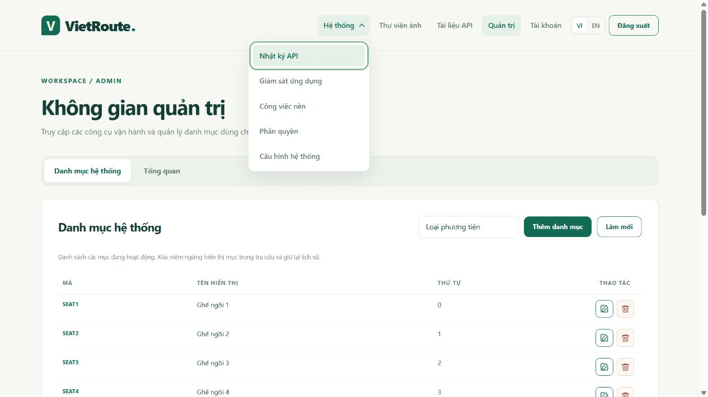
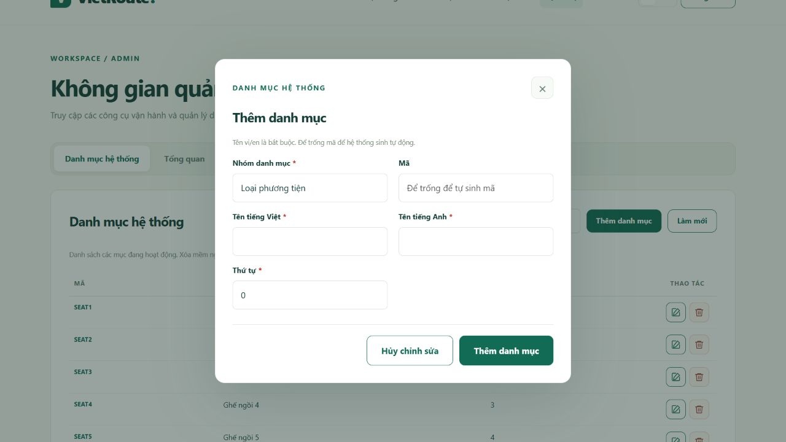
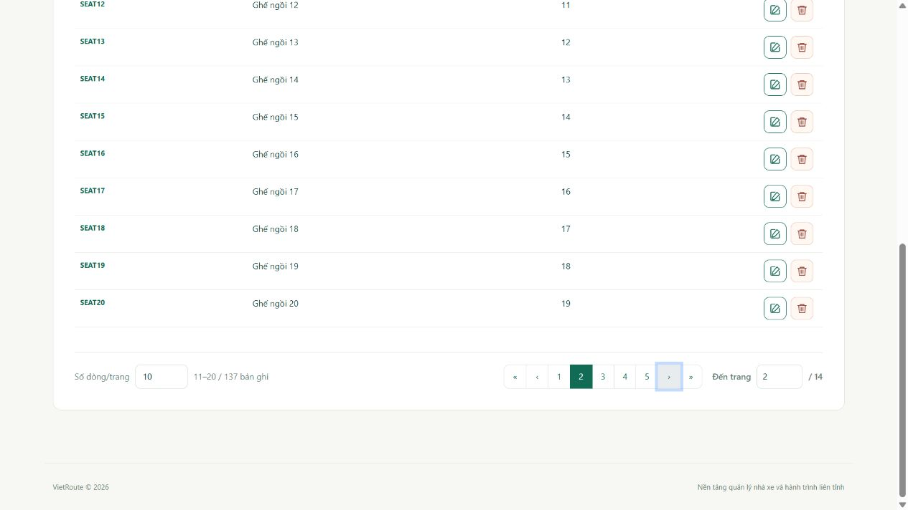
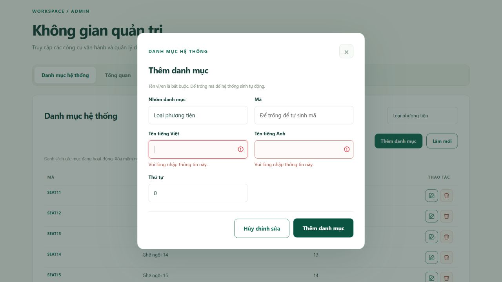

# Bảng, phân trang và validation giao diện

Đọc sau [tab và modal](TAB_VA_MODAL.md) khi làm màn hình business. Dùng Bootstrap đã đóng gói trong WAR; không thêm CDN, jQuery hoặc thư viện bảng chỉ để phân trang. API vẫn phân trang ở PostgreSQL, không tải toàn bộ danh sách về trình duyệt.

## Component dùng chung

`fragments/pagination.html` nhận prefix duy nhất và size mặc định. `assets/js/table.js` cung cấp `window.VietRouteTable`; layout nạp trước script của từng trang. Hiện đã dùng ở danh mục (`catalog`), tài khoản (`users`), job (`jobs`), nhật ký (`journal`) và ảnh (`media`).

```html
<div th:replace="~{fragments/pagination :: pager('catalog', 10)}"></div>
```

Component có số dòng/trang, khoảng bản ghi/tổng, đầu/trước/tối đa 5 số trang/sau/cuối và ô đến trang. Danh sách dùng 10/20/50/100 dòng; thư viện ảnh dùng 12/24/48/96. Trang trên UI bắt đầu từ 1, API bắt đầu từ 0; size không vượt giới hạn 100 của backend. Ô đến trang không tạo một option cho từng trang nên số node DOM không tăng theo tổng số trang.

```javascript
const pager = window.VietRouteTable.pager('catalog', {
    busy: () => busy,
    onChange: (query) => perform(() => load(query)),
});

// load(query = pager.query): đọc đúng page/size, dựng bảng, rồi pager.update(result).
// perform chịu trách nhiệm khóa thao tác, catch lỗi và mở lại control trong finally.
```

Chỉ gọi `pager.update` sau khi tải thành công. Lỗi HTTP giữ số trang/size đã xác nhận và feedback hiện tại, không tự retry. `readPage(fetcher, query)` chỉ đọc lại một lần nếu trang cuối vừa biến mất sau xóa/lọc, dùng totalPages do DB trả về. Đổi size hoặc submit bộ lọc về trang đầu; làm mới giữ size/trang đang xem. Không nối sort/tên cột do người dùng gửi vào SQL.

Cột thao tác dùng `table-actions` ở th/td, rộng 96px, căn giữa và giữ bên phải khi bảng cuộn ngang. Nhóm nhiều nút dùng `row-actions`. `actionButton(label, icon, handler, danger)` tạo icon SVG nội bộ 16px trong nút 32px; icon hỗ trợ edit/delete/view/assign. Label được dịch và có ngữ cảnh đối tượng, đặt vào title/aria-label; không thay bằng một icon thiếu tên. Bảng nhỏ có thể cuộn bên trong `table-responsive` thay vì ép mã/ID xuống từng ký tự hoặc làm tràn toàn trang.

Nút tìm kiếm/thêm/làm mới đặt bên phải bằng `table-filter`/`toolbar-actions`. Footer modal dùng `dialog-actions`, Hủy trước và nút lưu chính sau, cùng hàng bên phải; mobile có thể xuống dòng. Giữ khóa nút/fieldset trong request, không đóng modal hoặc tự replay mutation khi lỗi.

Khi ít trường lọc, giữ bộ lọc và nút thao tác trên cùng một hàng, như `catalog-toolbar` ở danh mục hệ thống. Chỉ xuống dòng khi không đủ chiều rộng, không tách riêng một hàng nút trên desktop. Menu Hệ thống dùng grid với khoảng cách 6px giữa các mục để vùng hover/focus và mục đang chọn không chạm nhau.

## Validation trước khi gửi và lỗi từ API

`assets/js/forms.js` cung cấp `window.VietRouteForms`. Mỗi input cần id/name rõ ràng và label tương ứng. Khai báo required/min/max/minlength/maxlength/pattern theo hợp đồng backend; pattern đặc thù có `data-pattern-message` lấy từ bundle vi/en. Component tắt bubble trình duyệt và hiện thông báo theo locale ứng dụng bên dưới field, viền lỗi, aria-invalid/aria-describedby, chuyển focus đến lỗi đầu tiên. Hint hiện có được giữ cùng aria-describedby.

Trường có `required` tự có dấu `*` đỏ cạnh label ngay khi tải trang, kể cả modal chưa mở. Nhóm `data-required-selection` hiển thị dấu ở legend; không đánh dấu bắt buộc từng checkbox. Dấu trang trí có `aria-hidden`, control vẫn giữ ngữ nghĩa `required` native và validation backend. Reset/mở lại modal giữ dấu; trường tùy chọn như mã danh mục tự sinh không có dấu. Không nhập thêm `*` thủ công vào bản dịch hoặc label vì sẽ trùng dấu.

Trước khi khóa fieldset/gửi request, gọi `VietRouteForms.validate(form)`. FormData phải lấy trước khi disable. Request bị chặn nếu không hợp lệ, không gọi API để thử kiểm tra field bắt buộc. Khi sửa input, lỗi tương ứng được tính lại; reset form xóa trạng thái lỗi. Nhóm checkbox vai trò có `data-required-selection` và `data-validation-key="roles"` để kiểm phải chọn ít nhất một role.

`VietRoute.failure` vẫn hiện mã lỗi/traceId ở feedback chung và chuyển các lỗi field từ envelope vào input đã khai báo. Không đưa rejected value, HTML hay mật khẩu từ server vào DOM; field mới mặc định không có mapping nếu chưa khai báo. Lỗi 409 giữ nội dung/version và không tự gửi lại. Validation client chỉ hỗ trợ trải nghiệm; API vẫn kiểm DTO, quyền/scope và version.

HTTP 401 khi đang thao tác không tự chuyển trang làm mất bản nháp: feedback có link đăng nhập lại để người dùng chọn. Không tăng hạn JWT, tự refresh token hoặc bỏ kiểm quyền để che lỗi. Nút “Vào hệ thống” trên Home chọn đường dẫn từ principal: khách → login, ADMIN → admin, role khác → account. Truy cập login khi đã xác thực cũng redirect theo cùng quy tắc, giữ locale/context WAR; đây chỉ là điều hướng, quyền backend tiếp tục được kiểm độc lập.

## Kiểm chứng và giới hạn

Test Java dựng root/servlet tách biệt như WAR, kiểm Home/login với khách/ADMIN/CUSTOMER ở vi/en và ROOT/context `/vietroute`, không mở DB. CI Docker/PostgreSQL tạm kiểm cookie JWT thật, CTA Home/redirect login và quyền truy cập trực tiếp của CUSTOMER. Node kiểm cửa sổ số trang lớn, chặn trang âm/vượt giới hạn, trang cuối biến mất và lỗi không tự retry; chạy trong workflow development, không thêm Node vào production build.

Kiểm trình duyệt dùng HTML Thymeleaf thật và API fixture riêng: đổi size/đến trang/trước/sau/cuối, tìm tài khoản, modal lỗi client/server/401, checkbox role, focus bàn phím và desktop/mobile. Fixture không chứng minh provider/DB production hoạt động. Không gửi form, đổi mật khẩu hoặc gán quyền thật lên Neon để kiểm UI.

Phần menu/toolbar/dấu bắt buộc đã kiểm ở vi/en và mobile 390px: các mục menu cách nhau 6px, bộ lọc/nút cùng hàng trên desktop, modal có dấu trước lần submit đầu tiên. Submit trống vẫn giữ modal và hiện lỗi cạnh field; hủy/mở lại xóa lỗi nhưng giữ đúng một dấu mỗi label, ô mã tùy chọn không bị đánh dấu. Form mật khẩu cũng nhận dấu từ component chung; không gửi đổi mật khẩu để kiểm phần này.

Ảnh minh họa dùng dữ liệu kiểm thử riêng:








