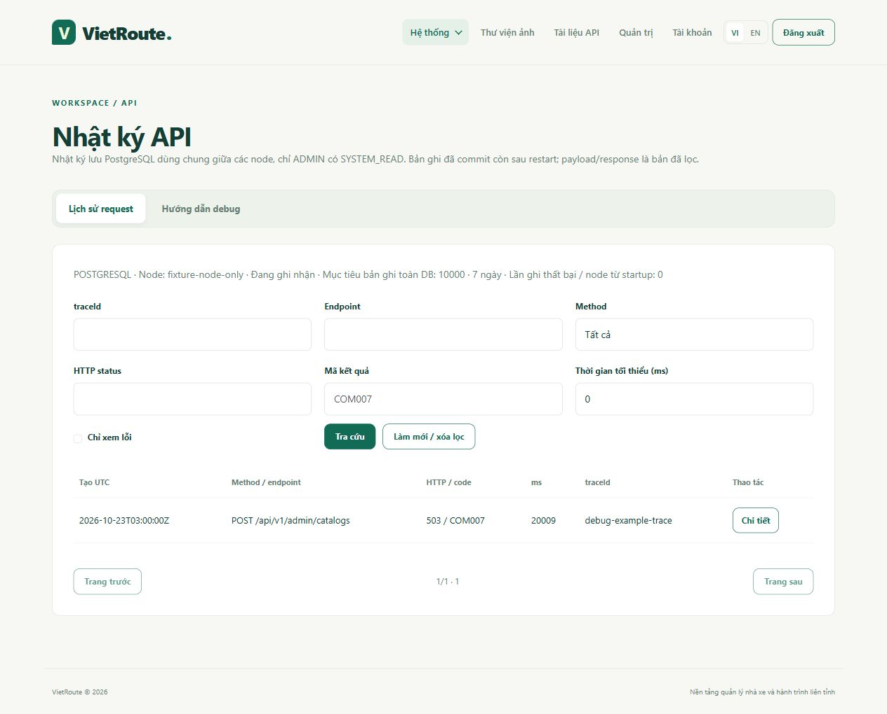

# Nhật ký API và xuất request để debug

## Sử dụng trên giao diện

Đăng nhập **ADMIN có SYSTEM_READ**, mở **Hệ thống → Nhật ký API** (`/operations/api-journal`). Dán mã yêu cầu `traceId` từ thông báo lỗi hoặc DevTools → Network → Response. Có thể lọc thêm endpoint, method, HTTP status, mã lỗi và thời gian xử lý tối thiểu; đánh dấu **Chỉ xem lỗi** để bỏ request thành công. Tra cứu thủ công, không poll liên tục.

Mở **Chi tiết** để xem controller/method, status, thời gian, mã lỗi/messageKey và nhóm chẩn đoán/SQLState. Modal có ba tab **Request / Response / Xuất debug**, hỗ trợ bàn phím và trả focus về nút mở sau khi đóng. JSON được hiển thị bằng text, không render HTML từ payload.

Ảnh kiểm giao diện với HTML thật và dữ liệu giả, không phải request hoặc lỗi production:

[Modal trên màn hình 390px](images/api-journal-mobile.png).

`traceId` dùng để đối chiếu request, không phải nguyên nhân lỗi. Một HTTP 503 kéo dài 20 giây chưa đủ kết luận DB quá tải: có thể hết connection pool, lỗi mạng, DB chưa sẵn sàng hoặc admission guard. Đối chiếu nhóm chẩn đoán với pool waiting, heap/CPU, log server và tình trạng DB tại thời điểm đó.

| Nhóm chẩn đoán | SQLState nếu driver cung cấp | Cách hiểu ban đầu |
|---|---|---|
| `DB_CONNECTION` | lớp `08` | Mất/không mở được kết nối; kiểm DB, mạng và pool |
| `DB_AUTHENTICATION` | lớp `28` | DB từ chối xác thực; kiểm Environment, không copy credential vào nhật ký |
| `DB_SCHEMA_OR_QUERY` | lớp `42` | Schema/table/query không hợp lệ; đối chiếu migration và schema cấu hình |
| `DB_CAPACITY` | lớp `53` | DB thiếu tài nguyên/connection; kiểm quota và tải thực |
| `DB_TRANSACTION` | lớp `40` | Transaction bị rollback, ví dụ deadlock/serialization |
| `DB_LOCK_OR_STATE` | lớp `55` | Lock hoặc trạng thái DB chưa đáp ứng thao tác |
| `DB_FAILURE` | khác hoặc không có | Có SQLException nhưng chưa phân loại được; xem log vận hành |
| `APPLICATION_ERROR` / `API_ERROR` | không có | Lỗi app/validation/security; đọc mã lỗi, controller và errors đã lọc |
| `HTTP_STATUS_ONLY` | không có | Không đi qua response factory; chỉ có metadata HTTP |
| `SUCCESS` | không có | Response thành công theo envelope chung |

SQLState chỉ là gợi ý phân nhóm; không có SQL, parameter, stack trace hoặc message driver trên UI. Request bị chặn trước MVC có thể là `UNMAPPED` / `PRE_CONTROLLER`: lúc đó không có controller thực thi, cũng không giữ URL thô để suy diễn lại.

## Copy cURL và Postman

1. Trong **Xuất debug**, bấm **Sao chép cURL** hoặc **Tải Postman JSON**. Nếu trình duyệt không cho clipboard, nội dung được chọn để nhấn Ctrl+C.
2. Với cURL: Postman → Import → Raw text, dán nội dung. Hoặc import file `*.postman_collection.json` theo [schema Postman v2.1 chính thức](https://schema.postman.com/collection/json/v2.1.0/draft-07/docs/index.html).
3. Điền `baseUrl` trong môi trường Postman, ví dụ `http://localhost:8080`; WAR deploy có context thì dùng `http://localhost:8080/vietroute`. Điền `accessToken` bằng token của tài khoản debug được cấp quyền. Collection không lấy token/cookie đang đăng nhập trên trình duyệt.
4. Điền lại `[REDACTED]`, placeholder path và payload còn thiếu theo Swagger. Auth chỉ có placeholder username/password; file/multipart và DTO không được capture cần bổ sung thủ công. Mẫu response trong collection là projection đã lọc, không phải toàn bộ response server.
5. Kiểm tra method, URL và payload trước khi tự bấm Send. Export không gửi lại request. Mutation có thể thay đổi dữ liệu; ưu tiên môi trường development/staging tách biệt.

Collection không có script, secret, cookie hay thông tin môi trường thật. Giữ token/password trong môi trường riêng hoặc Vault của công cụ, không commit collection đã điền secret. cURL dùng cú pháp shell POSIX; Windows có thể import trực tiếp vào Postman, không dán nguyên cú pháp này vào PowerShell.

## Chính sách dữ liệu

Không ghi raw HTTP body hoặc buffer response. Không ghi Authorization/cookie/header, IP, URL thô, query không được cho phép, file, mail, password, JWT hoặc dữ liệu danh tính. Không lưu secret vào tab/storage.

Request chỉ projection DTO có trong danh sách tường minh: tạo/sửa/xóa danh mục, gán quyền role/gán role user, retry job. Chỉ giữ số, boolean và enum; mã/tên tự do bị thay bằng `[REDACTED]`. Field/DTO mới mặc định bị bỏ. JSON không parse được không có snapshot payload. Unknown body chỉ ghi trạng thái đã bỏ.

Response giữ `success`, `code`, `messageKey`, `locale`, field/code/messageKey của tối đa 10 lỗi validation. Không giữ message/args có thể chứa dữ liệu nhập. Data danh mục chỉ giữ projection an toàn, danh sách công khai tối đa 3 item; data auth/access/mail/media/job/runtime và DTO khác bị bỏ. Mỗi snapshot giới hạn 4096 ký tự, quá giới hạn được thay bằng trạng thái đã bỏ. Số byte thực tế phụ thuộc encoding/overhead JVM; đây là giới hạn chuỗi, không phải số đo RAM benchmark.

Route lấy từ mapping MVC; replay chỉ khôi phục path variable số/UUID/enum hợp lệ. Query chỉ nhận `page`, `size`, `lang=vi|en`, `status` job đã cho phép. Path/query còn thiếu phải điền lại; endpoint không mapping không được giả làm endpoint hợp lệ.

## Kiến trúc và hợp đồng

- `ApiJournalFilter` đặt trước Security/traffic để ghi cả 401/403/429/503 và đo duration. Chỉ `/api/**` đồng bộ; bỏ qua chính API nhật ký, static/page/health/metrics/Swagger. Hiện chưa instrument Servlet async/streaming.
- `ApiJournalBodyAdvice` đọc DTO đã parse trước validation, tạo projection rồi trả nguyên DTO cho controller. Không đọc stream thêm lần nữa.
- `ApiResponses` ghi projection response vào trạng thái request; `ApiExceptionMapper` trích SQLState tối đa 8 tầng cause. `BaseRepository` giữ cause nội bộ để chẩn đoán, không trả cause ra client.
- Khi request hoàn tất, filter đưa metadata/projection vào `ApiJournalStore` để insert đồng bộ và commit PostgreSQL. Không giữ danh sách/queue lịch sử trong RAM; chỉ có snapshot tạm của request đang xử lý. Không lưu servlet, exception, principal hay raw object. UUID bản ghi khác traceId vì client có thể gửi lại cùng traceId.
- `ApiJournalRepository` lưu bảng `api_request_journal` (V005) bằng JDBC/PreparedStatement, query/filter/paging trên DB, chỉ tải metadata trang hiện tại và JSON khi mở chi tiết. Pool nhật ký riêng tối đa 1 connection/node, không chiếm slot pool nghiệp vụ (mặc định 4). Service/page kiểm **ADMIN + SYSTEM_READ**; API kế thừa `BaseController`, Swagger đầy đủ.

WAR có hai Spring context: root tạo service/security, servlet tạo controller. `@EnableMethodSecurity` phải hiện diện tại `SecurityConfig` **và** `WebConfig`; advisor root không tự áp dụng cho controller ở servlet context con. Test hồi quy dựng đúng hai context để kiểm HTTP 403 cho trang nhật ký/giám sát/cấu hình/job/quyền khi CUSTOMER nhập URL trực tiếp. Không chỉ kiểm bằng context gộp hoặc dựa vào menu bị ẩn.

| API GET | Hợp đồng |
|---|---|
| `/api/v1/admin/system/api-journal` | Envelope `ApiJournalResponse`: instanceId node phục vụ, enabled, capacity (mục tiêu toàn DB), retentionMinutes, failedWrites node hiện tại, storage=POSTGRESQL và `records` phân trang |
| `/api/v1/admin/system/api-journal/{id}` | Envelope `ApiJournalDetail`: entry, instanceId, replayPath, query, requestBody, responseBody, contentKind; id UUID |

List nhận `page=0`, `size=20` (tối đa 100), `traceId` chính xác, `endpoint` chứa chuỗi route, `method`, `status=0` bỏ lọc, `code`, `minDurationMs=0`, `errorsOnly=false`. Lọc/paging trên PostgreSQL, mới ghi trước theo recorded_at/id; started_at là thời điểm bắt đầu request. Bộ đếm/trang có thể thay đổi khi request khác đang ghi. 400 cho bộ lọc không hợp lệ, 401 chưa xác thực, 403 thiếu role/quyền, 404 bản ghi hết hạn/đã dọn/không tồn tại; 503 nếu DB không đọc được. Response dùng locale/traceId/error envelope chung và `Cache-Control: no-store`.

## Cấu hình, retention và nhiều node

| Biến môi trường | Mặc định | Giới hạn |
|---|---|---|
| `VIETROUTE_API_JOURNAL_ENABLED` | `true` | Bật/tắt ghi request mới; vẫn tra được record đã lưu |
| `VIETROUTE_API_JOURNAL_CAPACITY` | `10000` | 20–100000 dòng mục tiêu toàn DB, không phải mỗi node |
| `VIETROUTE_API_JOURNAL_MINUTES` | `10080` (7 ngày) | 1–43200 phút; env cũ 30 phải cập nhật |

Người dùng đã chọn retention **7 ngày**. Database cấp `recorded_at TIMESTAMPTZ`; mọi node cùng DB/schema thấy cùng lịch sử. `instanceId` trong detail là node đã ghi request, không giới hạn truy cập theo node. Bản ghi đã commit **không mất khi restart/deploy/crash**. Khi process bị kill trước khi insert/commit thì không bảo đảm có log; không truy hồi được log RAM đã mất từ phiên bản cũ.

Cleanup tối đa mỗi phút trên node có request ghi thành công, hoặc khi job `SYSTEM_CLEANUP` chạy: advisory transaction lock, xóa tối đa 500 dòng hết hạn và 500 dòng vượt mục tiêu/lượt. Không chạy background flush hoặc queue log trong RAM. Khi app/worker/traffic tắt, xóa vật lý chờ lần bảo trì tiếp theo; API luôn ẩn record quá 7 ngày dù chưa dọn. Dưới tải cao, số dòng có thể vượt mục tiêu 10000 tạm thời; cần theo dõi dung lượng DB/autovacuum và lịch bảo trì. Không cam kết giữ đủ 7 ngày khi vượt mục tiêu dung lượng; dòng cũ có thể bị dọn sớm.

Đọc metadata không tải body cả bảng vào RAM. Snapshot request/response mỗi loại tối đa 4096 ký tự vẫn giữ nguyên; không lưu ảnh/blob hoặc dữ liệu tự do. PostgreSQL có TOAST/index/overhead nên 10000 dòng không phải cam kết một số MB chính xác.

## Chống quá tải và lỗi ghi log

Pool riêng lazy/minIdle=0, tối đa **1 connection/node**, chờ mượn tối đa 250ms, connect/socket timeout 2 giây, statement timeout 1 giây. Ngân sách mặc định cả app là tối đa **4 connection nghiệp vụ + 1 journal = 5/node**; nhân với mọi node khi lên kế hoạch Neon. Một slot ghi/node, request chờ slot tối đa 100ms; không tạo queue/batch log riêng. Hết thời gian chờ thì bỏ bản ghi đó và tăng `failedWrites`, không retry mutation hoặc giữ payload để gửi lại. DB insert lỗi kích hoạt backoff 30 giây để tránh mỗi HTTP request đều chờ DB hỏng. Timeout là từng bước I/O, không phải cam kết wall-clock toàn request bằng một con số.

`failedWrites` và thông tin backoff chỉ là counter/trạng thái nhỏ trong RAM node, không phải lịch sử request; reset khi node restart. Log `event=api_journal_write_unavailable traceId=...` lấy mẫu tối đa một dòng/giây, không log payload/exception/URL/credential. Cleanup timeout có log riêng, không rollback bản ghi đã commit. Response nghiệp vụ gốc không bị thay bằng lỗi ghi nhật ký. **Không hứa đủ mọi traceId khi DB/slot không sẵn sàng hoặc process bị kill.**

Nếu chính PostgreSQL lưu nhật ký bị chết, app không thể ghi vào DB đó. JWT cũng cần DB để kiểm tài khoản/quyền nên UI có thể không mở được; không tạo đường bỏ qua auth. Dùng server Logs/metrics độc lập khi sự cố và kiểm các record đã commit sau DB hồi phục. Đây là nhật ký chẩn đoán dùng chung trong DB, không phải API gateway/audit bất biến hoặc kho log độc lập với database ứng dụng.

## Triển khai và kiểm tra

V005 chỉ chạy tại startup khi `VIETROUTE_DB_INIT_ENABLED=true`; giữ nguyên V001–V004/checksum. Đã đổi Blueprint/.env.example sang 10000/10080; Environment của service cũ có 300/30 cần cập nhật, default Java không ghi đè env cũ. Không khởi tạo/migrate/cleanup Neon trong build verification. Source chuyển DB không có nghĩa production đã deploy/migrate thành công.

Khi thêm API/DTO, cập nhật Swagger/locales và kiểm quyền backend như cũ. Chỉ bổ sung projection sau khi rà từng field, không log raw hoặc blacklist theo tên password/token. Kiểm sentinel secret không lọt vào UI/export/DB; không thêm email/username/address vào whitelist để tiện replay.

Java test dùng repository giả chỉ để kiểm filter/security/omission/no-queue/backoff và response không bị log failure làm hỏng. Docker CI dùng PostgreSQL **tạm** để kiểm migration/index/schema cấu hình, SQL insert/filter/detail, restart vẫn thấy trace, node khác đọc được, retention/cleanup và permission. Node tests kiểm cURL/collection không secret/script; UI fixture HTML thật chỉ xác nhận frontend, không thay SQL integration. Không dùng Neon/provider thật hoặc benchmark production trong các kiểm tra này.
